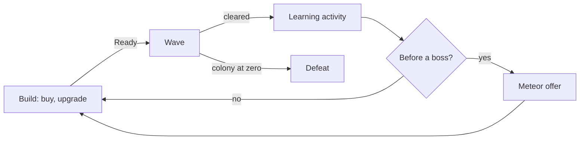
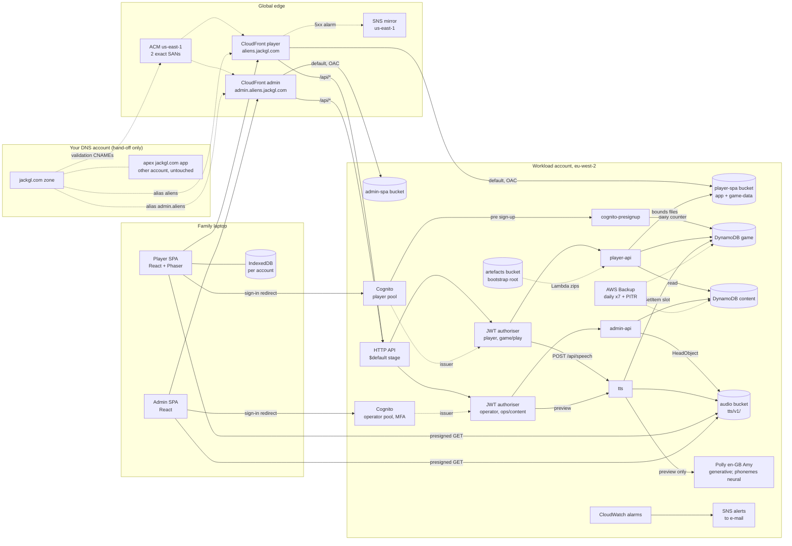
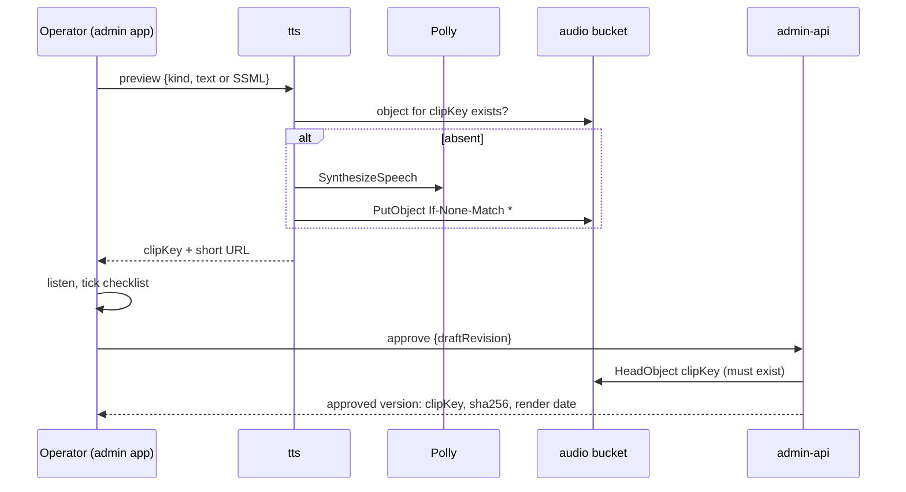
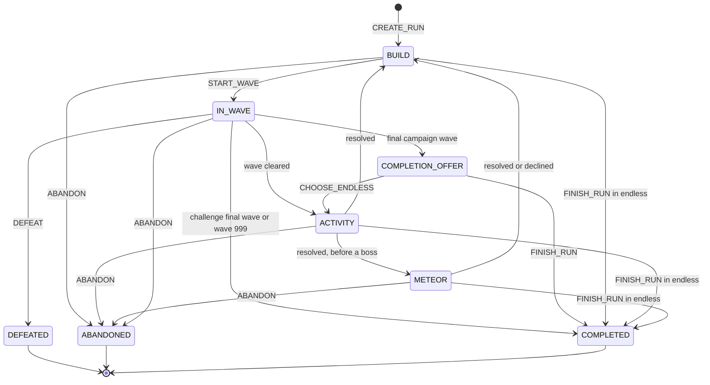
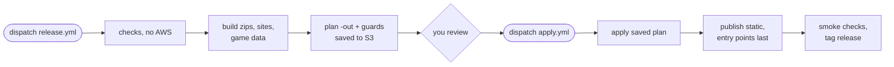
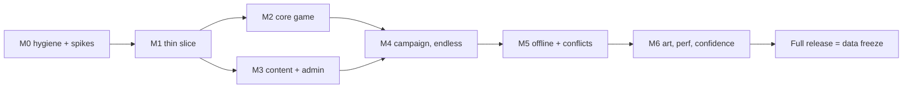

# Space Colony Defence: design overview

This is the one document to read to validate the plan. It distils the full implementation plan in [plan/](plan/) into about
45 to 60 minutes of reading, and links into the plan sections wherever you want the detail, the trade-offs or the evidence. It
does not replace them: when this page and a plan section disagree, the section wins, and when a section and the
[design spine](plan/00-spine.md) disagree, the spine wins.

"Space Colony Defence" is the spec's working title ([prompt.md:91](../prompt.md#L91)). The approved specification is
[prompt.md](../prompt.md); acceptance criteria are cited as AC-nn.

**Labels.** Every decision carries one:

| Label | Meaning |
|---|---|
| **[CONFIRMED]** | fixed by the spec, [prompt.md](../prompt.md) |
| **[CONFIRMED by owner]** | decided by you in chat (2026-11-14) |
| **[PROPOSAL]** | planner recommendation; yours to change |
| **[ASSUMPTION]** | routine detail, cheap to change |
| **[VERIFIED]** / **[UNVERIFIED]** | a fact checked directly / not yet checked (section 15 lists the important ones) |

Game-balance numbers are always initial playtest settings **[PROPOSAL]**.

**How to use this page.** Sections 1 to 12 explain the design. Section 13 is a checklist for you to fill in: one row per significant
decision, with a blank "Agree?" column. Sections 14 and 15 list what needs your action and what is still unchecked.

| Plan section | Owns |
|---|---|
| [00 Spine](plan/00-spine.md) | canonical names, states, keys, routes, codes and rules |
| [A Repository findings](plan/A-repository-findings.md) | what exists in the repo and AWS today; reuse decisions |
| [B Scope and decisions](plan/B-scope-and-decisions.md) | product summary, exclusions, milestone 1 vs full release, every planner decision |
| [C Game and learning design](plan/C-game-and-learning-design.md) | roster, waves, economy, meteors, endless, badges, content bank, selection |
| [D UX and content operations](plan/D-ux-and-content-operations.md) | screens, journeys, keyboard, interaction types, admin workflow, phonics review |
| [E Architecture](plan/E-architecture.md) | components, trust boundaries, TTS service, auth, offline, audio |
| [F State and data](plan/F-state-and-data.md) | state machines, checkpoints, idempotency, conflicts, DynamoDB |
| [G API contracts](plan/G-api-contracts.md) | every route, error codes, limits |
| [H Infrastructure and delivery](plan/H-infrastructure-and-delivery.md) | Terraform, workflows, release, rollback, monitoring, backup, DNS hand-off |
| [I Validation](plan/I-validation.md) | test strategy, AC map, hard cases, child playtests |
| [J Execution backlog](plan/J-execution-backlog.md) | ordered tasks, first build phase, how to review a phase |

---

## 1. The product in one page

**What.** A colourful, browser-based, single-player educational tower defence game. Stationary astronauts defend a moon colony from
cartoon aliens walking one fixed route. Between waves the child does one untimed maths, phonics or spelling activity to earn extra
credits; before each boss there is an optional "meteor" activity that earns a temporary power. **[CONFIRMED]**
([B §B1](plan/B-scope-and-decisions.md#b1-the-product-in-one-page-confirmed-requirements))

**Who.** Children aged 5, 6 and 7, initially your family, on laptop browsers with keyboard and mouse. Public self sign-up, free, with
an architecture that could take more users. Individual child accounts (username and password, no e-mail); no parent accounts.
**[CONFIRMED]**

**The core promise.** Combat, interface, wave schedule, starting funds and reward opportunities are identical at every age; only the
questions differ. A run spans several visits. Learning speeds progress up but never gates it. **[CONFIRMED]** (AC-13)

**Where.** Player app `aliens.jackgl.com`; content admin app `admin.aliens.jackgl.com`; production only, in the existing London workload
account `263185198757`. **[CONFIRMED]**

**Scope of the full first release** **[CONFIRMED]** (`prompt.md:111-139`, AC-01..AC-43):

| Area | In scope |
|---|---|
| Game | One planet, one route, six astronaut classes with three levels, nine-entry alien catalogue, 50-wave campaign with five bosses, meteor powers, endless continuation, short challenges |
| Learning | Maths, phonics and spelling; six interaction types; three attempts; human-reviewed, versioned content; spoken phonics through a dedicated speech service |
| Saving | Cloud saves, several saved runs, mid-wave rewind, offline continuation of a prepared run, one accepted writer per account |
| Admin | Content administration only: drafts, preview, publish, retire, withdraw, clip approval, bank status |
| Operations | One manual release pipeline, rollback, logs without private data, alarms by e-mail, daily backups with seven recovery points |

**What we are not building** ([B §B2](plan/B-scope-and-decisions.md#b2-delivery-boundary-what-we-are-not-building)):

- **Excluded** **[CONFIRMED]** (`prompt.md:153-173`): multiplayer, rankings, chat or sibling comparison; ads or payments; a sandbox; a
  gameplay tutorial; parent accounts, dashboards or difficulty overrides; adaptive difficulty or remedial paths; penalties for wrong
  answers; music or character voices; browser speech synthesis; live, unreviewed AI-generated questions.
- **Later scope, not in the first release** **[CONFIRMED]** (`prompt.md:141-151`): additional planets, tablet optimisation, parent or
  teacher account models, an installable PWA or native app, expanded content-authoring automation. These are deferred, not excluded.
- **Not in the architecture**: VPCs, containers, queues, WebSockets, GraphQL or Redis **[CONFIRMED]** (`prompt.md:826`); a DNS redesign
  or a new API hostname **[CONFIRMED]** (`prompt.md:27`, `prompt.md:109`); server-side combat simulation or elaborate anti-cheat **[PROPOSAL]**.

**Full release versus first playable** ([B §B3](plan/B-scope-and-decisions.md#b3-full-first-release-versus-the-first-playable-milestone)):

| | Milestone 1, the first playable slice **[PROPOSAL]** | Full first release **[CONFIRMED]** scope |
|---|---|---|
| Purpose | Touch every layer once, at small size, so you review each layer before it grows | The agreed product, meeting AC-01..AC-43 |
| Game | One placeholder map, one class (Nova), one alien, a two-wave challenge wave set | Full campaign, challenges, endless, art |
| Learning | Exactly one phonics multiple-choice activity with one approved clip; bank thresholds set to 1 as labelled milestone configuration | About 240 authored records, all six interaction types, all three age bands eligible |
| Speech | The real path: `POST /api/speech` → `tts` Lambda → signed URL → browser, plus a minimal admin app for preview and approval | Same, plus about 200 reviewed clips and the offline audio cache |
| Saving | Online ops with revision and session fence, cloud save, resume after refresh | Plus offline queue, readiness, divergence and recovery, takeover |
| Infrastructure | The whole production stack through the real release workflow, protection flags on, plan guard reporting | Plus alarms confirmed, restore drill, plan guard enforcing, data freeze |
| Done when | A clip plays through the real service; three attempts and one reward work; refresh keeps attempts; resume from cloud save; child playtest P1 recorded | AC-01..AC-43 demonstrated |

The rule for Milestone 1: no shortcut the full release would have to undo. It uses the real op envelope, slot model and speech path,
just with less content. **[PROPOSAL]**

---

## 2. How a child plays

The journeys below are D's ([D §D3](plan/D-ux-and-content-operations.md#d3-key-journeys)); each step names what the child sees and,
briefly, what happens behind it.

### 2.1 Sign up and profile

1. Landing page: **I'm new** or **Sign in**, with "Ask a grown-up to help you make your account."
2. Cognito's managed login page (branded, but its wording is Cognito's fixed adult English): username and password. No e-mail. A
   pre sign-up trigger auto-confirms the account so no child is ever stuck "unconfirmed" **[CONFIRMED]** requirement; mechanism
   **[PROPOSAL]**. A global daily cap (default 20) limits abuse; when it is hit the page shows "No new accounts today. Please try again
   tomorrow." **[ASSUMPTION]** number.
3. Back in the game, `GET /api/me` returns `PROFILE_NOT_FOUND`, so profile setup appears: nickname, avatar, and birthday entered with a
   grown-up. The date of birth is write-only (section 4).
4. Home, with **New game** prominent.

Password recovery is administrator-managed: you reset it from a runbook with `AdminSetUserPassword` **[CONFIRMED]**.

### 2.2 Starting a new run

Home → **New game** → galaxy map (Moonbeam Colony is the only bright planet; later worlds are faint and cannot be pressed) → planet
screen with **Big adventure** (the 50-wave campaign) and **Quick challenges**. Unavailable choices say why. **Start** calls
`POST /api/runs` (online only). The server pins, at that moment and for the life of the run: the age band derived from the date of birth,
a random seed, the game-data versions, and **every activity slot for the whole campaign** (49 normal plus 5 meteor slots). A birthday
therefore affects new runs only (AC-06). An optional card offers **Get ready for offline**; **Play now** works straight away.

### 2.3 The wave loop

Reading the diagram: the child builds, presses **Ready** (nothing starts until then), watches the wave, then gets one activity. After
waves 9, 19, 29, 39 and 49 an optional meteor offer follows. Then back to building. There is no activity before wave 1. **[CONFIRMED]**

### 2.4 Activities and the Play button

One panel for all six interaction types: select (or place, or type), then press **Check**. Only Check on a complete answer uses a try.
Up to three tries; the first correct answer gives the reward exactly once; three wrong answers end the activity with no reward and no
penalty. Untimed. Playing audio, watching a "Show me" demonstration, network or speech failure and refreshing never cost a try
**[CONFIRMED]**. Options already tried are greyed out and an identical resubmission is blocked with a gentle message (owner decision D-8).

Phonics (and spelling dictation and some instruction stems, D-1) have a visible **Play** button. If the clip is already on the device it
plays immediately from local bytes while the authenticated speech request goes to the server in parallel; otherwise the browser waits for
the server, downloads, checks and stores the clip, then plays (section 5) **[CONFIRMED by owner]**.

### 2.5 Meteor challenges and bosses

Before each boss (waves 10, 20, 30, 40, 50) the child may try an extra activity. Success earns one charge of a temporary power (Frost
Pulse, Comet Burst or Colony Shield, in a fixed rotation). Declining is allowed only before the first try (D-11). Every boss is beatable
without any power (simulator evidence, [C §C17.4](plan/C-game-and-learning-design.md#c174-no-boss-requires-a-class-or-a-power)).

### 2.6 Campaign completion, endless and challenges

Clearing wave 50 commits the **Colony Hero** badge first, then offers **Keep going** (endless, needs a connection) or **Finish this
game** **[CONFIRMED]** (AC-12). Endless waves are generated from waves 41 to 49 and the five bosses, with every growth capped; a later
endless defeat keeps the badge and best wave. If the activity bank runs out the child sees "You have done every activity we have for
now" and play continues without an activity; nothing is ever repeated within a run (D-6). Endless stops at wave 999. An endless run
can also be finished at any time between waves with **Finish this game**, which ends it as completed; the badge and best wave stay.

Quick challenges are ordinary runs over a short wave set; completing one earns its own badge and touches nothing else.

### 2.7 Defeat

The colony reaches zero → "The aliens got through this time", waves cleared, badges earned, **New game** or **Home**. Defeat is terminal:
the run's credits, astronauts and powers are gone; best completed wave, badges, next-planet eligibility and learning summaries stay
**[CONFIRMED]** (AC-14, AC-27).

### 2.8 Saving and leaving

- **Save and exit** in preparation or during an activity loses nothing; the same question and its recorded tries come back.
- **During a wave**, a confirmation explains that the wave will start again from the beginning and that its credits will not be kept.
  On return: "Wave 7 will start again from the beginning." **[CONFIRMED]** (AC-24..26).
- A save chip always says where progress is: "Saved to the cloud", "Saving…", or "Saved on this device — waiting to sync"
  **[CONFIRMED]** wording.
- **Signing out** on a shared laptop warns if progress is only on this device; the next child sees nothing of the previous child (AC-05).

### 2.9 Offline

A run that was prepared for offline (every planned activity, every clip's bytes and the game data stored locally, and the app's assets
loaded in this page session) can continue without a connection in the already-open tab. There is no offline cold start and no service
worker **[CONFIRMED]**. Progress is saved on the device and synced later. New runs, endless, resets, sign-in and sign-out need a
connection. If an endless run outruns its prepared activities offline, it waits in preparation with "Reconnect to get more
activities" (AC-34).

---

## 3. Architecture

Detail: [E. Architecture](plan/E-architecture.md), canonical shape in [spine S1](plan/00-spine.md#s1-system-shape).

Reading the diagram: each app is a static build in its own private bucket behind its own CloudFront distribution, and both distributions
forward `/api/*` to the one HTTP API, so the browser only ever calls its own hostname. Two JWT authorisers, one per Cognito pool, decide
which Lambda a token can reach. Four Lambdas sit behind the API and the player pool; none calls another. Only the operator's preview ever
calls Polly. Dotted lines on the left are the DNS hand-off points you own: two validation CNAMEs and two alias records in your DNS account;
the existing apex app is never touched.

### 3.1 Components

| Component | Choice | Label |
|---|---|---|
| Static hosting | Two SPAs, each a private S3 bucket + CloudFront + Origin Access Control; one us-east-1 ACM certificate with exactly two SANs; SPA deep links via a CloudFront Function on the default behaviour only (distribution-wide custom error responses would rewrite API 403/5xx into `index.html`) | **[PROPOSAL]**; hostnames **[CONFIRMED]** |
| API reach | Same origin: `/api/*` behaviour on each distribution to the HTTP API default endpoint, `CachingDisabled`, `AllViewerExceptHostHeader` (forwards `Authorization`). No CORS, no API hostname or certificate. Route keys keep the `/api` prefix (the reference product instead uses a Function URL with a prefix-stripping CloudFront Function) | **[PROPOSAL]** |
| API | One HTTP API in eu-west-2, payload 2.0, `$default` stage, access logs (allow-listed fields only), route throttles | **[PROPOSAL]** |
| Authorisers | `player` (player pool issuer and audience) on player routes and `POST /api/speech`; `operator` on `/api/admin/*`. Every route needs a scope (`game/play` or `ops/content`); handlers also check `token_use = access`; operator also needs the `admin` group (exact match) | **[PROPOSAL]** |
| Identity | Two Cognito pools. Player pool: username + password, case-insensitive, no e-mail, auto-confirm trigger, recovery admin-only, deletion protection. Operator pool: no self sign-up, TOTP MFA required, group `admin`. Both use managed login with authorisation code + PKCE (Essentials tier), `prompt=login`, sign-out through `/logout` | **[CONFIRMED by owner]** two pools (D-10); PKCE **[CONFIRMED]**; details **[PROPOSAL]** |
| Compute | Four Python 3.14 arm64 zip Lambdas, one IAM role each, timeouts under the 30 s HTTP API limit (`player-api` 25 s) | **[PROPOSAL]** |
| Data | Two DynamoDB tables (`game`, `content`), on-demand, deletion protection, PITR, `prevent_destroy` | **[PROPOSAL]** |
| Buckets | `…-player-spa-bucket`, `…-admin-spa-bucket`, `…-audio-bucket` (clips under `tts/v1/`, never overwritten), `…-artifacts-bucket` (Lambda zips by hash, release manifests, archived static builds, saved plans; created in the **bootstrap root**) | **[PROPOSAL]** |
| Speech | Amazon Polly, generative engine, en-GB, voice Amy; isolated phonemes and letter names on `tts_phoneme_engine` (default `neural`) | **[CONFIRMED by owner]** (O-1) |
| Operations | CloudWatch logs (7 days; admin audit log longer) → alarms → SNS topic → e-mail; mirror topic in us-east-1 for CloudFront alarms; AWS Backup daily with seven recovery points plus PITR | backup retention (7 recovery points) **[CONFIRMED]**; log retention 7 days **[ASSUMPTION]**; rest **[PROPOSAL]** |

### 3.2 The four Lambdas

| Function | Does | Data access (least privilege) |
|---|---|---|
| `player-api` | profile, runs, session lease, run ops, packs, resets | `game`: full item CRUD on `U#*` keys; `content`: read only; site bucket: read bounds files |
| `admin-api` | content administration, speech approval | `content`: read/write; audio bucket: `GetObject` + prefix-scoped `ListBucket`; **never** `game` |
| `tts` | dedicated speech microservice: player Play and operator preview | `game`: `GetItem` only; **no** `content` access; audio bucket get/put (no delete) under `tts/v1/*`; `polly:SynthesizeSpeech`; never writes DynamoDB |
| `cognito-presignup` | auto-confirm within the daily cap | `game`: `UpdateItem` on the `SYS#SIGNUPS` partition only |

No Lambda calls another, because the spec rules out forwarding Lambdas and each boundary is cohesive
([E §E.6](plan/E-architecture.md#e6-lambda-and-api-boundaries)). **[PROPOSAL]**

### 3.3 Browser side

npm workspaces under `web/`: `game-core` (pure TypeScript simulation and rules, no Phaser or DOM), `player` (React + Phaser), `admin`
(React), `shared` (API types, limits, the answer canonicaliser and the shared learning panel used by both apps). Phaser renders the
battlefield and maps pointer input; React owns screens, HUD, shop, learning panels, dialogs and every keyboard control, and never
re-renders per frame. A typed `GameBridge` connects them. **[PROPOSAL]** ([spine S10](plan/00-spine.md#s10-react--phaser-split-proposal))

The simulation runs at a **fixed 60 ticks per second**, whatever the screen's refresh rate. A fixed timestep exists so a slow laptop and a
fast one produce identical battles: each frame adds real elapsed time to an accumulator and runs as many whole ticks as fit. The
accumulator is an integer in 1/60,000 s units (no floating-point drift), at most 30 ticks run per frame and any surplus is discarded, so
the game slows rather than spirals. Combat uses no random numbers. **[PROPOSAL]**; frame-rate independence **[CONFIRMED]** (AC-13).

Stack pins: Node 24 LTS, Vite 8, React 19, TypeScript per create-vite, Phaser 4.2.1, Vitest, Playwright, `idb`; Python 3.14 with
Powertools, pytest and moto **[PROPOSAL]** (current versions **[VERIFIED]** 2026-11-14).

### 3.4 DNS hand-off points

DNS stays in your DNS account and you integrate it **[CONFIRMED]**. Terraform outputs what you need; you create:

| Record | When |
|---|---|
| Two ACM validation CNAMEs (one certificate, both hostnames) | after the pipeline requests the certificate, before distributions are planned |
| Alias `aliens.jackgl.com` → player distribution | after the release that creates the distributions (Milestone 1) |
| Alias `admin.aliens.jackgl.com` → admin distribution | same release (the minimal admin app ships in Milestone 1) |

Facts and checks you supplied **[CONFIRMED by owner]** (O-3; [spine S1.0](plan/00-spine.md#s10-dns-hand-off-facts-confirmed-by-owner-2026-11-14-unless-marked)):
an HTTPS app already serves the apex `jackgl.com` from another account; `aliens` and `admin.aliens` do not exist yet, so there is no
clash. Before Milestone 1: CAA records on `jackgl.com` (if any) must allow `amazon.com`; check whether the apex distribution has a
wildcard alternate domain name `*.jackgl.com`, which could block adding `aliens.jackgl.com` to a distribution in this account
**[UNVERIFIED]**. Apex domain-wide cookies will reach our subdomains (harmless, we use bearer tokens) and HSTS `includeSubDomains` is fine.
Never touch the apex or `www` records; never use `allow_overwrite`. Sequencing: [H §H.15](plan/H-infrastructure-and-delivery.md#h15-dns-hand-off).

---

## 4. Trust model and security

Detail: [E §E.10](plan/E-architecture.md#e10-family-level-trust-model), canonical form [spine S2](plan/00-spine.md#s2-trust-model-confirmed-family-level-trust-mechanisms-proposal).

The spec sets **family-level trust** **[CONFIRMED]**: the browser runs combat and judges answers locally when offline; the backend does
not simulate battles. The backend owns what matters across accounts and over time: authentication, ownership, accepted run state,
recorded attempts, reward accounting and permanent progress.

| Guarantee | How | Label |
|---|---|---|
| Nobody reaches another child's data | Every `game` key is built from the access token's `sub`; no request field names an owner; another player's IDs return `NOT_FOUND` (AC-03) | **[PROPOSAL]** mechanism |
| Admin is a backend role, not a hostname | Operator token from the operator pool **and** `cognito:groups` contains exactly `admin` (parsed, never substring-matched); route key decides authorisation before any lookup; unknown routes denied (AC-04) | **[CONFIRMED]** requirement; **[PROPOSAL]** mechanism |
| A child can never trigger speech synthesis or send free text to it | `POST /api/speech` takes only `{runId, slotId, variant}`; `tts` reads the slot under the caller's `sub` and signs the clip pinned on that slot. It never reads `content` and never calls Polly on the player path (AC-20) | **[PROPOSAL]**; narrowing **[CONFIRMED by owner]** (D-12) |
| Rewards exactly once, at most three attempts, no skipped phases | Server-side op processing with revisions, slot conditions and idempotency (section 8) | **[PROPOSAL]** |
| Server derives anything valuable | Badge IDs, class unlocks, slot rewards, summary keys and available classes are computed on the server, never taken from payloads | **[PROPOSAL]** |
| Credit plausibility | `value = credits + invested`; build ops cannot raise it; a completed wave can raise it by at most that wave's maximum bounty; health, shield and power counts bounded | **[PROPOSAL]** |
| Logs carry no private data | Allow-list logging only (request ID, route, `sub`, run/slot/op IDs, op type, result code, revision, generation, duration); never bodies, `Authorization`, signed URLs, answers or nicknames | **[PROPOSAL]** |

**Date-of-birth rules** **[PROPOSAL]** mechanism for a **[CONFIRMED]** privacy requirement (`prompt.md:219`). The DOB is **write-only**:
it enters only through `PUT/PATCH /api/me/profile`, is stored only as `PROFILE.dob`, and is read only by `player-api` to derive age and
age band (Europe/London time zone). No response, error body, log line, local store, op payload, speech request, audio key or Cognito
attribute ever carries it. Correcting it means typing it again; the correction affects new runs only. Profile data is never a Cognito
attribute, because attributes leak into ID tokens.

**Accepted tampering gains** (stated so nobody mistakes the bounds for anti-cheat) **[PROPOSAL]**: a modified client can, within its own
account, report maximum bounty and full health each wave, answer from the pack data it holds, and drop wrong attempts before they sync. No
leaderboard exists, so this harms nobody else. It **cannot** touch another account, skip a phase, receive a reward twice, record a fourth
attempt or exceed per-wave income ceilings.

**Other hardening** **[PROPOSAL]**: a built-asset scan fails the release if the browser bundles contain AWS keys, the AWS SDK, a Polly
client or `speechSynthesis` (gate G-6); a CSP and security-headers policy on both distributions
([H](plan/H-infrastructure-and-delivery.md)); one playing tab per browser profile via a Web Lock (a browser API that lets only one tab hold a named lock, used here so only one
tab plays); "one page load = one account" (the app
reloads if the signed-in `sub` changes); the operator pool requires TOTP MFA.

---

## 5. Speech and phonics

Detail: [E §E.4](plan/E-architecture.md#e4-the-dedicated-tts-service), [D §D9](plan/D-ux-and-content-operations.md#d9-phonics-preview-review-and-the-quality-gate),
canonical form [spine S5.2](plan/00-spine.md#s52-activities-templates-speech).

### 5.1 Voice and engine (O-1) **[CONFIRMED by owner]**

- Amazon Polly, the newest **generative** engine, en-GB, default voice **Amy**.
- Isolated phonemes and letter names use the engine in `tts_phoneme_engine` (default `neural`), because AWS documentation is contradictory
  on `<phoneme>` support in the generative engine. The Milestone 0 listening bake-off decides; if generative passes, the variable becomes
  `generative`.
- Terraform variables `tts_voice_id` (Amy), `tts_engine` (generative) and `tts_phoneme_engine` (neural) feed the `tts` and `admin-api`
  environments. The voice/engine allow-list stays in code, because IAM has no condition keys for Polly voice or engine.
- Changing a variable affects **new previews only**: voice and engine are part of a clip's identity. Approved clips keep their bytes until
  someone re-previews and re-approves them. There is no silent re-voicing.
- Speech definitions carry `kind` (`WORD`, `PHONEME`, `LETTER_NAME`, `INSTRUCTION`, `DICTATION`), `provider` (`polly`), `engine` and
  `voiceId`; approval records the render date.
- Nova Sonic was rejected (conversational speech-to-speech, no SSML, not in eu-west-2). Human recordings are the fallback for any sound
  that fails the listening test.

### 5.2 Render once, approve the bytes, cache (O-2) **[CONFIRMED by owner]**; mechanism **[PROPOSAL]**

A **content-addressed key** names a file by a hash of what produced it, so the same input always maps to the same object and nothing is
ever overwritten. Here the clip key is the SHA-256 of the canonical synthesis input (text or SSML, locale, voice, engine, output format,
generation number), computed by one shared Python module.

Reading the diagram: the operator's preview is the **only** path that calls Polly, and it synthesises only if the object is absent. Approval
recomputes the key from the saved draft and requires the object to exist, so the bytes the operator heard are byte-for-byte what children
hear. A clip is synthesised **once ever** and shared by every activity that uses the same text, voice, engine and settings. Activity
versions pin `{speechId, speechVersion, clipKey}` per variant at publish; runs pin them on each slot.

### 5.3 Play (O-2) **[CONFIRMED by owner]**

| Situation | What happens |
|---|---|
| Online, the slot's pinned clip is stored locally | Playback starts **immediately** from local bytes, and `POST /api/speech` is sent concurrently (debounced: repeated presses within a short window send one request, not one per click), so every online Play still reaches the service (AC-19) |
| Online, not stored | Wait for the response, download from the presigned URL (300 s), verify the `sha256`, store, play |
| Response names a different clipKey | Log it, download and store the server's clip, use it from the next Play |
| Offline | Local bytes only |
| Failure | **Retry**; never costs an attempt. A missing server object returns `503 SPEECH_UNAVAILABLE` and raises an alarm; it is **never** re-synthesised for a child (D-12, narrowing `prompt.md:577`) |

The browser stores clip bytes once per clipKey, pre-fetched when a run is prepared. When an activity's answer depends on hearing, the
answer area stays hidden until the clip bytes are local.

### 5.4 Phonics quality

Some sounds cannot be heard clearly in isolation, so clips are tiered **[PROPOSAL]**: A whole words; B continuant and vowel sounds (need a
listening check); C stops and similar (risky; the bank works even if every tier-C sound fails). The Milestone 0 bake-off renders the test
set with the AWS CLI from the same canonical inputs and records per-sound verdicts in `content/listening-verdicts.json` (to create); a CI
check refuses a `PHONEME` definition for a sound marked `word-only`. Every clip passes a listening checklist before approval, every
phonics activity needs an approved clip, and a sound that fails stays unpublished until a human recording passes the same review
([D §D9.5](plan/D-ux-and-content-operations.md#d95-the-quality-gate)).

---

## 6. Game design headline numbers

Every number here is an initial playtest setting **[PROPOSAL]**, checked with the balance simulator in `tools/sim/`. Full tables, the
50-wave schedule and the simulator evidence: [C. Game and learning design](plan/C-game-and-learning-design.md).

**Map.** One 40-tile serpentine route; 16 build pads, 6 open at the start and 2 more with each new class. Colony: 20 health, up to 10
shield points; small aliens leak 1, bosses 8/10/12/14/20. Astronauts and pads are never damaged, disabled or blocked **[CONFIRMED]**.

### 6.1 Roster

Six roles and their level descriptions are **[CONFIRMED]**; names, unlock points and numbers are **[PROPOSAL]**.

| Name | Role | Unlocks | Cap | Cost to level 3 | Targeting |
|---|---|---|---|---|---|
| Nova | Laser Scout: dependable single-target damage | start | none | 260 | FRONT, FAST |
| Pip | Frost Explorer: slows (strongest slow wins, capped) | after wave 5 | 3 | 310 | FRONT, FAST |
| Juno | Comet Engineer: area blast | after wave 10 | 4 | 500 | CROWD, FRONT |
| Orion | Orbit Ranger: long range, heavy shot | after wave 15 | 3 | 600 | FRONT, STRONG at level 3 |
| Mira | Shield Specialist: colony shield and repair, no attack | after wave 20 | 2 | 620 | none |
| Sol | Beacon Commander: buffs nearby astronauts, no attack | after wave 25 | 2 | 650 | none |

The order puts every firepower class before the two non-attackers, so early bosses have answers. Selling returns 70 % of everything paid,
rounded down to 5, so sell-then-rebuy always loses credits.

### 6.2 Aliens and bosses

Nine catalogue entries **[CONFIRMED]** list: Moon Blob (wave 1), Meteor Mite (fast, 3), Shellback (armour, 6), Bubble Swarm (clusters,
8), Orbit Flutter (flying on the same route, 12), Bubble Guard (bubble layers, 14), Patchling (healer, 22), Split Slime (splits into two
Slimelets, 24) and Alien Craft (carrier of four Moon Blobs, 27). Each trait is one exact rule with a silhouette or motion cue, so colour is
never the only signal. Descendants resolve before the wave ends; no duplicate spawns or rewards (AC-10).

| Boss | Wave | Health | Built from |
|---|---|---|---|
| King Wobble | 10 | 450 | giant Moon Blob; speeds up at half health |
| Captain Clank | 20 | 1000 | giant Shellback; sheds armour in three phases |
| Queen Bubbla | 30 | 2200 | giant Bubble Guard; gives bubble layers to nearby aliens |
| The Mothership | 40 | 2300 | giant Alien Craft |
| The Great Glorp | 50 | 3600 | one trick from each earlier boss |

Bosses walk the one route and fire nothing. Object caps: 60 active aliens, 24 live descendants, 16 astronauts.

### 6.3 Economy

| Rule | Value |
|---|---|
| Starting credits | 150 (exactly three Novas); fixed allowance **[CONFIRMED]** |
| Credit sources | bounties and successful **normal** activities only; **no wave-clear bonus** |
| Learning reward, same at every age | 30 (after waves 1–9), 40, 50, 60, 75 (after waves 40–49); 75 in endless; pinned on each slot from the ruleset |
| Campaign totals | learning rewards at 100 % = 2,520; bounty with no leaks = 5,037; reference 16-astronaut board = 6,990 |
| Meteor reward | one power charge, never credits |
| Wallet | none; credits belong to one run **[CONFIRMED]** |

Simulator findings ([C §C9.6](plan/C-game-and-learning-design.md#c96-can-a-reasonable-baseline-defence-progress-without-every-bonus-promptmd471)):
a careful player completes the campaign with no learning rewards and no powers; a naive child at 60 % correct reached wave 30 in 20 of 20
seeds (median 42), limited by not spending rather than by income. Learning is worth about half as much again as combat income: it speeds
progress, never gates it. Whether real children upgrade is the biggest unknown for playtests.

### 6.4 Meteor powers

| Power | Effect |
|---|---|
| Frost Pulse | slows every alien by 50 % for 6 s (bosses 25 %) |
| Comet Burst | aliens within 1.5 tiles of a chosen point on the route lose 50 % of maximum health (bosses 10 %); aiming pauses the game |
| Colony Shield | +10 shield points at once (up to an absolute 20; trimmed to 10 at wave end) |

Fixed rotation by meteor slot (Frost Pulse, Comet Burst, Colony Shield, round again); one charge per success; at most 2 of each kept;
each power once per wave with a 3 s shared lockout; charges stay until used, defeat, abandon or run end. A success at the cap of 2 (only
possible in endless) still counts as SUCCEEDED but adds no charge.

### 6.5 Endless caps

Wave n ≥ 51 is a pure function of n: groups of waves 41–49, with a boss every tenth wave. Health multiplier up to ×14 (reached at wave
120), speed up to ×1.4, count up to ×1.25, at most 110 scheduled spawns per wave, endless boss health up to 10,000. From wave 120 nothing
grows. Normal reward 75; endless boss bounty 100; a meteor before every endless boss. Hard cap: clearing wave 999 completes the run, and no
activity is planned after interval 998 **[ASSUMPTION]**. In the simulator a full board fell around waves 87 to 95.

### 6.6 Badges (v1)

Positive, personal, permanent; never comparative. Derived by the server on `COMPLETE_WAVE` as thresholds, so they can be re-earned after a
campaign reset.

| Group | Badges |
|---|---|
| Campaign progress (campaign runs only) | First Steps (wave 1), Wobble Stopper (10), Clank Cracker (20, also next-planet eligibility), Bubble Popper (30), Mothership Mover (40), **Colony Hero** (50, committed before the endless offer **[CONFIRMED]**), Star Voyager (endless 60), Safe and Sound (boss wave cleared without losing health) |
| Any mode | Full Crew (one of each class), Top Team (a level-3 astronaut) |
| Challenges | one per challenge: Parade Marshal (`blob-parade`), Boss Buddy (`wobble-rematch`), Bubble Wrangler (`bubble-trouble`) |

The five learning-outcome badges from the research are **dropped from v1** ([B §B5.5 L-17](plan/B-scope-and-decisions.md#b55-learning-content-and-selection)): they would need profile writes on attempts and would
cross reset categories. Challenge badges are kept: a challenge's final wave may write the profile's badges only, never planets or
eligibility. **[PROPOSAL]**

---

## 7. Learning design

Detail: [C §C18–C27](plan/C-game-and-learning-design.md#c18-learning-content-curriculum-basis-and-age-mapping),
admin UX in [D §D8](plan/D-ux-and-content-operations.md#d8-operator-app-adminaliensjackglcom).

### 7.1 Age bands

England's national curriculum is the authoring reference **[CONFIRMED]**. The age band is the child's age in completed years on the
run-creation date (Europe/London), accepted only for 5, 6 or 7, pinned on the run. Each band is anchored on the **lower** of the two school
years a child of that age could be in, stretching into the upper one, because there is no adaptive difficulty to rescue a child from a bank
that is too hard **[PROPOSAL]**.

| Band | Could be in | Anchor | Phonics stage |
|---|---|---|---|
| 5 | Reception or Year 1 | end-of-Reception early learning goals plus early Year 1 | Letters and Sounds phases 2–4 |
| 6 | Year 1 or Year 2 | the Year 1 programme of study, complete; a little early Year 2 | phase 5; pseudo-words as in the Year 1 check |
| 7 | Year 2 or Year 3 | the Year 2 programme of study; no Year 3 content | phase 6 and the Year 2 spelling appendix |

An activity may span at most two adjacent ages (5–6 or 6–7). Ages 4 and 8 have no bank and see an honest "We don't have activities for
your age yet" for new runs; the eighth birthday is accepted for v1 and documented (D-3). No nearest-age fallback **[CONFIRMED]**.

### 7.2 Subjects, topics and interaction types

Maths, phonics and spelling, rotated maths → phonics → spelling by interval **[CONFIRMED]** subjects; rotation **[PROPOSAL]**. A campaign
has 17 maths, 16 phonics and 16 spelling normal slots plus 5 meteor slots. Topic counts per band **[PROPOSAL]**:

| Band | Maths topics | Phonics topics | Spelling topics |
|---|---|---|---|
| 5 | 13 | 9 | 8 |
| 6 | 14 | 9 | 12 |
| 7 | 14 | 8 | 12 |

Six interaction types **[CONFIRMED]**: picture selection, number selection, moving/counting/sorting objects, arranging (letters or
ordered items), multiple choice, typed number or word. All share one grammar: select, then Check. Choice types need at least four options
so that failure stays possible (D-8). Age 5 never types words; it uses letter tiles (D-7). Every type is fully playable by keyboard alone
(AC-41). Multi-step activities are one Check, one attempt, one reward.

**Judging** **[PROPOSAL]**: the answer is canonicalised once, in TypeScript (shared by player and admin apps), into a single string of at
most 64 characters for every type (arranging uses tile values; two-step answers are joined by `|`). Published versions store canonical
accepted answers; the offline judge and the server judge both compare by exact equality, so they cannot disagree.

### 7.3 Three attempts, same rewards for every age

Up to three attempts; first correct = reward once; third incorrect = FAILED, no reward, no penalty; untimed **[CONFIRMED]**. A "Show me"
demonstration is available, including after a wrong attempt; it is static and identical for every child, not an adaptive hint (D-2). After
the activity resolves the correct answer is shown (D-4). Content never carries a reward: the amount comes from the pinned ruleset by slot
kind and interval, so "same reward at every age" is a unit-testable property (AC-13) **[PROPOSAL]**. Learning summaries are simple counts
(completed, succeeded, failed per topic) and change only when a slot resolves; declined and voided slots never count; meteors count like
any other activity (D-5).

### 7.4 Content bank sizes, including age 6

A band is **eligible** when every slot can be filled **and** each group holds at least twice what one run uses **[PROPOSAL]**:

| Group (per band) | One campaign uses | Eligibility threshold, v1 | Comfortable target |
|---|---|---|---|
| Maths, normal | 17 | 34 units | 60+ (templates make this easy) |
| Phonics, normal | 16 | 32 | 48 |
| Spelling, normal | 16 | 32 | 48 |
| Maths / phonics / spelling, meteor | 2 / 2 / 1 | 4 / 4 / 2 | 6 / 6 / 4 |

Thresholds apply to each of bands 5, 6 and 7 independently; age 6 shares 8 phonics and 8 spelling items with each neighbouring band and
otherwise needs its own Year 1 content. Totals for v1 across all three bands: **about 240 records (about 36 of them maths template rows),
about 200 approved clips, about 80 activity pictures**, roughly 20–25 hours of operator effort **[ASSUMPTION]** estimates, to be checked
against the first authored batch. Maths is multiplied by **templates**: an ordinary activity naming a pure generator and a bounded domain,
machine-checked exhaustively (up to 5,000 instances) plus human review of a sample, materialised on the server at run creation; the
browser never runs a generator. Phonics and spelling are hand-authored against approved clips.

### 7.5 Selection

At run creation, for the pinned age band: subject rotation by interval, seeded hash draws, topic round-robin, no repeat of an activity or
template instance within a run, every campaign slot filled or the run is refused with an honest message **[PROPOSAL]**. Selection never
reads results (no adaptivity, **[CONFIRMED]**). Endless plans blocks of 10 intervals on the server from the bank published at that moment,
never repeating within the run.

### 7.6 Admin publication

Activities have one working draft. **Publish** requires validation, a preview-solve of the exact draft revision and a checklist, and
creates an immutable version (stored ID is a UTC timestamp; "v3" is derived). **Retire** stops selection for new games; pinned games are
untouched. **Withdraw** marks a version as wrong: unresolved slots pinned to it become VOIDED, the child gets the reward once with "This one
had a mistake, so we took it away. You still get your reward.", nothing is counted, and already-failed slots stay failed (D-9).
Immutable versions and the retire/withdraw distinction are **[CONFIRMED]**; mechanisms **[PROPOSAL]**. Five identity fields (subject,
topic, reward category, authoring mode, interaction type) lock at first publish. Seeding and imports create drafts only and never overwrite
operator content **[CONFIRMED]**. Speech definitions follow draft → preview → listen → approve (section 5); withdrawing a clip is a runbook
in v1, not a route.

---

## 8. State and saves in plain language

Detail: [F. State and data](plan/F-state-and-data.md); canonical form in [spine S3–S7](plan/00-spine.md#s3-state-machines-proposal).

Three patterns carry the whole design. In one or two sentences each:

| Pattern | Plain meaning |
|---|---|
| **Pure reducer** | A function `(state, op) → new state` with no side effects. The browser (TypeScript) and the server (a Python mirror) run the same rules, checked against the same JSON fixtures, so they agree. |
| **Op with a stable ID** | Every player action that changes a run (start a wave, submit an attempt) is an op with a client-generated UUID, sent to one endpoint. Sending it twice has the same effect as once (idempotency): the run remembers its last 32 op IDs. |
| **Revision + lease + fencing token** | Each run has a revision that rises with every accepted op; each write says which revision it expects. One lease per account says which device may write; its `generation` number rises at every takeover and every write checks it, so a stale device's late writes are refused even if its clock is wrong. |

### 8.1 Run phases

A run has `status` (IN_PROGRESS, DEFEATED, ABANDONED, COMPLETED), `stage` (AUTHORED, ENDLESS) and, while in progress, a `phase`
**[PROPOSAL]** (simpler than the spec's ten suggested state names, with a mapping table in F).

Reading the diagram: a run starts in BUILD for wave 1 (no activity before wave 1). Each cleared wave goes to that interval's activity, then
the meteor offer if one exists, then back to BUILD; one shared "next-phase rule" decides this in both languages. Defeat happens only during
a wave; abandon is possible from any persisted phase until the campaign is complete; a challenge's last wave and endless wave 999 go
straight from IN_WAVE to COMPLETED. Once the campaign is complete (`campaignCompletedAt` set), an endless run can be finished with
`FINISH_RUN` from any phase except IN_WAVE. Terminal states are never left. The canonical table is
[spine S3.2](plan/00-spine.md#s32-operations-the-only-ways-run-state-changes).

### 8.2 What is saved, and when

Each run keeps **exactly one snapshot** (credits, placements, colony health and shield, power charges). Between waves it is the build
state; during a wave it is the wave-start state. Nothing is written during combat. A rule imposed on the game design makes this enough: no
timer or cooldown crosses a wave boundary, and wave randomness derives from (run seed, wave number) **[PROPOSAL]**.

| Moment | Written |
|---|---|
| Buying, selling, upgrading, retargeting in BUILD | locally at once; a `SAVE_PREP` op about 2 s later (debounced: it waits about 2 s after the last change and sends one op instead of one per click) |
| Pressing Ready | `START_WAVE` with the build state: this becomes the wave-start snapshot |
| Wave cleared | `COMPLETE_WAVE` with the full post-wave snapshot, checked against plausibility bounds |
| Each Check in an activity | `SUBMIT_ATTEMPT`; feedback waits until the op is durable (stored locally or acknowledged) |
| Defeat | `DEFEAT`; the snapshot is removed |

**Mid-wave exit** (save and exit, crash, refresh, tab close) writes **nothing**: the stored snapshot already is the wave-start snapshot, so
exactly the current wave is rolled back, including credits earned, purchases and power use in it; learning rewards granted before Ready are
kept, exactly once **[CONFIRMED]** behaviour (AC-24..26). Resuming never writes. Refreshing during an activity shows the same question,
the same layout and the recorded tries (AC-17).

**Defeat** is terminal and removes the run's resources; best completed wave, badges, eligibility and summaries are on the profile and stay.

**Cloud save** means the result of the last acknowledged op. Anything not yet acknowledged is "saved on this device" only, and the chip
says so (AC-31).

### 8.3 The offline queue

The browser applies every op through the reducer first, writes it to an IndexedDB database (the browser's built-in per-site database, which survives refreshes) private to that account (`scd-`; another
child's sign-in never opens it), and sends ops in order, one batch in flight per account. Offline attempts are judged locally from the pack
data; the server judges the same canonical bytes on sync. `CREATE_RUN` and `CHOOSE_ENDLESS` are online-only because they need fresh content
selection. If IndexedDB is unavailable or full the game runs in online-only mode, with a banner **[PROPOSAL]**.

### 8.4 Session lease and takeover

One lease per account **[PROPOSAL]**: 180 s, renewed every 60 s only while the page is visible and there was input in the last 5 minutes
**[ASSUMPTION]**.

| Situation | Child sees |
|---|---|
| Another laptop holds a live lease | "You're already playing on Chrome on Windows. Finish there first, or try again in 2 minutes." |
| Another laptop's lease lapsed without a clean release | "This game may have unsaved progress on Chrome on Windows. Play here instead?" Taking over raises the generation, so that laptop can never write again |
| A second tab in the same browser | "This game is already open in another tab." |

The honest limitation **[CONFIRMED]**: an offline browser cannot be stopped from playing; the guarantee is one **accepted** writer.

### 8.5 Conflicts

When the server refuses queued ops (a stale session or any rejected op), nothing is merged automatically **[PROPOSAL]**. The child gets one
clear choice: **use the cloud save** (the unsent ops move to a "Progress that was not saved" panel with a downloadable recovery file), or,
only when the revisions still line up and after a deliberate takeover, **keep this device's progress** (the frozen ops are replayed in
order). Every rejected op is logged and alarmed, because the shared reducer means a rejection always signals a rule mismatch or tampering.
Withdrawn content, newer or older protocol versions after a release or rollback, and resets each have a defined path in
[F §9–§10](plan/F-state-and-data.md#9-offline-conflict-handling-divergence).

---

## 9. Data and API

Detail: [F §12](plan/F-state-and-data.md#12-dynamodb-design) and [G. API contracts](plan/G-api-contracts.md).

### 9.1 Tables **[PROPOSAL]**

Two tables, because table-level IAM limits blast radius (`admin-api` never touches `game`; `tts` never touches `content`) and `game` can be
restored alone, since content versions are never deleted. Both use string `pk`/`sk`, no GSI, no TTL except the sign-up counter.

| Table | Entity | pk | sk |
|---|---|---|---|
| `game` | Profile (nickname, avatar, DOB, planets, badges) | `U#` | `PROFILE` |
| | Session lease | `U#` | `SESSION` |
| | Run | `U#` | `RUN#<runId>` |
| | Activity slot | `U#` | `SLOT#<runId>#<slotId>` |
| | Learning summary | `U#` | `SUM#<subject>#<topicId>` |
| | Sign-up counter | `SYS#SIGNUPS` | `<yyyy-mm-dd>` |
| `content` | Activity header / draft / version | `ACT` / `ACT#<id>` | `<id>` / `DRAFT` / `V#<timestamp>` |
| | Speech header / draft / version | `SPEECH` / `SPEECH#<id>` | `<id>` / `DRAFT` / `V#<timestamp>` |
| | Audit | `AUDIT#<yyyy-mm>` | `<timestamp>#<id>` |

Every op is one DynamoDB transaction that checks the session fence and the run revision. Creating a campaign run is a 57-action
transaction; a build gate refuses any wave set that would exceed the 100-action limit. Growth is bounded: at most 5 runs in progress (soft
cap), the newest 50 finished runs kept, RUN items around 8 KB.

**Resets** are separate **[CONFIRMED]**: current run (abandon), campaign progress (clears planets and badges), learning history (clears
summaries), and whole profile (deletes runs, slots, summaries and profile; keeps the Cognito user).

### 9.2 Routes **[PROPOSAL]**

All under `/api`, JSON, `Authorization: Bearer <access token>`. The machine-readable list will be `contracts/routes.json` (to create), and
Terraform's route keys must equal it.

| Route | Lambda | Who |
|---|---|---|
| `GET /api/me`, `GET /api/me/progress` | player-api | player |
| `PUT /api/me/profile`, `PATCH /api/me/profile` | player-api | player |
| `POST /api/me/resets` | player-api | player |
| `GET /api/planets` | player-api | player |
| `GET /api/runs`, `POST /api/runs` | player-api | player |
| `GET /api/runs/{runId}`, `GET /api/runs/{runId}/pack` | player-api | owner |
| `POST /api/runs/{runId}/ops` (the one write path for run state; 1–25 ops, ≤ 64 KB) | player-api | owner + session |
| `POST /api/runs/{runId}/endless` | player-api | owner + session |
| `PUT /api/session`, `DELETE /api/session` | player-api | owner |
| `POST /api/speech` | tts | player |
| `POST /api/admin/speech/preview` | tts | operator |
| `/api/admin/speech-definitions` (list, create, get, save, approve) | admin-api | operator |
| `/api/admin/activities` (list, create, get, draft, validate, publish, retire, withdraw) | admin-api | operator |
| `GET /api/admin/bank-status` | admin-api | operator |

Lambda errors use one envelope `{"error": {code, message, details?, requestId}}`; the ops endpoint returns a per-op result list plus the
authoritative run view. Throttles: stage 20 rps / burst 40; `POST /api/runs` 1/5; `POST /api/speech` 20/40; admin speech 2/5
**[ASSUMPTION]**. Error table: [G §10](plan/G-api-contracts.md#10-error-table).

---

## 10. Delivery

Detail: [H. Infrastructure and delivery](plan/H-infrastructure-and-delivery.md); canonical form [spine S11](plan/00-spine.md#s11-delivery-proposal).

**Way of working** **[CONFIRMED by owner]** (O-4): Claude builds in sequential build phases; you review the code at each phase gate; work
happens on `main` and either of you commits and pushes; deployment happens **only** through GitHub Actions. Locally, `terraform
fmt`/`validate`/`plan` and read-only AWS calls are fine. The one local apply is the bootstrap root, which creates the CI's own trust, and it
is yours.

### 10.1 Repository layout (to create unless marked as existing)

| Path | Holds |
|---|---|
| `web/` | npm workspaces `game-core`, `player`, `admin`, `shared`; `web/player/` exists already as an early scaffold from Phase 1 work (untracked, only `public/` so far), the rest to create |
| `api/` | Python Lambdas: one folder per function plus a `shared/` package, built into four zips |
| `contracts/` | JSON Schemas, `routes.json`, shared fixtures, `golden/` scenarios |
| `game-data/` | rulesets, planet documents, asset manifests (JSON), published under immutable paths |
| `content/seed/`, `content/listening-verdicts.json` | seed drafts; per-sound listening verdicts |
| `infrastructure/` | `bootstrap/` (exists, owner-applied), `envs/` (exists), `main/` (started), `modules/`, `plan-guard.json` |
| `scripts/`, `tools/sim/` (exists), `spikes/` | build and gate scripts; balance simulator; Milestone 0 spikes |
| `docs/` | `plan/` (exists), `build-phases.md` (exists), `art/` (exists: asset catalogue and image prompts); `runbooks/`, `releases/`, `decisions/` (ADRs), `validation/` to create |

### 10.2 Terraform layout **[PROPOSAL]**

The main root `infrastructure/main/` uses the existing state bucket `prod-state-bucket-space-tower-defence`, key `main/terraform.tfstate`,
S3 native locking, Terraform pinned to your local version. Modules: `certificate`, `static_site` (×2), `http_api`, `lambda_function` (×4,
each with its log group, role and alarms), `cognito_pool` (×2), `dynamodb_table` (×2), `private_bucket` (audio), `monitoring`, `backup`.
Configuration lives in the committed env JSON files (new keys such as `domain_name`, `player_hostname`, `notification_email`,
`signup_daily_cap`, `player_signup_closed` and the three `tts_*` keys), not in GitHub secrets. Names follow your reference conventions
(`space-tower-defence-prod-<thing>`). The bootstrap root gains the artefacts bucket beside the existing module call ([B §B5.3 D-T7](plan/B-scope-and-decisions.md#b53-data-and-storage), H-14), so the main
stack never needs a `-target` apply. ([H §H.3–H.6](plan/H-infrastructure-and-delivery.md#h3-infrastructuremain-all-to-create))

### 10.3 Pipelines **[PROPOSAL]**

Reading the diagram: one manual release. Checks (lint, types, unit tests in both languages, shared fixtures, DynamoDB Local integration
tests as a CI service container, Terraform fmt/validate, the gates) run without AWS. Build makes two environment-free static apps, four
Lambda zips uploaded by content hash, and the game data. The plan is saved to the artefacts bucket (never as a GitHub artefact). By default
the release stops there and you dispatch `apply.yml` with the plan's run ID (two-dispatch, D-13); if required reviewers are available, a
`prod-apply` environment can hold the apply job instead. Apply uses the exact saved plan; publishing uploads game data and hashed assets
first and `config.json` and `index.html` last, without `--delete`, invalidating only the entry points and `current.json`. Smoke checks then
confirm every route returns 401 without a token on both distributions.

- **Artefact ownership:** Terraform owns all infrastructure **and** Lambda code (from the release manifest); the workflow owns static files
  and `config.json`. The workflow never calls `update-function-code`.
- **Workflows:** `release.yml`, `apply.yml`, `plan.yml` (plan-only drift check) to create; `oidc-smoke.yml` kept as a manual workflow; the
  interim Phase 0 `tf-apply-destroy-env.yml` goes, and **no destroy workflow** exists for the real stack.
- **OIDC:** every role-assuming job declares `environment: prod` with a `main`-only branch rule; `trusted_subs` matches the subject the
  token actually presents (BL-1, section 14). Fallback if environments are unavailable: `…:ref:refs/heads/main`.

### 10.4 Release order

Milestones run M0 → M1, then M2 (core game) and M3 (content and admin) in either order, then M4 (campaign, progression, endless), M5
(offline and conflicts), M6 (art, performance, release confidence), and the full first release **[PROPOSAL]**. Milestones describe scope
and dependencies; execution follows the phase cut in [build-phases.md](build-phases.md), which interleaves Milestone 0 spikes with
Milestone 1 work (for example, a Milestone 0 spike phase after the first Milestone 1 phases).

The first deployment is ordered around your DNS work: bootstrap re-apply (artefacts bucket and trust) → pipeline requests the certificate →
you add the validation CNAMEs and wait for ISSUED → a release creates the distributions → you add the alias records
([H §H.15.2](plan/H-infrastructure-and-delivery.md#h152-first-apply-sequencing-proposal)).

### 10.5 Rollback **[PROPOSAL]**

Re-dispatch `release.yml` with `artefacts_from=<release_id>`: current `main` Terraform plus that release's archived manifest (zips, static
build, game data); nothing is rebuilt ([B §B5.8 H-08](plan/B-scope-and-decisions.md#b58-delivery-and-operations)). Rolling back Terraform code itself is a normal forward commit. Static files are never
deleted, so old and new assets coexist. Player data is never rolled back by a release **[CONFIRMED]**. Never roll back past a mechanics or
protocol addition that an in-progress run or a queued client still needs; a queued client that meets an older server waits ("Saving paused
while the game updates") rather than losing its ops.

### 10.6 Data protection and the data-freeze point **[PROPOSAL]**

Tables, pools and buckets have native deletion protection and `prevent_destroy` **from the first apply**, and no `force_destroy`. A plan
guard (`infrastructure/plan-guard.json`) reports any delete or replace of a protected type (including Cognito app clients, whose
replacement signs everyone out). The **data-freeze point** is the first release whose saves the children keep; I recommend the full first
release, no earlier than the end of M5. From it the plan guard fails the release, game-data and golden files may only be added, golden
scenarios are required, the CI role's `AdministratorAccess` has been replaced by a scoped policy, and a restore test has been recorded.
Before it, tell the children their saves are test saves.

### 10.7 Monitoring and backup

Alarms (Sum ≥ 1 over 5 minutes **[ASSUMPTION]**) → SNS → e-mail to `notification_email`: Lambda errors and throttles (all four), HTTP API
5xx (the primary AC-40 signal), `result=REJECTED` ops, `SPEECH_UNAVAILABLE`, DynamoDB throttles, AWS Backup job failures, CloudFront 5xx
rate (us-east-1 mirror topic). Both e-mail subscriptions must be confirmed within 48 hours of the first apply.

AWS Backup takes a daily backup of both tables with seven recovery points **[CONFIRMED]**, plus PITR **[PROPOSAL]**. A restore always
creates a new table: `game` is verified and then cut over through the `table_name_overrides` variable or copied back, and every session
generation is bumped so no pre-restore device can write; `content` is restored to a scratch table and the needed items copied back. A
restore drill is recorded before the data freeze (AC-39). Runbooks: [H §H.13](plan/H-infrastructure-and-delivery.md#h13-daily-backup-and-restore-runbook-spine-s84).

---

## 11. Validation approach

Detail: [I. Validation](plan/I-validation.md).

The spec asks for tests that protect behaviour, especially ownership, saving, duplicate rewards and phonics delivery, not tests that mirror
implementation **[CONFIRMED]**. Five working rules **[PROPOSAL]**: test at the boundary someone relies on; write the risky rules once as
data and run them in both languages; fast tests first and few slow ones; real DynamoDB where moto cannot show the truth (concurrency,
transactions); children are observed, never measured.

| Level | Proves | Runs |
|---|---|---|
| TypeScript unit (Vitest) | simulation, fixed clock, reducer, canonicaliser | every push |
| Shared fixtures (Vitest and pytest on the same files) | TS reducer, Python mirror and real handler agree | every push |
| Component tests | learning panel, sync engine, account scoping, clip store | every push |
| Handler unit (pytest + moto) | ownership, fence, revision, attempts, rewards, resets, speech authorisation | every push |
| DynamoDB Local integration | the transactions that carry the guarantees, and races | release checks (CI) |
| Browser, faked back end (Playwright) | offline, 401 sequences, divergence dialogs, keyboard-only play, accessibility scans | release checks |
| Infrastructure gates | fmt/validate, plan guard, route keys = `routes.json`, lock checks, transaction-size gate | release |
| Smoke + deployed checks | every route 401 without a token; then, by you, sign-in, Play, ownership with real tokens | each release |
| Operational | listening bake-off, restore drill, alarm delivery, rollback rehearsal, browser matrix, performance measurement | named milestones |
| Child playtests P1 (M1), P2 (M2), P3 (M4), P4 (M6) | readability, fairness, playing without help | you, with notes and no names |

Every acceptance criterion AC-01..AC-43 is mapped to tests and evidence in [I §I.3](plan/I-validation.md#i3-acceptance-criteria-map-ac-01-to-ac-43),
and the named hard cases (phonics correctness, refresh after wrong answers, duplicate rewards, partial-wave rewind, defeat, stale offline
writers, new content versions, expired authentication, API access control) have step-by-step scripts in
[I §I.4](plan/I-validation.md#i4-the-named-hard-cases). Playtest findings change one number at a time, only when seen twice, re-checked in
the simulator before a child sees it again. Evidence lives under `docs/validation/`.

---

## 12. Build phases

The backlog in [J. Execution backlog](plan/J-execution-backlog.md) (about 90 tasks across M0–M6) is cut into **sequential phases with
review gates, starting with Phase 0 repo hygiene and pipeline trust** in [build-phases.md](build-phases.md), which exists and is the working
order of the build. Each phase names its tasks, what you do yourself (the bootstrap apply, DNS records, GitHub settings, listening sessions,
playtests) and its gate.

How to review a phase ([J §J.4.3](plan/J-execution-backlog.md#j43-how-to-review-a-phase-proposal)) **[PROPOSAL]**: read the phase entry;
`git log` and `git diff` since the last gate commit; run the local checks (never `terraform apply` on the main stack); check the evidence
each task's "Done when" asks for (a green CI run, a release entry, an ADR), not just "code written"; read for the area risks (least
privilege, no destroy path, no DOB in logs, no wall clock or `Math.random` in `game-core`, tests that would fail if the code were wrong);
then approve and record the date and commit, or list changes. Pushing never deploys: you dispatch releases by hand, so a release can wait
for its phase to pass review.

---

## 13. Validation checklist for you

Fill in the last column. "Y" means agreed; "N" or a comment means it needs a conversation before the phase that depends on it.

### 13.1 Decisions you already accepted (spine S13) **[CONFIRMED by owner]**

| # | Decision | Choice | Why | Link | Agree? (Y/N/comment) |
|---|---|---|---|---|---|
| D-1 | Clips beyond phonics stimuli | Yes: spelling dictation and some instruction stems | Age-5 prompts usable by non-readers | [B §B6](plan/B-scope-and-decisions.md#b6-owner-decisions-d-1-to-d-13-o-1-to-o-4) | |
| D-2 | "Show me" after a wrong attempt | Yes: child-initiated, static, same for all | Teaching without an adaptive hint sequence | [C](plan/C-game-and-learning-design.md) | |
| D-3 | Eighth birthday | Accept for v1: honest "no activities for your age" for new runs | No age-8 bank; stretching band 7 would be unreviewed | [C §C18](plan/C-game-and-learning-design.md#c18-learning-content-curriculum-basis-and-age-mapping) | |
| D-4 | Show the correct answer after resolution | Yes, when no reward is at stake | The child learns the answer | [C](plan/C-game-and-learning-design.md) | |
| D-5 | Meteor results in summaries | Yes, like any activity | Simple, consistent counts | [F](plan/F-state-and-data.md) | |
| D-6 | Endless bank exhausted | Fall back to another subject; never repeat; then "done every activity" | No silent repeats | [C](plan/C-game-and-learning-design.md) | |
| D-7 | Typed words at age 5 | No; letter tiles | Keyboard spelling would test motor skill | [C](plan/C-game-and-learning-design.md) | |
| D-8 | "Tried that" guard + ≥ 4 options | Both, client-side; server counts every attempt | Without both, failure becomes impossible or a mis-click wastes a try | [C](plan/C-game-and-learning-design.md) | |
| D-9 | Withdrawn version, already-FAILED slots | Stay FAILED | No retroactive regrant into finished runs | [F §4.4](plan/F-state-and-data.md#44-void-exceptional-invalid-content) | |
| D-10 | Cognito layout | Two pools | Different sign-up, MFA and recovery policies | [E §E.7](plan/E-architecture.md#e7-authentication-and-authorisation) | |
| D-11 | Late meteor skip | Only before the first attempt | No escaping a FAILED record | [F](plan/F-state-and-data.md) | |
| D-12 | Player speech on a missing clip | Never synthesise; `SPEECH_UNAVAILABLE` + alarm | Children hear only approved bytes | [E §E.4](plan/E-architecture.md#e4-the-dedicated-tts-service) | |
| D-13 | Repo visibility / required reviewers | Two-dispatch default works either way; `prod-apply` if reviewers available | Same guarantee on any plan | [H §H.7](plan/H-infrastructure-and-delivery.md#h7-workflows-what-replaces-the-two-copies) | |

### 13.2 Decisions you took in chat on 2026-11-14 **[CONFIRMED by owner]**

| # | Decision | Choice | Why | Link | Agree? (Y/N/comment) |
|---|---|---|---|---|---|
| O-1 | Voice | Polly generative, en-GB, Amy; `tts_phoneme_engine` (neural) for phonemes and letter names until the bake-off; changes affect new previews only; Nova Sonic rejected; human recordings as fallback | Best voice; `<phoneme>` support on generative unclear | [Section 5](#5-speech-and-phonics), [spine S5.2](plan/00-spine.md#s52-activities-templates-speech) | |
| O-2 | Speech reuse and Play | Synthesise once ever; store once per clipKey; play immediately from local bytes while the request runs concurrently | No waiting for a sound the device holds; every Play still reaches the service | [Section 5.3](#53-play-o-2-confirmed-by-owner) | |
| O-3 | Domain | Apex app exists elsewhere; no clash; CAA, wildcard, cookie and HSTS checks; never touch apex/`www`; no `allow_overwrite` | Safe coexistence with the apex app | [Section 3.4](#34-dns-hand-off-points) | |
| O-4 | Way of working | Claude builds in phases, you review at gates; `main`; deploy only via GitHub Actions; Node 24 via nvm | Your review at each layer; pipeline-only deployment | [J §J.4](plan/J-execution-backlog.md#j4-first-build-phase-and-how-to-review-a-phase) | |

### 13.3 The 25 most important planner proposals **[PROPOSAL]**

The `DP-nn` numbers are local to this page. The "B §B5 row" column gives the matching rows in
[B §B5](plan/B-scope-and-decisions.md#b5-assumptions-and-engineering-decisions), where each decision is recorded with its alternative.

| # | B §B5 row | Decision | Choice | Why | Link | Agree? (Y/N/comment) |
|---|---|---|---|---|---|---|
| DP-01 | E-01, E-03 | Static hosting | Two SPAs, two distributions, one certificate; SPA fallback via CloudFront Function on the default behaviour only | Admin code never ships to players; API errors never become `index.html` | [E §E.2](plan/E-architecture.md#e2-same-origin-api-through-cloudfront) | |
| DP-02 | E-02 | API reach | Same-origin `/api/*` to the HTTP API default endpoint | No CORS, no API hostname or certificate | [E §E.2](plan/E-architecture.md#e2-same-origin-api-through-cloudfront) | |
| DP-03 | E-05 | Authorisers | HTTP API with two JWT authorisers and required scopes; exact `admin` group check in Lambda | An admin route is unreachable with a player token before any code runs | [E §E.7](plan/E-architecture.md#e7-authentication-and-authorisation) | |
| DP-04 | E-06, E-08 | Compute boundaries | Four Python 3.14 arm64 zip Lambdas, one role each, none calls another; `tts` has no `content` access | Least privilege; the dedicated speech service the spec requires | [E §E.6](plan/E-architecture.md#e6-lambda-and-api-boundaries) | |
| DP-05 | I-03, I-04 | Sign-up control | Auto-confirm in a pre sign-up trigger, daily cap 20, fail closed; kill switch via Terraform variable | No stuck accounts, no e-mail, limited abuse | [spine S1.2](plan/00-spine.md#s12-sign-up-control-proposal-numbers-assumption) | |
| DP-06 | I-09 | Date of birth | Write-only; never returned, logged, cached or sent anywhere | Privacy requirement made testable | [Section 4](#4-trust-model-and-security) | |
| DP-07 | D-T1, D-T2, D-T4 | Tables | Two tables (`game`, `content`), no GSI, no TTL except the sign-up counter | IAM blast radius; restore `game` alone; never rely on TTL | [F §12](plan/F-state-and-data.md#12-dynamodb-design) | |
| DP-08 | D-T10, D-T11 | Game data | Rulesets and planet documents as JSON in the repo, published under immutable paths with a `current.json` pointer; TypeScript emits numbers-only bounds files for Python | One implementation of the rules; rollback-safe | [spine S5.1](plan/00-spine.md#s51-pins-and-game-data) | |
| DP-09 | R-01 | Run state | `status` + `stage` + `phase` instead of ten combined states | Fewer states, same transitions | [F §3](plan/F-state-and-data.md#3-run-state-machine) | |
| DP-10 | R-02, R-03 | Snapshot | Exactly one per run; no timer crosses a wave boundary | Mid-wave exit writes nothing; resume never writes | [F §6](plan/F-state-and-data.md#6-checkpoint-semantics) | |
| DP-11 | R-04, R-05 | Write path | Every run change is an op through `/ops`, created only by the pure reducer (TS, mirrored in Python, shared fixtures) | One path online and offline; a rejection always means divergence | [F §8](plan/F-state-and-data.md#8-attempt-and-reward-idempotency) | |
| DP-12 | R-07 | Credit plausibility | `credits + invested` cannot rise in BUILD; at most the wave's maximum bounty per wave | Never trust the client's balance, without simulating combat | [spine S6](plan/00-spine.md#s6-plausibility-bounds-proposal-per-op-against-the-stored-snapshot) | |
| DP-13 | R-08, R-09 | Session exclusivity | One account-wide lease (180 s, renew 60 s) with a generation fence checked by every op | One accepted writer; correctness never depends on clocks | [F §5](plan/F-state-and-data.md#5-play-session-state-machine-account-wide-lease-with-fencing-token) | |
| DP-14 | R-10 | Takeover | "Play here instead?" when a lease lapsed without release; same rule on new runs | A crashed laptop may hold unsynced progress | [D §D3 J10](plan/D-ux-and-content-operations.md#j10-playing-on-another-laptop-ac-28-ac-29) | |
| DP-15 | R-12 | Divergence | Never auto-merge; recovery panel and file; replay only by explicit choice when revisions line up | Stale branches kept, never silently merged | [F §9](plan/F-state-and-data.md#9-offline-conflict-handling-divergence) | |
| DP-16 | R-13, R-14 | Local storage and durability | IndexedDB per account; feedback waits until an op is durable; online-only mode if storage fails | Refresh after wrong answers keeps tries; no cross-child leakage | [F §6.4](plan/F-state-and-data.md#64-durability-rule) | |
| DP-17 | L-01 | Age anchoring | Each band anchored on the lower school year | No adaptive rescue from a too-hard bank | [C §C18.1](plan/C-game-and-learning-design.md#c181-age-band--bank) | |
| DP-18 | L-04 | Judging | One TypeScript canonicaliser; one string ≤ 64 chars; exact equality on both sides | Offline and server judges cannot disagree | [C §C20.1](plan/C-game-and-learning-design.md#c201-canonical-answers-one-normaliser-exact-equality) | |
| DP-19 | L-07, L-08 | Content sources | Maths by deterministic templates; phonics and spelling hand-authored | Large safe maths bank; every sound listened to | [C §C25](plan/C-game-and-learning-design.md#c25-templates) | |
| DP-20 | L-11, L-12 | Selection and eligibility | All slots pinned at run creation, seeded, no repeats; a band is eligible at ≥ 2× per-run need | Reload never changes a question; honest refusal over a thin bank | [C §C24](plan/C-game-and-learning-design.md#c24-selection-when-a-run-is-created) | |
| DP-21 | L-17 | Badges v1 | Campaign, progress and challenge badges; learning-outcome badges dropped | Badge writes in two well-tested places; resets stay separate | [C §C12](plan/C-game-and-learning-design.md#c12-badges) | |
| DP-22 | L-06 (numbers: C §C9) | Economy core | Start 150; no wave-clear bonus; learning reward 30→75 by block, same at every age; sell 70 % | Learning is how you get ahead; easy to say and to check | [C §C9](plan/C-game-and-learning-design.md#c9-economy) | |
| DP-23 | — (C §C5 only) | Roster pacing | Unlocks after waves 5/10/15/20/25 (Pip, Juno, Orion, Mira, Sol); caps 3/4/3/2/2 | Firepower before non-attackers; mixed teams | [C §C5](plan/C-game-and-learning-design.md#c5-astronaut-roster) | |
| DP-24 | H-01, H-02, H-03, H-08, D-T7 | Release and rollback | One manual release with a saved plan and two-dispatch apply; Terraform owns Lambda code; artefacts bucket in the bootstrap root; rollback by `artefacts_from` | One owner per artefact; you see the exact plan that is applied; rollback rebuilds nothing | [H §H.8](plan/H-infrastructure-and-delivery.md#h8-the-manual-release-spine-s111), [H §H.12](plan/H-infrastructure-and-delivery.md#h12-compatible-rollback-spine-s112) | |
| DP-25 | D-T3, H-07, H-13 | Data protection | Protection flags from the first apply; plan guard reporting, then enforcing from a data freeze at the full release (no earlier than M5); CI role scoped before the freeze | Routine releases never recreate data stores | [B §B3.4](plan/B-scope-and-decisions.md#b34-the-data-freeze-point-proposal-spine-s114), [H §H.11](plan/H-infrastructure-and-delivery.md#h11-data-protection-spine-s113) | |

The full list of planner decisions (nearly 100 rows) is in [B §B5](plan/B-scope-and-decisions.md#b5-assumptions-and-engineering-decisions),
and the places where the plan narrows the spec (N-1..N-11) are in [B §B4](plan/B-scope-and-decisions.md#b4-where-this-plan-narrows-or-reinterprets-the-spec).

---

## 14. Genuine blockers and owner actions

Only two things block the work, and neither is a design question ([B §B7](plan/B-scope-and-decisions.md#b7-genuine-blockers)):

| # | Blocker | What you do | Gates |
|---|---|---|---|
| BL-1 | **GitHub OIDC subject format.** Repositories created after 15 July 2026 present an immutable `sub` (`repo:OWNER@OWNER-ID/REPO@REPO-ID:…`) **[VERIFIED]** GitHub docs. `trusted_subs` in the repo already holds the immutable `environment:prod` subject **[VERIFIED]**; whether the bootstrap has been re-applied with it is **[UNVERIFIED]** | Create the `prod` environment with a `main`-only branch rule; re-apply the bootstrap root locally (with the new artefacts bucket); run `oidc-smoke.yml`; if the printed `sub` differs, set `trusted_subs` to it and re-apply; record the outcome as an ADR | every CI release |
| BL-2 | **DNS integration** in your DNS account **[CONFIRMED]** owner-owned | Do the CAA and wildcard checks; add the two ACM validation CNAMEs once Terraform outputs them; add the two alias records after the distributions exist | the first deployed site (M1) |

Other actions that are yours, in roughly the order they arrive:

| When | Action |
|---|---|
| Phase 0 | Check whether the Phase 0 test bucket still exists with `aws s3api head-bucket --bucket testing-bucket-9489424594` (read-only). Its resource is already gone from [main.tf](../infrastructure/main/main.tf) **[VERIFIED]** (commit `f88439c`). If the bucket is still in state, dispatch the interim pipeline `plan` then `apply`: Terraform destroys a resource that is in state but no longer in code. If it exists but is not in state, delete it by hand as a one-off clean-up of a throwaway. Then review the removal of the interim workflow's `destroy` action ([build-phases.md Phase 0](build-phases.md)) |
| M0 | Install Python 3.14 (Node 24 is already installed); check whether required reviewers are available; read the first ADRs |
| M0 | Listening sessions for the Polly bake-off; record verdicts; approve the `tts_phoneme_engine` outcome |
| M0 (contingent) | If the auth spike shows managed login cannot do username-only auto-confirmed sign-up, approve or reject the in-app SRP sign-in form, a deviation from `prompt.md:777` (N-8) |
| First apply | Confirm both SNS e-mail subscriptions within 48 hours |
| Each release | Review the saved plan, dispatch `apply.yml`; run the deployed checks that need real accounts |
| M1, M2, M4, M6 | Child playtests P1–P4, with a parent present and notes without names |
| M1 | List the family's laptops and browsers for the browser matrix |
| M3–M4 | Author and review content (operator time): activities, clip approvals, pictures |
| Before the freeze | Name the data-freeze release; run and record the restore drill; approve the scoped CI role policy |
| Each phase | Review the phase against [J §J.4.3](plan/J-execution-backlog.md#j43-how-to-review-a-phase-proposal) and record the gate in [build-phases.md](build-phases.md) |

---

## 15. Unverified items to check (top 15)

Each section of the plan ends with its own list; these are the fifteen that most affect the design or the schedule. All **[UNVERIFIED]**.

| # | Item | Why it matters | How / when |
|---|---|---|---|
| 1 | The CI role trusts the OIDC subject the token actually presents (bootstrap re-applied) | Without it no workflow can deploy (BL-1) | Run `oidc-smoke.yml` after the bootstrap re-apply; M0 |
| 2 | GitHub Environments, branch rules and required reviewers available on this repo's plan and visibility | Decides `environment:prod` (± `prod-apply`) or the `ref:refs/heads/main` fallback | Settings → Environments during the smoke test; M0 |
| 3 | Whether referencing a missing environment silently creates it without a branch rule | Would make the trust narrowing meaningless | Create `prod` before the first run; M0 |
| 4 | Managed-login sign-up works for a username-only, auto-confirmed pool | Main auth risk; the fallback needs your approval | M0 auth spike with a throwaway pool |
| 5 | Whether Polly generative honours `<phoneme>` for Amy, and which isolated sounds pass | Sets `tts_phoneme_engine` and which phonics items are publishable | M0 listening bake-off |
| 6 | A wildcard `*.jackgl.com` alternate domain name on the apex distribution | Could block adding `aliens.jackgl.com` in this account | Read the apex distribution's aliases (other account, read-only); before M1 |
| 7 | CAA records on `jackgl.com` | Without `amazon.com` allowed, the certificate never issues | `dig CAA jackgl.com`; before M1 |
| 8 | `AllViewerExceptHostHeader` forwards `Authorization` to the HTTP API | Otherwise every API call is 401 behind CloudFront | First release smoke check; M1 |
| 9 | How `cognito:groups` is serialised in the payload 2.0 event; 401 vs 403 for a missing scope | The exact `admin` check and client error handling | M0 auth spike (captured event kept as a fixture) |
| 10 | Europe/London (`zoneinfo`/`tzdata`) available in the Python 3.14 Lambda runtime | Age could be off by a day near midnight (AC-06) | M0 check; bundle `tzdata` if missing |
| 11 | S3 returns the stored SHA-256 on `HeadObject` with checksum mode enabled | `tts` returns `sha256` without `content` access | M0 audio spike |
| 12 | Safari plays audio after an awaited fetch when primed synchronously | Decides `HTMLAudioElement` vs Web Audio for clips not yet stored | M0 audio spike on Safari and Chromium |
| 13 | The CI role's maximum session duration outlasts the first apply's certificate wait (up to 30 minutes) | The first apply could fail mid-run | `aws iam get-role` (read-only); M0 |
| 14 | Balance numbers suit real five- to seven-year-olds (the simulator's players are heuristics) | Too hard or too easy loses the children | Playtests P1–P4; C17.7 lists which numbers move first |
| 15 | Clip sizes fit the 2 MB per-campaign pack budget; bank and effort estimates hold | Offline preparation time and whether every band is eligible in M3 | Measure bake-off MP3s in M0; time the first authored batch in M3 |
