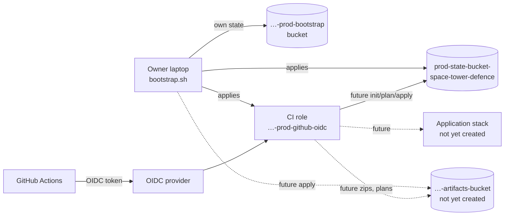

# A. Repository findings

This section records what existed when planning started, what I'd reuse, and what still has to be built or wired before the
first release. Everything marked **[VERIFIED]** was read from disk or checked read-only on 2026-11-14. The plan itself changed
nothing in AWS.

**Snapshot note.** Sections 1–4 (and the workflow rows of section 6) record the repository as it was at the **start of
planning**, before the owner's commits `8e669ff` and `dee3f51` on the same day. The two copied workflows they analyse were
byte-identical to the reference product's files, so their line links point at the copies as committed in
[`8e669ff`](https://github.com/jacklavelle286/space-tower-defence/tree/8e669ff/.github/workflows) (the same text is in
`/home/jack/Documents/Projects/jacks-productivity-tool/.github/workflows/`, **[VERIFIED]** `cmp`). Section 1.1 lists what
has changed since; sections 5, 9 and 10 describe the current state and the work left, in step with
[J. Execution backlog](J-execution-backlog.md) M0-01 to M0-03.

Scope of this section (other sections own the detail):

- The Terraform layout, workflows, release order and DNS hand-off are designed in [H. Infrastructure and delivery](H-infrastructure-and-delivery.md).
- The architecture and trust-boundary diagrams, including where DNS plugs in, are in [E. Architecture](E-architecture.md).
- The dependency-ordered tasks that act on these findings are in [J. Execution backlog](J-execution-backlog.md).
- Every name, key, route and rule used here follows the canonical spine, [00-spine.md](00-spine.md) (v0.3). Where this section
  cites "spine Sn", that is the matching section of that file.

Way of working **[CONFIRMED by owner]**: Claude builds the app in sequential build phases and the owner reviews the code at each
phase gate. Work happens on `main`; Claude or the owner commits and pushes. Deployment happens **only** through GitHub Actions
pipelines: no local `terraform apply` on the main stack (local `fmt`/`validate`/`plan` and read-only AWS calls are fine). The one
exception is the bootstrap root, which the owner applies locally because it creates the CI's own trust
([spine S0.1](00-spine.md#s01-way-of-working-confirmed-by-owner-2026-11-14)).

Spec anchors: the brief asks for "actual observed paths/configuration, reuse decisions and missing integration work"
(prompt.md:49-50), "a short evidence table of what exists, what can be reused and what must be added" (prompt.md:972), and
"Repository findings with real file/path evidence" (prompt.md:1294). The infrastructure constraints this section checks against
are prompt.md:25, prompt.md:27, prompt.md:797-799, prompt.md:819-822 and prompt.md:976-1002.

---

## 1. Summary

| # | Finding | Consequence | Label |
|---|---|---|---|
| 1 | At the snapshot, the repository held one commit with a one-line `README.md`; `.github/`, `infrastructure/` and `prompt.md` were untracked, and there was no `.gitignore`, no `CLAUDE.md` and no application code, tests or docs. The `.gitignore` and the first commits have since landed (section 1.1). | Repository hygiene is mostly done; `CLAUDE.md` is still missing (section 10.1, item 4). | **[VERIFIED]** `git status`, `ls` at the snapshot; `git log` since |
| 2 | The bootstrap root calls the owner's external module at tag `v1.0.0` and **has been applied**. The main-stack state bucket, the bootstrap's own state bucket, the CI role and the GitHub OIDC provider exist in account `263185198757`. Apart from the organisation's baseline roles (OrganizationAccountAccessRole, CostScanningRole, an SSO role, a StackSets execution role), nothing else does. | We reuse the bootstrap and do not replace it (prompt.md:976). `infrastructure/main/` starts from an empty directory and an empty state bucket. The bootstrap root gains one addition, the Lambda artefacts bucket, beside the existing module call (section 9.1) **[PROPOSAL]**. | **[VERIFIED]** files + read-only AWS checks |
| 3 | The main-stack state bucket is `prod-state-bucket-space-tower-defence`, from the formula `<environment>-state-bucket-<project>`. The copied workflows compute `<account>-<region>-<project>-<environment>` instead. | Every workflow `terraform init` must use the real name. If it doesn't, init points at a bucket that does not exist. | **[VERIFIED]** |
| 4 | Both workflow files are byte-identical copies of the reference product's workflows. They reference a role, Terraform version, lock table, app paths, secrets and jobs that do not exist here. | They are examples to learn from, not pipelines. Both are replaced (see section 4). | **[VERIFIED]** `cmp` against the reference |
| 5 | The CI role trusts `repo:jacklavelle286/space-tower-defence:*` and has `AdministratorAccess`. | It is too broad for production. Section 5 gives the recommended narrowing. | **[VERIFIED]** IAM read |
| 6 | GitHub repositories created after 15 July 2026 use an immutable OIDC subject format that the deployed trust pattern will not match. | This is **likely to block CI** until it is checked. It is the first thing to test (section 5.2). | Docs **[VERIFIED]**; this repository **[UNVERIFIED]** |
| 7 | GitHub Environment required reviewers are available only on public repositories for Free/Pro/Team plans. | The release design must work with or without the review pause. The default is two dispatches (plan, then apply by run ID); section 5.4. | Docs **[VERIFIED]**; this repository **[UNVERIFIED]** |
| 8 | The target repository contains no DNS, Route 53 or certificate code, although the brief expected "domain-related resources" to be present (prompt.md:960). The reference project looks up a hosted zone by name in its own account and writes its validation and alias records there with the default provider. | DNS stays the owner's integration (prompt.md:27, prompt.md:822). An HTTPS app in another account already serves the apex `jackgl.com`; `aliens` and `admin.aliens` do not exist yet, so there is no clash **[CONFIRMED by owner]**. Section 7 lists the integration points and the hand-off checks only. | **[VERIFIED]** |

### 1.1 Changes since the snapshot

| Change | Evidence | Still to do | Label |
|---|---|---|---|
| `.gitignore` added and the first commits pushed to `main` (`prompt.md`, `infrastructure/`, `docs/` tracked; `infrastructure/bootstrap/.terraform-prod/` not tracked) | [.gitignore](../../.gitignore); `git log` (`8e669ff`) | Nothing (J M0-01) | **[VERIFIED]** |
| `deploy.yml` removed | `git show --stat dee3f51` | Nothing; `release.yml` replaces it in M1-10 | **[VERIFIED]** |
| `tf-apply-destroy-env.yml` rewritten for this repository (129 lines: this repo's CI role and state bucket, S3 native locking, saved plan applied in the same job, Terraform version from the env file) | [tf-apply-destroy-env.yml](https://github.com/jacklavelle286/space-tower-defence/blob/61160df0788cabc79f387f68e6713af878c172e3/.github/workflows/tf-apply-destroy-env.yml); commit `dee3f51` | It stays as the interim plan/apply pipeline until M1-10 deletes it; its `destroy` action is removed in M0-01 ([line 56](https://github.com/jacklavelle286/space-tower-defence/blob/61160df0788cabc79f387f68e6713af878c172e3/.github/workflows/tf-apply-destroy-env.yml#L56)) | **[VERIFIED]** |
| `oidc-smoke.yml` added: prints only the decoded `sub` claim, then assumes the CI role and runs `aws sts get-caller-identity` | [oidc-smoke.yml](../../.github/workflows/oidc-smoke.yml); commit `dee3f51` | Dispatch it on `main` once the `prod` environment exists (J M0-02); kept afterwards as a manual workflow | **[VERIFIED]** |
| `trusted_subs` already holds the immutable-format `…:environment:prod` subject; `terraform_version` = `1.17.2` added | [common.auto.tfvars.json:4-8](../../infrastructure/envs/common.auto.tfvars.json#L4-L8) | The deployed trust is unchanged until the owner re-applies the bootstrap locally (J M0-03); M0-02 confirms the subject first | **[VERIFIED]** file; deployed trust unchanged |
| `infrastructure/main/` started: [provider.tf](../../infrastructure/main/provider.tf), [variables.tf](../../infrastructure/main/variables.tf), lock file, and a throwaway test bucket in [main.tf](../../infrastructure/main/main.tf) | commit `dee3f51` | Destroy the test bucket through the interim workflow and delete the resource (J M0-01); the rest of the root is J M1-02 | **[VERIFIED]** files; whether the test bucket is applied **[UNVERIFIED]** |

---

## 2. What exists in this repository

### 2.1 Tree as observed at the snapshot

This is the tree before commits `8e669ff` and `dee3f51`; section 1.1 lists what changed.

```
space-tower-defence/
├── README.md                              tracked; one line
├── prompt.md                              untracked; the approved brief + spec
├── .github/workflows/
│   ├── deploy.yml                         untracked; copy of the reference product's workflow (removed in dee3f51)
│   └── tf-apply-destroy-env.yml           untracked; copy of the reference product's workflow (rewritten in dee3f51)
└── infrastructure/
    ├── bootstrap/
    │   ├── main.tf  locals.tf  variables.tf  outputs.tf
    │   ├── .terraform.lock.hcl            hashicorp/aws 6.73.0
    │   └── .terraform-prod/               local Terraform data dir (must be git-ignored)
    ├── envs/
    │   ├── common.auto.tfvars.json
    │   └── prod.tfvars.json
    └── main/                              EMPTY directory (provider.tf, variables.tf, main.tf since dee3f51)
```

Absent at the snapshot **[VERIFIED]**: `.gitignore` (added since), `CLAUDE.md` (or any other repository-instructions file), `docs/` (until this plan),
`web/`, `package.json`, any Python source or Python dependency file, `tests/`, `contracts/`, and any staging environment file.
So there is no build tooling, dependency file or output convention to reuse from this repository (prompt.md:970). The only
output convention is the bootstrap's Terraform outputs, and the only deployment inputs are the two env JSON files.
Added during planning: this plan in `docs/plan/` (with the spine [00-spine.md](00-spine.md) and evidence in
[sources/](sources/)) and the balance simulator in [tools/sim/](../../tools/sim/) (`python3 -B tools/sim/selftest.py`
passes, per [spine S0](00-spine.md#s0-verified-starting-point)).

The brief asks me to "Read repository instructions" (prompt.md:9). There are none, so this plan's conventions come from the
reference project and the bootstrap module README, as the brief directs (prompt.md:25).

### 2.2 File-by-file evidence

| File | What it says (evidence) | Label |
|---|---|---|
| [README.md:1](../../README.md#L1) | `# space-tower-defence` and nothing else. | **[VERIFIED]** |
| [infrastructure/bootstrap/main.tf:2](../../infrastructure/bootstrap/main.tf#L2) | `required_version = ">= 1.10.0"` | **[VERIFIED]** |
| [infrastructure/bootstrap/main.tf:7](../../infrastructure/bootstrap/main.tf#L7) | AWS provider `">= 6.0, < 7.0"` | **[VERIFIED]** |
| [infrastructure/bootstrap/main.tf:11](../../infrastructure/bootstrap/main.tf#L11) | `backend "s3" {}`: a partial backend, filled at init by `bootstrap.sh` | **[VERIFIED]** |
| [infrastructure/bootstrap/main.tf:14-16](../../infrastructure/bootstrap/main.tf#L14-L16) | `provider "aws" { region = var.region }`, with no `default_tags` | **[VERIFIED]** |
| [infrastructure/bootstrap/main.tf:19](../../infrastructure/bootstrap/main.tf#L19) | `source = "git::ssh://git@github.com/jacklavelle286/terraform-bootstrap.git//modules/bootstrap?ref=v1.0.0"` | **[VERIFIED]** |
| [infrastructure/bootstrap/main.tf:21-28](../../infrastructure/bootstrap/main.tf#L21-L28) | Inputs: `project`, `environment`, `tags = var.extra_tags`, `trusted_subs`, `role_policy_arns`, `ecr_repos`, `state_bucket_name = local.state_bucket`. There is no `role_name` override, so the module default applies. | **[VERIFIED]** |
| [infrastructure/bootstrap/locals.tf:2](../../infrastructure/bootstrap/locals.tf#L2) | `state_bucket = "${var.environment}-state-bucket-${var.project}"` → `prod-state-bucket-space-tower-defence` | **[VERIFIED]** |
| [infrastructure/bootstrap/variables.tf:16-22](../../infrastructure/bootstrap/variables.tf#L16-L22) | `aws_account_id` is declared only so Terraform does not warn about the shared env file. It is read by `bootstrap.sh` as an account guard. | **[VERIFIED]** |
| [infrastructure/bootstrap/variables.tf:41-47](../../infrastructure/bootstrap/variables.tf#L41-L47) | `ecr_repos` defaults to `[]`, so no ECR is created. | **[VERIFIED]** |
| [infrastructure/bootstrap/outputs.tf:1-13](../../infrastructure/bootstrap/outputs.tf#L1-L13) | Outputs `ci_role_arn`, `state_bucket_name`, `ecr_repository_urls` | **[VERIFIED]** |
| `infrastructure/bootstrap/.terraform-prod/` | Exists. It is the `TF_DATA_DIR` that `bootstrap.sh` creates. Its contents are not cited here; it must never be committed. | **[VERIFIED]** (existence only) |
| [infrastructure/envs/common.auto.tfvars.json:2-8](../../infrastructure/envs/common.auto.tfvars.json#L2-L8) | `project = space-tower-defence`, `region = eu-west-2`, `role_policy_arns = []`. At the snapshot `trusted_subs` was `["repo:jacklavelle286/space-tower-defence:*"]`; since `dee3f51` it holds the immutable `…:environment:prod` subject and the file also sets `terraform_version = 1.17.2` (section 1.1). | **[VERIFIED]** |
| [infrastructure/envs/prod.tfvars.json:2-4](../../infrastructure/envs/prod.tfvars.json#L2-L4) | `environment = prod`, `aws_account_id = 263185198757`, `role_policy_arns = ["arn:aws:iam::aws:policy/AdministratorAccess"]`. There is no `domain_name`, no hostnames and no `notification_email`. | **[VERIFIED]** |
| `infrastructure/main/` | Empty directory at the snapshot; started since (section 1.1) | **[VERIFIED]** |
| [.github/workflows/deploy.yml](https://github.com/jacklavelle286/space-tower-defence/blob/8e669ff/.github/workflows/deploy.yml) | 390 lines at the snapshot. It is byte-identical to `/home/jack/Documents/Projects/jacks-productivity-tool/.github/workflows/deploy.yml`. Removed in `dee3f51`. Detail in section 4.1. | **[VERIFIED]** `cmp` |
| [.github/workflows/tf-apply-destroy-env.yml @ 8e669ff](https://github.com/jacklavelle286/space-tower-defence/blob/8e669ff/.github/workflows/tf-apply-destroy-env.yml) | 183 lines at the snapshot. It is byte-identical to the reference file of the same name; the current file is a 129-line rewrite (section 1.1). Every line is indented by two spaces, which YAML accepts. Detail in section 4.2. | **[VERIFIED]** `cmp` |

Two details that are easy to miss:

- **`role_policy_arns` appears in both env files.** The common file sets `[]` and the prod file sets `AdministratorAccess`.
  The later `-var-file` wins, and the applied role confirms that `AdministratorAccess` was attached. I'd suggest removing the
  key from the common file so only one file sets it. **[ASSUMPTION]**
- **The env files are shared by the bootstrap root, the main root and CI** (the bootstrap README describes this layout, but only
  in its uncommitted working copy; see section 8.1).
  Any key added for the main stack (hostnames, e-mail, the `tts_*` voice keys) will make the bootstrap root warn about an undeclared variable, and the
  reverse is also true. Terraform only warns about undeclared keys in a `-var-file`; it does not fail. That is
  **[UNVERIFIED]** for the current version (it is from memory and from the bootstrap README's statement; see
  [Unverified items to check](#unverified-items-to-check)). The fix is cheap:
  declare the foreign keys with defaults in each root. H adopts this: the main root declares the bootstrap keys
  ([H §H.3.2](H-infrastructure-and-delivery.md#h32-variablestf)) and the bootstrap root declares the main-stack keys
  ([H §H.5](H-infrastructure-and-delivery.md#h5-bootstrap-changes-you-make-no-replacement-bootstrap), B-5). **[PROPOSAL]**

---

## 3. AWS reality after the bootstrap apply

The owner applied the bootstrap at about 14:24 on 2026-11-14. I then checked the account read-only with the
`space-tower-defence` CLI profile.

| Resource | Observed state | Label |
|---|---|---|
| Bootstrap stack state | `s3://263185198757-eu-west-2-space-tower-defence-prod-bootstrap/terraform.tfstate`. `bootstrap.sh` created and owns this bucket outside Terraform. | **[VERIFIED]** |
| Main-stack state bucket | `prod-state-bucket-space-tower-defence`, in eu-west-2 with versioning enabled. It is **empty**: no main stack has ever been initialised. | **[VERIFIED]** |
| CI role | `arn:aws:iam::263185198757:role/space-tower-defence-prod-github-oidc`, with a maximum session of 3600 s and `AdministratorAccess` attached | **[VERIFIED]** |
| CI role trust | Federated principal is the GitHub OIDC provider, using `sts:AssumeRoleWithWebIdentity`. `StringEquals …:aud = sts.amazonaws.com` and `StringLike …:sub = repo:jacklavelle286/space-tower-defence:*` | **[VERIFIED]** |
| GitHub OIDC provider | `arn:aws:iam::263185198757:oidc-provider/token.actions.githubusercontent.com`, audience `sts.amazonaws.com` | **[VERIFIED]** |
| Everything else | The account has exactly two S3 buckets, the two above. There is no Cognito, DynamoDB, Lambda, API Gateway, CloudFront or application bucket. No GitHub workflow has ever run against this account. | **[VERIFIED]** |
| Main-stack lock table | None exists, and none is needed. The module defaults `create_lock_table = false`, and locking is native to S3 (`use_lockfile`). | **[VERIFIED]** module source |



How to read the diagram: two Terraform stacks keep state in two places. The bootstrap stack is applied only from the owner's
machine and keeps its state in the `…-bootstrap` bucket. The main stack will be applied only by CI through the OIDC role and
will keep its state in `prod-state-bucket-space-tower-defence`. The dotted lines are what this plan still has to build: the
application stack, and the Lambda artefacts bucket, which the owner's next local bootstrap apply creates and CI then writes
Lambda zips and saved plans into ([spine S11.1](00-spine.md#s111-workflows)). **[PROPOSAL]**

The owner can repeat these checks read-only at any time (read-only AWS calls stay allowed under the way of working):

- `TF_DATA_DIR=infrastructure/bootstrap/.terraform-prod terraform -chdir=infrastructure/bootstrap output` shows `state_bucket_name` and `ci_role_arn`.
- `aws iam get-role --role-name space-tower-defence-prod-github-oidc --query Role.AssumeRolePolicyDocument --profile space-tower-defence` shows the trust policy.

---

## 4. The two workflow files: what they reference that does not exist here

This analysis is of the copies at the snapshot (line links go to commit `8e669ff`). Since then `deploy.yml` has been removed
and `tf-apply-destroy-env.yml` rewritten as the interim pipeline (section 1.1); the lessons below still shape the replacements.

Both files were `workflow_dispatch` only and requested `permissions: id-token: write, contents: read`. They read the env JSON
with `jq` and checked that `aws sts get-caller-identity` returns the expected account. These habits are worth keeping
(prompt.md:139, prompt.md:978). Everything else is tied to the reference product.

### 4.1 `deploy.yml`

| Line(s) | What it does | Status here | Label |
|---|---|---|---|
| [10-48](https://github.com/jacklavelle286/space-tower-defence/blob/8e669ff/.github/workflows/deploy.yml#L10-L48) | Manual trigger. Inputs `env` (prod/staging), `component`, image `tag`, `also_tag_sha`, `run_terraform`, `deploy_backend`, `rebuild_apk` | Most inputs relate to containers or an APK. Staging does not exist here. | **[VERIFIED]** |
| [50-52](https://github.com/jacklavelle286/space-tower-defence/blob/8e669ff/.github/workflows/deploy.yml#L50-L52) | `permissions: id-token: write, contents: read` | Keep | **[VERIFIED]** |
| [67-80](https://github.com/jacklavelle286/space-tower-defence/blob/8e669ff/.github/workflows/deploy.yml#L67-L80) | A `config` job reads `region`/`project` from the common file and `aws_account_id`/`environment` from the env file | Keep the pattern; the keys already exist here | **[VERIFIED]** |
| [86-98](https://github.com/jacklavelle286/space-tower-defence/blob/8e669ff/.github/workflows/deploy.yml#L86-L98) | `refresh-apk` calls `./.github/workflows/shell-release.yml` with `secrets: inherit` | That file does not exist here. I'd expect GitHub to reject the whole workflow file when it loads, even with `rebuild_apk=false` **[UNVERIFIED]** | **[VERIFIED]** reference |
| [111-150](https://github.com/jacklavelle286/space-tower-defence/blob/8e669ff/.github/workflows/deploy.yml#L111-L150) | The `tests` job installs Node 20 and Python 3.12, runs `npm ci` in `web/jacks-productivity-tool` ([123](https://github.com/jacklavelle286/space-tower-defence/blob/8e669ff/.github/workflows/deploy.yml#L123), [135](https://github.com/jacklavelle286/space-tower-defence/blob/8e669ff/.github/workflows/deploy.yml#L135)) and runs `./tests/run.sh` ([150](https://github.com/jacklavelle286/space-tower-defence/blob/8e669ff/.github/workflows/deploy.yml#L150)) | None of these paths exist here | **[VERIFIED]** |
| [166](https://github.com/jacklavelle286/space-tower-defence/blob/8e669ff/.github/workflows/deploy.yml#L166), [218](https://github.com/jacklavelle286/space-tower-defence/blob/8e669ff/.github/workflows/deploy.yml#L218), [300](https://github.com/jacklavelle286/space-tower-defence/blob/8e669ff/.github/workflows/deploy.yml#L300), [352](https://github.com/jacklavelle286/space-tower-defence/blob/8e669ff/.github/workflows/deploy.yml#L352) | `role-to-assume: arn:aws:iam::<account>:role/github-federation` | The real role is `space-tower-defence-prod-github-oidc` | **[VERIFIED]** |
| [174-190](https://github.com/jacklavelle286/space-tower-defence/blob/8e669ff/.github/workflows/deploy.yml#L174-L190) | Builds the SPA, then `aws s3 sync … --delete` to `<account>-<region>-<environment>-spa-bucket`, with `index.html` last and `no-cache` | Keep the `index.html`-last idea. Drop `--delete`, because prior hashed assets must survive for rollback and open tabs. | **[VERIFIED]** |
| [192-203](https://github.com/jacklavelle286/space-tower-defence/blob/8e669ff/.github/workflows/deploy.yml#L192-L203) | Finds the distribution by `Comment == <project>-<environment>` and invalidates `/*` | There will be two distributions, and they will be found through `terraform output` | **[VERIFIED]** |
| [205-261](https://github.com/jacklavelle286/space-tower-defence/blob/8e669ff/.github/workflows/deploy.yml#L205-L261) | Logs in to ECR and ECR Public, runs `docker build -f docker/api/Dockerfile` and pushes `:tag` and `:sha` | No containers here (prompt.md:826); no ECR repos (`ecr_repos = []`) | **[VERIFIED]** |
| [268](https://github.com/jacklavelle286/space-tower-defence/blob/8e669ff/.github/workflows/deploy.yml#L268) | The `terraform` job declares `needs: config` only, so **a failing test suite does not stop the apply** | Must not be copied | **[VERIFIED]** |
| [270-271](https://github.com/jacklavelle286/space-tower-defence/blob/8e669ff/.github/workflows/deploy.yml#L270-L271) | `environment: name: ${{ inputs.env }}` on the terraform job only | Will matter for the OIDC subject (section 5) | **[VERIFIED]** |
| [276-292](https://github.com/jacklavelle286/space-tower-defence/blob/8e669ff/.github/workflows/deploy.yml#L276-L292) | `TF_VAR_*` from secrets `POSTGRES_*`, `AI_CREDS`, `WEATHER_API_KEY`, `AUTH_SECRET`, `VAPID_PRIVATE_KEY`, `FCM_CREDENTIALS` and others | None apply. The new stack needs no third-party secrets. | **[VERIFIED]** |
| [303-307](https://github.com/jacklavelle286/space-tower-defence/blob/8e669ff/.github/workflows/deploy.yml#L303-L307) | Account guard: compares `sts get-caller-identity` with the env file | Keep, and run it in every job that assumes the role | **[VERIFIED]** |
| [312](https://github.com/jacklavelle286/space-tower-defence/blob/8e669ff/.github/workflows/deploy.yml#L312) | `terraform_version: 1.8.5` | Too old: the bootstrap needs `>= 1.10`, and the owner's local CLI is 1.17.2 | **[VERIFIED]** |
| [317](https://github.com/jacklavelle286/space-tower-defence/blob/8e669ff/.github/workflows/deploy.yml#L317) | `BUCKET="<account>-<region>-<project>-<environment>"` | **Wrong bucket for this repo** (section 6) | **[VERIFIED]** |
| [320](https://github.com/jacklavelle286/space-tower-defence/blob/8e669ff/.github/workflows/deploy.yml#L320) | `key=terraform.tfstate` | The bootstrap README recommends `main/terraform.tfstate` | **[VERIFIED]** |
| [322](https://github.com/jacklavelle286/space-tower-defence/blob/8e669ff/.github/workflows/deploy.yml#L322) | `-backend-config="dynamodb_table=$BUCKET"` | No lock table exists. Use `use_lockfile=true` instead. | **[VERIFIED]** |
| [332-334](https://github.com/jacklavelle286/space-tower-defence/blob/8e669ff/.github/workflows/deploy.yml#L332-L334) | `terraform apply -auto-approve` with no saved plan | The spec requires a reviewed plan (prompt.md:990-992) | **[VERIFIED]** |
| [339-390](https://github.com/jacklavelle286/space-tower-defence/blob/8e669ff/.github/workflows/deploy.yml#L339-L390) | Waits for CloudFront, then runs `aws lambda update-function-code --image-uri` on `<project>-<environment>-<region>-api` | Two tools would own the Lambda code. Here, Terraform alone owns it (prompt.md:1000). | **[VERIFIED]** |

### 4.2 `tf-apply-destroy-env.yml`

| Line(s) | What it does | Status here | Label |
|---|---|---|---|
| [4-23](https://github.com/jacklavelle286/space-tower-defence/blob/8e669ff/.github/workflows/tf-apply-destroy-env.yml#L4-L23) | Manual trigger. `env` defaults to **staging** and `action` (plan/apply/destroy) defaults to **apply** | Staging does not exist here. Defaulting to apply is unsafe. | **[VERIFIED]** |
| [38-39](https://github.com/jacklavelle286/space-tower-defence/blob/8e669ff/.github/workflows/tf-apply-destroy-env.yml#L38-L39) | `environment: name: <env>` | Keep (subject format, section 5) | **[VERIFIED]** |
| [45-61](https://github.com/jacklavelle286/space-tower-defence/blob/8e669ff/.github/workflows/tf-apply-destroy-env.yml#L45-L61), [93-97](https://github.com/jacklavelle286/space-tower-defence/blob/8e669ff/.github/workflows/tf-apply-destroy-env.yml#L93-L97) | Maps the reference product's secrets, then **exits 1 if the `POSTGRES_*` secrets are missing** | This would fail on its first run here | **[VERIFIED]** |
| [86](https://github.com/jacklavelle286/space-tower-defence/blob/8e669ff/.github/workflows/tf-apply-destroy-env.yml#L86) | `TF_VERSION=$(jq -r '.terraform_version // "1.8.5"' common)`. The common file has no such key, so 1.8.5 always wins. | Worth reusing: add a `terraform_version` key here **[PROPOSAL]** | **[VERIFIED]** |
| [99-101](https://github.com/jacklavelle286/space-tower-defence/blob/8e669ff/.github/workflows/tf-apply-destroy-env.yml#L99-L101) | `BUCKET` and `DDB` = `<account>-<region>-<project>-<environment>`, `KEY=terraform.tfstate` | Wrong bucket; no lock table | **[VERIFIED]** |
| [119](https://github.com/jacklavelle286/space-tower-defence/blob/8e669ff/.github/workflows/tf-apply-destroy-env.yml#L119) | `role/github-federation` | Wrong role name | **[VERIFIED]** |
| [137](https://github.com/jacklavelle286/space-tower-defence/blob/8e669ff/.github/workflows/tf-apply-destroy-env.yml#L137) | `terraform fmt -recursive` rewrites files on the runner and never fails | Use `terraform fmt -check -recursive` instead | **[VERIFIED]** |
| [146](https://github.com/jacklavelle286/space-tower-defence/blob/8e669ff/.github/workflows/tf-apply-destroy-env.yml#L146) | `dynamodb_table` backend config | Remove | **[VERIFIED]** |
| [153-159](https://github.com/jacklavelle286/space-tower-defence/blob/8e669ff/.github/workflows/tf-apply-destroy-env.yml#L153-L159), [169-175](https://github.com/jacklavelle286/space-tower-defence/blob/8e669ff/.github/workflows/tf-apply-destroy-env.yml#L169-L175) | Prints a plan, then runs `apply -auto-approve`, which plans again, so what is applied is not what was printed | Use a saved plan (`-out`) and apply that exact file | **[VERIFIED]** |
| [161-167](https://github.com/jacklavelle286/space-tower-defence/blob/8e669ff/.github/workflows/tf-apply-destroy-env.yml#L161-L167), [177-183](https://github.com/jacklavelle286/space-tower-defence/blob/8e669ff/.github/workflows/tf-apply-destroy-env.yml#L177-L183) | `terraform destroy -auto-approve` in prod, guarded only by typing `CONFIRM` | No destroy path for production data **[PROPOSAL]** | **[VERIFIED]** |

The replacement workflows are designed in [H §H.7](H-infrastructure-and-delivery.md#h7-workflows-what-replaces-the-two-copies):
`release.yml` replaces `deploy.yml`, a plan-only `plan.yml` replaces `tf-apply-destroy-env.yml`, `apply.yml` applies a
reviewed saved plan (section 5.4), and there is no destroy workflow. The saved plan is stored in the artefacts bucket under
`plans/<run_id>/`, never as a GitHub artefact (which could be public). `release.yml` takes an optional input
`artefacts_from=<release_id>` for rollback: current `main` Terraform plus that release's archived manifest
([spine S11.2](00-spine.md#s112-rollback)). The M0 OIDC smoke test, `oidc-smoke.yml`, is kept afterwards as a manual
workflow ([spine S11.1](00-spine.md#s111-workflows)). **[PROPOSAL]**

---

## 5. GitHub OIDC: trust breadth, subject format and the review pause

### 5.1 What the deployed trust allows today

The pattern `repo:jacklavelle286/space-tower-defence:*` with `StringLike` (from the module's `assume_role` policy document,
`/home/jack/Documents/Projects/terraform-bootstrap/modules/bootstrap/main.tf` lines 39-61) matches **any** workflow in the
repository, on any branch, tag, pull-request ref or environment. Because the role holds `AdministratorAccess`, any workflow
file pushed to any branch can act as account administrator in production. The bootstrap module's own README says
`repo:my-org/my-app:*` is "fine for staging, but too broad for prod", and that `AdministratorAccess` is "the quickest option,
but a tighter policy is better for production" (`/home/jack/Documents/Projects/terraform-bootstrap/README.md` lines 209
and 102; uncommitted working copy, about 3 lines earlier at v1.0.0). **[VERIFIED]**

### 5.2 Immutable OIDC subject: likely CI blocker

- GitHub documents that repositories created after 15 July 2026 emit an immutable default subject of the form
  `repo:OWNER@OWNER-ID/REPO@REPO-ID:<context>`. Older repositories keep `repo:OWNER/REPO:<context>` unless they opt in.
  **[VERIFIED]** in GitHub's OIDC reference documentation (GitHub Docs, "OpenID Connect reference").
- This repository's only commit is dated 2026-11-14, so it was very probably created after that cut-off. I could not check
  this because the `gh` CLI was not authenticated in the planning session. **[UNVERIFIED]**; the M0 OIDC smoke test settles it
  ([spine S0](00-spine.md#s0-verified-starting-point)).
- If the repository uses the immutable format, the trust pattern `repo:jacklavelle286/space-tower-defence:*` cannot match the
  token (the owner segment becomes `jacklavelle286@<id>`). Every `configure-aws-credentials` step would then fail with an
  `AssumeRoleWithWebIdentity` access-denied error. The reference product is older, which is why its pattern looks correct
  there.

**How the owner can check (any one is enough; none of them exposes a token):**

| Method | What to look at | Notes |
|---|---|---|
| REST API | `GET /repos/{owner}/{repo}/actions/oidc/customization/sub`, e.g. `gh api repos/jacklavelle286/space-tower-defence/actions/oidc/customization/sub`. Check the field `use_immutable_subject` (field name **[UNVERIFIED]**; see [Unverified items to check](#unverified-items-to-check); if the field is absent, the throwaway workflow below is the definitive check). | Read-only. `gh api repos/jacklavelle286/space-tower-defence --jq '.created_at, .visibility, .id, .owner.id'` gives the creation date, the visibility and the two numeric IDs that an immutable subject would contain. |
| Repository Settings | The repository's Settings pages, where GitHub exposes the OIDC subject option for the repository | The REST field above is the definitive answer if the UI does not show it |
| Throwaway workflow | A `workflow_dispatch` workflow with `permissions: id-token: write`, one job with `environment: prod`, and a step that requests an ID token for audience `sts.amazonaws.com`, decodes **only the payload** and prints **only** the `sub` claim (optionally `repository_id` and `repository_owner_id`). A second step runs `configure-aws-credentials` and `aws sts get-caller-identity`. | **Never print, echo or upload the token itself.** This is also the Milestone 0 OIDC smoke test, [oidc-smoke.yml](../../.github/workflows/oidc-smoke.yml), already in the repository (commit `dee3f51`) and kept afterwards as a manual workflow. Its result (which subject format, whether environments and required reviewers are available) is recorded as an ADR in `docs/decisions/` (to create). |

**Fix (the owner applies it, using the existing bootstrap):** `trusted_subs` in
[common.auto.tfvars.json:5](../../infrastructure/envs/common.auto.tfvars.json#L5) already holds the immutable-format
`…:environment:prod` subject (commit `dee3f51`) **[VERIFIED]**; it is corrected only if the smoke test prints a different
`sub` (J M0-02, M0-03). What is left is to re-run
`/home/jack/Documents/Projects/terraform-bootstrap/scripts/bootstrap.sh prod apply --dir <repo>/infrastructure/bootstrap`
from the clone. This is an in-place update of the role's trust policy. It does not create a replacement bootstrap
(prompt.md:976). The same local apply also adds the Lambda artefacts bucket beside the module call (section 9.1). This local
bootstrap apply is the one permitted exception to "deploy only through GitHub Actions", because the pipeline cannot create its
own trust ([spine S0.1](00-spine.md#s01-way-of-working-confirmed-by-owner-2026-11-14)). **[PROPOSAL]**

### 5.3 Recommended narrowing

| Item | Today | Recommended | Label |
|---|---|---|---|
| Subject | `repo:jacklavelle286/space-tower-defence:*` (deployed; the env file already holds the narrowed subject, awaiting the bootstrap re-apply) | One entry for the environment context only: `repo:jacklavelle286/space-tower-defence:environment:prod`. If section 5.2 shows the immutable format, use `repo:jacklavelle286@<owner-id>/space-tower-defence@<repo-id>:environment:prod` instead ([spine S11.1](00-spine.md#s111-workflows)). | **[PROPOSAL]** |
| Second environment (only if required reviewers are available) | — | Add an environment `prod-apply` with required reviewers, used only by the apply job. Both subjects (`…:environment:prod` and `…:environment:prod-apply`) go into `trusted_subs`, in the immutable format if the repository uses it. Without reviewers, the two-dispatch design (section 5.4) stands alone. | **[PROPOSAL]** |
| Workflow side | Only the terraform job declares an environment | **Every** job that assumes the role declares `environment: prod`, so its token's `sub` ends `:environment:prod`. Jobs without credentials (checks, builds) do not assume the role at all. | **[PROPOSAL]** |
| Who can enter `prod` | Unrestricted | Give the `prod` environment a deployment-branch rule allowing only `main`. Without that rule, any branch can declare `environment: prod` and receive the narrowed subject, so the environment-only narrowing depends on it. The spine (S11.1) and H adopt this rule ([H §H.5](H-infrastructure-and-delivery.md#h5-bootstrap-changes-you-make-no-replacement-bootstrap), B-2). Availability on a private repository depends on the plan **[UNVERIFIED]**; the M0 smoke test settles it. | **[PROPOSAL]** |
| Fallback subject | — | If environments are not available on this repository's plan, trust `repo:jacklavelle286/space-tower-defence:ref:refs/heads/main` (or its immutable-format equivalent) instead, and no job declares an environment. This is the spine's recorded fallback (S11.1); the M0 OIDC smoke test settles which applies and the result is recorded as an ADR in `docs/decisions/` ([H §H.5](H-infrastructure-and-delivery.md#h5-bootstrap-changes-you-make-no-replacement-bootstrap), B-3). | **[PROPOSAL]** |
| Permissions | `AdministratorAccess` | Keep it while the module set is still changing (Milestones 0–1). Before the data-freeze point, replace it with a scoped policy through the module's `role_inline_policy_json` input: the services in use (S3, CloudFront, ACM, Cognito, DynamoDB, Lambda, API Gateway, Logs, CloudWatch, SNS, Backup, IAM). Limit IAM writes to `space-tower-defence-prod-*` role names. Add explicit denies on deleting the state buckets, the two tables and the user pools, and on changing the CI role's own trust. The policy outline is in [H §H.5.1](H-infrastructure-and-delivery.md#h51-scoped-ci-policy-outline-not-json) (change B-4). | **[PROPOSAL]** |
| Session | 3600 s | Keep it. A release is well under an hour. If one ever runs longer, the apply job re-assumes the role rather than raising the maximum. | **[ASSUMPTION]** |

A caution for the scoped policy: `iam:CreateRole` + `iam:PutRolePolicy` + `iam:PassRole` without a permissions boundary is
still privilege escalation to administrator. If the owner wants the narrowing to be meaningful, it needs either a permissions
boundary condition on role creation or role-name scoping plus a deny on attaching `AdministratorAccess`. **[PROPOSAL]**

### 5.4 Required reviewers on the `prod` environment

- GitHub documents that on Free, Pro and Team plans, required reviewers on environments are available **only for public
  repositories**. One approval is enough, and "prevent self-review" is optional, so a solo owner can approve their own run
  when it is off. **[VERIFIED]** docs.
- This repository's visibility and the account plan are **[UNVERIFIED]**. To check:
  `gh api repos/jacklavelle286/space-tower-defence --jq .visibility`, then look under Settings → Environments → `prod` to see
  whether "Required reviewers" can be ticked.
- Consequence: the release design in [H](H-infrastructure-and-delivery.md) works either way. The **default is two dispatches**:
  `release.yml` stops after storing the saved plan in the artefacts bucket under `plans/<run_id>/`, and the owner reviews it and
  dispatches `apply.yml` with that run's ID (`plan_run_id`). This guarantees that only a reviewed, saved plan is applied, whatever
  the repository's plan allows ([spine S11.1](00-spine.md#s111-workflows);
  [H §H.7](H-infrastructure-and-delivery.md#h7-workflows-what-replaces-the-two-copies), W-4). If required reviewers turn out to be
  available, the environment `prod-apply` (with reviewers) is added and used only by the apply job (section 5.3). **[PROPOSAL]**

---

## 6. State-bucket naming mismatch

| Where | Formula | Result for prod | Label |
|---|---|---|---|
| [locals.tf:2](../../infrastructure/bootstrap/locals.tf#L2) → `state_bucket_name` input | `<environment>-state-bucket-<project>` | `prod-state-bucket-space-tower-defence` (**exists**) | **[VERIFIED]** |
| Module default, used only when no override is passed (`/home/jack/Documents/Projects/terraform-bootstrap/modules/bootstrap/main.tf` line 22) | `<account>-<region>-<project>-<environment>` | `263185198757-eu-west-2-space-tower-defence-prod` (**does not exist**) | **[VERIFIED]** |
| [deploy.yml:317](https://github.com/jacklavelle286/space-tower-defence/blob/8e669ff/.github/workflows/deploy.yml#L317), [tf-apply-destroy-env.yml:99](https://github.com/jacklavelle286/space-tower-defence/blob/8e669ff/.github/workflows/tf-apply-destroy-env.yml#L99) | Module-default formula | Pointed at the non-existent bucket (snapshot copies, commit `8e669ff`). The rewritten interim workflow now uses `${ENVIRONMENT}-state-bucket-${PROJECT}` ([tf-apply-destroy-env.yml:78](https://github.com/jacklavelle286/space-tower-defence/blob/61160df0788cabc79f387f68e6713af878c172e3/.github/workflows/tf-apply-destroy-env.yml#L78)). | **[VERIFIED]** |
| Bootstrap stack's own state (`bootstrap.sh`) | `<account>-<region>-<project>-<environment>-bootstrap` | Exists. CI must never touch it. | **[VERIFIED]** |

Decision **[PROPOSAL]**: keep the bucket that exists. Moving to the module default would replace the bucket for no benefit.
The workflows initialise the main stack with:

| Backend setting | Value |
|---|---|
| `bucket` | `prod-state-bucket-space-tower-defence`, computed as `${environment}-state-bucket-${project}` from the env JSON. A comment points at `locals.tf:2` so the two formulas stay in step. |
| `key` | `main/terraform.tfstate` (the bootstrap README's recommendation) |
| `region` | `eu-west-2` |
| `use_lockfile` | `true` (no `dynamodb_table`) |
| `encrypt` | `true` |

A cheap guard I'd add: the plan job runs `aws s3api head-bucket` on the computed name before `terraform init` and fails with a
clear message, so a future rename cannot silently create an empty state in the wrong place. H uses exactly these backend
settings and this guard in every job that runs Terraform
([H §H.8.4](H-infrastructure-and-delivery.md#h84-backend-initialisation-every-job-that-runs-terraform)). **[PROPOSAL]**

This is the one deliberate exception to the spine rule that workflows learn names from `terraform output -json`
([spine S1.1](00-spine.md#s11-naming-verified-reference-conventions-applied-as-proposal)): the backend bucket is needed before
`terraform init`, so no output can supply it. The spine's backend settings name the bucket literally
([spine S11.1](00-spine.md#s111-workflows)), and the formula plus `head-bucket` guard keeps the workflows honest against
`locals.tf:2`. The alternative, a single `state_bucket_name` env key read by both roots, was not adopted. **[PROPOSAL]**

---

## 7. DNS: integration points only

The owner will integrate DNS (prompt.md:27, prompt.md:822). The plan does not choose a mechanism. The owner's facts about the
domain are recorded in [spine S1.0](00-spine.md#s10-dns-hand-off-facts-confirmed-by-owner-2026-11-14-unless-marked):

- An HTTPS app already serves the apex `jackgl.com` (a separate app and API, in another account). `aliens.jackgl.com` and
  `admin.aliens.jackgl.com` do not exist yet. There is no clash: different hostnames and different origins. **[CONFIRMED by owner]**
- Apex domain-wide cookies will be sent to our subdomains. That is harmless, because our apps use bearer tokens, not cookies.
  HSTS `includeSubDomains` on the apex is also fine, since both our sites are HTTPS-only. **[CONFIRMED by owner]**

What the repositories show:

- **This repository** has no DNS, Route 53, ACM or provider-alias code. **[VERIFIED]**
- **The reference product** looks up a public zone by name with the default provider, in its own workload account
  (`/home/jack/Documents/Projects/jacks-productivity-tool/infrastructure/main/data.tf` lines 6-9). It writes validation and
  alias records with that same provider (`/home/jack/Documents/Projects/jacks-productivity-tool/infrastructure/modules/cloudfront/main.tf`
  lines 83-104 and 315-339). It has only two `provider "aws"` blocks, the default and `us_east_1`
  (`/home/jack/Documents/Projects/jacks-productivity-tool/infrastructure/main/provider.tf` lines 13-27), and no `assume_role`
  or `terraform_remote_state`. **[VERIFIED]** Whether a hosted zone for `jackgl.com` is visible from account `263185198757`
  is **[UNVERIFIED]** and is the owner's concern.

| Integration point | What the stack produces or needs | Where it lands in this repo | Label |
|---|---|---|---|
| Certificate validation | Two DNS-validation CNAMEs, for `aliens.jackgl.com` and `admin.aliens.jackgl.com`, from the us-east-1 ACM certificate's `domain_validation_options`. These are exposed as the Terraform output `acm_validation_records`. | Certificate module and `infrastructure/main/outputs.tf` (to create) | **[PROPOSAL]** |
| Issue-before-use ordering | A distribution with aliases needs an issued certificate, so the first apply waits on validation. ACM times out after 72 h. | First release order in [H](H-infrastructure-and-delivery.md) | **[PROPOSAL]** |
| Alias records | `aliens.jackgl.com` and `admin.aliens.jackgl.com` → their distributions' `domain_name`/`hosted_zone_id` (A + AAAA; IPv6 is on). Both are needed in M1: the admin alias and a minimal admin app ship in M1 because clip approval needs them. | Outputs `player_distribution_domain`, `admin_distribution_domain`, `cloudfront_hosted_zone_id`, plus whatever mechanism the owner uses | **[PROPOSAL]** |
| CAA check | If `jackgl.com` has CAA records, they must allow `amazon.com`, or ACM cannot issue the certificate | Owner's DNS hand-off checklist ([H §H.15](H-infrastructure-and-delivery.md#h15-dns-hand-off)) | **[CONFIRMED by owner]**; whether CAA records exist **[UNVERIFIED]** |
| Wildcard-alias check | If the apex CloudFront distribution lists a wildcard alternate domain name `*.jackgl.com`, it could block adding `aliens.jackgl.com` to a distribution in another account | Owner checks the apex distribution's alternate domain names before M1 | **[CONFIRMED by owner]** as a check; the effect **[UNVERIFIED]** |
| Zone lookup / record-writing provider | The equivalent of the reference `data.tf` zone lookup and record-writing provider | **None in the workload stack.** `infrastructure/main/data.tf` (to create) holds only the managed CloudFront policy lookups, and `provider.tf` (to create) has no DNS alias. The owner creates the records from the outputs; if the owner later wires the DNS account into Terraform, `provider.tf` is where that alias would go ([H §H.3.4](H-infrastructure-and-delivery.md#h34-datatf), [H §H.15](H-infrastructure-and-delivery.md#h15-dns-hand-off)). | **[CONFIRMED]** owner-owned |
| Env keys | Hostnames (section 10.2) | `infrastructure/envs/prod.tfvars.json` | **[PROPOSAL]** |
| Never touched | The `jackgl.com` apex and `www`, which belong to the other product. No `allow_overwrite` on any record. | n/a | **[CONFIRMED by owner]** |

The API gets **no hostname of its own**. Each site reaches it same-origin under `/api/*`, an idea borrowed from the reference
(`/home/jack/Documents/Projects/jacks-productivity-tool/infrastructure/modules/cloudfront/main.tf` lines 193-208). The origin
type differs: in the reference, `/api/*` goes to a Lambda Function URL and a CloudFront Function strips the `/api` prefix
(same file, line 33 and lines 204-207) **[VERIFIED]**. Ours goes to the HTTP API's default endpoint and keeps `/api` in the route
keys ([spine S1](00-spine.md#s1-system-shape)). So no API certificate or API DNS record is needed (see
[E](E-architecture.md)). **[PROPOSAL]**

---

## 8. Sibling repositories as pattern sources

### 8.1 `terraform-bootstrap` (module source, tag `v1.0.0`)

Path: `/home/jack/Documents/Projects/terraform-bootstrap`. Tag `v1.0.0` is the head of `main`. The working copy has
**uncommitted** changes to `README.md` and `scripts/bootstrap.sh`, which add `--envs-dir` and the `bootstrap/../envs`
fallback that this repository's layout relies on. They are not in the tag. That doesn't matter for the module, because the
script runs from the clone. It does mean a fresh clone of `v1.0.0` would not find `infrastructure/envs/` without flags.
**[VERIFIED]** `git status`, `git diff --stat`

| Element | Evidence | Use here | Label |
|---|---|---|---|
| Role default name | `modules/bootstrap/main.tf` line 21: `"${var.project}-${var.environment}-github-oidc"` | Matches the applied role | **[VERIFIED]** |
| Trust policy | `modules/bootstrap/main.tf` lines 39-61: `StringEquals aud`, `StringLike sub` in `var.trusted_subs` | Narrow through `trusted_subs` (section 5) | **[VERIFIED]** |
| State bucket | `modules/bootstrap/main.tf` lines 89-168: versioning, AES256, public-access block, `BucketOwnerEnforced`, TLS-only policy, `force_destroy = var.state_bucket_force_destroy` (default false) | Reuse as is | **[VERIFIED]** |
| Lock table | `modules/bootstrap/main.tf` lines 170-183, created only if `create_lock_table` (default false) | Not used; `use_lockfile` instead | **[VERIFIED]** |
| ECR | `modules/bootstrap/main.tf` lines 191-233, only for `ecr_repos` entries | Not used (zip Lambdas) | **[VERIFIED]** |
| Inline policy input | README inputs table: `role_inline_policy_json` | Vehicle for the scoped CI policy (section 5.3) | **[VERIFIED]** |
| Main-stack backend recommendation | `README.md` lines 180-191 (uncommitted working copy; about 3 lines earlier at v1.0.0): `key = "main/terraform.tfstate"`, `use_lockfile = true`, `encrypt = true` | Adopt | **[VERIFIED]** |
| One OIDC provider per account | `README.md` lines 211-223 (uncommitted working copy; about 3 lines earlier at v1.0.0) | Already created by this bootstrap. A future project in this account would pass `create_oidc_provider = false`. | **[VERIFIED]** |
| `.gitignore` | Ignores `.terraform/`, `.terraform-*/`, `*.tfstate`, `*.tfstate.*`, `*.tfplan`, `crash.log`, `.terraform.lock.hcl` | Adapt: copy everything **except** the lock-file rule, because this repo commits its lock files | **[VERIFIED]** |

### 8.2 `jacks-productivity-tool` (reference product, pattern source only)

Path: `/home/jack/Documents/Projects/jacks-productivity-tool`. It is a different product: FastAPI in a container Lambda,
Postgres, a VPC, a Vite SPA and native shells. It is where the env-file convention, the copied workflows and the
CloudFront/ACM approach come from. I re-checked every line cited below against the files themselves.

| Pattern | Evidence (plain paths) | Label |
|---|---|---|
| Partial backend + default provider with `default_tags` + `us_east_1` alias | `/home/jack/Documents/Projects/jacks-productivity-tool/infrastructure/main/provider.tf` lines 1-27 (only `random ~> 3.0` constrained; no `required_version`) | **[VERIFIED]** |
| `default_tags = merge({environment, project}, var.tags)` | `/home/jack/Documents/Projects/jacks-productivity-tool/infrastructure/main/locals.tf` lines 16-22 | **[VERIFIED]** |
| Modules receive the alias via `configuration_aliases = [aws.us_east_1]` | `/home/jack/Documents/Projects/jacks-productivity-tool/infrastructure/modules/cloudfront/providers.tf` | **[VERIFIED]** |
| Managed CloudFront policies looked up by name, not UUID | `/home/jack/Documents/Projects/jacks-productivity-tool/infrastructure/modules/cloudfront/main.tf` lines 13-14 | **[VERIFIED]** |
| Site bucket name `<account>-<region>-<environment>-spa-bucket`, `force_destroy = true` | same file, lines 50-51 | **[VERIFIED]** |
| OAC `<project>-<environment>-spa-oac` | same file, line 64 | **[VERIFIED]** |
| us-east-1 certificate, DNS validation, `www` SAN, `create_before_destroy`; validation wait | same file, lines 71-81 and 100-104 | **[VERIFIED]** |
| Distribution `comment = "<project>-<environment>"` | same file, line 141 | **[VERIFIED]** |
| `/api/*` ordered behaviour to the backend origin (a Lambda Function URL), with a viewer-request CloudFront Function that strips the `/api` prefix | same file, lines 193-208; function defined at line 33 | **[VERIFIED]** |
| **Distribution-wide** `custom_error_response` 403 → 200 `/index.html` | same file, lines 244-249 | **[VERIFIED]** |
| Route 53 alias records with `allow_overwrite = true` | same file, lines 92, 319, 332 | **[VERIFIED]** |
| Container-image API Lambda pinned to `:latest`; Function URL with `authorization_type = "NONE"`; log group retention 7 days | `/home/jack/Documents/Projects/jacks-productivity-tool/infrastructure/modules/api_lambda/main.tf` lines 8, 155-158, 329-339 | **[VERIFIED]** |
| Zip Lambda: `<project>-<environment>-<region>-<name>`, `filename` + `source_code_hash` from `archive_file` | `/home/jack/Documents/Projects/jacks-productivity-tool/infrastructure/modules/lambda/main.tf` lines 1-7; `.../modules/lambda/data.tf` lines 1-5 | **[VERIFIED]** |
| Alarm prefix `<project>-<environment>`; topics `…-alerts` and `…-alerts-use1` | `/home/jack/Documents/Projects/jacks-productivity-tool/infrastructure/modules/monitoring/main.tf` lines 9, 19, 33 | **[VERIFIED]** |
| HTTP API with `$default` stage and `auto_deploy` (but a literal name, no authoriser) | `/home/jack/Documents/Projects/jacks-productivity-tool/infrastructure/modules/api_gateway/main.tf` lines 1-3, 61-65 | **[VERIFIED]** |
| Env files: common has `project`, `region` (plus an app key); prod has `environment`, `aws_account_id`, `domain_name`, `notification_email` and app keys | `/home/jack/Documents/Projects/jacks-productivity-tool/infrastructure/envs/*.json` (key names only) | **[VERIFIED]** |
| `.gitignore` ignores `*.tfvars` (not `.tfvars.json`), `.terraform.lock.hcl` and `**/.terraform*` | `/home/jack/Documents/Projects/jacks-productivity-tool/.gitignore` lines 16, 83, 87 | **[VERIFIED]** |
| Tests as plain scripts behind one runner | `/home/jack/Documents/Projects/jacks-productivity-tool/tests/run.sh` (about 50 files in `tests/`) | **[VERIFIED]** |
| Modules present | `api_gateway, api_lambda, bootstrap, cloudfront, db, eventbridge, gcp-bootstrap, gcp-gmail-sender, iam, lambda, monitoring, network, s3, secrets_manager, sns_topic, step_functions` | **[VERIFIED]** `ls` |

---

## 9. Reuse decisions

Decision key: **REUSE** = use as is. **ADAPT** = keep the shape, change the content. **REPLACE** = this repository needs its
own version, informed by the original. **DO-NOT-COPY** = leave it behind.

### 9.1 This repository

| File | What it says | Decision | Label |
|---|---|---|---|
| [infrastructure/bootstrap/main.tf](../../infrastructure/bootstrap/main.tf) | Calls the module `v1.0.0` with the shared env inputs | **REUSE**, with one addition: the Lambda artefacts bucket (`…-artifacts-bucket`, versioned; Lambda zips, release manifests, archived static builds, saved plans under `plans/<run_id>/`) is declared beside the module call. This is not a replacement bootstrap. It removes the chicken-and-egg of the main stack needing a bucket for its own Lambda zips, so the pipeline never needs a `-target` apply ([spine S1](00-spine.md#s1-system-shape), S11.1). Don't bump the tag. Re-apply only from the owner's machine, for trust/permission changes and this bucket. | **[PROPOSAL]** |
| [infrastructure/bootstrap/locals.tf](../../infrastructure/bootstrap/locals.tf) | State-bucket formula | **REUSE**. This formula is the contract the workflows mirror. | **[PROPOSAL]** |
| [infrastructure/bootstrap/variables.tf](../../infrastructure/bootstrap/variables.tf) | Typed, described inputs | **REUSE**, plus declaration-only entries (`default = null`) for the main-stack env keys so the shared env files load without warnings ([H §H.5](H-infrastructure-and-delivery.md#h5-bootstrap-changes-you-make-no-replacement-bootstrap), B-5). | **[PROPOSAL]** |
| [infrastructure/bootstrap/outputs.tf](../../infrastructure/bootstrap/outputs.tf) | Role ARN, bucket, ECR URLs | **REUSE**, plus an output for the artefacts bucket name | **[PROPOSAL]** |
| `infrastructure/bootstrap/.terraform.lock.hcl` | aws 6.73.0 | **REUSE**: commit it | **[PROPOSAL]** |
| `infrastructure/bootstrap/.terraform-prod/` | Local data directory | **DO-NOT-COPY**: git-ignore it | **[PROPOSAL]** |
| [infrastructure/envs/common.auto.tfvars.json](../../infrastructure/envs/common.auto.tfvars.json) | project, region, trust subject, `terraform_version` | **ADAPT**: `trusted_subs` is already narrowed and `terraform_version` already added (section 1.1); left: drop the duplicate `role_policy_arns` | **[PROPOSAL]** |
| [infrastructure/envs/prod.tfvars.json](../../infrastructure/envs/prod.tfvars.json) | env, account, Admin policy | **ADAPT**: add the keys in section 10.2; later replace Admin with a scoped policy | **[PROPOSAL]** |
| [infrastructure/main/](../../infrastructure/main/provider.tf) | Started: `provider.tf`, `variables.tf`, lock file, throwaway test bucket | **ADAPT** the reference root's file layout into it; the remaining files are to create (J M1-02) | **[PROPOSAL]** |
| [deploy.yml @ 8e669ff](https://github.com/jacklavelle286/space-tower-defence/blob/8e669ff/.github/workflows/deploy.yml) | Reference product release; removed in `dee3f51` | **REPLACE** with `release.yml` (to create). Keep: manual trigger, permissions, `config` job + `jq`, account guard, `index.html` last. | **[PROPOSAL]** |
| [.github/workflows/tf-apply-destroy-env.yml](https://github.com/jacklavelle286/space-tower-defence/blob/61160df0788cabc79f387f68e6713af878c172e3/.github/workflows/tf-apply-destroy-env.yml) | Rewritten for this repository in `dee3f51`; plan/apply/destroy | **Interim**: kept as the plan/apply pipeline until M1-10, with its `destroy` action removed in M0-01; then **REPLACE** with `plan.yml` + `apply.yml` (to create) and deleted in the same commit; no destroy. | **[PROPOSAL]** |
| [.github/workflows/oidc-smoke.yml](../../.github/workflows/oidc-smoke.yml) | M0 OIDC smoke test (commit `dee3f51`) | **REUSE**: kept after M0 as a manual diagnostic workflow | **[PROPOSAL]** |
| [README.md](../../README.md) | Title only | **ADAPT**: grows with local setup, build, test and release notes as work lands | **[PROPOSAL]** |
| `prompt.md` | The approved brief and spec | **REUSE**: commit it unchanged. The plan cites it by line number, so moving or reflowing it would break every `prompt.md:<line>` reference. | **[PROPOSAL]** |

### 9.2 Sibling repositories

| Source | What it is | Decision | Label |
|---|---|---|---|
| `terraform-bootstrap` `modules/bootstrap` @ `v1.0.0` | OIDC provider, CI role, state bucket | **REUSE** (already applied) | **[CONFIRMED]** prompt.md:976 |
| `terraform-bootstrap` `scripts/bootstrap.sh` (working copy) | Bootstrap state bucket + plan/apply with an account guard | **REUSE** from the clone for trust re-applies. I'd suggest the owner commits and tags the `--envs-dir` change there. | **[PROPOSAL]** |
| `terraform-bootstrap` `README.md` backend snippet | `main/terraform.tfstate`, `use_lockfile` | **REUSE** | **[PROPOSAL]** |
| `terraform-bootstrap` `.gitignore` | Terraform ignores | **ADAPT** (do not ignore lock files) | **[PROPOSAL]** |
| Reference `infrastructure/main/provider.tf` | Partial backend, `default_tags`, `us_east_1` alias | **ADAPT**: add `required_version` and an AWS provider constraint matching the bootstrap root | **[PROPOSAL]** |
| Reference `infrastructure/main/locals.tf` `default_tags` | Tag merge | **REUSE**, using provider `default_tags` as the single mechanism | **[PROPOSAL]** |
| Reference `infrastructure/main/data.tf` zone lookup | Same-account lookup by name | **DO-NOT-COPY** as is. The owner supplies the DNS equivalent. | **[CONFIRMED]** owner-owned |
| Reference `modules/cloudfront` | OAC, managed-policy lookup, us-east-1 certificate, `/api/*` behaviour | **ADAPT** into H's `static_site` (called twice: player, admin) and `certificate` modules; one certificate with two exact names; SPA fallback through a CloudFront Function on the default behaviour. Drop the distribution-wide error responses, `www`, the maintenance origin, `force_destroy` and `allow_overwrite`. | **[PROPOSAL]** |
| Reference `modules/cloudfront/providers.tf` | `configuration_aliases` | **REUSE** | **[PROPOSAL]** |
| Reference `modules/lambda` (zip functions) | Terraform owns code through `source_code_hash` | **ADAPT**: Terraform still owns code, but from content-hashed zips in the artefacts bucket created by the bootstrap root (`s3_key` + hash from a release manifest, passed through the variable `lambda_artifacts`), not `archive_file` at plan time | **[PROPOSAL]** |
| Reference `modules/api_lambda` | Image Lambda, Function URL `NONE`, workflow-owned code | **DO-NOT-COPY**, except the "role beside the function" and explicit log-group habits (**ADAPT**) | **[PROPOSAL]** |
| Reference `modules/monitoring` | SNS e-mail topic, us-east-1 mirror, `for_each` Lambda error alarms, `name_prefix` naming | **ADAPT**: drop the RDS/NAT/Step Functions parts; add API, DynamoDB and Backup alarms | **[PROPOSAL]** |
| Reference `modules/api_gateway` | Unauthenticated HTTP API for Step Functions | **DO-NOT-COPY** beyond the `aws_apigatewayv2_api` + `$default` stage shape | **[PROPOSAL]** |
| Reference `modules/s3` | Seven product buckets (`/home/jack/Documents/Projects/jacks-productivity-tool/infrastructure/modules/s3/main.tf`) with no public-access block or encryption | **DO-NOT-COPY**; borrow only the CORS block shape | **[PROPOSAL]** |
| Reference `modules/{network,db,iam,eventbridge,step_functions,secrets_manager,sns_topic,bootstrap,gcp-*}` | VPC, RDS, central IAM, schedulers, old bootstrap | **DO-NOT-COPY** (prompt.md:826) | **[CONFIRMED]** exclusions |
| Reference `infrastructure/envs/*.json` key names | `domain_name`, `notification_email` | **ADAPT** (section 10.2) | **[PROPOSAL]** |
| Reference SPA `/api` relative base path | Same-origin API; the reference sets it at build time through `VITE_API_BASE_URL` (`"/api"` in production, per the comment in `/home/jack/Documents/Projects/jacks-productivity-tool/web/jacks-productivity-tool/src/lib/authFetch.ts` line 30) | **ADAPT**: keep the relative `/api` base, but bake nothing environment-specific into the build; the new apps fetch `config.json` at start-up ([spine S11.1](00-spine.md#s111-workflows)), which the reference does not do | **[PROPOSAL]** |
| Reference `tests/run.sh` | One entry point for script tests | **ADAPT** the single-entry-point idea only. Runners are Vitest, Playwright and pytest; DynamoDB Local integration tests run in CI as a service container and are optional locally (see [I](I-validation.md)). | **[PROPOSAL]** |
| Reference `.github/workflows/shell-release.yml`, `gcp-tf-apply-destroy-env.yml` | APK/native shells, GCP | **DO-NOT-COPY** | **[PROPOSAL]** |

---

## 10. Missing integration work

This is everything that has to be added before the first release. The ordering and completion criteria are in
[J. Execution backlog](J-execution-backlog.md), and the build phases that carry them out (with a phase-gate code review by the
owner) are in `docs/build-phases.md` (to create). The designs are in the sections linked below.

### 10.1 Checklist

| # | Item | Notes | Owner of the design | Label |
|---|---|---|---|---|
| 1 | [.gitignore](../../.gitignore) | **Done** (commit `8e669ff`), before `infrastructure/` was first added: it ignores `.terraform/`, `.terraform-*/` (covers `infrastructure/bootstrap/.terraform-prod/`), `*.tfstate`, `*.tfstate.*`, `*.tfplan`, `crash.log`, `node_modules/`, `dist/`, `.venv/`, `__pycache__/` and local env files, and does **not** ignore `.terraform.lock.hcl` or `*.tfvars.json` **[VERIFIED]**. Left: the generated `release.tfvars.json` is not listed yet; add it with the release workflows. | [H §H.16](H-infrastructure-and-delivery.md#h16-gitignore-to-create-before-the-first-git-add-infrastructure) (full file) | **[PROPOSAL]** |
| 2 | First commits and Phase 0 clean-up | **Done** (J M0-01): `prompt.md`, `infrastructure/` (minus ignored paths) and `docs/` are on `main`; `deploy.yml` was removed in `dee3f51`; `tf-apply-destroy-env.yml` was rewritten for this repository and stays as the interim plan/apply pipeline until M1-10 deletes it **[VERIFIED]** `git log`. Left (J M0-01): destroy the throwaway test bucket through that workflow, delete the resource, then remove the workflow's `destroy` action. | [J](J-execution-backlog.md) | **[PROPOSAL]** |
| 3 | OIDC subject check + trust narrowing | Section 5.2–5.3. `trusted_subs` is already edited in the env file (J M0-03) **[VERIFIED]**; left: the smoke-test run (J M0-02) and the owner's local bootstrap re-apply (the one permitted local apply) | [H §H.5](H-infrastructure-and-delivery.md#h5-bootstrap-changes-you-make-no-replacement-bootstrap) (B-1 to B-3) | **[PROPOSAL]** |
| 4 | Repository instructions | A short `CLAUDE.md` (to create) or a README section stating the conventions: labels, layout, and the way of working (Claude builds in sequential phases, the owner reviews code at each gate, work on `main`, deploy only through GitHub Actions, local `fmt`/`validate`/`plan` and read-only AWS calls only). The brief expects instructions to exist (prompt.md:9). | [J](J-execution-backlog.md) | **[ASSUMPTION]**; way of working **[CONFIRMED by owner]** |
| 5 | `infrastructure/main/` root | `provider.tf`, `variables.tf`, `locals.tf`, `data.tf` (managed CloudFront policy lookups only; no zone lookup), `main.tf`, `outputs.tf`, committed `.terraform.lock.hcl` (all to create). It declares the bootstrap-only env keys so the shared files load cleanly. | [H §H.3](H-infrastructure-and-delivery.md#h3-infrastructuremain-all-to-create) | **[PROPOSAL]** |
| 6 | `infrastructure/modules/` | `certificate`, `static_site` (×2), `http_api`, `lambda_function` (×4), `cognito_pool` (×2), `dynamodb_table` (×2), `private_bucket` (audio), `monitoring`, `backup` (all to create; names per H, which notes they differ from the brief's list). The artefacts bucket is not in the main stack: it is created by the bootstrap root (item 16). | [H §H.4](H-infrastructure-and-delivery.md#h41-module-summary), [E](E-architecture.md), [F](F-state-and-data.md) | **[PROPOSAL]** |
| 7 | Env keys | Section 10.2 | [H §H.6](H-infrastructure-and-delivery.md#h6-environment-file-keys) | **[PROPOSAL]** |
| 8 | Workflows | `release.yml` (with the optional rollback input `artefacts_from=<release_id>`), `plan.yml` and `apply.yml` (all to create, J M1-10); delete the interim `tf-apply-destroy-env.yml` in the same commit. [oidc-smoke.yml](../../.github/workflows/oidc-smoke.yml) already exists and is kept; `deploy.yml` is already gone | [H §H.7](H-infrastructure-and-delivery.md#h7-workflows-what-replaces-the-two-copies) | **[PROPOSAL]** |
| 9 | GitHub settings | `prod` environment with a `main`-only deployment-branch rule. If required reviewers are available, a second environment `prod-apply` with reviewers, used only by the apply job. If environments are unavailable, the `ref:refs/heads/main` fallback subject applies (section 5.3). The M0 smoke test decides; the outcome is an ADR in `docs/decisions/`. No repository secrets are needed. | [H §H.5](H-infrastructure-and-delivery.md#h5-bootstrap-changes-you-make-no-replacement-bootstrap) | **[PROPOSAL]** |
| 10 | Application folders | `web/` npm workspaces `game-core`, `player`, `admin`, `shared`; `contracts/` for JSON Schemas and shared fixtures ([E §E.5.1](E-architecture.md#e51-workspace-layout-all-to-create)). Python Lambda source in a top-level `api/` (`functions/<key>/`, `shared/`, `tests/`), outside `infrastructure/`. Game-data JSON in a top-level `game-data/`; seed content in `content/seed/`; build and guard scripts in `scripts/`; Milestone 0 spikes in `spikes/` (all to create). The balance simulator already sits in [tools/sim/](../../tools/sim/) (added during planning). The full folder list is in [spine S1.3](00-spine.md#s13-configuration-names-and-repository-layout-proposal). | [E](E-architecture.md), [H §H.2](H-infrastructure-and-delivery.md#h2-repository-layout-after-this-plan) | **[PROPOSAL]** |
| 11 | Tooling versions | Node 24 LTS via `.nvmrc` (Node 24 has been installed locally via nvm **[CONFIRMED by owner]**), Python 3.14 via `.python-version` (3.12.3 local today), Terraform `1.17.2` exact in CI (the owner's local CLI) with `required_version = ">= 1.11, < 2.0"` | [H §H.17](H-infrastructure-and-delivery.md#h17-version-pins) | **[PROPOSAL]** |
| 12 | Tests | Vitest, Playwright, pytest + moto, contract fixtures (`contracts/golden/` additive-only), DynamoDB Local integration tests (CI service container; optional locally), Terraform `fmt -check`/`validate`, plan guard against `infrastructure/plan-guard.json`, a gate that plan route keys equal `contracts/routes.json`, and a release smoke check that every route in `contracts/routes.json` returns 401 without a token on both distributions (all to create) | [I](I-validation.md) | **[PROPOSAL]** |
| 13 | Docs | `docs/plan/` (this plan, with the spine [00-spine.md](00-spine.md) and evidence in [sources/](sources/)); `docs/build-phases.md`, ADRs in `docs/decisions/`, runbooks in `docs/runbooks/` (restore, operator password reset, sign-up kill switch, rollback, speech withdrawal), a release log in `docs/releases/` and evidence in `docs/validation/` (playtests, performance, acceptance, browsers) (all to create), added alongside the work, not as a separate phase | [J](J-execution-backlog.md) | **[PROPOSAL]** |
| 14 | DNS hand-off | The owner wires the validation and alias records (section 7), after the CAA and wildcard-alias checks; never touches apex/`www`; never uses `allow_overwrite` | Owner; points in [E](E-architecture.md), [H](H-infrastructure-and-delivery.md) | **[CONFIRMED by owner]** |
| 15 | CI permission narrowing | Replace `AdministratorAccess` before the data-freeze point (section 5.3) | [H](H-infrastructure-and-delivery.md) | **[PROPOSAL]** |
| 16 | Lambda artefacts bucket | Declared in `infrastructure/bootstrap/` beside the module call (to create), applied locally by the owner together with the `trusted_subs` fix; versioned; holds zips, manifests, archived static builds and saved plans (`plans/<run_id>/`) | [H §H.5](H-infrastructure-and-delivery.md#h5-bootstrap-changes-you-make-no-replacement-bootstrap), [H §H.8.3](H-infrastructure-and-delivery.md#h83-artefacts-bucket-layout) | **[PROPOSAL]** |
| 17 | Protection flags | `prevent_destroy` and native deletion protection on tables, pools and buckets **from the first apply**; the plan-guard check enforces from the data-freeze point | [H §H.11](H-infrastructure-and-delivery.md#h11-data-protection-spine-s113) | **[PROPOSAL]** |

### 10.2 Environment-file keys to add

Values the owner has not given are left as placeholders. I have not invented them. The key names here and in
[H §H.6](H-infrastructure-and-delivery.md#h6-environment-file-keys) are the same, and they are recorded in
[spine S1.3](00-spine.md#s13-configuration-names-and-repository-layout-proposal). H owns the full list and how each key is
declared in both roots.

| File | Key | Value | Why | Label |
|---|---|---|---|---|
| `prod.tfvars.json` | `domain_name` | `jackgl.com` | Reference key name; the parent zone for the DNS integration | **[PROPOSAL]** key; value **[CONFIRMED]** prompt.md:822 |
| `prod.tfvars.json` | `player_hostname` | `aliens.jackgl.com` | Certificate name, distribution alias, Cognito callback/sign-out URLs, audio-bucket CORS origin | **[PROPOSAL]** key; value **[CONFIRMED]** prompt.md:105 |
| `prod.tfvars.json` | `admin_hostname` | `admin.aliens.jackgl.com` | Same uses, for the admin app | **[PROPOSAL]** key; value **[CONFIRMED]** prompt.md:107 |
| `prod.tfvars.json` | `notification_email` | owner to supply | SNS alert subscription (reference key name). It must be confirmed within 48 h of the first apply. | **[PROPOSAL]** |
| `prod.tfvars.json` | `signup_daily_cap` | `20` | Pre-sign-up daily cap ([spine S1.2](00-spine.md#s12-sign-up-control-proposal-numbers-assumption); see [E](E-architecture.md)) | **[ASSUMPTION]** |
| `prod.tfvars.json` | `player_signup_closed` | `false` | Sign-up kill switch → `allow_admin_create_user_only`, changed only through a release (spine S1.2) | **[PROPOSAL]** |
| `prod.tfvars.json` | `player_auth_domain_prefix`, `operator_auth_domain_prefix` | owner to choose | Cognito managed-login prefix domains | **[ASSUMPTION]** |
| `prod.tfvars.json` | `tts_voice_id` | `Amy` | Polly voice (en-GB), passed to the `tts` and `admin-api` Lambda environment. Changing it affects new previews only; approved clips keep their bytes until re-previewed and re-approved. | **[CONFIRMED by owner]** |
| `prod.tfvars.json` | `tts_engine` | `generative` | Polly engine for words, instructions and dictation (the newest engine) | **[CONFIRMED by owner]** |
| `prod.tfvars.json` | `tts_phoneme_engine` | `neural` | Engine for isolated phonemes and letter names, because AWS documentation is contradictory on `<phoneme>` support in the generative engine. The M0 listening bake-off decides; if generative passes, set it to `generative`. Evidence: [sources/06-polly-tts.md](sources/06-polly-tts.md), [sources/11-voice-engine.md](sources/11-voice-engine.md). | **[CONFIRMED by owner]** |
| `prod.tfvars.json` | `role_policy_arns` | `[]` once the scoped inline policy replaces `AdministratorAccess` (section 5.3) | Bootstrap only | **[PROPOSAL]** |
| `common.auto.tfvars.json` | `terraform_version` | `1.17.2` (the owner's local CLI); **already added** **[VERIFIED]** | One source for CI's `setup-terraform`. The snapshot copy already read this key ([tf-apply-destroy-env.yml:86 @ 8e669ff](https://github.com/jacklavelle286/space-tower-defence/blob/8e669ff/.github/workflows/tf-apply-destroy-env.yml#L86)); the interim workflow reads it at [line 70](https://github.com/jacklavelle286/space-tower-defence/blob/61160df0788cabc79f387f68e6713af878c172e3/.github/workflows/tf-apply-destroy-env.yml#L70). | **[PROPOSAL]** |
| `common.auto.tfvars.json` | `trusted_subs` | narrowed (section 5.3); **already edited**, awaiting the bootstrap re-apply (J M0-03) **[VERIFIED]** | Production-only trust | **[PROPOSAL]** |

---

## 11. Facts a later section must not contradict

| Fact | Value | Label |
|---|---|---|
| Account / region | `263185198757` / `eu-west-2`; us-east-1 only for the CloudFront certificate (and its alarm mirror) | **[VERIFIED]** env files; **[CONFIRMED]** prompt.md:819 |
| Project / environment | `space-tower-defence` / `prod` (production only for now) | **[VERIFIED]**; **[CONFIRMED]** prompt.md:25 |
| CI role | `space-tower-defence-prod-github-oidc` | **[VERIFIED]** |
| Main state | `s3://prod-state-bucket-space-tower-defence/main/terraform.tfstate`, `use_lockfile` | Bucket **[VERIFIED]**; key **[PROPOSAL]** |
| Terraform | `>= 1.10` required by the bootstrap root; local CLI 1.17.2; AWS provider 6.x (6.73.0 locked in bootstrap). The main stack's pin must be `>= 1.11` (S3 native locking is GA from 1.11; [spine S11.1](00-spine.md#s111-workflows)); H sets `required_version = ">= 1.11, < 2.0"` and `1.17.2` exact in CI. | **[VERIFIED]**; pin **[PROPOSAL]** |
| Additional environments | Production only now, but the per-environment layout (`<env>.tfvars.json`, the bootstrap's `environment` input, `<environment>` in every name) is kept so a later staging needs only a new env file and a bootstrap apply | **[CONFIRMED]** prompt.md:976; layout **[PROPOSAL]** |
| ECR | None; `ecr_repos = []` | **[VERIFIED]** |
| GitHub secrets needed | None. Configuration lives in committed env JSON, and nothing secret is passed to Terraform. | **[PROPOSAL]** |
| Who applies what | Main stack: only GitHub Actions, from a reviewed saved plan. Bootstrap root (trust, artefacts bucket): only the owner, locally. Locally, anyone may run `fmt`/`validate`/`plan` and read-only AWS calls. | **[CONFIRMED by owner]** |
| Artefacts bucket | `…-artifacts-bucket`, created by the bootstrap root, not the main stack; saved plans under `plans/<run_id>/` | **[PROPOSAL]** |
| DNS boundaries | Apex `jackgl.com` and `www` belong to another app in another account and are never touched; no `allow_overwrite` | **[CONFIRMED by owner]** |

---

## Unverified items to check

Facts this section relies on that could not be checked during planning. Decisions that depend on them are already made
(sections 5.3 and 5.4 work either way); these rows say how the owner or the first build phase confirms the fact.

| Item | Why it matters | How / when to check | Milestone |
|---|---|---|---|
| Repository creation date and OIDC subject format (immutable `repo:OWNER@OWNER-ID/REPO@REPO-ID:…` or classic) **[UNVERIFIED]** | If the repository uses the immutable format, the deployed trust pattern cannot match and every `configure-aws-credentials` step fails (section 5.2) | `gh api repos/jacklavelle286/space-tower-defence --jq '.created_at, .id, .owner.id'`, then the `oidc-smoke.yml` run, which prints only the `sub` claim; record the result as an ADR in `docs/decisions/` | M0 |
| REST field name `use_immutable_subject` on `GET /repos/{owner}/{repo}/actions/oidc/customization/sub` **[UNVERIFIED]** | Section 5.2 offers it as a quick read-only check; the field name came from planning notes, not from the endpoint's documentation | Read GitHub's REST documentation for that endpoint, or call it once; if the field is absent, the `oidc-smoke.yml` `sub` print is the definitive answer | M0 |
| Repository visibility and account plan: are environments, deployment-branch rules and required reviewers available? **[UNVERIFIED]** | Decides between `environment:prod` subjects (plus optional `prod-apply` with reviewers) and the `ref:refs/heads/main` fallback (sections 5.3, 5.4) | `gh api repos/jacklavelle286/space-tower-defence --jq .visibility`; Settings → Environments → `prod`; confirmed by the `oidc-smoke.yml` run; recorded in the same ADR | M0 |
| Terraform only warns (does not fail) on undeclared keys in a `-var-file` **[UNVERIFIED]** for 1.17.2 | The shared env files feed both roots (section 2.2); if it fails rather than warns, the cross-declarations become mandatory before the first plan | Local `terraform plan` of the bootstrap root with a test key added to a scratch copy of the env file (local plan is allowed) | M0 |
| Wildcard alternate domain name `*.jackgl.com` on the apex CloudFront distribution **[UNVERIFIED]** | Could block adding `aliens.jackgl.com` to a distribution in this account (section 7) | Owner reads the apex distribution's alternate domain names in the other account | Before M1 (first apply with aliases) |
| CAA records on `jackgl.com` **[UNVERIFIED]** | If they exist and do not allow `amazon.com`, ACM cannot issue the certificate and the first apply waits until the 72 h validation timeout | `dig CAA jackgl.com` (read-only) | Before M1 |
| Whether a hosted zone for `jackgl.com` is visible from account `263185198757` **[UNVERIFIED]** | Decides how the owner writes the validation and alias records (section 7); the workload stack does not depend on it | Owner's DNS integration choice | Before M1 |
