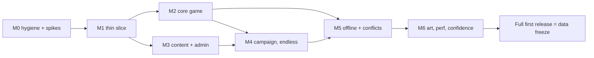

# B. Confirmed scope and design decisions

This section answers four questions:

1. What exactly are we building (the confirmed requirements, in one place)?
2. What are we deliberately *not* building?
3. What is the difference between the **full first release** and the **first playable milestone**?
4. Which choices did the planner make on your behalf, and which ones have you settled yourself?

It does not re-open the discovery questionnaire. The approved specification (`prompt.md:81` onwards) is the authority for product
behaviour. The canonical names, states, keys, routes and rules are in the [design spine](00-spine.md) (v0.3), which this section cites
as "spine Sn". Everything else in this plan is a labelled proposal that you can change.

**Labels used here** (same as every plan section):
**[CONFIRMED]** fixed by the spec · **[CONFIRMED by owner]** decided by you in chat (date given) · **[PROPOSAL]** planner
recommendation, yours to change · **[ASSUMPTION]** routine detail, cheap to change · **[VERIFIED]** checked directly (source given) ·
**[UNVERIFIED]** not checked (how to check is given).

**Way of working** **[CONFIRMED by owner, 2026-11-14]** ([spine S0.1](00-spine.md#s01-way-of-working-confirmed-by-owner-2026-11-14)):
Claude builds the app in sequential build phases and you review the code at each phase gate; work happens on `main` and either of
us commits and pushes; deployment happens **only** through GitHub Actions pipelines (local `fmt`/`validate`/`plan` and read-only AWS
calls are fine; the bootstrap root, which creates the CI's own trust, is the one thing you still apply locally).

**Ownership.** This section summarises and links. The detail lives elsewhere:
game balance numbers, roster, waves and content bank → [C. Game and learning design](C-game-and-learning-design.md);
screens and admin workflow → [D. UX and content operations](D-ux-and-content-operations.md);
architecture and trust → [E. Architecture](E-architecture.md); state machines and DynamoDB → [F. State and data](F-state-and-data.md);
routes and errors → [G. API contracts](G-api-contracts.md); Terraform and release → [H. Infrastructure and delivery](H-infrastructure-and-delivery.md);
tests → [I. Validation](I-validation.md); task order → [J. Execution backlog](J-execution-backlog.md);
what already exists in the repository → [A. Repository findings](A-repository-findings.md).

---

## B1. The product in one page (confirmed requirements)

A colourful, browser-based, single-player educational tower defence game for children aged 5, 6 and 7. Stationary astronauts defend a
research colony from cartoon aliens on a fixed route. Between waves the child does one untimed maths, phonics or spelling activity
to earn extra credits; before each boss there is an optional "meteor" activity that earns a temporary power. Combat, interface and
reward opportunities are identical at every age; only the questions differ. **[CONFIRMED]** `prompt.md:97-99`

### B1.1 Product and audience

| Area | Confirmed requirement | Source |
|---|---|---|
| Audience | Children initially aged 5, 6 and 7; laptop browsers; keyboard **and** mouse | `prompt.md:97`, `prompt.md:113`, AC-41 |
| Reach | Public, self sign-up, free, initially for the owner's family; architecture can accommodate more users | `prompt.md:101` |
| Hostnames | Player `aliens.jackgl.com`; admin `admin.aliens.jackgl.com`; no new custom API hostname required | `prompt.md:103-109` |
| Same game for all ages | Same combat, interface, wave schedule, starting funds and reward opportunities at every age | `prompt.md:99`, AC-13 |
| Visits | A run continues over several visits; it is not one sitting | `prompt.md:99` |
| Curriculum | England's national curriculum as the authoring reference; age is a curated proxy, not attainment | `prompt.md:475` |

### B1.2 Accounts and administration

| Area | Confirmed requirement | Source |
|---|---|---|
| Identity | Individual child accounts, unique username + password via Cognito; no parent accounts | `prompt.md:203`, AC-01 |
| Profile | Cognito `sub` as owner; nickname; avatar; private DOB; derived age; permanent progress | `prompt.md:205-217` |
| Confirmation | No account may be stuck unconfirmed; no email required; no admin API rights to users | `prompt.md:223` |
| Password recovery | Administrator-managed (operational Cognito task) | `prompt.md:225`, AC-02 |
| DOB privacy | Never in public screens, speech requests, audio keys or general logs | `prompt.md:219` |
| Age pinning | Age band and content versions pinned at run creation; a birthday affects new runs only | `prompt.md:221`, AC-06 |
| Shared laptop | Sign-out/sign-in switches children; no leakage of another child's local data; warn before discarding pending progress | `prompt.md:227`, AC-05 |
| Admin role | Separate admin role/group assigned by trusted administration; enforced at the backend, not by hostname | `prompt.md:229`, AC-04 |
| Resets | Separate resets: current run, campaign progress, learning history; whole-profile reset distinct again | `prompt.md:231` |
| Admin scope | Content administration only: list/filter, drafts, preview activity and audio, publish, retire; no CMS, no user console | `prompt.md:259-269`, `prompt.md:554` |

### B1.3 Game

| Area | Confirmed requirement | Source |
|---|---|---|
| World | One playable planet, one clearly marked route, angled 2D, predefined pads beside the route | `prompt.md:115`, `prompt.md:279-281` |
| Roster | Six stationary astronaut classes (laser scout, frost, area, shield, long range, support), three levels each | `prompt.md:117`, `prompt.md:305-359` |
| Astronaut safety | Astronauts and pads are never damaged, disabled or blocked | `prompt.md:297`, AC-07 |
| Controls | Click astronaut then pad (drag optional); deploy, upgrade, sell, targeting, temporary powers, pause, speed | `prompt.md:271`, `prompt.md:283-295` |
| Pause rule | Hidden page or interruption pauses combat; it stays paused until the player resumes | `prompt.md:273` |
| Determinism | Frame rate must not change damage, movement or rewards | `prompt.md:303`, AC-13 |
| Performance | Representative busiest waves meet a documented, measured performance target (the target is set after the first prototype measurement in M2) | AC-42, `prompt.md:1286` |
| Campaign | 50 authored waves; bosses on 10, 20, 30, 40, 50; predictable between attempts | `prompt.md:119`, `prompt.md:409`, AC-11 |
| Enemies | Nine-entry alien catalogue incl. carrier and splitter; descendants resolve before wave end; no duplicate spawns/rewards | `prompt.md:363-405`, AC-10 |
| Meteors | Optional extra activity before each boss (after waves 9, 19, 29, 39, 49); success gives a temporary power; declining never makes the boss unwinnable | `prompt.md:439-441` |
| Completion | Badge committed before the endless offer; later endless defeat keeps it | `prompt.md:435`, AC-12 |
| Endless | Optional, bounded continuation after wave 50 | `prompt.md:121`, `prompt.md:405` |
| Challenges | Short standalone challenges on the same systems; never a sandbox | `prompt.md:123`, `prompt.md:443` |
| Economy | Fixed starting allowance per run; credits from aliens and learning; no wallet, no purchases | `prompt.md:447` |
| Defeat | Terminal; resets run resources; keeps best completed wave, eligibility, badges and summaries | `prompt.md:455-469`, `prompt.md:675`, AC-14, AC-27 |
| Next planet | Clearing wave 20 records eligibility for the next planet when one is released | `prompt.md:419`, `prompt.md:437` |

Numbers (prices, health, wave tables, rewards) are **not** confirmed; they are initial playtest settings owned by
[C. Game and learning design](C-game-and-learning-design.md).

### B1.4 Learning

| Area | Confirmed requirement | Source |
|---|---|---|
| Subjects | Maths, phonics, spelling, rotated automatically | `prompt.md:125`, `prompt.md:477-483` |
| Interaction types | Picture selection, number selection, moving/counting/sorting, arranging, multiple choice, typed numeric/word | `prompt.md:485-497` |
| Rules | Untimed; up to three attempts; first correct = reward once; three incorrect = no reward; no penalty | `prompt.md:503-517`, AC-15, AC-16 |
| What never costs an attempt | Waiting, audio play/replay, pauses, thinking time | `prompt.md:503`, AC-22 |
| Interval shape | One normal activity per interval; none before wave 1; one before wave 51 if endless is chosen | `prompt.md:505-519` |
| Stability | Stable activity ID per run; refresh keeps the question and its attempt count | `prompt.md:523`, AC-17 |
| No adaptivity | No performance-based difficulty, overrides or remedial routing | `prompt.md:165`, `prompt.md:501` |
| Teaching | A short concept demonstration is allowed; it is not a failure-triggered hint sequence | `prompt.md:275` |
| Summaries | Simple counts: completed, succeeded, failed, by subject/topic | `prompt.md:527` |
| Content lifecycle | Human-reviewed; immutable published versions; retire from future runs; deliberate invalid-content recovery | `prompt.md:525`, `prompt.md:552-556`, AC-23 |

### B1.5 Speech, saves, offline and concurrency

| Area | Confirmed requirement | Source |
|---|---|---|
| Phonics Play | Visible Play → authenticated API → dedicated Python TTS Lambda → audio to the browser; Polly proposed (you have since confirmed Polly, generative engine, voice Amy: S-01); never browser speech synthesis | `prompt.md:560-563`, AC-19 |
| Speech safety | Player endpoint takes identifiers of approved content only; admin preview separately authorised and validated | `prompt.md:589`, AC-20 |
| Phonics quality | Listening check before publication; a sound that cannot be rendered stays unpublished | `prompt.md:593-611`, AC-21 |
| Checkpoints | Wave-start snapshot on Ready; attempts persisted as they happen; mid-wave save-and-exit restarts the wave with partial gains rolled back | `prompt.md:657-673`, AC-24..26 |
| Terminal states | Defeat, campaign completion, endless, suspend and abandon are distinct | `prompt.md:677-681` |
| Idempotency | Stable identities for attempts, rewards, milestones and finalisation; no reliance on TTL timing | `prompt.md:683-693`, AC-18 |
| Offline | Finite prepared campaign continues offline in an already-loaded app; cached audio **bytes**; honest "saved on this device" status; no offline cold start | `prompt.md:697-723`, AC-30..34 |
| Concurrency | Several saved runs; one accepted active writer per account (lease + fencing token + revision); stale branches kept for recovery, never silently merged | `prompt.md:725-741`, AC-28, AC-29 |

### B1.6 Platform and operations

| Area | Confirmed requirement | Source |
|---|---|---|
| Stack | React + TypeScript, Phaser, Python Lambda, DynamoDB, Cognito, Terraform, GitHub Actions | `prompt.md:781-799` |
| Account | Production only, existing London workload account, existing bootstrap/state/OIDC; keep support for more environments | `prompt.md:25`, `prompt.md:976` |
| DNS | Stays in the owner's DNS account; the owner integrates it; plan lists integration points only (an HTTPS app already serves the apex `jackgl.com` from another account; no clash, see BL-2) | `prompt.md:27`, `prompt.md:822` |
| Release | One manually triggered, coordinated production release; one owner per deployed artefact | `prompt.md:980-1000` |
| Data protection | Routine releases never recreate tables, pools or stores; seeding never overwrites operator content | `prompt.md:1002` |
| Rollback | Restores compatible application versions; never reverts player data automatically | `prompt.md:1004`, AC-38 |
| Operations | Logs without private data; error alerts to a configurable destination; daily backup of each table, seven recovery points, verified restore | `prompt.md:1010-1026`, AC-39, AC-40 |
| Art | Placeholders first, replaced through a stable asset manifest; no music, no character voices | `prompt.md:1066`, `prompt.md:169` |

---

## B2. Delivery boundary: what we are not building

### B2.1 Explicit exclusions **[CONFIRMED]** (`prompt.md:153-173`)

| Exclusion | What it means in this plan |
|---|---|
| Multiplayer, public rankings, chat, social sharing, sibling comparison | No leaderboard, no shared data between accounts; the progress screen shows only the child's own counts |
| Advertising, paid credits, payments, monetisation | No payment or store code paths; credits exist only inside a run |
| A sandbox mode | Challenges are ordinary runs over a short, pinned wave set — same engine, same rules ([F](F-state-and-data.md)) |
| A gameplay tutorial | No forced walkthrough; cards, labels and previews explain controls. Concept demonstrations attach to *learning* activities only |
| Parent accounts, dashboards, assignments, difficulty overrides | Age band comes from DOB only; there is no setting to change it |
| Performance-adaptive difficulty, remedial paths | Selection uses age band, seed and bank only; results are never read to choose content |
| Penalties for wrong answers | An activity can only add a reward or add nothing |
| Music and character voice acting | Small combat sound set and phonics clips only; character-card lines are unvoiced text |
| Browser speech synthesis as a replacement | A missing clip blocks the activity with Retry; there is no fallback voice |
| Live, unreviewed AI-generated questions | Children see only published, reviewed versions; templates are deterministic code over bounded domains |

### B2.2 Later scope — not in the first release **[CONFIRMED]** (`prompt.md:141-151`)

| Later item | How the first release leaves room for it |
|---|---|
| Additional planets and environments | Planet documents are versioned data; eligibility (`bestCompletedWave ≥ 20`) is recorded now; unavailable planets are never shown as playable |
| Tablet-specific optimisation | Not tested or claimed; laptop browser matrix only |
| Parent/teacher accounts, classroom or commercial features | None |
| Installable PWA or native app | No service worker; no offline cold start |
| Expanded content-authoring automation | Import and AI-assisted drafting stay outside the product; everything still passes human review and the normal publish path |

### B2.3 Other boundaries the spec draws **[CONFIRMED]**

| Boundary | Source |
|---|---|
| No VPC/NAT, containers, Kubernetes, Redis, WebSockets, GraphQL, queues or orchestration engines without a concrete need | `prompt.md:826` |
| No server-authoritative combat simulation or elaborate anti-cheat; the backend validates ordering, attempts and bounds only | `prompt.md:759` |
| No forwarding Lambda that only calls another Lambda | `prompt.md:585` |
| No replacement bootstrap; production only for now | `prompt.md:976` |
| No DNS redesign; no new API hostname | `prompt.md:109`, `prompt.md:822` |
| Flying aliens use the same route; no new routes, base-attacking projectiles or pad-disabling powers | `prompt.md:301`, `prompt.md:403` |
| Endless is bounded: no unlimited rendered objects, no infinite offline content, no silent repeats | `prompt.md:405`, `prompt.md:721` |
| No parent reporting, no general user-management console | `prompt.md:554` |

---

## B3. Full first release versus the first playable milestone

### B3.1 Two different things

- **Full first release** — everything in the spec's "Full initial product scope" (`prompt.md:111-139`) meeting AC-01..AC-43.
  This is the agreed product. Nothing in this plan redefines it. **[CONFIRMED]**
- **Milestone 1 (M1), the first playable slice** — a deployed, end-to-end game that is small in content (one astronaut, one alien,
  two waves, one activity, one clip) but touches every layer. It proves the riskiest joins work
  (auth → profile → run → combat → activity with speech → cloud save → resume). It is labelled a milestone and is **not** the product.
  **[CONFIRMED]** that it may be a subset (`prompt.md:175`, `prompt.md:1270-1271`); its exact contents are **[PROPOSAL]**
  ([J, M1](J-execution-backlog.md#m1--thin-vertical-slice-one-planet-two-waves-one-activity-with-play-cloud-save)).

The point of M1 is learning, for you as much as for the system: Claude builds it and you review every layer (Terraform, Cognito, a
Lambda, DynamoDB transactions, React, Phaser, the release workflow) once, at small size, at the phase gates, before any of them gets
big ([spine S0.1](00-spine.md#s01-way-of-working-confirmed-by-owner-2026-11-14)). How the phases are cut and how to review one is
in [J. Execution backlog](J-execution-backlog.md) and `docs/build-phases.md` (to create).

Small in content does not mean quick. J counts about 24 M1 tasks
([J §J.3.1](J-execution-backlog.md#j31-size-of-each-milestone-count-of-tasks-by-effort-assumption)), so M1 spans several build
phases and review gates. The battlefield task (M1-21) needs only the clock and the shared rules, not the deployed stack, so you can
play a two-wave run locally in the browser, on fixture data, well before the first release. That is a good moment to show the
children; M1 ends with child playtest P1 ([I. Validation](I-validation.md)). **[PROPOSAL]**

### B3.2 Side by side

| Dimension | Milestone 1 (first playable) **[PROPOSAL]** | Full first release (scope **[CONFIRMED]**; mechanisms and estimates are the B5 proposals) |
|---|---|---|
| Accounts | One child account, real Cognito sign-up/sign-in, profile setup (nickname, avatar, DOB) | Self sign-up with daily cap, operator pool, admin-managed recovery, account switching on a shared laptop |
| Planet and route | One placeholder map, one route, a few pads | One fully authored planet, art-complete |
| Astronauts | One class (the first-available laser scout), level 1 only (upgrades optional) | Six classes × three levels, selling, refunds, targeting, support rules |
| Aliens | One basic alien | Full catalogue incl. carrier, splitter, healer, shield; five bosses |
| Waves | One short wave set with exactly **one activity interval** and no `meteorAfter` entry (so two waves) — the same `waveSets` structure, just short. With one activity and the no-repeat rule ([C §C24](C-game-and-learning-design.md#c24-selection-when-a-run-is-created)) a longer set could not fill its slots | 50-wave campaign, short challenges, endless continuation |
| Meteors and powers | None | Five meteor slots per campaign; temporary powers (the spec's three suggestions, `prompt.md:441`; defined in [C](C-game-and-learning-design.md)) |
| Learning content | **Exactly one** phonics multiple-choice activity with Play, and one approved clip | About 240 authored records (estimate, L-16), six interaction types, all three age bands eligible |
| Content admin | Minimal admin app on `admin.aliens.jackgl.com` (operator sign-in; Speech page with Preview / Play / Approve; Activity page with Validate / Publish for seeded drafts), the first slice of the M3 admin app (J-3 in [J, M1](J-execution-backlog.md#m1--thin-vertical-slice-one-planet-two-waves-one-activity-with-play-cloud-save)). The one activity is seeded through the create-only seed path ([D §D8.6](D-ux-and-content-operations.md#d86-seeding-and-import)); its clip goes through the real preview → approve path | Admin app: drafts, validation, preview, publish, retire, withdraw, bank status |
| Bank eligibility | Thresholds set to 1 as **milestone configuration**, labelled as such — not the product rule | Every slot fillable and each group ≥ 2× per-run need (server configuration) |
| TTS | Real `POST /api/speech` → `tts` Lambda → signed URL → browser plays; Polly generative, en-GB, voice Amy **[CONFIRMED by owner]**; the M0 listening bake-off (rendered with the AWS CLI) decides `tts_phoneme_engine`; the M1 clip is re-rendered through the real preview route | Same, plus admin preview, about 200 reviewed clips (estimate, L-16), offline audio cache |
| Saving | Online ops through the real `/api/runs/{runId}/ops` endpoint with revision and session fence; cloud save; resume after refresh | Plus offline queue, readiness, divergence/recovery UX, takeover confirmation |
| Run lifecycle | Create, BUILD → IN_WAVE → ACTIVITY → BUILD → IN_WAVE, complete the short set, defeat. The M1 wave set is `mode = CHALLENGE` (J-1), so completing wave 2 sets `status = COMPLETED` directly; no `COMPLETION_OFFER` or `FINISH_RUN` ([F §3.7](F-state-and-data.md#37-the-milestone-1-wave-set-data-view)) | All phases incl. METEOR, COMPLETION_OFFER, ENDLESS, abandon, finish, resets |
| Progress | None. Challenges never change best wave; the first `PROFILE` write on `COMPLETE_WAVE` arrives in M2 (M2-06) | Badges, planet eligibility, learning summaries, progress screen |
| Offline | Not supported (online only) | Prepared finite campaign continues offline (AC-30..34) |
| Art and audio | Labelled placeholders | Generated art through the asset manifest; small combat sound set |
| Infrastructure | The whole prod stack through the real release workflow ([H §H.8](H-infrastructure-and-delivery.md#h8-the-manual-release-spine-s111)): both distributions (both alias records in M1, J-3), API, all four Lambdas (`lambda_artifacts` requires all four keys; `admin-api` also serves the M1 clip approval), both tables, audio bucket (the artefacts bucket lives in the bootstrap root, B5.3 D-T7); protection flags on; plan guard in report mode | Admin app live, alarms confirmed, AWS Backup with a recorded restore drill, plan guard enforcing, data freeze |
| Done when | A clip plays through the real speech service; three attempts and one reward work; a refresh keeps the attempts; leaving and returning resumes from the cloud save ([C §C26.3](C-game-and-learning-design.md#c263-authoring-sequence-and-sources) phase B); playtest P1 recorded | AC-01..AC-43 demonstrated ([I. Validation](I-validation.md)) |

What M1 must **not** do: invent a shortcut that the full release would have to undo. In particular it uses the real op envelope, the
real slot/attempt model and the real speech path, just with less content. **[PROPOSAL]**

### B3.3 Milestone path

Reading the diagram: M0 removes the unknowns (OIDC, managed-login sign-up, how Polly renders isolated phonemes, toolchain). M1 joins
every layer once. M2 (game systems) and M3 (content and admin) are independent because they meet only through the activity slot.
M4 needs both; M5 hardens persistence, so it needs M2's full op set as well as M4; M6 finishes art and proves performance, rollback and restore. The milestone order is a
**[PROPOSAL]** ([spine S12](00-spine.md#s12-milestones-proposal-the-spec-heads-them-suggested)); the spec labels its own list
"SUGGESTED" (`prompt.md:1263-1265`). Because Claude builds in sequential build phases with your review at each gate
**[CONFIRMED by owner, 2026-11-14]**, "parallel" here means "either order", not two people working at once. Task-level ordering is in
[J. Execution backlog](J-execution-backlog.md).

### B3.4 The data-freeze point **[PROPOSAL]** (spine S11.4)

A **data-freeze point** is the first release whose saves the children are allowed to keep
([spine S11.4](00-spine.md#s114-data-freeze-point)). It exists because, while the app is still being reshaped phase by phase, we will
want to wipe tables, recreate pools and edit game-data files freely — and after children have real progress nobody may do any of that
casually.

| | Before the freeze | From the freeze onwards |
|---|---|---|
| Tables, user pools, buckets | `prevent_destroy` and native deletion protection are on from the first apply; a replacement or wipe is still possible, but only deliberately (a commit lifts the protection, a release applies it, a later release replaces). Plan guard reports only | Plan guard enforcing (`enforce: true` in `infrastructure/plan-guard.json`, to create): the plan job fails on any delete/replace of a protected type (incl. Cognito app clients); no workflow input bypasses it |
| CI role | `AdministratorAccess` while the module set is changing | Scoped inline policy and narrowed trust (H-13, H-05) |
| Game-data files (rulesets, campaigns, asset manifests, bounds) and `contracts/golden/` | May be edited in place | Only new files added; CI lock check (diff vs the last `release-*` tag shows additions only) |
| Compatibility | Not enforced | Golden scenarios per `mechanics` number run in CI; "supported" is additive forever |
| Release artefacts | Kept as convenient | Archive kept (manifests, zips, static builds) for rollback |
| Backup | Configured | A restore test has been run and recorded |

My recommendation: name the freeze at the full first release, and **no earlier than the end of M5**, because the IndexedDB schema,
op payloads and `protocolVersion` are still moving until offline sync is finished. If the children start playing seriously earlier,
tell them their saves are test saves. The operational detail, including the freeze checklist, is in
[H §H.11.3](H-infrastructure-and-delivery.md#h113-data-freeze-point-spine-s114).

---

## B4. Where this plan narrows or reinterprets the spec

These are the places where the plan does something more specific than, or slightly different from, a literal reading of the spec.
Each is deliberate and each is yours to overturn.

| # | Spec text | What the plan does | Why | Label / decision |
|---|---|---|---|---|
| N-1 | "On a cache miss, Lambda calls Polly … and stores the MP3" (`prompt.md:577`, also Example B `prompt.md:1132`) | Player `POST /api/speech` **never** calls Polly; a missing clip returns `SPEECH_UNAVAILABLE` and alarms. Polly is called only by the operator's preview, and approval binds the exact previewed bytes | Children hear byte-for-byte what the operator listened to; a child can never trigger synthesis; still satisfies "Play always reaches the service" (`prompt.md:587`) | **[PROPOSAL]** D-12 |
| N-2 | Suggested state names PREPARING … ABANDONED (`prompt.md:680`) | `status` + `stage` + `phase` fields ([F §3.1](F-state-and-data.md#31-persisted-run-fields)) with a mapping table | Fewer combined states; spec allows a simpler representation (`prompt.md:681`) | **[PROPOSAL]** |
| N-3 | Error category "activity resolved or attempts exhausted" (`prompt.md:946`) | Covered by `PHASE_MISMATCH` (no answerable slot) rather than a separate code; no server identical-answer rule | The client never creates an op the shared reducer refuses, so a server rejection is always a divergence handled one way | **[PROPOSAL]** ([G](G-api-contracts.md)) |
| N-4 | "Use expiry for temporary coordination records where useful" (`prompt.md:882`) | No TTL in the `game` table except tidying the sign-up counter; the session lease is checked by condition, never by TTL | Correctness must never depend on TTL timing (`prompt.md:693`) | **[PROPOSAL]** |
| N-5 | Copied workflows `deploy.yml` and `tf-apply-destroy-env.yml` | Replaced by `release.yml`, `apply.yml` (applies a reviewed saved plan) and `plan.yml` (plan-only drift check), all to create; `oidc-smoke.yml` kept as a manual workflow; **no destroy workflow** for the real stack | The copies pointed at another product (role, Terraform version and state-bucket formula). Status at commit `dee3f51` **[VERIFIED]**: `deploy.yml` has been removed; `tf-apply-destroy-env.yml` was adapted to this repo for the Phase 0 pipeline test and still offers a `destroy` action, guarded by a typed `CONFIRM` in prod ([tf-apply-destroy-env.yml:56](../../.github/workflows/tf-apply-destroy-env.yml#L56)), which conflicts with `prompt.md:1002` once real data exists | **[PROPOSAL]** ([A](A-repository-findings.md), [H](H-infrastructure-and-delivery.md)) |
| N-6 | Reference pipeline recomputes resource names in shell | Workflows read names and IDs from `terraform output -json`. One exception: the backend bucket is needed before `init`, so it is computed with the same formula as [locals.tf:2](../../infrastructure/bootstrap/locals.tf#L2) and checked with `head-bucket` first ([A §6](A-repository-findings.md#6-state-bucket-naming-mismatch), [H §H.8.4](H-infrastructure-and-delivery.md#h84-backend-initialisation-every-job-that-runs-terraform)) | One source of truth; the copied formula is already wrong for this repo | **[PROPOSAL]** |
| N-7 | Milestone 1 "one astronaut … one activity, one TTS clip" (`prompt.md:1271`) | Bank eligibility thresholds set to 1 for M1, labelled as milestone configuration | Otherwise no run could be created with one activity | **[PROPOSAL]** |
| N-8 | Cognito public clients "should use authorisation-code/PKCE" (`prompt.md:777`) | Managed login + PKCE. **Contingent:** if the M0 spike shows managed login cannot do username-only auto-confirmed sign-up, the fallback (in-app SRP form via the SDK) is a deviation you must approve | Managed-login sign-up for this pool shape is **[UNVERIFIED]** | **[PROPOSAL]**, contingent owner approval |
| N-9 | The speech request identifies "the run, activity, published content version and audio variant" (`prompt.md:569`) | `POST /api/speech` sends `{runId, slotId, variant}` only; `tts` reads the slot under the caller's `sub` and takes the pinned activity version from it | The client cannot name a version it was not given; ownership and approval are checked in one read; any mismatch is `NOT_FOUND` | **[PROPOSAL]** ([G](G-api-contracts.md)) |
| N-10 | "Select the exact en-GB voice through a listening check" and the cited neural voices (`prompt.md:563`) | Polly **generative** engine, en-GB, default voice **Amy**, set by Terraform variables. Isolated phonemes and letter names use `tts_phoneme_engine` (default `neural`); the M0 listening bake-off decides whether that can become `generative` and which sounds are published. Human recordings are the fallback for a sound that fails | You chose the newest engine; AWS documentation is contradictory on `<phoneme>` support in the generative engine, so the listening check still governs isolated sounds ([sources/06-polly-tts.md](sources/06-polly-tts.md), [sources/11-voice-engine.md](sources/11-voice-engine.md)) | **[CONFIRMED by owner, 2026-11-14]** (S-01) |
| N-11 | Proposed online flow: request → response → download → play (`prompt.md:565-579`); "Normal online Play requests reach the service even when generated audio already exists" (`prompt.md:587`) | If the slot's pinned clip is stored locally, playback starts **immediately** from local bytes and `POST /api/speech` is sent concurrently; otherwise the browser waits for the response, downloads, verifies, stores and plays | No wait for a sound the device already holds; every online Play still reaches the service (AC-19) | **[CONFIRMED by owner, 2026-11-14]** (S-04) |

---

## B5. Assumptions and engineering decisions

Everything below is a planner choice. **[PROPOSAL]** rows are design recommendations you might reasonably want to change;
**[ASSUMPTION]** rows are routine details that are cheap to change later. Where a row rests on a spec rule, the rule is cited.
Game-balance numbers are deliberately absent: they are initial playtest settings in [C](C-game-and-learning-design.md).

A few patterns recur in the "why" column. In one or two sentences each:

| Term | Plain meaning |
|---|---|
| **Pure reducer** | A function `(state, op) → new state` with no side effects. Running the same ops in the same order always gives the same state, so the browser and the server can each run "the rules" and agree. |
| **Idempotency** | Doing the same request twice has the same effect as doing it once. We get it by giving every operation a stable ID and remembering recent IDs. |
| **Lease + fencing token** | A lease says "this device may write for the next N seconds". The fencing token (`generation`) increases every time a new device takes over, and every write checks it, so an old device's late writes are refused even if its clock is wrong. |
| **Revision** | A counter on each run that increases with every accepted op. A write says "I expect revision 41"; if the run is now at 42, someone else got there first. |
| **Optimistic op queue** | The browser applies an op locally at once, stores it, and sends it later. The server's answer then confirms or contradicts it. |
| **Fixed timestep** | The simulation advances in equal ticks (1/60 s) however fast the screen draws, so a slow laptop and a fast one produce identical battles. |
| **Content-addressed key** | A file is named by a hash of what produced it, so the same input always maps to the same object and nothing is ever overwritten. |
| **Op** | One recorded player action (for example `START_WAVE` or `SUBMIT_ATTEMPT`) sent to `POST /api/runs/{runId}/ops`. |
| **Op envelope** | The batch wrapper around ops: `{protocolVersion, sessionId, generation, ops[]}` ([G §5.1](G-api-contracts.md#51-request-envelope)). |
| **Slot** | One pinned activity position in a run: `N-<interval>` for a normal activity, `M-<interval>` for a meteor, e.g. `N-001` after wave 1. |
| **Snapshot** | The single saved state of a run: the build state between waves, or the wave-start state during a wave (R-02). |
| **Canonicaliser** | Turns any typed or selected answer into one exact string, so the browser and the server compare equal ([C §C20.1](C-game-and-learning-design.md#c201-canonical-answers-one-normaliser-exact-equality)). |
| **Spike** | A short, throwaway experiment to answer one question; its output is a written decision, not code you keep. |
| **ADR** | Architecture decision record: a short dated note of one decision and why ([J §J.6](J-execution-backlog.md#j6-decision-log-practice)). |

Row IDs in the tables below (`E-01`, `I-01`, `D-T1`, `R-01`, `L-01`, `S-01`, `F-01`, `H-01`) group rows by topic inside B5 only. They
are not references to plan sections E, I, F or H. Other IDs: owner decisions `D-1`…`D-13` and `O-1`…`O-4` are in B6, spec
narrowings `N-1`…`N-11` in B4, blockers `BL-1`/`BL-2` in B7. The cross-plan ID legend is in
[J §J.1.1](J-execution-backlog.md#j11-task-fields). Unless a row says otherwise, the canonical form of every name below is in the
[spine](00-spine.md).

### B5.1 Hosting, API and compute

Canonical form: [spine S1](00-spine.md#s1-system-shape).

| # | Decision | Choice | Why | Main alternative | Label | Detail |
|---|---|---|---|---|---|---|
| E-01 | Static hosting | Two SPAs (player, admin), each a private S3 bucket + CloudFront + OAC; one us-east-1 ACM certificate with the two exact hostnames | Admin code never ships in the player bundle; OAC + regular bucket origin is what the spec names (`prompt.md:819`) | One distribution with an `/admin` path | **[PROPOSAL]** | [E](E-architecture.md), [H](H-infrastructure-and-delivery.md) |
| E-02 | How the browser reaches the API | Same origin: a `/api/*` behaviour on each distribution to the HTTP API (caching disabled, `Authorization` forwarded) | No CORS, no API certificate or hostname; follows the reference project's `/api/*` behaviour (`CachingDisabled` + `AllViewerExceptHostHeader`, **[VERIFIED]** at [jacks-productivity-tool cloudfront/main.tf:195](../../../jacks-productivity-tool/infrastructure/modules/cloudfront/main.tf#L195)). There the origin is a Lambda Function URL and a CloudFront Function strips `/api`; here the origin is the HTTP API and route keys keep `/api` | `execute-api` URL with CORS, or a custom API hostname | **[PROPOSAL]** | [E](E-architecture.md) |
| E-03 | SPA deep links | CloudFront Function on the default behaviour only | Distribution-wide custom error responses would turn API 403/5xx into `index.html` | Custom error responses (reference pattern, 403 → `/index.html` at [cloudfront/main.tf:244](../../../jacks-productivity-tool/infrastructure/modules/cloudfront/main.tf#L244)) | **[PROPOSAL]** | [H](H-infrastructure-and-delivery.md) |
| E-04 | API type | One HTTP API, payload 2.0, `$default` stage, access logs, route throttles | Native JWT authorisers with scopes (`prompt.md:777`); cheaper and simpler than REST API | REST API with Cognito authoriser | **[PROPOSAL]** | [E](E-architecture.md), [G](G-api-contracts.md) |
| E-05 | Authorisers | Two JWT authorisers (player, operator); every route requires a scope (`game/play` for players, `ops/content` for the operator; names as in [E §E.6.3](E-architecture.md#e63-route--function--authoriser), Terraform variables `player_route_scope`/`operator_route_scope`); handlers also check `token_use = access` | Separate issuers make an admin route unreachable with a player token even before Lambda runs | One authoriser + group check in Lambda only | **[PROPOSAL]** | [E](E-architecture.md) |
| E-06 | Lambda boundaries | Four functions: `player-api`, `admin-api`, `tts`, `cognito-presignup`; one IAM role each; no Lambda calls another; timeouts under the 30 s HTTP API integration limit (`player-api` 25 s) | "A small number of cohesive boundaries" (`prompt.md:809`); `tts` is the dedicated speech Lambda the spec requires | One function per route | **[PROPOSAL]** | [E](E-architecture.md) |
| E-07 | Lambda packaging | Python 3.14, arm64, **zip** artefacts; source in a top-level `api/` folder (to create): one folder per function plus a `shared/` package, built into four reproducible zips | No Docker or ECR needed; small dependencies (Powertools); tests and packaging live with the code | Container images as in the reference project | **[PROPOSAL]** | [H](H-infrastructure-and-delivery.md) |
| E-08 | Least privilege | `tts` never writes DynamoDB and has no `content` access (it resolves speech from the slot's pinned clips map), with S3 read/write on `tts/v1/*` plus `s3:ListBucket` conditioned on that prefix (so `HeadObject` on a missing key returns 404, not 403); `admin-api` never touches `game`; `cognito-presignup` may update only `SYS#SIGNUPS` | Smallest blast radius per function (`prompt.md:771`) | Shared role | **[PROPOSAL]** | [E](E-architecture.md) |
| E-09 | Resource naming | Reference conventions: `space-tower-defence-prod-<thing>`, Lambdas `…-prod-eu-west-2-<key>`, buckets `<account>-<region>-<env>-<purpose>-bucket` | Reuse the owner's established conventions | Any other scheme | **[ASSUMPTION]** | [H](H-infrastructure-and-delivery.md) |
| E-10 | Excluded infrastructure | No VPC, containers, queues, streams, schedulers, WebSockets, GraphQL, Redis | No requirement justifies them (`prompt.md:826`) | — | **[CONFIRMED]** | [E](E-architecture.md) |

### B5.2 Identity and privacy

| # | Decision | Choice | Why | Main alternative | Label | Detail |
|---|---|---|---|---|---|---|
| I-01 | Pool layout | Two user pools: players and operators | Different sign-up, MFA and recovery policies; a player can never hold an operator token | One pool + `admin` group | **[PROPOSAL]** (D-10) | [E](E-architecture.md) |
| I-02 | Sign-in flow | Managed login (Essentials tier), authorisation code + PKCE, `prompt=login`, sign-out via `/logout` | Required flow (`prompt.md:777`); `prompt=login` stops one child inheriting another's hosted session | In-app SRP form (needs your approval, see N-8) | **[CONFIRMED]** flow / **[PROPOSAL]** details | [E](E-architecture.md) |
| I-03 | Auto-confirmation | Pre sign-up trigger auto-confirms within a global daily cap; fails closed when the cap is hit | No email, never stuck UNCONFIRMED (`prompt.md:223`); cap limits abuse of a public sign-up | Admin-created accounts only | **[PROPOSAL]** | [E](E-architecture.md) |
| I-04 | Sign-up cap and kill switch | `signup_daily_cap` default 20; kill switch is the Terraform variable `player_signup_closed` (switches the player pool to admin-create-only) through a normal release | Small family scale; never use ad-hoc `update-user-pool` (it resets unspecified settings) | Higher cap; WAF | **[ASSUMPTION]** (number) | [H](H-infrastructure-and-delivery.md) |
| I-05 | Username rules | Case-insensitive usernames; no email/phone attributes; recovery `admin_only`; deletion protection on | Children mistype case; recovery is admin-managed (`prompt.md:225`) | Case-sensitive | **[PROPOSAL]** | [E](E-architecture.md) |
| I-06 | Operator pool | No self sign-up (AdminCreateUser only); TOTP MFA required; exact `admin` group match | Admin privilege only by trusted administration (`prompt.md:229`) | Optional MFA | **[PROPOSAL]** | [E](E-architecture.md) |
| I-07 | Password recovery | Operator runs `AdminSetUserPassword` (permanent) from a runbook | Works with no email (`prompt.md:225`, AC-02) | Admin UI for resets (out of scope) | **[PROPOSAL]** | [H](H-infrastructure-and-delivery.md) |
| I-08 | Where profile data lives | Never in Cognito attributes; identity = access-token `sub`; profile in DynamoDB | Attributes leak into ID tokens | Custom Cognito attributes | **[PROPOSAL]** | [F](F-state-and-data.md) |
| I-09 | DOB handling | Write-only: accepted only by `PUT/PATCH /api/me/profile`, read only to derive age (Europe/London); never returned, logged or cached locally | DOB privacy (`prompt.md:219`); correcting it means re-typing | Return DOB to the owner | **[PROPOSAL]** | [E](E-architecture.md), [G](G-api-contracts.md) |
| I-10 | Logging | Allow-list fields only (request ID, route, `sub`, run/slot/op IDs, result code, revision, duration) | Prevents leaking DOB, answers, nicknames, signed URLs (`prompt.md:1012`) | Deny-list redaction | **[PROPOSAL]** | [E](E-architecture.md) |
| I-11 | Accepted tampering | A modified client can inflate its own run within per-wave bounds; it cannot touch another account, skip phases, double-claim rewards or record a fourth attempt | Family-level trust model (`prompt.md:745-759`); no leaderboard exists | Server combat simulation (excluded) | **[CONFIRMED]** model / **[PROPOSAL]** bounds | [E](E-architecture.md) |

### B5.3 Data and storage

Canonical form: [spine S8](00-spine.md#s8-dynamodb-proposal) and [spine S5.1](00-spine.md#s51-pins-and-game-data).

| # | Decision | Choice | Why | Main alternative | Label | Detail |
|---|---|---|---|---|---|---|
| D-T1 | Table layout | Two tables: `game` (player-owned + sign-up counter) and `content` (operator-owned) | Table-level IAM blast radius; `game` can be restored alone because content versions are never deleted | Single table | **[PROPOSAL]** | [F](F-state-and-data.md) |
| D-T2 | Indexes | No GSIs; activity headers in one partition read whole and filtered in code | A few hundred items; fewer moving parts | GSI by subject/age | **[PROPOSAL]** | [F](F-state-and-data.md) |
| D-T3 | Table protection | On-demand, deletion protection, PITR, `prevent_destroy` | `prompt.md:1002`; PITR adds finer recovery than the daily backup | Provisioned capacity | **[PROPOSAL]** | [H](H-infrastructure-and-delivery.md) |
| D-T4 | TTL | None in `game` except tidying `SYS#SIGNUPS` | Never rely on TTL timing (`prompt.md:693`) | TTL on sessions | **[PROPOSAL]** | [F](F-state-and-data.md) |
| D-T5 | Bounded growth | ≤ 5 IN_PROGRESS runs (soft cap), newest 50 terminal runs kept, older pruned best-effort; RUN item ≤ ~8 KB | No unbounded item or partition growth (`prompt.md:880`) | Keep everything | **[ASSUMPTION]** (numbers) | [F](F-state-and-data.md) |
| D-T6 | Content version IDs | Non-reusable UTC timestamps (`V#20261114T100000Z`); "v3" display derived | A withdrawn or failed publish can never reuse a number | Integer counters | **[PROPOSAL]** | [F](F-state-and-data.md) |
| D-T7 | Buckets | Player site, admin site, audio (never-overwrite keys under `tts/v1/`), artefacts (versioned: Lambda zips, release manifests, archived static builds, saved plans under `plans/<run_id>/`, never a GitHub artefact). The artefacts bucket is created in the **bootstrap root**, beside the existing module call (not a replacement bootstrap), so the main stack never needs a `-target` apply to create the bucket its own Lambda zips live in | Separate lifecycles and permissions; you apply the bootstrap locally anyway for the `trusted_subs` fix | Shared bucket with prefixes | **[PROPOSAL]** | [H](H-infrastructure-and-delivery.md) |
| D-T8 | Backup | AWS Backup daily, 7 recovery points, both tables; plus PITR | Seven daily points is the agreed retention (`prompt.md:1020-1022`) | PITR only | **[CONFIRMED]** retention / **[PROPOSAL]** PITR | [H](H-infrastructure-and-delivery.md) |
| D-T9 | Restore approach | Restore to a new table; `game` cuts over via a Terraform variable or copy-back; `content` restored to scratch and needed items copied back | A restore never overwrites in place; content must never fall behind `game` | In-place overwrite | **[PROPOSAL]** | [F](F-state-and-data.md), [H](H-infrastructure-and-delivery.md) |
| D-T10 | Game data location | Kinds `ruleset`, `campaign` (planet documents), `asset-manifest` and `bounds`, authored as JSON in `game-data/` (to create), published to immutable `/game-data/<kind>/<version>.json` + a no-cache `current.json` | Versioned with the code that runs it; rollback-safe because files are never deleted | Game data in the `content` table | **[PROPOSAL]** | [F](F-state-and-data.md), [H](H-infrastructure-and-delivery.md) |
| D-T11 | Server-side bounds | A TypeScript build step emits a small numbers-only bounds file per version; Python reads numbers and never interprets waves | One implementation of the game rules (TypeScript) | Re-implement wave maths in Python | **[PROPOSAL]** | [F](F-state-and-data.md) |

### B5.4 Run state, saving and concurrency

Canonical form: [spine S3](00-spine.md#s3-state-machines-proposal), [spine S4](00-spine.md#s4-snapshot-and-checkpoint-semantics-proposal) and [spine S7](00-spine.md#s7-operation-log-revisions-idempotency-proposal).

| # | Decision | Choice | Why | Main alternative | Label | Detail |
|---|---|---|---|---|---|---|
| R-01 | State representation | `status` (4 values) + `stage` (AUTHORED/ENDLESS) + `phase` (5 values) | Simpler than the spec's ten combined states; same transitions (`prompt.md:681`) | One combined state enum | **[PROPOSAL]** | [F](F-state-and-data.md) |
| R-02 | Snapshot | Exactly one snapshot per run: build state between waves, wave-start state during a wave | Save-and-exit mid-wave writes nothing; resume never writes (AC-24..26) | Separate prep and wave-start snapshots | **[PROPOSAL]** | [F](F-state-and-data.md) |
| R-03 | Rule imposed on game design | No timer or cooldown crosses a wave boundary; wave randomness derives from (run seed, wave number) | Keeps the snapshot small and resume deterministic | Snapshot gains cooldown fields (changes [F §6.2](F-state-and-data.md#62-rules-the-game-design-must-keep)) | **[PROPOSAL]** | [C](C-game-and-learning-design.md), [F](F-state-and-data.md) |
| R-04 | Write path | Every run change is an op through `POST /api/runs/{runId}/ops`; ops are created only by the shared pure reducer (TypeScript, mirrored in Python with shared fixtures) | One write path for online and offline; a server rejection always means divergence, never "retry" | Separate REST endpoints per action | **[PROPOSAL]** | [F](F-state-and-data.md), [G](G-api-contracts.md) |
| R-05 | Op identity | Client-generated UUIDs for `opId` and `runId`; last 32 op IDs kept on the run | Duplicate delivery returns the original result (AC-18, AC-32) | Server-side idempotency table | **[PROPOSAL]** | [F](F-state-and-data.md) |
| R-06 | Online-only ops | `CREATE_RUN` and `CHOOSE_ENDLESS` are never queued | Both need fresh server-side content selection | Offline run creation (impossible without content) | **[PROPOSAL]** | [F](F-state-and-data.md) |
| R-07 | Credit plausibility | `value = credits + invested`; build ops cannot increase value; a completed wave can add at most that wave's maximum bounty | The client's balance is never accepted as unquestionable (`prompt.md:956`) | Server combat simulation (excluded) | **[PROPOSAL]** | [F](F-state-and-data.md) |
| R-08 | Session exclusivity | One account-wide lease with a `generation` fencing token; every op transaction checks it | One accepted writer (`prompt.md:725-741`); correctness never depends on clocks | Per-run locks | **[PROPOSAL]** | [F](F-state-and-data.md) |
| R-09 | Lease timing | 180 s lease, renewed every 60 s only while the page is visible and there was input in the last 5 minutes | An idle tab should not block a sibling for ever | Fixed renew regardless of activity | **[ASSUMPTION]** | [F](F-state-and-data.md) |
| R-10 | Takeover | Taking over a lease that lapsed **without** release asks "Play here instead?" first; the same rule applies to `POST /api/runs` (`takeover` flag, `409 TAKEOVER_CONFIRM_REQUIRED`); a holder left by a reset is treated as released | A crashed device may hold unsynced progress; a clean exit needs no prompt | Silent takeover | **[PROPOSAL]** | [D](D-ux-and-content-operations.md), [F](F-state-and-data.md) |
| R-11 | Second tab | One playing tab per browser profile via an origin-wide Web Lock | Stops two tabs racing the same queue | Allow and fence only | **[PROPOSAL]** | [E](E-architecture.md) |
| R-12 | Divergence | Never auto-merge; stale ops move to a `recovery` store with a "Progress that was not saved" panel and JSON download; replay only by explicit choice when revisions line up | `prompt.md:737-739` | Discard stale ops | **[PROPOSAL]** | [F](F-state-and-data.md), [D](D-ux-and-content-operations.md) |
| R-13 | Local storage | IndexedDB database per account (`scd-`), never opened by another account; request persistent storage; online-only mode if unavailable or full | Account-scoped local data (`prompt.md:227`, AC-05); defined response to full storage (`prompt.md:719`) | localStorage | **[PROPOSAL]** | [E](E-architecture.md), [F](F-state-and-data.md) |
| R-14 | Durability before feedback | Attempt feedback and advancement wait until the op is stored locally or acknowledged | Refresh after two wrong answers keeps one attempt even without IndexedDB (AC-17) | Show feedback immediately | **[PROPOSAL]** | [F](F-state-and-data.md) |
| R-15 | Offline readiness | Per-run states NOT_PREPARED → PREPARING(n of m) → READY_OFFLINE / INCOMPLETE, or PREPARE_FAILED (retry); assets readiness is per page load (no service worker) | Honest offline claim (`prompt.md:701`, `prompt.md:719`) | Service worker cache (would be a PWA, later scope) | **[PROPOSAL]** | [E](E-architecture.md) |
| R-16 | Challenges | Ordinary runs over a different pinned wave set (`mode = CHALLENGE`) | Same engine, cannot become a sandbox (`prompt.md:443`) | Separate challenge engine | **[PROPOSAL]** | [F](F-state-and-data.md) |
| R-17 | Endless planning | Blocks of 10 intervals planned server-side, never repeating an activity within a run; hard cap at wave 999, and no slot is ever planned for an interval above 998 | Finite buffer (`prompt.md:721`); 3-digit slot IDs | Unlimited | **[PROPOSAL]** / **[ASSUMPTION]** (999) | [F](F-state-and-data.md) |
| R-18 | Next-planet eligibility | Derived from `bestCompletedWave ≥ 20`, not stored | Nothing to keep in sync; threshold is **[CONFIRMED]** (`prompt.md:437`) | Stored flag | **[PROPOSAL]** | [F](F-state-and-data.md) |
| R-19 | Reset scopes | Campaign reset clears planets and badges but leaves runs (they re-earn by threshold); learning reset clears summaries only; whole-profile reset deletes runs, slots, summaries and profile but keeps the Cognito user and the session record | Distinct, non-overlapping categories (`prompt.md:231`) | Whole-profile reset also deletes the Cognito user | **[PROPOSAL]** | [F](F-state-and-data.md) |
| R-20 | Version compatibility | Rulesets declare a `mechanics` number; supported numbers only ever grow; non-playable runs are kept untouched and flagged | No silent mid-run rebalance (`prompt.md:884`, AC-35) | Migrate old runs forward | **[PROPOSAL]** | [F](F-state-and-data.md) |
| R-21 | Protocol versions | API accepts current and previous `protocolVersion`; older clients get "Reload to update" and keep their queue; a *newer* version (only possible after a rollback) gets `409 PROTOCOL_UNSUPPORTED` for the whole batch and the client holds its queue ("Saving paused while the game updates"), never marking ops rejected | Queued offline ops survive a release | Accept any version | **[PROPOSAL]** | [G](G-api-contracts.md) |

### B5.5 Learning content and selection

Topic tables, schemas and examples are in [C](C-game-and-learning-design.md);
authoring and review workflow in [D](D-ux-and-content-operations.md).

| # | Decision | Choice | Why | Main alternative | Label | Detail |
|---|---|---|---|---|---|---|
| L-01 | Age → bank mapping | Each band anchored on the *lower* of the two school years a child of that age could be in, stretching into the upper one (5: end of Reception + early Year 1; 6: Year 1; 7: Year 2) | Age is a proxy, not attainment (`prompt.md:475`); safer to under- than over-pitch | Anchor on the upper year | **[PROPOSAL]** | [C](C-game-and-learning-design.md) |
| L-02 | Interaction grammar | One grammar for all six types: select, then press Check; only Check on a complete answer uses an attempt | Predictable for a 5-year-old; makes "what never costs an attempt" testable | Instant submit on click | **[PROPOSAL]** | [C](C-game-and-learning-design.md), [D](D-ux-and-content-operations.md) |
| L-03 | Repeated wrong answers | Client greys out options already tried and blocks an identical resubmission (no op created); server counts every attempt it receives; choice activities need ≥ 4 options | Free repeats with only three options would make failure impossible | Server-side duplicate-answer rule | **[PROPOSAL]** (D-8) | [C](C-game-and-learning-design.md) |
| L-04 | Judging | Canonicalise once in TypeScript (shared by player and admin); published versions store canonical accepted answers; both sides compare by exact equality. A canonical answer is a single string of at most 64 characters for every interaction type (arranging uses tile values; two-step answers are joined by `\|`); `; = , \|` are refused inside values at publish | One normaliser means the offline and server judges cannot disagree | Fuzzy matching | **[PROPOSAL]** | [C](C-game-and-learning-design.md), [F](F-state-and-data.md) |
| L-05 | Multi-step activities | One Check submits the whole answer; one attempt; one reward | Prevents multiplying the reward budget (`prompt.md:521`) | One attempt per sub-step | **[PROPOSAL]** | [C](C-game-and-learning-design.md) |
| L-06 | Reward source | Content says only NORMAL or METEOR; the amount/power comes from the pinned ruleset by (kind, interval) | "Same reward at every age" becomes a unit-testable property (AC-13) | Reward per activity | **[PROPOSAL]** | [C](C-game-and-learning-design.md) |
| L-07 | Templates | Maths multiplied by templates: an ordinary activity naming a generator kind and bounded domain; instances materialised server-side at run creation; exhaustive machine check (≤ 5,000 instances) plus human review of a sample | Large safe maths bank without per-item audio; the browser never runs a generator | Hand-author all maths | **[PROPOSAL]** | [C](C-game-and-learning-design.md) |
| L-08 | Phonics and spelling | Hand-authored against a finite set of approved clips | Every sound a child hears has been listened to | Templates for phonics | **[PROPOSAL]** | [C](C-game-and-learning-design.md) |
| L-09 | Phonics audio risk tiers | A: whole words; B: continuant/vowel sounds (listening check); C: stops and similar (risky). The bank works even if tier C fails | DfE guidance says some sounds cannot be heard clearly in isolation | Assume all isolated sounds work | **[PROPOSAL]** | [C](C-game-and-learning-design.md), [D](D-ux-and-content-operations.md) |
| L-10 | Subject rotation | Maths → phonics → spelling by interval; campaign = 17 maths, 16 phonics, 16 spelling normal slots + 5 meteors | Even mixture (`prompt.md:501`) | Random subject | **[PROPOSAL]** | [C](C-game-and-learning-design.md) |
| L-11 | Selection | Seeded hash draws, topic round-robin, no repeat within a run, all slots pinned at run creation | Fresh runs differ; reload never changes a question (`prompt.md:523`) | Select on demand per interval | **[PROPOSAL]** | [C](C-game-and-learning-design.md), [F](F-state-and-data.md) |
| L-12 | Band eligibility | Every slot fillable **and** each group ≥ 2× per-run need; thresholds are server configuration shown on bank status; otherwise an honest content-unavailable message | No silent other-age fallback (`prompt.md:219`) | Fill gaps from a neighbouring band | **[PROPOSAL]** | [C](C-game-and-learning-design.md) |
| L-13 | Retire vs withdraw | Retire = not selected for new runs; withdraw = exceptional invalid content: unresolved pinned slots become VOIDED, reward granted once, not counted, child told honestly. Withdrawing a *speech* clip is a runbook in v1 ([D §D9.6](D-ux-and-content-operations.md#d96-when-a-clip-turns-out-to-be-wrong-later)), with no route | Distinguishes routine retirement from invalid-content recovery (`prompt.md:556`) | Replace the question in place | **[PROPOSAL]** | [C](C-game-and-learning-design.md), [F](F-state-and-data.md) |
| L-14 | Summary counting | Counters change only on SUCCEEDED/FAILED, in the resolving transaction; DECLINED/VOIDED never count | Interrupted is not failed (`prompt.md:469`); exactly-once (AC-18) | Count at every attempt | **[PROPOSAL]** | [F](F-state-and-data.md) |
| L-15 | Curriculum references | Every reference carries a framework identifier | A revised national curriculum is due (first teaching September 2028) | Plain text references | **[PROPOSAL]** | [C](C-game-and-learning-design.md) |
| L-16 | First-release bank size | About 240 records (about 36 template rows), about 200 reviewed clips, about 80 text-free activity pictures | Enough for all three bands to pass L-12 | Smaller bank, fewer eligible bands | **[ASSUMPTION]** (estimate) | [C](C-game-and-learning-design.md), [D](D-ux-and-content-operations.md) |

### B5.6 Speech

| # | Decision | Choice | Why | Main alternative | Label | Detail |
|---|---|---|---|---|---|---|
| S-01 | Engine and voice | Polly neural, en-GB; voice chosen from Amy, Emma, Brian, Arthur in the M0 listening spike | Polly is the spec's *proposed* synthesiser and the voice must be chosen by a listening check (`prompt.md:563`); neural en-GB availability in London **[VERIFIED]** (Amazon Polly "Available voices" and regional availability documentation) | Standard engine | **[PROPOSAL]** engine and voice shortlist / **[CONFIRMED]** listening-check selection | [E](E-architecture.md), [D](D-ux-and-content-operations.md) |
| S-02 | Clip identity | SHA-256 of the canonical synthesis input (text/SSML, locale, voice, engine, format, generation number); immutable S3 objects | Cache identity rules (`prompt.md:591`); never overwrite | Version-numbered keys | **[PROPOSAL]** | [E](E-architecture.md) |
| S-03 | Only one synthesis path | Operator preview (in `tts`) is the only caller of Polly; approval (in `admin-api`) records the key of the bytes already heard | Approval binds to the exact audio reviewed | Synthesise on first child request (see N-1) | **[PROPOSAL]** (D-12) | [E](E-architecture.md) |
| S-04 | Online Play | Every Play (debounced) calls `POST /api/speech`; local bytes reused only if the returned clip key matches | "Normal online Play reaches the service" (`prompt.md:587`) | Play from cache without calling | **[CONFIRMED]** behaviour / **[PROPOSAL]** mechanism | [E](E-architecture.md) |
| S-05 | Signed URL lifetime | 300 s, never logged; audio bucket CORS GET/HEAD from the two exact origins | Short delivery window; local cache holds bytes (`prompt.md:583`, `prompt.md:621`) | Longer URLs | **[ASSUMPTION]** | [E](E-architecture.md) |
| S-06 | Speech beyond phonics | Clips also for spelling dictation and a few instruction stems | Makes age-5 prompts usable by non-readers | Phonics stimuli only | **[PROPOSAL]** (D-1) | [C](C-game-and-learning-design.md) |

### B5.7 Front end

| # | Decision | Choice | Why | Main alternative | Label | Detail |
|---|---|---|---|---|---|---|
| F-01 | Code layout | npm workspaces under `web/` (to create): `game-core` (pure TS rules + simulation), `player`, `admin`, `shared`; `contracts/` (to create) for JSON Schemas and shared fixtures | The rules are testable without a browser and shared with Python through fixtures | One app folder | **[PROPOSAL]** | [E](E-architecture.md), [J](J-execution-backlog.md) |
| F-02 | Simulation clock | Fixed 60 Hz timestep with a capped accumulator; paused/hidden adds no time | Frame rate cannot change outcomes (`prompt.md:303`) | Variable delta time | **[PROPOSAL]** | [E](E-architecture.md) |
| F-03 | React/Phaser split | Phaser renders and maps battlefield pointer input; React owns screens, HUD, learning panels and keyboard controls; typed `GameBridge`; HUD updates ≤ 10 Hz | `prompt.md:824`; keeps shortcuts from interfering with typing (`prompt.md:273`) | Phaser UI for everything | **[PROPOSAL]** | [E](E-architecture.md) |
| F-04 | Toolchain pins | Node 24 LTS, Vite 8, React 19, TypeScript per create-vite, Phaser 4.2.1, React Router, Vitest, Playwright, `idb`; Python 3.14 + Powertools, pytest, moto | Current versions **[VERIFIED]** 2026-11-14 (npm registry and the projects' release pages) | Older LTS set | **[PROPOSAL]** | [H](H-infrastructure-and-delivery.md) |
| F-05 | Runtime config | Builds carry no environment values; the release writes `config.json` from Terraform outputs | One build artefact; rollback by hash | Bake values at build time | **[PROPOSAL]** | [H](H-infrastructure-and-delivery.md) |

### B5.8 Delivery and operations

| # | Decision | Choice | Why | Main alternative | Label | Detail |
|---|---|---|---|---|---|---|
| H-01 | Release shape | One manual `release.yml`: checks → build → saved plan → approval → apply that exact plan → publish static → smoke checks | `prompt.md:980-998` | Separate infra and app pipelines | **[PROPOSAL]** | [H](H-infrastructure-and-delivery.md) |
| H-02 | Approval gate | Default: two dispatches — `release.yml` stops after the plan and you dispatch `apply.yml` (to create) with the plan run ID. If required reviewers are available, `release.yml` can call `apply.yml` and pause for approval instead | Required reviewers need a public repo on Free/Pro/Team (**[VERIFIED]** GitHub docs) | `-auto-approve` as in [deploy.yml](../../.github/workflows/deploy.yml) | **[PROPOSAL]** (D-13) | [H](H-infrastructure-and-delivery.md) |
| H-03 | Artefact ownership | Terraform owns all infrastructure **and** Lambda code (`s3_key` + hash from the release manifest); the workflow owns static files and `config.json`; never `update-function-code` | One owner per artefact (`prompt.md:1000`) | Workflow updates Lambda code | **[PROPOSAL]** | [H](H-infrastructure-and-delivery.md) |
| H-04 | Static publish order | Game data and hashed assets first, `config.json` and `index.html` last; no `--delete`; invalidate only the two entry files | Safe entry-point update (`prompt.md:996`); old assets stay for rollback | Sync with delete | **[PROPOSAL]** | [H](H-infrastructure-and-delivery.md) |
| H-05 | OIDC trust | Narrow `trusted_subs` from `repo:…:*` ([common.auto.tfvars.json:4](../../infrastructure/envs/common.auto.tfvars.json#L4)) to the `environment:prod` subject (in the immutable format if the repo uses it), plus a `main`-only deployment-branch rule on the `prod` environment. Fallback if environments are not available on your plan (**[UNVERIFIED]**): trust `…:ref:refs/heads/main` and declare no environment | Any branch or PR can assume the prod admin role today | Keep the wildcard | **[PROPOSAL]** | [A](A-repository-findings.md), [H](H-infrastructure-and-delivery.md) |
| H-06 | Terraform backend | `bucket = prod-state-bucket-space-tower-defence` (from [locals.tf:2](../../infrastructure/bootstrap/locals.tf#L2)), `key = main/terraform.tfstate`, `use_lockfile = true`; CI runs exactly your local Terraform (`1.17.2`, from the `terraform_version` key) and the root requires `>= 1.11, < 2.0` | Reuse the applied bootstrap; S3 native locking, no lock table | DynamoDB lock table as in the copied workflows | **[PROPOSAL]** | [H](H-infrastructure-and-delivery.md) |
| H-07 | Plan guard | After the data freeze, the release fails if the plan would delete or replace a protected resource type (incl. Cognito app clients) | `prompt.md:1002` | Rely on `prevent_destroy` alone | **[PROPOSAL]** | [H](H-infrastructure-and-delivery.md) |
| H-08 | Rollback | Re-dispatch with an earlier `ref`, reusing its archived manifest (zips and static build by hash); never roll back past a mechanics or protocol addition still in use | `prompt.md:1004`, AC-38 | Rebuild old commits | **[PROPOSAL]** | [H](H-infrastructure-and-delivery.md) |
| H-09 | Environments | Production only; env files keep room for more (`infrastructure/envs/<env>.tfvars.json`) | `prompt.md:25`, `prompt.md:976` | Add staging now | **[CONFIRMED]** | [H](H-infrastructure-and-delivery.md) |
| H-10 | Monitoring | Alarms (Sum ≥ 1 over 5 min) on Lambda errors/throttles, API 5xx, `result=REJECTED`, `SPEECH_UNAVAILABLE`, CloudFront 5xx, Backup failures, DynamoDB throttles → SNS e-mail | API/Lambda failures visible (AC-40) | Dashboards only | **[ASSUMPTION]** (thresholds) | [H](H-infrastructure-and-delivery.md) |
| H-11 | Log retention | 7 days (reference, `log_retention_days`); the `admin-api` log group keeps audit lines 90 days (`audit_log_retention_days`) | Proportionate; publication history must outlive a week | 30 days | **[ASSUMPTION]** | [H](H-infrastructure-and-delivery.md) |
| H-12 | Limits and throttles | One shared limits file: body ≤ 64 KB on `/ops` and admin drafts, ≤ 8 KB elsewhere; stage 20 rps / burst 40; `POST /api/runs` 1/5; `POST /api/speech` 20/40; admin speech 2/5 | Rate-limit expensive operations (`prompt.md:771`) | WAF rate rules | **[ASSUMPTION]** | [G](G-api-contracts.md), [H](H-infrastructure-and-delivery.md) |
| H-13 | CI role permissions | Keep `AdministratorAccess` ([prod.tfvars.json:4](../../infrastructure/envs/prod.tfvars.json#L4)) while the modules are changing; before the data freeze, replace it with a scoped inline policy through the bootstrap module's `role_inline_policy_json` input (explicit denies on deleting tables, pools, state buckets and the CI role's own trust) | Least privilege for a role that touches children's data; a tight policy too early slows M0–M1 | Keep administrator access | **[PROPOSAL]** | [A](A-repository-findings.md#53-recommended-narrowing), [H §H.5](H-infrastructure-and-delivery.md#h5-bootstrap-changes-you-make-no-replacement-bootstrap) |
| H-14 | First apply | Once only, from your laptop: a targeted foundation apply (certificate request + artefacts bucket); you add the validation CNAMEs; then the first normal release creates everything else | A distribution with an alias needs an issued certificate, and the first build needs the artefacts bucket | One apply that waits on validation (fallback) | **[PROPOSAL]** | [H §H.15.2](H-infrastructure-and-delivery.md#h152-first-apply-sequencing-proposal) |
| H-15 | Env-file keys | `prod.tfvars.json` gains `domain_name`, `player_hostname`, `admin_hostname`, `notification_email`, `signup_daily_cap`, `player_signup_closed`, `player_auth_domain_prefix`, `operator_auth_domain_prefix`; `common.auto.tfvars.json` gains `terraform_version`. Each is declared in both Terraform roots | Configuration stays in committed env JSON; no GitHub secrets | Hard-coded values in the root | **[PROPOSAL]** (names) | [A §10.2](A-repository-findings.md#102-environment-file-keys-to-add), [H §H.6](H-infrastructure-and-delivery.md#h6-environment-file-keys) |

---

## B6. Owner decisions (D-1 to D-13)

None of these blocks planning or the first tasks. Each has a recommendation; if you say nothing, the plan proceeds with it.
"Decide by" is the latest point at which changing your mind is still cheap. **[PROPOSAL]** throughout.

| # | Question | Recommendation | If you choose otherwise | Decide by | Detail |
|---|---|---|---|---|---|
| D-1 | May approved clips be used beyond phonics stimuli — for spelling dictation and a small set of read-aloud instruction stems? | **Yes.** Same approved pipeline, about 75 extra clips; age-5 prompts become usable by non-readers | Age-5 spelling leans entirely on pictures; prompts need an adult reader | M3 (spelling authoring) | [C](C-game-and-learning-design.md) |
| D-2 | Is a "Show me" concept demonstration still available after an incorrect attempt? | **Yes.** Child-initiated, static, identical for every child — not an adaptive hint | Demonstration only before the first attempt | M3 | [C](C-game-and-learning-design.md), [D](D-ux-and-content-operations.md) |
| D-3 | What happens on a child's eighth birthday (no age-8 bank)? | **Accept for version one** and document it: new runs show the honest content-unavailable message. Revisit before the first child nears 8; the only proper fix is curated content with `maxAge = 8` | Stretch band 7 to 8 (an unreviewed pitch) | Before the eldest child's eighth birthday | [C](C-game-and-learning-design.md) |
| D-4 | Show the correct answer after an activity resolves? | **Yes.** Shown only when no reward is at stake; same for everyone; changes nothing later | Child never sees the right answer after failing | M3 | [C](C-game-and-learning-design.md) |
| D-5 | Do meteor results count in learning summaries? | **Yes**, like any other activity | Summaries count normal activities only | M3 | [F](F-state-and-data.md) |
| D-6 | Endless, when a subject's unused bank runs out? | **Fall back to another subject** (maths, then phonics, then spelling); **never repeat** within a run; if nothing is left, say "You have done every activity we have for now" | Deliberately start a second cycle (repeats), or end the run | M4 | [C](C-game-and-learning-design.md), [F](F-state-and-data.md) |
| D-7 | Typed *word* answers at age 5? | **No — letter tiles instead.** Typed numbers are fine | Keyboard spelling at age 5 (motor skill becomes the test) | M3 | [C](C-game-and-learning-design.md) |
| D-8 | Client-only "you tried that one" guard plus ≥ 4 options on choice activities? | **Adopt both together.** The server counts every attempt it receives | Without ≥ 4 options failure becomes impossible; without the guard a mis-click wastes an attempt | M1 (affects the single M1 activity) | [C](C-game-and-learning-design.md) |
| D-9 | When a version is withdrawn, slots already resolved as FAILED on it stay FAILED? | **Accept.** Only unresolved slots are voided; recorded outcomes are left as they were | Retroactive regrant — more state, rewards land in finished runs | M3 | [F](F-state-and-data.md) |
| D-10 | Two Cognito pools, or one pool with an `admin` group? | **Two pools** | One pool: fewer resources, but player and operator share sign-up, MFA and recovery policy, and a mistaken group grant is the only barrier | M0 (auth spike) | [E](E-architecture.md) |
| D-11 | May a meteor challenge be skipped after an attempt has been made? | **No — skip only before the first attempt.** After that it runs to success or three tries | Allowing a late skip lets a child escape a FAILED record | M4 | [F](F-state-and-data.md) |
| D-12 | Player speech never synthesises on a missing clip (narrows `prompt.md:577`)? | **Yes.** Children hear only bytes an operator approved | Allow synthesis on a child's cache miss: unreviewed audio could reach a child | M1 (`tts` design) | [E](E-architecture.md) |
| D-13 | Repository visibility / required reviewers on the `prod` environment? | **No action needed:** the two-dispatch fallback gives the same guarantee either way. Tell us if the repo is public, and the single-dispatch form with required reviewers is used | — | First release workflow (M1) | [H](H-infrastructure-and-delivery.md) |

**Contingent decision (only if a spike fails):** if the M0 auth spike shows that Cognito managed login cannot handle username-only,
auto-confirmed sign-up, you will be asked to approve an in-app sign-up/sign-in form using the SDK (SRP) — a deviation from the
PKCE requirement in `prompt.md:777` (see N-8). The Polly listening spike can likewise narrow which isolated sounds are published (L-09);
that is a content outcome, not a new decision.

---

## B7. Genuine blockers

Only two things need **your action** before the work they gate can finish. Neither is a design question.

| # | Blocker | Why it blocks | What you do | Gates |
|---|---|---|---|---|
| BL-1 | **GitHub OIDC subject format.** GitHub repositories created after 15 July 2026 present an immutable `sub` of the form `repo:OWNER@OWNER-ID/REPO@REPO-ID:…` (**[VERIFIED]** GitHub docs). The applied CI role trusts `repo:jacklavelle286/space-tower-defence:*` ([common.auto.tfvars.json:4](../../infrastructure/envs/common.auto.tfvars.json#L4), **[VERIFIED]** in AWS). The repository's creation date is **[UNVERIFIED]** (`gh` was not authenticated) | If the formats differ, no workflow can assume the role, so no release can run | Run the M0 OIDC smoke test (a minimal workflow that assumes the role and calls `sts get-caller-identity`). If it is refused, update `trusted_subs` to the subject the token actually presents — narrowed to `environment:prod`, with a `main`-only branch rule on `prod` (H-05) — and re-apply the bootstrap root ([infrastructure/bootstrap](../../infrastructure/bootstrap/main.tf)) the way you applied it originally | Every CI release, from M1 |
| BL-2 | **DNS integration** in your DNS account (owner-owned, **[CONFIRMED]** `prompt.md:822`) | The us-east-1 certificate cannot validate without its CNAMEs, so the CloudFront distributions cannot serve the hostnames; children cannot reach `aliens.jackgl.com` without the alias records | Create the ACM validation CNAMEs Terraform outputs, then alias records `aliens.jackgl.com` and `admin.aliens.jackgl.com` → their distributions, using your established lookup approach | First deployed site: both validation CNAMEs and both alias records in M1 (one certificate covers both hostnames; the admin alias serves the minimal M1 admin app, J-3) |

The ordering of the first apply around BL-2 is settled in
[H §H.15.2](H-infrastructure-and-delivery.md#h152-first-apply-sequencing-proposal) (H-14): a one-off targeted foundation apply
requests the certificate and creates the artefacts bucket; you add the two validation CNAMEs and wait for `ISSUED`; the first
normal release then creates the distributions; you add the alias records afterwards.

### B7.1 Things to check early that are **not** blockers

| Item | Status | How it is closed | Effect if it goes the wrong way |
|---|---|---|---|
| Repo visibility (required reviewers) | **[UNVERIFIED]** | `gh repo view` once authenticated, or tell us | None — two-dispatch fallback (D-13) |
| GitHub Environments (and branch rules) available for this repository on your plan | **[UNVERIFIED]** | Settings → Environments, during the M0 OIDC smoke test | Fallback subject `…:ref:refs/heads/main` with no environment on any job (H-05) |
| Managed-login sign-up for a username-only pool | **[UNVERIFIED]** | M0 auth spike | Contingent decision (N-8) |
| How Polly en-GB neural voices render isolated phonemes | **[UNVERIFIED]** | M0 listening matrix | Fewer tier B/C sounds published; bank still viable (L-09) |
| `tzdata` / Europe/London available in the Python 3.14 Lambda runtime | **[UNVERIFIED]** | M0 check; bundle `tzdata` if missing | Age derivation off by a day near midnight |
| Node/npm on your machine | **[VERIFIED]** absent (`which node npm` finds neither, 2026-11-14) | Install Node 24 LTS before the first front-end task | Front-end tasks cannot start |
| `.gitignore` missing; `infrastructure/bootstrap/.terraform-prod/` would be committed | **[VERIFIED]** | First repo-hygiene task ([J](J-execution-backlog.md)) | Local Terraform data in git |

---

## Open points for the planner

- **The spine is not part of the published plan.** B's body text no longer cites "spine Sn" (each reference now links the plan section
  that owns the rule), except the heading of B3.4 "(spine S11.4)", kept because J, H and I link to its anchor. Other sections (F, I, J,
  H anchors such as `#h8-the-manual-release-spine-s111`) still cite the spine about 490 times, and J M0-05 asks the owner to record
  spine amendments. The planner should either publish the spine into `docs/plan/` (planner-only notes removed) and link it from every
  section intro, or replace each reference with a link to the owning section; then the B3.4 heading can drop "(spine S11.4)".
- **AC-42 in spine S10.** Spine S10 cites AC-42 for the frame-rate determinism test, but AC-42 is the busiest-wave performance target.
  B cites `prompt.md:303` for determinism and AC-42 for performance; I §I.2.4's frame-rate check row still cites AC-42 alongside AC-13.
- **Spine S1 wording on the reference origin.** Spine S1 calls the reference `/api/*` origin "the HTTP API's default endpoint (reference
  pattern)"; in the reference it is a Lambda Function URL with a prefix-stripping CloudFront Function. E-02 and E §E.2.1 already say
  this; only the spine wording remains to fix.
- **Names not in the spine that B now repeats from H/G:** scope names `game/play` and `ops/content` (E-05), the `api/` source folder
  (E-07), the `player_signup_closed` kill switch (I-04), `audit_log_retention_days` (H-11) and the env keys in H-15. If the spine is
  amended, these rows follow it.
- **Anchors.** Most links to C, I and J still point at files only (they were written before those sections existed); the links added
  in this pass are anchored.
- **ID legend.** B5 now says its row prefixes are local to B5. A cross-plan legend (D-n, N-n, B-n, W-n, G-n gates, G5/G7 access
  patterns, Rn routes, F-n freeze items) belongs in J §J.1.1, which this pass could not edit.
