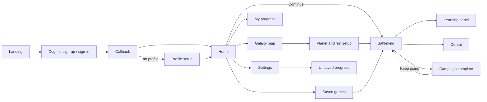
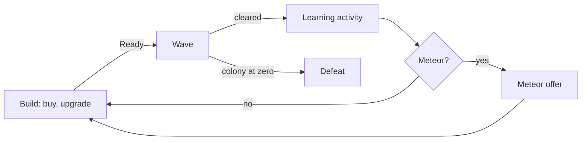
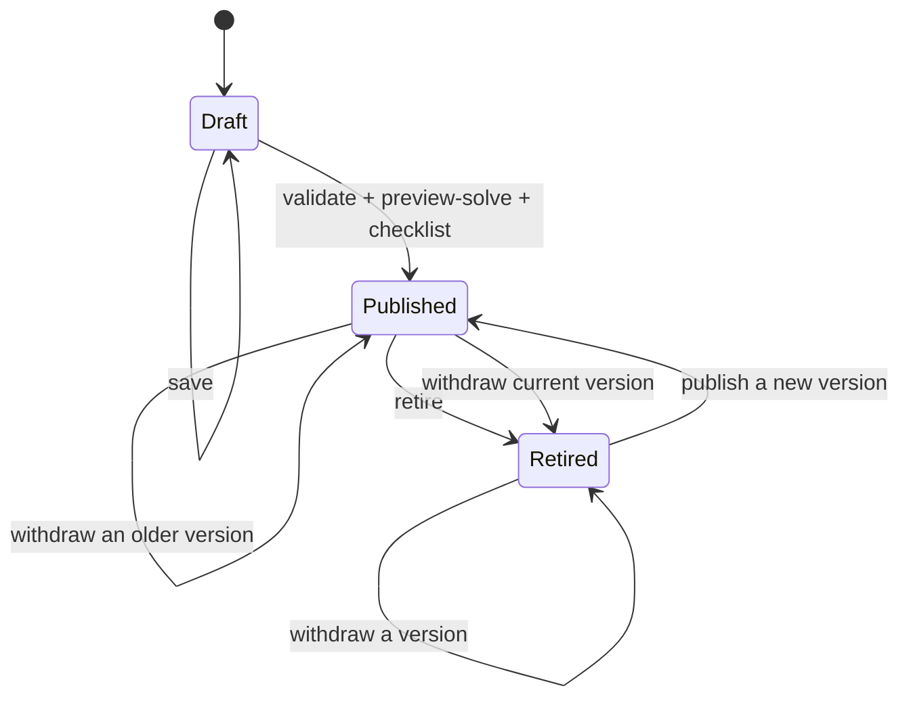
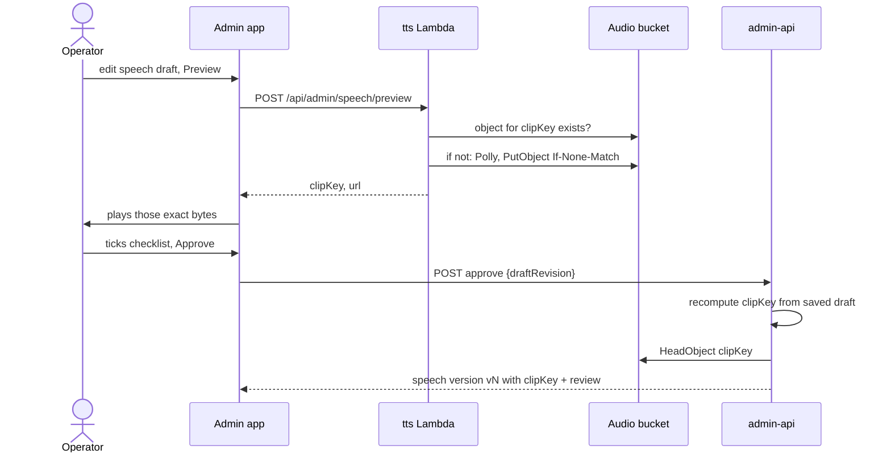

# D. UX and content operations

This section describes what the children and the content operator see and do: the screens and journeys, how every action works
with both mouse and keyboard, the six learning interaction types as a child experiences them, the exact words used for saving and
offline states, the admin publication workflow, the generated-art inventory, and the phonics listening workflow with its quality gate.

It does **not** repeat material owned elsewhere. Rules behind the screens live in
[F. State and data](F-state-and-data.md) (state machines, sync engine, resets), the route contracts in
[G. API contracts](G-api-contracts.md), the speech-service sequence and React/Phaser split in [E. Architecture](E-architecture.md), and
the roster, waves, powers, badges and content-bank design in [C. Game and learning design](C-game-and-learning-design.md).
Character, boss, power and badge names used below are C's proposals; where C changes a name, this section follows.

Nothing described here exists yet. Every screen, file and asset is to be built **[VERIFIED]** (no app code, assets or tests in the repo; spine S0).

---

## D1. Design rules that apply to every screen

| # | Rule | Why | Label |
|---|---|---|---|
| 1 | One interface for every age. Only the learning content differs. | prompt.md:99, prompt.md:271, AC-13 | **[CONFIRMED]** |
| 2 | Pictures and short text explain gameplay. No forced tutorial. Character cards, cost and range previews, and one short explanation line per class do the teaching. | prompt.md:271, prompt.md:275, AC-43 | **[CONFIRMED]** |
| 3 | Every control is a real DOM element (button, input) in React. The Phaser canvas draws the battlefield only. Each pad has an invisible, focusable DOM button over the canvas. | One code path for mouse and keyboard; labels, focus rings and tests come free (research 07 §a.9) | **[PROPOSAL]** |
| 4 | Phaser keyboard handling is switched off (`input: { keyboard: false }`). All shortcuts live in one React hook on `document` (spine S10). | Phaser's default key capture calls `preventDefault` on `window` and would swallow digits typed into an answer box — VERIFIED in Phaser 4.2.1 source by research 07 §a.8 | **[PROPOSAL]** |
| 5 | Click-then-click is the primary way to move or place anything. Dragging may be added later as an extra; it is never required. | prompt.md:271; WCAG 2.2 SC 2.5.7 | **[CONFIRMED]** (no-drag requirement) |
| 6 | Nothing is timed: no countdown, no auto-advance, no double-click, no long-press. | prompt.md:503 | **[CONFIRMED]** |
| 7 | State is never shown by colour alone: selected = thick outline + tick badge; tried = dimmed + the word "tried"; sync state = icon + words. | WCAG 1.4.1; prompt.md:299 ("Colour is supplementary") | **[PROPOSAL]** |
| 8 | Click targets at least 64 × 64 CSS px for options, tiles, pads and shop cards, with 12 px between them. | Five-year-olds on a trackpad; WCAG 2.5.8 asks for only 24 px | **[PROPOSAL]** |
| 9 | Kind, short words. Never "Wrong!", never a red cross, never a score shown to anyone else. Main line for the child; an optional smaller "For grown-ups" line carries detail or a code. | prompt.md:155 (no comparison), prompt.md:167 (no penalties) | **[PROPOSAL]** |
| 10 | British English throughout. Educational text is rendered as accessible text, never baked into bitmaps. | England's curriculum and en-GB speech (prompt.md:475, prompt.md:563); no vital text in bitmaps (prompt.md:1090) | **[PROPOSAL]** (British English UI copy) · **[CONFIRMED]** (no text in bitmaps) |
| 11 | When the page is hidden or any dialog opens, combat pauses. It stays paused until the child presses Resume. | prompt.md:273; spine S10 | **[CONFIRMED]** |
| 12 | Keyboard focus is always visible (a thick, high-contrast ring that is not the brand colour). Dialogs trap focus and put it on the safe choice. | prompt.md:271 ("clear focus") | **[PROPOSAL]** |

---

## D2. Screen map (player app, `aliens.jackgl.com`)



Reading: a first visit goes Landing → Cognito → Profile setup → Home; later visits land on Home. Every game starts from Home
(Continue, Saved games, or Galaxy → Planet). The learning panel, defeat and completion screens are overlays of the battlefield
route, not separate pages. Settings holds resets and the "Progress that was not saved" panel.

| ID | Screen | Route (to create) | Main data | Works offline? | Spec |
|---|---|---|---|---|---|
| P1 | Landing | `/` | `config.json` | No (sign-in needs a connection) | prompt.md:237 |
| P2 | Sign-up / sign-in | Cognito managed login (hosted) | — | No | prompt.md:237, prompt.md:777 |
| P3 | Profile setup | `/setup` | `PUT /api/me/profile` | No | prompt.md:239 |
| P4 | Home | `/home` | `GET /api/me`, local runs store | Yes, from local data | prompt.md:241 |
| P5 | Saved games | `/games` | `GET /api/runs?state=open\|done` | Partly (local views of open runs) | prompt.md:243 |
| P6 | Galaxy map | `/galaxy` | `GET /api/planets` | No | prompt.md:245 |
| P7 | Planet and run setup, offline readiness | `/planet/:planetId` | `GET /api/planets`, `POST /api/runs`, pack | No (creation); readiness shown offline | prompt.md:247 |
| P8 | Battlefield, HUD, shop | `/play/:runId` | local run view, pack, game data | Yes, once prepared | prompt.md:249-251 |
| P9 | Learning panel (and meteor offer) | overlay on `/play/:runId` | slot definition from pack, `POST /api/speech` | Yes, with local clips | prompt.md:249 |
| P10 | Campaign complete / endless offer | overlay | run view | Offer shown offline; Keep going needs a connection | prompt.md:253, prompt.md:435 |
| P11 | Defeat | overlay | run view | Yes | prompt.md:253 |
| P12 | My progress | `/progress` | `GET /api/me/progress` | Last fetched copy, labelled | prompt.md:255 |
| P13 | Settings and resets | `/settings` | `PATCH /api/me/profile`, `POST /api/me/resets` | View only | prompt.md:257, prompt.md:231 |
| P14 | Progress that was not saved | `/settings/unsaved` | local `recovery` store | Yes | spine S7.5 |
| P15 | Blocking screens (other tab, other player, reload to update) | full-page | — | Yes | spine S3.4, S7.2 |

Route paths and screen names are **[ASSUMPTION]**; the screen list itself is **[CONFIRMED]** (prompt.md:235-257).

---

## D3. Key journeys

Each journey lists only what the child sees and the call behind it. The state rules are F's; the request shapes are G's.

### J1. First visit (AC-01)

| Step | Child sees / does | Behind it |
|---|---|---|
| 1 | Landing: logo, a short line ("Defend the moon colony from silly aliens!"), two big buttons: **I'm new** and **Sign in**. A note: "Ask a grown-up to help you make your account." | `config.json` loaded first (spine S11.1 step 6) |
| 2 | Cognito's branded sign-up page: username, password. | Managed login + PKCE **[CONFIRMED]**; wording on that page is Cognito's fixed adult English, only the look is brandable (research 05 §2.2, VERIFIED in AWS docs) |
| 3 | Back in the game. "Let's set up your astronaut!" | Callback, token exchange, `GET /api/me` → 404 `PROFILE_NOT_FOUND` → Profile setup |
| 4 | Choose a name, a picture, enter birthday (with a grown-up). Press **Done**. | `PUT /api/me/profile` (idempotent) |
| 5 | Home, with **New game** prominent (no Continue yet). | — |

If the daily sign-up cap is reached, the pre sign-up trigger raises an error whose text Cognito shows on its page (spine S1.2).
Proposed message, kept short because it is shown inside Cognito's own error wrapper: **"No new accounts today. Please try again tomorrow."** **[PROPOSAL]**
How Cognito frames that text is **[UNVERIFIED]** — the Milestone 0 auth spike should screenshot it.

### J2. Returning player

Landing → **Sign in** → Cognito (`prompt=login`, spine S1) → Home. Home shows **Continue** for the most recently played playable
open run. Continue opens the battlefield and follows the resume table (spine S3.7): preparation, activity or completion offer, with
"Wave N will start again from the beginning" when the run was left mid-wave.

### J3. Start a new game (AC-01, AC-06, AC-13)

| Step | Child sees / does | Behind it |
|---|---|---|
| 1 | Home → **New game** → Galaxy map. Moonbeam Colony is the only bright planet; later worlds are faint outlines labelled "Coming later" and cannot be pressed. | prompt.md:245, prompt.md:437 — never show an unavailable world as playable |
| 2 | Planet screen: **Big adventure** (campaign, 50 waves) and **Quick challenges** (short wave sets from C). Unavailable choices show why (D7). | `GET /api/planets` returns `available, reason` per wave set |
| 3 | Press **Start**. "Getting your game ready…" | `POST /api/runs` with a fresh client `runId` (spine S3.2); online only |
| 4 | Readiness card: "Want to play without internet later? **Get ready for offline**." Optional; the child can press **Play now** straight away. | Pack preparation (spine S3.6) |
| 5 | Battlefield in preparation for wave 1, with starting credits. No activity before wave 1. | prompt.md:519 |

### J4. The wave loop (AC-15, AC-16)



Reading: the child builds, presses Ready, watches the wave (buying and upgrading still allowed), then gets one activity. After waves
9, 19, 29, 39 and 49 a meteor offer follows the activity. Then back to building. Nothing starts until Ready is pressed (prompt.md:503).

### J5. Save and exit

| Where | What happens | Copy |
|---|---|---|
| Preparation or activity | Leaves at once; nothing is lost. | Menu item: **Save and exit** |
| During a wave | Confirmation first (focus on **Keep playing**). | "Leave now? Wave 7 will start again from the beginning next time. Credits from this wave won't be kept." Buttons: **Keep playing** · **Save and leave** — behaviour **[CONFIRMED]** (prompt.md:659-669, AC-24/25); wording **[PROPOSAL]** |
| Resuming that run | Preparation screen restored from the wave-start snapshot. | Banner: "Wave 7 will start again from the beginning." (spine S3.2, F12) |

Leaving flushes the queue if possible and releases the session (spine S3.4). Save-and-exit mid-wave writes nothing (spine S3.2).

### J6. Defeat (AC-14, AC-27)

The colony reaches zero → combat stops → Defeat overlay (P11): "The aliens got through this time." Shows **Waves cleared: 16**,
badges earned in this game, and two buttons: **New game** and **Home**. Refreshing shows the same defeat; the run is never offered
by Continue again. In online-only mode (no local storage) the overlay shows "Saving…" until `DEFEAT` is acknowledged (spine S7.2).

### J7. Campaign complete and endless (AC-12)

Clearing wave 50 shows P10: the **Colony Hero** badge (already committed, spine S3.2) with a star burst, then the choice
**Keep going** (endless; needs a connection) or **Finish this game**. Endless shows "Wave 51" etc. in the HUD and a readiness line
"Ready offline up to wave N" (spine S3.6). A later endless defeat shows the same Defeat overlay with the line "You still have your
Colony Hero badge."

### J8. Endless runs out of prepared content (AC-34)

Offline, at the first interval whose activities are not on the device: the run stays in preparation and **Ready** is replaced by a
panel: "Reconnect to get more activities." with **Try again** — behaviour **[CONFIRMED]** (prompt.md:721, AC-34; spine S5.3). Online and the bank is used
up: "You have done every activity we have for now." then preparation continues (owner decision D-6).

### J9. Switching child on a shared laptop (AC-05)

Settings or Home → **Sign out**. If ops are pending: "Some progress is only saved on this laptop. It will save next time you sign in
here." **Stay signed in** · **Sign out anyway** — the warning is **[CONFIRMED]** (prompt.md:227). Sign-out tries to flush, releases the session,
calls Cognito `/logout` and hard-reloads (spine S7.2). The next child sees nothing of the previous child.
Offline, **Sign out** is shown disabled with "Connect to the internet to sign out", because the `/logout` redirect and the reload
both need the network ([E §E.7.4](E-architecture.md#e74-sign-out-shared-laptop-switching-and-one-page-load--one-account)) **[PROPOSAL]**
(not yet in spine S7.4's list; see Open points).

### J10. Playing on another laptop (AC-28, AC-29)

| Situation | Copy | Actions |
|---|---|---|
| Lease held elsewhere and still valid | "You're already playing on **Chrome on Windows**. Finish there first, or try again in 2 minutes." (minutes rounded up from `retryAfterSeconds`) | **Try again** (enabled after `retryAfterSeconds`) · **Home** |
| Lease lapsed without being released | "This game may have unsaved progress on **Chrome on Windows**. Play here instead?" For grown-ups: "Progress on the other laptop that hasn't been saved to the cloud won't be added." | **Play here** · **Not now** |
| Same browser, second tab | Blocking screen: "This game is already open in another tab. Use that tab, or close it and press Try again." | **Try again** |

The takeover question ("This game may have unsaved progress on … Play here instead?") is the spine's wording (S3.4); the other
lines are **[PROPOSAL]** copy. Device labels come from `deviceLabel` (browser + OS by default; the family can rename this
laptop in Settings, kept in local `meta`) **[PROPOSAL]**.

### J11. Something didn't save (divergence, AC-29, AC-31)

See D7 rows "DIVERGED". The child gets one clear choice; the details go to P14.

### J12. Resets (prompt.md:231)

From Settings only, each in its own dialog (D4 P13). Needs a connection and an empty queue, except whole-profile which may discard
pending progress after a warning (spine S8.2).

---

## D4. Screen specifications

### P1 Landing and P2 Cognito pages

- Landing is the game's own page: logo, backdrop, one sentence, **I'm new** (→ `/signup` on the managed-login domain) and
  **Sign in** (→ `/oauth2/authorize`), plus "Ask a grown-up to help." **[PROPOSAL]**
- Managed-login branding (logo, space background, large high-contrast buttons) via one branding style per app client
  (research 05 §2.2) **[PROPOSAL]**. Text on those pages cannot be changed (VERIFIED in research 05 from AWS docs) — the Milestone 0
  auth spike includes showing it to the children with a parent.

### P3 Profile setup

| Field | Control | Rules | Label |
|---|---|---|---|
| Name | Text input, large font | 1–20 letters, digits, spaces or hyphens (spine S9.5). Hint: "This is the name you'll see in the game." | **[CONFIRMED]** field; limits **[ASSUMPTION]** |
| Picture | Grid of 12 avatar buttons (radio group, arrow keys) | from the shipped avatar list (D10) | **[PROPOSAL]** |
| Birthday | Three selects: day, month (names), year (last 10 years) | Line under it: "Only used to choose activities for your age. Nobody else sees it." | **[CONFIRMED]** private DOB; control **[PROPOSAL]** |

After saving, the birthday is never shown again — not on this screen, not in Settings (spine S2: DOB is write-only). Settings shows
"Birthday: saved" and a **Change birthday** button that asks for it again and explains "This changes activities in new games only."
(AC-06). Age outside 5–7 still creates the profile; only new games are blocked (D7 `CONTENT_UNAVAILABLE`).

### P4 Home

```
+-----------------------------------------------------------+
| [avatar] Hi, Mia!                     [cloud] Saved ✓      |
|                                                           |
|  +-----------------------------------------------------+  |
|  |  CONTINUE                                            |  |
|  |  Moonbeam Colony · Big adventure · Wave 12           |  |
|  |  [ Ready offline ✓ ]               ( ▶ Continue )    |  |
|  +-----------------------------------------------------+  |
|                                                           |
|  ( New game )   ( Saved games )   ( My progress )         |
|                                                           |
|  ! Some progress was not saved.  ( Have a look )          |
|                                    ( Settings ) (Sign out)|
+-----------------------------------------------------------+
```

- **Continue** = the playable open run with the latest `lastPlayedAt`; runs with pending ops use the local view; locally defeated or
  abandoned runs are skipped; `playable:false` runs are skipped (spine S5.1, S7.2). No such run → the card is replaced by a big
  **New game**.
- Banner when `GET /api/me` reports `activeElsewhere`: "You're playing on Chrome on Windows right now."
- Banner when the local `recovery` store is not empty: "Some progress was not saved. **Have a look**" → P14.
- Sync chip top right (D7).

### P5 Saved games

Two tabs: **Playing** (open runs) and **Finished**.

| Column | Playing | Finished |
|---|---|---|
| Planet and mode | "Moonbeam · Big adventure" / "Blob Parade" | same |
| Progress | "Wave 12" (endless: "Wave 63 · endless") | "Cleared 16 waves" / "Completed!" / "Gave up after wave 4" |
| Last played | "Today", "Yesterday", "3 Nov" | end date |
| Offline | readiness badge (D7) | — |
| Actions | **Continue** · **Give up…** (or **Finish…** once the campaign is complete) | none |

- Give up = `ABANDON`; dialog: "Give up this game? You keep your badges and your learning stars. You can't come back to this game."
  **Keep it** · **Give up**. Finish = `FINISH_RUN`: "Finish this game? Your Colony Hero badge stays." (spine S3.2) **[PROPOSAL]** copy.
- "Start again" = Give up + New game, offered only online and only when a new game can be created (notes SM-12).
- A non-playable run shows "This game can't be opened right now." with **Give up**/**Finish** only (D7).
- Soft cap: with 5 open games, **New game** explains "You have 5 games on the go. Finish or give up one first." (`RUN_LIMIT_REACHED`).
- Finished list shows the last 50 (retention, spine S8.1) **[PROPOSAL]**.

### P6 Galaxy map and P7 Planet / run setup

```
+--------------------------------------------------------------+
| < Back                Moonbeam Colony                        |
|  [planet picture]                                            |
|                                                              |
|  ( BIG ADVENTURE )        50 waves · 5 bosses   ( Start )    |
|                                                              |
|  QUICK CHALLENGES                                            |
|  [Blob Parade]  5 waves   ( Start )                          |
|  [Wobble Rematch]  …      ( Start )                          |
|  [Bubble Trouble]  …      ( Start )                          |
|                                                              |
|  -- after Start --------------------------------------------|
|  Your game is ready!                                         |
|  Play without internet later?  ( Get ready for offline )     |
|  ▓▓▓▓▓▓▓▓░░░░  Getting ready… 34 of 60                       |
|                                     ( Play now ▶ )           |
+--------------------------------------------------------------+
```

- Challenge names and lengths are C's proposals. A wave set with `available:false` shows its reason copy instead of **Start**.
- **Start** is disabled offline with "You need the internet to start a new game." (spine S7.4).
- Readiness is shown here, on Home and on Saved games (D7). **Play now** is always allowed online (spine S3.6).

### P8 Battlefield, HUD and shop

```
+------------------------------------------------------------------------+
| ★ 145 credits | ♥ 18/20  ◈ 0 | Wave 7 of 50 | [⏸ Pause] [1× ▸2×] [≡ Menu] [☁ Saving…] |
+------------------------------------------------------------+-----------+
|                                                            | ASTRONAUTS|
|   (canvas: route, pads, astronauts, aliens)                | [Nova  50]|
|                                                            | [Pip   60]|
|      [pad P04: Nova L2]   [pad P05: empty]                 | [Juno 🔒 after wave 10]|
|                                                            | [Orion 🔒]|
|                                                            | [Mira  🔒]|
|                                                            | [Sol   🔒]|
+------------------------------------------------------------+-----------+
| Selected: Nova · Level 2 · aims at: FRONT                              |
| ( Upgrade to 3 · 150 ) shows: more range, more damage   ( Send home +75 ) ( Aim: FRONT ▾ ) |
| POWERS: [❄ Frost Pulse ×0]  [☄ Comet Burst ×0]  [◈ Colony Shield ×0]   ( READY ▶ ) |
+------------------------------------------------------------------------+
```

- **HUD** (DOM, updated at most 10 times a second, spine S10): credits, colony health and shield (icon + number), wave ("Wave 7 of 50";
  endless "Wave 63"; challenge "Wave 3 of 5"), Pause/Resume, speed (1× / 2× — speeds from C), Menu, sync chip.
- **Shop**: six class cards. Each card: portrait, name and role ("Pip — Frost Explorer"), cost, one-line explanation, optional character
  line from prompt.md:1094-1104 ("Let's cool things down."). Locked cards show the silhouette and "Unlocks after wave 5" **[CONFIRMED]**
  unlock idea (prompt.md:357); waves from C. A card the child cannot afford is dimmed with "Need 15 more".
- **Placing**: select a card → every open, empty pad shows a ring and the range circle previews on hover/focus → select a pad.
  Pads not yet opened show a small lock and "Opens after wave 15" (pad schedule from C).
- **Selected astronaut panel**: level, aim, **Upgrade** with cost and a short benefit line ("faster shots"), **Send home** (sell) with
  the refund amount, **Aim** (targeting choices the class supports at its level, from C). Range circle visible while selected.
- **Powers** tray: one button per power with its charge count; Comet Burst enters a targeting mode (a ring on the route).
- **Ready** appears only in preparation. In a wave the bottom-right shows "Wave in progress".
- **Menu** (opens a dialog, pauses combat): **Resume** · **Save and exit** · **Start this game again** · **Give up this game** (or **Finish this game**) · **Keys**.
  "Start this game again" is the restart control asked for at prompt.md:251: it confirms like Give up ("Start again? This game ends and a
  new one begins on the same planet."), sends `ABANDON`, then goes straight to P7 with the same planet and mode preselected, which
  reuses `POST /api/runs` (restart = `ABANDON` + `CREATE_RUN`, [F §3.3](F-state-and-data.md#33-operations-the-only-ways-run-state-changes)). Online only; offline it is disabled with
  "Needs a connection" **[PROPOSAL]**. After defeat the run has already ended, so P11's **New game** is the restart path.
- Buying and upgrading during a wave are allowed (prompt.md:273); the simulation validates them at tick boundaries so the balance
  cannot go negative (spine S10, AC-09).
- When a wave is cleared: a small banner "Wave 7 cleared! You earned 34 credits this wave" for two seconds (the sum of bounties collected
  during the wave; there is no clear bonus, [C §C9.1](C-game-and-learning-design.md#c91-rules)), then the learning panel (P9). The banner
  does not need dismissing and is announced through a polite live region.
- Badge earned (any time): toast "New badge: Wobble Stopper!" with the badge picture.
- Page hidden → paused; on return a centred **Paused** card with **Resume** focused (rule 11).

### P9 Learning panel and meteor offer

Specified in D6. The panel is modal over the dimmed battlefield; the shop and powers are unavailable while it is open (phase
`ACTIVITY` / `METEOR` allows no build ops, spine S3.2).

Meteor offer (phase `METEOR`, before any attempt):
"**Meteor challenge!** Win a power for the boss." with the power's picture and name ("Frost Pulse"), then **Have a go** · **No thanks**.
No thanks sends `DISMISS_SLOT` and returns to preparation with "That's fine — you can still beat the boss!" **[CONFIRMED]** optional
(prompt.md:439, Example D). After the first attempt there is no No thanks (owner decision D-11); Save and exit is always there.

### P10 Campaign complete

"**You saved the colony!**" + Colony Hero badge + "Waves cleared: 50". Buttons **Keep going** (endless, online only; disabled offline
with the reason) and **Finish this game**. No activity interrupts this screen (prompt.md:519). Shown again on resume until a choice is
made (spine S3.7).

### P12 My progress

Three subject cards — Maths, Phonics, Spelling — each "Activities done: 23 · Stars: 19" and optionally "Still practising: 4"
(research 09 §9.3) **[PROPOSAL]**. Opening a card lists topics by child-friendly title. Below: planets ("Moonbeam Colony — best: 34 waves
cleared"), and the badge shelf (earned badges in colour; unearned ones as outlines with their rule in words, e.g. "Clear wave 10").
No percentages, grades, ages, school years, streaks or comparisons **[CONFIRMED]** (prompt.md:155, prompt.md:527).
Offline: last fetched copy with "Last updated today at 10:12".

### P13 Settings and resets

| Item | What it does | Confirmation copy | Label |
|---|---|---|---|
| Name and picture | `PATCH /api/me/profile` | — | **[CONFIRMED]** |
| Change birthday | asks again, never shows the old one | "This changes activities in new games only." | **[CONFIRMED]** rule (prompt.md:221) |
| Name this laptop | local `deviceLabel` | — | **[PROPOSAL]** |
| Progress that was not saved | → P14 | — | spine S7.5 |
| Give up current game | `ABANDON` (or `FINISH_RUN`) for the chosen open game | as P5 | **[CONFIRMED]** distinct reset |
| Clear planets and badges | `CAMPAIGN_PROGRESS` | "This clears your best waves and badges. Your saved games stay, and you can earn badges again." | **[CONFIRMED]** distinct; copy **[PROPOSAL]** |
| Clear learning stars | `LEARNING_HISTORY` | "This clears your Maths, Phonics and Spelling stars. Everything else stays." | same |
| Start my profile again | `WHOLE_PROFILE` | "This deletes all your games, badges, stars, name and picture. Your username and password stay. You can't undo this." plus, if ops are pending, "Some progress on this laptop hasn't saved yet and will be lost." | same |
| Sign out | J9 | J9 | **[CONFIRMED]** |

Reset dialogs are written for the grown-up. Each lists **What changes** and **What stays**, and the confirm button is enabled only after
typing the word shown (for example `badges`) — the client then sends `confirm = type` (spine S8.2) **[PROPOSAL]**. A reset needs a
connection and an empty queue; otherwise the button explains "Wait until everything is saved to the cloud." After a whole-profile reset
the device deletes `scd-<sub>` and opens Profile setup.

The two partial resets (planets and badges, learning stars) also say plainly, in the grown-up line: "A device that was offline may still
add its saved progress when it reconnects." (spine S8.2; [F §12.5](F-state-and-data.md#125-resets-post-apimeresets-type-confirm))
**[PROPOSAL]** copy.

### P14 Progress that was not saved

Read-only list from the local `recovery` store (spine S7.5): game, wave reached, date, and a grown-up reason line (for example
"Continued on another device (STALE_SESSION)"). Buttons per entry: **Download recovery file** (JSON) and **Remove**; removal asks
"Remove this? It can't be put back." Copy at the top: "These steps were played on this laptop but couldn't be added to your saved game,
because the game had moved on." **[PROPOSAL]**

A small grown-up note under the list keeps it honest about one rare case [F](F-state-and-data.md#84-why-32-recent-opids-are-enough)
documents (a lost reply, then a takeover, then many more steps on the other device): "Occasionally an entry here includes steps that did
reach the cloud before the game moved on." Nothing is ever applied twice. **[PROPOSAL]** copy.

### P15 Blocking screens

| Screen | Copy | Action |
|---|---|---|
| Another tab holds the play lock | "This game is already open in another tab." | **Try again** |
| A different player signed in (offline case) | "A different player is signed in on this laptop. Ask a grown-up to help you sign in." | **Reload** (online) |
| Upgrade required | "A new version of the game is ready. Reload to update. Your progress is kept." | **Reload** |

---

## D5. Keyboard and mouse

### D5.1 How keys are handled

- Phaser's keyboard plugin is disabled; one React hook listens on `document` (spine S10; research 07 §a.8) **[PROPOSAL]**. It ignores a key when:
  focus is in an `input`, `textarea`, `select` or `contenteditable`; `event.isComposing`; Ctrl/Alt/Meta is held; or any dialog or the
  learning panel is open. So battlefield shortcuts can never interfere with typing an answer **[CONFIRMED]** requirement (prompt.md:273).
- Every shortcut has a visible button equivalent. Shortcuts are conveniences, never the only way (AC-41).
- **Keys** (from the Menu, or `?`) opens a dialog listing every shortcut with pictures. It is a reference card, not a tutorial.
- Tab order on the battlefield: HUD → shop cards → pads (in route order) → selected-astronaut panel → powers → Ready.

### D5.2 Battlefield actions

| Action | Mouse | Keyboard | When |
|---|---|---|---|
| Choose an astronaut to place | Click its card | Letter shortcut **N** Nova, **P** Pip, **J** Juno, **O** Orion, **M** Mira, **S** Sol; or Tab to the card, Enter/Space | Preparation and waves |
| Place it | Click a highlighted pad | Focus jumps to the first open pad; arrow keys move to the nearest pad in that direction; Enter/Space places | same |
| Cancel a choice / targeting | Right-click, or click the card again | Esc | same |
| Select a placed astronaut | Click it (its pad button) | Tab or arrows to its pad, Enter | same |
| Upgrade | **Upgrade** button | **U** | same |
| Sell (send home) | **Send home** → confirm | **X** → confirm dialog (Enter = Send home, Esc = keep) | same |
| Change aim (targeting) | **Aim** menu | **T** cycles the choices available | same |
| Use a power | Power button (Comet Burst: then click the route) | **1** Frost Pulse, **2** Comet Burst, **3** Colony Shield; Comet Burst ring moves with Left/Right, Enter drops, Esc cancels | Waves (C's rule) |
| Pause / resume | Pause button | **Space**, only when no button has focus (a focused button keeps Space for pressing itself) | Waves |
| Speed | Speed button | **F** toggles 1×/2× | Waves |
| Ready (start wave) | **Ready** | **R**, or Enter on the button | Preparation |
| Menu (save and exit, give up) | Menu button | Esc when nothing is selected | Any |

Power keys and the ring controls follow C's draft (`1`/`2`/`3`). Class letters are the names' initials, which are all different
**[PROPOSAL]**. Arrow-key pad movement chooses the nearest pad within a 90° cone in the pressed direction; ties go to route order
**[ASSUMPTION]**. Each pad button's accessible name says what is there: "Pad 4, Nova level 2, aiming at the front" / "Pad 5, empty" /
"Pad 1, opens after wave 20".

### D5.3 Learning panel keys

Inside the panel battlefield shortcuts are off. Tab moves between Play, Show me, the answer area (one tab stop, arrows inside), Check
and Save and exit. Per-type keys are in D6.3. Esc only cancels a lifted tile or object; it never closes the panel or submits.
Enter in a typed-answer field presses Check.

### D5.4 Dialogs

All dialogs trap focus, open with focus on the safe choice ("Keep playing", "Keep it", "Not now"), and close with Esc as the safe
choice. Destructive buttons are never the default. **[PROPOSAL]**

---

## D6. The six interaction types as the child experiences them

The six types are **[CONFIRMED]** (prompt.md:485-497): picture selection, number selection, moving/counting/sorting objects,
arranging letters or ordered items, multiple choice, typed numeric or word answers. Type names, payloads and normalisation are defined in [C](C-game-and-learning-design.md) (activity schema) from research 09 §4.
This part is the UX. Canonicalisation runs once, in TypeScript, shared by the player and admin apps (spine S7.2).

### D6.1 One panel, one grammar

```
+-------------------------------------------------------------+
|  Which letters make this sound?            (heading)         |
|  ( ▶ Play )   ( 🔈 read it to me )   ( Show me )             |
|                                                             |
|   [ sh ]   [ ch ]   [ th ]   [ s ]                          |
|    1        2        3        4                             |
|                                                             |
|   Tries left: ● ● ○            Not quite. Have another go.  |
|                                   ( Check ✓ )               |
|                                        ( Save and exit )    |
+-------------------------------------------------------------+
```

**Grammar: select (or place, or type), then press Check.** Selecting never submits **[PROPOSAL]** (research 09 §4.1). The order on
screen is the focus order: heading (focused when the panel opens) → Play → read-to-me → Show me → answer area → Check → tries and
message line (polite live region) → Save and exit. Check uses `aria-disabled` while the answer is incomplete so it stays focusable and
can explain itself. Option and tile order is fixed when the run is created (`presentation` on the slot), so a refresh shows the same
layout (spine S3.3).

### D6.2 What uses up a try

| Uses a try | Never uses a try **[CONFIRMED]** (spine S3.3, prompt.md:503, AC-22) |
|---|---|
| Pressing Check on a complete answer that is different from every earlier try on this activity — one try per Check, however many steps the activity has | Opening, waiting, leaving, refreshing, signing out · Play, replay, stop, loading, a sound that fails · Show me · selecting, moving, typing, deleting · Check on an incomplete answer · a network failure |

Client-only guards (no op is created) **[PROPOSAL]**, owner decision D-8:

- On choice types (picture, number, multiple choice), an option already tried is dimmed, labelled "tried", and skipped by the arrow keys.
- On arrange, object-move and typed answers, pressing Check with exactly the same answer as an earlier try shows "You've tried that one.
  Have another go." The server counts every attempt it receives; there is no server duplicate rule (spine S3.3).
- On an activity whose audio is required, Check before Play has ever been pressed shows "Press Play to listen first."

Feedback appears only once the try is **durable** — written to the local op log, or acknowledged by the server when local storage is
unavailable (spine S4). In that online-only case Check shows "Checking…" until the reply. Check is latched after one press until the op
exists, so a double-click is one try (spine S7).

### D6.3 Type by type

| Type | Child sees | Mouse | Keyboard | Complete when | After a wrong try |
|---|---|---|---|---|---|
| `PICTURE_SELECT` | 4–6 picture cards with number badges | Click a card (outline + tick), click Check | Arrows move and select (radio pattern); digits 1–6 pick by badge; Tab to Check | one card chosen | That card marked "tried" |
| `NUMBER_SELECT` | a number track (≤21) or hundred square | Click a number, Check | Left/Right one step, Up/Down one row, Home/End ends | one number chosen | That number marked "tried" |
| `OBJECT_MOVE` (share/count) | a tray of identical objects and 1–3 zones | Click an object: it hops to the zone (one zone); with several zones click object then zone. Click a placed one to send it back | Tab to a zone; `+`/Enter moves one in; `−`/Backspace moves one out | at least one placed (all when required) | Objects stay where they were; no marking |
| `OBJECT_MOVE` (sort) | 4–8 objects and 2–3 labelled bins | Click object (lifts), click bin (drops) | Arrows through objects; Enter lifts; arrows choose bin; Enter drops; digits 1–3 send to a bin, 0 to the tray; Esc cancels | every object in a bin | same |
| `ARRANGE` (letters) | letter/grapheme tiles and empty spaces, with a picture or sound cue | Click a tile: it fills the next space. Click a placed tile: back to the tray | Arrows + Enter place; typing a letter places the first matching free tile; Backspace removes the last; in the spaces row Enter lifts, Left/Right moves, Enter drops | every space filled | Arrangement stays; no per-letter hints; "Tried: cta" line |
| `ARRANGE` (sequence) | 3–6 items to put in order, with "smallest first" | as letters | as letters (no letter typing) | every space filled | same |
| `MULTIPLE_CHOICE` | 4–6 text buttons (graphemes, words or numerals) | as picture select | as picture select | one chosen | marked "tried" |
| `TYPED` (number / word) | an input box plus an on-screen keypad (digits, or a–z and apostrophe) | Click keypad keys, then Check | Type; Backspace; **Enter = Check** | at least one character | Answer stays; "Tried: 12" line |

Numbers of options, tiles and objects are the publish-validation limits from research 09 §4.4 **[PROPOSAL]**; choice types need at
least four options so failure stays possible (spine S3.3). For `TYPED` word answers the input has spellcheck, autocorrect,
autocomplete and autocapitalise switched off, otherwise the browser gives the spelling away **[PROPOSAL]**. Every change is announced
in words for screen readers ("c placed in space 1 of 3"); in a counting zone the count is announced but not shown as a numeral, so
counting stays counting (research 09 §4.4).

**Two-step activities**: both steps on one panel, one Check, one try for the whole thing. After a wrong try, steps that were right
are locked with a tick; the wrong step says "Try this part again." (research 09 §4.5) **[PROPOSAL]**.

### D6.4 Feedback words

Same words for every age and subject **[PROPOSAL]** (research 09 §4.3, adjusted to spine S3.3).

| Situation | Message | Try used? |
|---|---|---|
| Check with nothing chosen | "Choose an answer first." / "Fill every space first." / "Move them first." / "Type your answer first." | No |
| Audio-required, Play not pressed | "Press Play to listen first." | No |
| Same as an earlier try | "You've tried that one. Have another go." | No |
| Incorrect, tries left | "Not quite. Have another go." Tries indicator drops (icons + "Tries left: 2") | Yes |
| Correct | "You got it!" + reward line from the ruleset: "+30 space credits" or "Frost Pulse is ready!" | Yes, resolves |
| Third incorrect | "Good try. No credits this time — you can keep playing." then "The answer was …" and **Continue** | Yes, resolves |
| Activity voided (withdrawn content) | "This one had a mistake, so we took it away. You still get your reward." | — |
| Interval with no activity left (endless) | "You have done every activity we have for now." | — |
| Answer couldn't be stored anywhere | "That didn't save. Press Check again." | No |

**Showing the answer after the activity ends** — on success and after the third try, the correct option is highlighted, the word or
order is shown assembled, a sort is shown completed, with a speaker button for the `answer` clip where one exists. Never after try 1 or 2.
Owner decision D-4 (recommended yes) **[PROPOSAL]**.

**Show me** (concept demonstration): 1–3 static cards with Next / Start / Skip. Shown automatically once per concept per run when the
slot says `intro = AUTO`; otherwise on request. Never opened because of a wrong answer, never after resolution. Keeping the button after a
wrong try is owner decision D-2 (recommended yes) **[PROPOSAL]**.

Sounds: a soft chime for correct, a neutral soft "bloop" for not quite — never a buzzer **[PROPOSAL]**.

### D6.5 The Play control

| State | Button shows | Notes |
|---|---|---|
| Play | ▶ "Play" | Never autoplays (prompt.md:567) |
| Loading | spinner "Getting the sound ready…" | Re-press ignored — that is the debounce (prompt.md:587) |
| Playing | ■ "Stop" | Starting another clip stops the current one |
| Played | ↻ "Play again" | Replays are free, any number |
| Failed | "We couldn't get the sound." **Try again** | Never a try, never a reward (AC-22) |

Online, every Play calls `POST /api/speech`; local bytes are used only when the returned `clipKey` matches (spine S5.2, AC-19).
Offline, only local bytes play. When the activity's audio is **required** and its clip is not available, the answer area stays hidden
behind "Getting the sound ready…" or the failure message, so the question is never shown as ready without its sound (prompt.md:617)
**[CONFIRMED]** behaviour. Phonics always has a visible Play control (prompt.md:271).

---

## D7. Player-facing copy for saving, sync and offline states

One string per state (spine S3.5, S3.6, S7.4, S7.5, notes F12). Where the spine gives wording it is used verbatim. **Main line** is
for the child; **For grown-ups** is a smaller second line, shown in dialogs and in the chip's tooltip/expanded view.

### D7.1 Sync chip (Home and HUD; icon + words, AC-31)

| State | Icon | Main line | For grown-ups / action | Source |
|---|---|---|---|---|
| `SYNCED` | cloud ✓ | "Saved to the cloud" | — | spine S3.5 |
| `PENDING` | cloud ↑ | "Saving…" | — | spine S3.5 |
| `OFFLINE_PENDING` | laptop | "Saved on this device — waiting to sync" | "It will save to the cloud when you're back online." | **[CONFIRMED]** wording prompt.md:711 |
| `RETRYING` | cloud ↻ | "Couldn't save — trying again" | — | spine S3.5 |
| `AUTH_REQUIRED` | key | "Sign in again to finish saving" | **Sign in** (at a preparation boundary; in a wave the button first says "Wave 7 will start again from the beginning.") — nothing on this laptop is lost | spine S3.5, AC-33 |
| `DIVERGED` (stale session) | ! | "This game was continued somewhere else" | Dialog D7.3 | spine S3.5 |
| `DIVERGED` (rejected) | ! | "We couldn't save some progress" | Dialog D7.3 | spine S3.5 |
| `UPGRADE_REQUIRED` | ↻ | "Reload to update the game" | "Your progress is kept." **Reload** | spine S3.5 |
| flag `LOCAL_STORAGE_UNAVAILABLE` | banner | "This browser can't save on this laptop, so you need the internet to play." | "Each step is saved to the cloud before the game moves on." | spine S3.5, S4 |
| local write failed mid-run, offline | banner | "Not saved yet — keep this page open and reconnect." | — | notes F09 |

Re-signing in with managed login is a full-page redirect (research 05, VERIFIED), which is why it is offered at a boundary; pending ops
are in IndexedDB and survive it (spine S7.3).

### D7.2 Offline readiness (per game; Planet screen, Home card, Saved games)

| State | Main line | Action |
|---|---|---|
| `NOT_PREPARED` | "Not ready for offline play" | **Get ready for offline** |
| `PREPARING(n of m)` | "Getting ready… 34 of 60" with a bar | **Play now** stays available |
| `READY_OFFLINE` | "Ready to play offline" · endless: "Ready offline up to wave 70" | For grown-ups: "Offline play works while this page stays open. Don't close or reload it." |
| `INCOMPLETE(missing)` | "Some parts are missing." | For grown-ups: "3 sounds, 1 activity" + **Try again** |
| `PREPARE_FAILED` | "Couldn't get ready." | **Try again** |

The "page stays open" line is the honest statement of prompt.md:719 and spine S3.6: there is no offline cold start **[CONFIRMED]**.

### D7.3 Connection, sessions and errors

| Situation (code) | Main line | For grown-ups / actions |
|---|---|---|
| Offline, connection-required action | Button disabled with "You need the internet for this." | Applies to: sign in/up, profile setup, new game, Keep going (endless), resets, getting ready for offline, the first fetch of a sound (spine S7.4); also sign-out, with its own reason line (J9; E's proposal, pending the spine) |
| `OFFLINE_PACK_INCOMPLETE` | "We need the internet to get the next activity." | **Try again**; Ready stays disabled (spine S7.4) |
| Endless buffer empty | "Reconnect to get more activities." | **Try again** (spine S5.3) |
| Resume a run left mid-wave | "Wave 7 will start again from the beginning." | spine S3.2, AC-24 |
| `ACTIVE_SESSION_ELSEWHERE` | "You're already playing on Chrome on Windows. Finish there first, or try again in 2 minutes." | **Try again** · **Home** |
| `TAKEOVER_CONFIRM_REQUIRED` | "This game may have unsaved progress on Chrome on Windows. Play here instead?" | "Progress there that hasn't reached the cloud won't be added." **Play here** · **Not now** |
| `DIVERGED` after `STALE_SESSION` | "This game was continued somewhere else." | **Use the cloud save** (a) · **Keep this device's progress** (b, only when the spine S7.5 conditions hold; asks for the takeover confirmation first) — "The other choice will be kept under Settings › Progress that was not saved." |
| `DIVERGED` after any `REJECTED` | "We couldn't save some progress." | **Use the cloud save** (option a only) — "What wasn't saved is kept under Settings › Progress that was not saved." |
| `RUN_LIMIT_REACHED` | "You have 5 games on the go. Finish or give up one first." | link to Saved games |
| `CONTENT_UNAVAILABLE` `AGE_OUT_OF_RANGE` | "We don't have activities for your age yet." | research 09 §7.9 |
| `CONTENT_UNAVAILABLE` `BANK_NOT_READY` | "Activities for your age are still being made. Please come back soon." | research 09 §7.9 |
| `CONTENT_VERSION_UNSUPPORTED` (run not playable) | "This game can't be opened right now." | "It needs a game version this website doesn't have. You can still give up or finish it." |
| `SPEECH_UNAVAILABLE` | "We couldn't get the sound." | **Try again**; never a try (spine S9.1) |
| Unexpected `INTERNAL` / `THROTTLED` | handled as `RETRYING` | — |

Codes never appear in the main line; they may appear in the grown-up line to make support easier. Copy strings live in one file
`web/player/src/copy/en-GB.ts` (to create) so the owner and playtesters can check them in one place **[ASSUMPTION]**.

---

## D8. Operator app (`admin.aliens.jackgl.com`)

Adult audience, ordinary web forms, mouse and keyboard. Desktop only. Not available offline (a banner says so). Every admin route needs
the operator token and the exact `admin` group (spine S2); an operator-pool account outside the `admin` group sees "This account can't use
the content admin." (`403 FORBIDDEN`, AC-04). A player token never reaches the function (gateway 401). Request and response fields for
every admin route, and their route numbers (R16–R30), are in [G §12](G-api-contracts.md#12-administration-routes).

### D8.1 Screens

| ID | Screen | Route(s) used | Spec |
|---|---|---|---|
| A1 | Sign-in (managed login, TOTP required) | operator pool | prompt.md:261 |
| A2 | Activity list with search and filters | `GET /api/admin/activities` | prompt.md:263 |
| A3 | Activity editor (draft) | `GET …/{id}`, `PUT …/{id}/draft` | prompt.md:265, prompt.md:533-541 |
| A4 | Preview and solve | shared learning-panel component; `POST /api/admin/speech/preview` for draft clips | prompt.md:265 |
| A5 | Validate | `POST …/{id}/validate` | prompt.md:543 |
| A6 | Publish (review checklist) | `POST …/{id}/publish` | prompt.md:267 |
| A7 | Versions, retire, withdraw | `…/retire`, `…/withdraw {version, reason}` | prompt.md:545, prompt.md:556 |
| A8 | Speech library | `GET /api/admin/speech-definitions` | prompt.md:541 |
| A9 | Speech editor, preview, approve | `PUT …/{id}`, `POST /api/admin/speech/preview`, `POST …/{id}/approve` | prompt.md:603 |
| A10 | Bank status | `GET /api/admin/bank-status` | research 09 §7.8 |
| A11 | Import drafts (later phase) | `POST /api/admin/activities` per row | prompt.md:525, prompt.md:1002 |

### D8.2 Activity list (A2)

Columns: ID, title, subject, topic, ages ("5–6"), type, mode (fixed/template), reward category, state, current version ("v3"),
"draft has changes" flag, updated. Filters: subject, age (5/6/7), interaction type, state, topic, reward category, authoring mode;
free-text search over ID, title and prompt. The server reads the whole header partition in one consistent query (spine S8.3 C1); the
app asks for the maximum page (`limit` 200, G R22) and filters in the browser **[PROPOSAL]**. **New activity** asks for the activity ID
first: the operator chooses it, it must match the key-ID pattern `^[a-z0-9-]{1,40}$` (spine S9.5; e.g. `ph-0012`, `ma-0101`), and
creating the same ID twice returns the existing activity rather than a duplicate (G R23) **[PROPOSAL]**. Then A3 opens.

### D8.3 Activity lifecycle



Reading: an activity always has one working draft. Publishing creates an immutable version (shown as v1, v2… by counting; the stored
ID is the UTC timestamp, spine S8.3) and makes it the one used for new games. Retiring stops selection for new games but leaves
pinned games untouched. Withdrawing marks one version as wrong; if it was the current version the activity is also retired (spine C6).

| Action | Effect for new games | Effect for games already holding it | Confirmation | Label |
|---|---|---|---|---|
| Save draft | none | none | — (`409 DRAFT_CONFLICT` on a `draftRevision` mismatch, G R25: "Someone saved this draft after you opened it. Reload to see their changes.") | **[PROPOSAL]** |
| Publish | this version is selectable | none — they keep their pinned version (AC-23) | checklist (A6) | **[CONFIRMED]** immutable versions |
| Retire ("Stop using in new games") | not selectable | **unaffected**: presented, attempted, rewarded, counted as before | one dialog | **[CONFIRMED]** |
| Withdraw ("This version is wrong") | not selectable | unresolved slots pinned to it are voided and their reward granted once; slots already succeeded or failed stay as recorded (D-9) | reason (required) + type the activity ID + bank warning | **[CONFIRMED]** distinction (prompt.md:556); mechanism spine S3.3 |
| Copy version to draft | — | — | — | **[PROPOSAL]** |

Subject, topic and reward category are locked once a version is published (spine S5.2), and so are authoring mode (fixed/template)
and interaction type: G R25 refuses a change to any of the five with 400 rule `locked_after_publish` (list in
[F §12.6](F-state-and-data.md#126-content-table-summary-lifecycle-ux-in-d)). The editor shows all five read-only with "Locked after
first publish". Only ages and content change between versions.

### D8.4 Activity editor (A3–A6)

```
+--------------------------------------------------------------------------------+
| ph-0012  "Which letters make /sh/"     Draft rev 7 · v2 published · [Retire]   |
|--------------------------------------------------------------------------------|
| Subject [phonics 🔒]  Topic [phonics-gpc-consonant-digraphs 🔒]  Reward [NORMAL 🔒]|
| Ages [5]–[6]   Curriculum ref [NC14.En.Y1.WR-2 ▾]   Type [MULTIPLE_CHOICE 🔒]   |
| Prompt  [Which letters make this sound?                       ]                 |
| Options a[sh] b[ch] c[th] d[s] (+)        Correct ( ) a  ...                    |
| Audio   prompt → [phoneme-sh v1 ✓ approved]  instruction → [instr-which-letters v1 ✓] |
| Show me [ + add card ]                   Pictures [ none ]                      |
|--------------------------------------------------------------------------------|
| [Save draft]  [Validate ✓ rev 7]  [Preview and solve ✓ rev 7]  [Publish…]       |
+--------------------------------------------------------------------------------+
```

- **Payload editor per type**: structured fields, never raw JSON editing (a read-only JSON view is available) **[PROPOSAL]**.
- **Pictures** are picked from the asset manifest; the picker shows alt text and only lists assets flagged text-free (D10).
- **Audio** variants (`prompt`, `instruction`, `option-a`…, `answer`, `intro-1`…) are picked from approved speech versions only.
  Picking an unapproved one is impossible; a speech definition with a newer unapproved draft still offers its approved version.
- **Validate** (G R26, `{draftRevision}`) returns `{valid, problems[{field, rule}], domainSize?, sample[]?}`; each problem links to its
  field. Template activities also run the exhaustive domain check (≤5,000 instances, spine S5.2), show "38 instances checked, 0 problems"
  and display the returned sample for human review.
- **Preview and solve** renders the real player learning panel (shared component) with the draft's current revision, including Play
  through the preview route. The operator must answer correctly — for a template, three sampled instances, and the sample view also
  shows the smallest, largest and some middle instances. Any edit (new `draftRevision`) clears both ticks **[PROPOSAL]** (research 09 §5.3).
- **Publish…** opens A6: a diff against the current version, the seven-point review checklist (research 09 §5.3: worked the answer myself;
  exactly one right answer; wording suits the youngest age, British spelling; pictures unambiguous and alt text neutral; listened to every
  clip; no homophone/heteronym/accent trap; nothing personal, branded or frightening). Publish is enabled only when validate and
  preview-solve are ticked for this revision and every checklist line is ticked. The reviewer identity (`publishedBy`) comes from the token.
  The request (G R27) carries `{draftRevision, review{checklist, previewSolvedDraftRevision}}`: `draftRevision` stops a stale tab
  publishing newer text it never saw (spine C4); `review` is stored in the version's review record with `publishedBy`. The server
  refuses an incomplete checklist (`checklist_incomplete`) or a preview-solve of another revision (`preview_solve_stale`). The record
  is the operator's own declaration, not proof that the work was done.

### D8.5 Bank status (A10)

A table of age (5, 6, 7) × subject × category (normal, meteor): units held, threshold, hard minimum, topics with ≥2 units, template
instance totals for maths, and an **Eligible / Not ready** cell per age (thresholds from server configuration, research 09 §7.8). The
withdraw and retire dialogs show the before/after for the affected cells and warn: "Age 5 phonics drops below its threshold. New games
for age 5 will be blocked until you publish more." **[PROPOSAL]**

### D8.6 Seeding and import

- **Seed content** for the first bank (the worked examples, the first templates) is authored as JSON files in the repo, using the
  spreadsheet columns of research 09 §11.3, and loaded by the seed script H describes: dry-run by default, create-only conditional
  writes, never Terraform ([H §H.4.6](H-infrastructure-and-delivery.md#h46-dynamodb_table-called-twice-and-private_bucket-called-twice);
  script in `scripts/`) **[PROPOSAL]**. The seed files live in `content/seed/` (to create), as H's repository layout
  places them ([H §H.2](H-infrastructure-and-delivery.md#h2-repository-layout-after-this-plan)), outside `game-data/`.
- Whether through the script or through A11, an import creates **drafts only**; an `activityId` that already exists is skipped and
  reported, never overwritten (spine C8; prompt.md:1002) **[CONFIRMED]** no-overwrite rule. Once the admin app exists, nothing is
  published or approved by an import: each draft goes through validate → preview-solve → checklist → publish like a hand-made one.
- Speech definitions are seeded the same way (drafts), then previewed and approved one by one (D9).
- A11 (operator import from a spreadsheet export) is a Milestone 3–4 convenience. Milestone 1 has no admin app: its single activity
  enters through the create-only seed path, and how its one clip is previewed and approved through the real preview → approve path is
  set in [J](J-execution-backlog.md) ([B §B3.2](B-scope-and-decisions.md#b32-side-by-side)) **[PROPOSAL]**.

---

## D9. Phonics preview, review and the quality gate

The spec makes this explicit: a valid synthesis is not proof of a correct sound, every clip is listened to before publication, and a
sound that cannot be rendered well keeps its activity unpublished — never browser speech, never a substitute sound
(prompt.md:593-611, AC-21) **[CONFIRMED]**.

### D9.1 Milestone 0 listening spike (before any phonics authoring)

| Step | What | Output |
|---|---|---|
| 1 | Render the test set with the AWS CLI (`SynthesizeSpeech`) from the owner's laptop on Amy, Emma, Brian and Arthur (neural, en-GB, London), using exactly the canonical inputs the clip key hashes (text/SSML, voice, engine, format). The preview route does not exist yet in Milestone 0; the chosen clips are re-rendered through it and approved in M1 ([J](J-execution-backlog.md) M0-11, M1-18/M1-19) | ~24 clips × 4 voices minimum (research 09 §6.4); the full 47 sounds + 26 letter names is research 06 §5.8 |
| 2 | For each medium/high-risk sound also try: bare `<phoneme>`, the small-schwa form, slower/faster `prosody rate` | variant clips |
| 3 | Listen on laptop speakers and headphones, with a second adult, and the shortlist with one of the children | scores on "intended sound / no added vowel / clean edges" |
| 4 | Decide | one voice for everything; a per-sound verdict (publishable · publishable with small schwa · word-only); a frozen SSML template set |

Voice is server configuration, chosen here, never by assumption (prompt.md:563, spine S1) **[CONFIRMED]**.

### D9.2 Risk tiers (from research 09 §6.4 and research 06 §5.5)

| Tier | What | Policy | Predicted members (until heard) |
|---|---|---|---|
| A | Whole words and instructions | Default wherever the learning point allows ("Which letters start *ship*?") | all words |
| B | Isolated sounds expected to be low/medium risk | Allowed after that exact clip passes | long vowels and diphthongs; /s/ /m/ /n/ /f/ /l/ /v/ /z/ /sh/ /ch/ /ks/; short vowels |
| C | Isolated sounds expected to be high risk | Only if a clip genuinely passes (maybe with a small schwa); otherwise taught inside words | /p/ /t/ /k/ /b/ /d/ /g/ /j/ /w/ /y/ /h/ /r/, both /th/, /ng/, /zh/, /kw/, /ure/ |

Research 06 predicts 16 high, 16 medium and 12 low of the 44 phonemes; those are **[UNVERIFIED]** predictions replaced by the spike's
verdicts. If more than a handful fail on every voice, the owner question in research 06 §5.4 (human-recorded clips, outside the stated
requirement) is raised then — not before.

### D9.3 One render path: what you hear is what children hear



Reading: preview is the only path that calls Polly, and it writes to a content-addressed key (SHA-256 of text/SSML, locale, voice,
engine, format and generation number). Approval never synthesises; it recomputes the key from the saved draft and requires that object
to exist, so the approved bytes are byte-for-byte what was heard (spine S5.2) **[PROPOSAL]**. Publishing an activity then checks that
every speech version it references is approved (spine C4). The full player-side sequence is in [E](E-architecture.md).

Editor details (A9) **[PROPOSAL]**:

- **Kind** is chosen first and shown in large type: PHONEME, LETTER NAME, WORD or INSTRUCTION, because a letter name and a phoneme are
  different outputs (prompt.md:595). Allowed input differs by kind (research 09 §6.3); `say-as characters` is always rejected because
  neural hands it to the standard engine (VERIFIED in AWS docs, research 06 §3.3).
- A **phoneme picker** built from Polly's en-GB table inserts `<phoneme alphabet="x-sampa" ph="…">` so nobody types symbols; the canonical
  stored text is X-SAMPA (research 06 §12).
- The preview player shows the clip's duration, has **Play**, **Play twice in a row** (edge check) and **Compare with…** (plays a
  neighbour clip, for the confusable pairs).
- Any edit to the text, or a change of voice or generation number, produces a new `clipKey`; **Approve** is disabled until the new draft
  has been previewed and listened to again.
- Validation errors from the preview route (over 300 characters, a disallowed tag, a symbol outside the table) are shown inline.

### D9.4 Listening checklist (every clip, before Approve)

Condensed from research 06 §14; all applicable lines must be ticked **[PROPOSAL]**:

| Group | Check |
|---|---|
| Identity | Matches its label (letter name / phoneme / word / instruction). It is the intended sound, compared side by side with its confusable pair (/f/–/th/, /ee/–/i/, /oo/ long–short, /ure/–/or/, /m/–/n/). No letter name in place of a sound, or the reverse. |
| Purity | Unvoiced sounds have no added vowel. /b/ /d/ /g/ /j/ at most a small schwa; /w/ /y/ small schwa or word-only. Continuants held about half a second, not a blip. Short vowels short and steady. |
| Accent and consistency | British throughout (non-rhotic; Z is "zed"). Same voice quality as neighbouring clips (no switch to a flatter voice). Similar loudness. |
| Mechanics | Start not clipped on first play after silence; end not cut and no long tail; falling, not questioning, intonation; no stray breaths or clicks; replay identical. |
| Teaching fit | Does not give an answer away in the activities that use it. For blending, the sounds then the word really blend. A second adult (ideally a child) names the sound unprompted. |
| Records | Only curriculum content in the text. Defaults used, or the deviation recorded. Reviewer, date, clipKey recorded (automatic). |

### D9.5 The quality gate

| # | Gate | Enforced where | Evidence kept |
|---|---|---|---|
| Q1 | Voice, engine, locale and format are server configuration, not operator input | tts preview route | in the clipKey inputs |
| Q2 | ≤300 characters, tag allow-list, phoneme symbols from the en-GB table | tts preview route + admin-api on save | validation error list |
| Q3 | Approved bytes are the previewed bytes | admin-api approve (recomputed key + HeadObject) | `clipKey` on the speech version |
| Q4 | A person listened and ticked the checklist | admin UI; reviewer (`listenedBy`) from the token | review record on the speech version (R21 carries `reviewNote?`) |
| Q5 | Tier C sounds only with a "publishable" verdict from the spike | review guidance; checklist "Identity/Purity" | decision log entry per sound |
| Q6 | Every phonics activity has at least one clip; every referenced clip is approved | admin-api validate + publish ConditionCheck | publish audit record |
| Q7 | Preview-solve of this exact draft revision | admin UI before Publish | `review.previewSolvedDraftRevision` in the version's review record (G R27; 400 `preview_solve_stale` if it differs from `draftRevision`) |
| Q8 | A sound that fails stays unpublished; no fallback voice, no browser speech | product rule; no code path exists | — |
| Q9 | A published clip that goes missing is never re-synthesised for a player: `SPEECH_UNAVAILABLE` + alarm (owner decision D-12) | tts player route | ERROR log, metric alarm (spine S11.5) |

Q1, Q2, Q4, Q6 and Q8 are **[CONFIRMED]** requirements in substance (prompt.md:589, prompt.md:603-611); Q3 is the spine's way of
meeting "through the same service" (prompt.md:603); Q5, Q7 and Q9 are **[PROPOSAL]** (Q9 is owner decision D-12). All mechanisms are **[PROPOSAL]**.

### D9.6 When a clip turns out to be wrong later

The operator finds the activities that use it (activity headers do not hold speech references, so how A8 lists "used by" is an
open point below), withdraws or retires those activity
versions (D8.3), fixes the speech draft, previews, listens, approves a new version, and publishes new activity versions referencing it.
Withdrawn content behaves for children as D6.4 "voided". The decision log records what went wrong and, if it is a new kind of fault,
a new checklist line (research 09 §12.5).

---

## D10. Generated-art and audio inventory

All assets are **to create**. Milestone 1 uses labelled placeholders (coloured shapes with the asset ID written on them — the only
place text appears in a bitmap) behind the same asset IDs, so final art replaces them through the manifest without code changes
(prompt.md:1066) **[CONFIRMED]** approach.

### D10.1 Conventions **[PROPOSAL]**

| Topic | Rule |
|---|---|
| Style | Colourful cartoon, angled 2D (three-quarter top-down), one light direction (top-left) and one outline weight across characters, pads, route and colony (prompt.md:1054-1060) |
| Logical canvas | 1920 × 1056 px = the 20 × 11 tile map grid (C's map) at 96 px per tile; scaled to fit the laptop window |
| Size classes | XS 32 px · S 64 px · M 128 px · L 256 px · XL 384 px · BG full canvas. Sprites are authored at 2× the listed display size for sharp HiDPI screens |
| Format | Sprites and effects: PNG-32 with transparency, packed into atlases (`atlas-luna-1`, `atlas-common`). Backdrop: opaque WebP with PNG fallback. DOM icons, badges, avatars: SVG where practical. Sounds: MP3 |
| Pivot | Characters and aliens: bottom-centre (feet on the route or pad). Projectiles, effects, icons: centre. Pads: centre |
| Animation | Idle 4 frames, walk 6, attack 4–6, at 12 fps; hit flash, slowed tint and selection glow are runtime tints, not frames |
| Naming | asset ID `^[a-z0-9-]{1,40}$` (spine S9.5); frame files `<assetId>-<anim>-<nn>.png`, e.g. `nova-l2-attack-03.png`, `alien-blob-walk-05.png` |
| No text in bitmaps | No readable words, numbers or letters in any image used by an activity or the HUD (prompt.md:1090). Manifest flag `textFree: true` is required for activity pictures |
| Alt text | Every manifest entry has `alt` (≤60 characters, plain words, says what it is; for activity pictures it neither adds nor hides information). Canvas sprites have no alt of their own: the DOM pad buttons and HUD carry names and state |
| Manifest fields | `assetId, kind, file/atlasFrame, sizeClass, frames, pivot, alt, textFree, source, status (PLACEHOLDER/FINAL), provenance note` |
| Source | **Generated** = image generation with the assistant's help, then owner-selected and cleaned up. **Owner-created** = drawn, edited or recorded by the owner. Generated images are checked for stray glyphs and for anything branded |

The manifest is versioned game data (`assetManifestVersion`, spine S5.1), published at `/game-data/asset-manifest/<version>.json`
(path segment **[ASSUMPTION]**). Hashed asset files are never deleted, so pinned runs keep working (spine S11.2).

### D10.2 Planet, map and colony (Moonbeam Colony)

| Asset ID | Purpose | Size | States / frames | Source | Status |
|---|---|---|---|---|---|
| `luna-backdrop` | lunar landscape behind everything | BG | 1 | Generated | to create |
| `route-straight`, `route-corner`, `route-portal-end`, `route-colony-end` | the one marked route, as tiles | one grid tile (96 px; not a size class) | 1 each; a faint arrow pattern on straights shows direction | Generated | to create |
| `portal` | where aliens arrive | L | idle 6 | Generated | to create |
| `colony` | the research colony | XL | healthy, worried (≤50%), very worried (≤25%) | Generated | to create |
| `colony-shield` | shield bubble over the colony | XL | on (4-frame shimmer), hit flash, break | Generated | to create |
| `pad` | build pad | M | empty, hover/focus ring, valid-target ring, selected, closed ("opens later", lock) | Generated | to create |
| `deco-crater-1..3`, `deco-rock-1..3`, `deco-antenna`, `deco-lamp`, `deco-flag-plain` | decorations off the route | S–M | 1 (lamp: 2-frame blink) | Generated | to create |
| `range-circle` | range preview (also used for Sol's beacon) | runtime-drawn | — | code | to create |

### D10.3 Astronauts (six classes × three levels)

The six roles are **[CONFIRMED]**; the personal names are the spec's initial creative proposals (prompt.md:305-307); visuals follow
the spec's identities (prompt.md:309-355).

| Class | Asset IDs | Visual progression L1 → L3 | Frames per level | Card extras | Source |
|---|---|---|---|---|---|
| Nova — Laser Scout | `nova-l1..l3` | larger lens, clearer beam, extra suit insignia (prompt.md:315) | idle 4, attack 4 | portrait `nova-card`, locked silhouette | Generated |
| Pip — Frost Explorer | `pip-l1..l3` | snowflake kit; bigger cooling canisters; L3 frost aura ring | idle 4, attack 4 | same | Generated |
| Juno — Comet Engineer | `juno-l1..l3` | chunkier comet launcher; L3 glowing barrel | idle 4, attack 6 | same | Generated |
| Mira — Shield Specialist | `mira-l1..l3` | obvious shield emblem; larger emitter; L3 repair wrench | idle 4, emit 4 | same | Generated |
| Orion — Orbit Ranger | `orion-l1..l3` | telescope sight grows; L3 star-chart visor | idle 4, attack 6 | same | Generated |
| Sol — Beacon Commander | `sol-l1..l3` | antenna/beacon grows taller; L3 double dish | idle 4, pulse 4 | same | Generated |

That is 18 sprite sets, 6 portraits (M) and 6 locked silhouettes (M). Pivot bottom-centre; display about 1 tile wide (S/M).
Character-card lines are text in the DOM, unvoiced: Nova "Ready for launch!", Pip "Let's cool things down.", Juno "I've got a bright
idea.", Mira "The colony is in good hands.", Orion "I can see them coming.", Sol "Better together!" (prompt.md:1094-1104).

### D10.4 Class effects

| Asset ID | Purpose | Size | Frames | Source |
|---|---|---|---|---|
| `fx-nova-beam-l1..l3` | laser beam, clearer per level | stretched S | 3 | Generated |
| `fx-pip-bolt`, `fx-pip-slow-ring` (L3 area) | frost shot and small-area slow | S / M | 4 / 6 | Generated |
| `fx-slowed` | frost overlay on a slowed alien (with icicle shape, not only blue tint) | S | 2 | Generated |
| `fx-juno-comet`, `fx-juno-blast-l1..l3` | comet projectile and blast ring matching each level's radius | S / M–L | 4 / 6 | Generated |
| `fx-mira-shield-pulse`, `fx-mira-repair` | shield top-up and L3 repair sparkle at the colony | M | 6 / 6 | Generated |
| `fx-orion-shot` | long tracer | stretched S | 3 | Generated |
| `fx-sol-beacon`, `fx-sol-buffed` | beacon pulse; small chevron over buffed astronauts | M / XS | 6 / 2 | Generated |
| `fx-upgrade` | upgrade burst (shared) | M | 8 | Generated |
| `fx-place`, `fx-sell` | place puff, beam-up when sent home | M | 6 / 6 | Generated |

### D10.5 Aliens, carrier and descendants

Names from prompt.md:365-381; first appearances and traits from C. Behaviour is shown by silhouette, equipment, motion and a small
trait icon — colour is supplementary (prompt.md:299).

| Asset ID | Alien | Size | Frames | Trait cue / icon | Source |
|---|---|---|---|---|---|
| `alien-blob` | Moon Blob | M | walk 6 (squash and stretch) | none | Generated |
| `alien-mite` | Meteor Mite | S | walk 6 (scurry), dust trail | speed lines | Generated |
| `alien-shell` | Shellback | M | walk 6 (plod), "clonk" spark on hit | `icon-armour` | Generated |
| `alien-swarm` | Bubble Swarm (one small bubble; spawned in clusters) | XS | bob 4 | none | Generated |
| `alien-flutter` | Orbit Flutter | M | fly 6 + ground shadow | `icon-flying` | Generated |
| `alien-guard` | Bubble Guard | M | walk 6; bubble layers 4→0 as overlays; pop 4 | `icon-bubbles` | Generated |
| `alien-patch` | Patchling | M | walk 6; heal pulse 6 | `icon-healer` | Generated |
| `alien-slime` | Split Slime | M | walk 6; split 6 | `icon-splitter` | Generated |
| `alien-slimelet` | Slimelet (descendant) | S | hop 4 | none | Generated |
| `alien-craft` | Alien Craft (carrier) | L | hover 6; doors-open release 6 | `icon-carrier` | Generated |
| `fx-pop-stars` | defeat: a playful burst of stars, shared by every alien and boss (no injury, prompt.md:299) | M | 8 | — | Generated |
| `fx-leak` | an alien reaching the colony: a harmless "boing" puff | M | 6 | — | Generated |

### D10.6 Bosses

Names and phases are C's proposals; each boss needs a body, a phase-change effect and per-phase cues (prompt.md:403, prompt.md:1080).

| Asset ID | Boss (wave) | Size | Frames | Phase indicators | Source |
|---|---|---|---|---|---|
| `boss-wobble` | King Wobble (10) | XL | walk 6, phase change 6 | blue → pink with steam puffs; crown tilt | Generated |
| `boss-clank` | Captain Clank (20) | XL | walk 6, plates-fall 6 | three plate states (full, cracked, off) | Generated |
| `boss-bubbla` | Queen Bubbla (30) | XL | walk 6, bubble-wand 6 | bubble-layer counter as DOM; bubble overlay states | Generated |
| `boss-mothership` | The Mothership (40) | XL | hover 6, door-open 6 ×3 | three doors with numbered lights (lights are shapes/dots, not digits) | Generated |
| `boss-glorp` | The Great Glorp (50) | XL | walk 6, phase change 6 | borrows plates, bubble, cargo, dash cues | Generated |
| `fx-boss-arrive`, `fx-boss-phase` | entrance shockwave; phase-change flash | XL | 8 / 6 | — | Generated |

The boss health bar and phase name are DOM, not bitmap.

### D10.7 Meteor powers

| Asset ID | Power | Size | Frames | Source |
|---|---|---|---|---|
| `power-frost-pulse-icon`, `fx-frost-pulse` | Frost Pulse: whole-field slow | M icon / BG overlay | 1 / 8 | Generated |
| `power-comet-burst-icon`, `fx-comet-target`, `fx-comet-impact` | Comet Burst: targeting ring snapped to the route, impact | M / M / L | 1 / 2 / 8 | Generated |
| `power-colony-shield-icon`, `fx-colony-shield-boost` | Colony Shield: instant shield boost | M / XL | 1 / 6 | Generated |
| `meteor-offer-art` | picture on the meteor offer card | L | 1 | Generated |

### D10.8 Interface, avatars and badges

| Asset ID(s) | Purpose | Size | Count / states | Alt rule | Source |
|---|---|---|---|---|---|
| `logo` | game logo (Landing, Cognito branding) | L | 1 | "Space Colony Defence" | Generated + owner-edited |
| `icon-maths`, `icon-phonics`, `icon-spelling` | subject icons (beads; ear with sound waves; pencil and blank tiles) | S | 3 | subject name | Generated |
| `icon-credits`, `icon-health`, `icon-shield`, `icon-wave`, `icon-pause`, `icon-play`, `icon-speed-1`, `icon-speed-2`, `icon-menu` | HUD | XS | 9 | control name | Owner-created (SVG) |
| `icon-sound-play`, `-loading`, `-stop`, `-replay`, `-retry`, `icon-sound-small` | Play control states (D6.5) | S | 6 | state name | Owner-created (SVG) |
| `icon-sync-saved`, `-saving`, `-device`, `-retrying`, `-signin`, `-warning`, `-reload` | sync chip (D7.1) | XS | 7 | state wording | Owner-created (SVG) |
| `icon-offline-ready`, `-preparing`, `-missing` | readiness badges | XS | 3 | state wording | Owner-created (SVG) |
| `icon-try-left`, `icon-try-used`, `icon-tick`, `icon-tried` | tries indicator, selected tick, tried mark | XS | 4 | "try left" etc. | Owner-created (SVG) |
| `icon-armour`, `icon-flying`, `icon-bubbles`, `icon-healer`, `icon-splitter`, `icon-carrier`, `icon-lock` | trait and lock icons | XS | 7 | trait name | Generated |
| `planet-luna-1`, `planet-silhouette` | galaxy map: Moonbeam, and the "coming later" outline | L | 2 | planet name / "a planet coming later" | Generated |
| `avatar-01..12` | profile pictures: astronaut-helmet characters with distinct shapes (rocket, star, moon, comet, ringed planet, robot, friendly alien, telescope, satellite, sun, meteor, astro-cat) | M | 12 | e.g. "astronaut with a rocket badge" | Generated |
| `badge-<badgeId>` | one per badge in C's list: First Steps, Wobble Stopper, Clank Cracker, Bubble Popper, Mothership Mover, Colony Hero, Star Voyager, Full Crew, Top Team, Safe and Sound, Meteor Catcher, Bright Spark, Brilliant Spark, All-Rounder, Keep Trying, Parade Marshal, Bubble Wrangler, Boss Buddy | M | 18 × (earned, outline) | badge name | Generated |
| `fx-reward-credits`, `fx-correct-sparkle` | reward and correct feedback | M | 8 / 8 | — | Generated |

### D10.9 Activity pictures

From research 09 §11.1; each must be recognisable at 128 px, carry no text, and have neutral alt text. Display M (128), authored at 256.

| Group | Asset IDs | Count | Source |
|---|---|---|---|
| Age-5 starter nouns | `pic-cat`, `pic-dog`, `pic-sun`, `pic-moon`, `pic-pin`, `pic-pan`, `pic-pen`, `pic-pig`, `pic-hat`, `pic-bed`, `pic-cup`, `pic-map`, `pic-net`, `pic-van`, `pic-jam`, `pic-box`, `pic-fox`, `pic-bus`, `pic-web`, `pic-zip`, `pic-mug`, `pic-peg`, `pic-log`, `pic-ship`, `pic-shop`, `pic-chip`, `pic-fish`, `pic-ring`, `pic-rain`, `pic-boat`, `pic-frog`, `pic-flag`, `pic-bell`, `pic-sock`, `pic-duck` | 35 | Generated |
| Age 6–7 nouns | chosen while authoring those banks (word clips reduce the need) | ~15 | Generated |
| Counting objects | `obj-star`, `obj-moon-rock`, `obj-rocket`, `obj-alien-egg`, `obj-planet`, `obj-comet` | 6 | Generated |
| 2-D shapes | `shape-circle`, `-triangle`, `-square`, `-rectangle`, `-pentagon`, `-hexagon` | 6 | Owner-created (SVG) |
| 3-D shapes | `shape-cube`, `-cuboid`, `-sphere`, `-cylinder`, `-cone`, `-pyramid` | 6 | Generated |
| Number pictures | `ten-frame`, `dice-1..6` (pips, not numerals), `group-frame` | 8 | Owner-created (SVG) |
| Sorting bins and zones | `bin-plain`, `zone-plain`, `tray` | 3 | Owner-created (SVG) |
| Demonstration card art | per concept, as authored | ~20 | Generated |

About 100 pictures for the eligibility-threshold bank; about 150 at the comfortable target (research 09 §11.1) **[UNVERIFIED]** estimate.
[B](B-scope-and-decisions.md#b55-learning-content-and-selection) L-16 quotes about 80 text-free activity pictures; the two agree once
the 17 owner-made SVG items above (2-D shapes, number pictures, bins and zones) are left out.
Pattern activities use shapes that differ in **shape**, not only colour.

### D10.10 Combat sound set (small; no music, no voices — prompt.md:169, prompt.md:1064)

| Asset ID | Sound | Source |
|---|---|---|
| `sfx-place`, `sfx-upgrade`, `sfx-sell` | build actions | Generated or owner-created |
| `sfx-nova`, `sfx-pip`, `sfx-juno`, `sfx-orion`, `sfx-mira`, `sfx-sol` | one short attack/emit sound per class | same |
| `sfx-hit-clonk`, `sfx-bubble-pop`, `sfx-pop-stars` | armour hit, bubble layer pop, alien pops into stars | same |
| `sfx-leak` | alien reaches the colony (gentle, not alarming) | same |
| `sfx-wave-start`, `sfx-wave-clear`, `sfx-boss-arrive`, `sfx-boss-phase` | wave events | same |
| `sfx-frost-pulse`, `sfx-comet-burst`, `sfx-colony-shield` | powers | same |
| `sfx-correct`, `sfx-not-quite`, `sfx-reward`, `sfx-badge`, `sfx-click` | interface and learning feedback (not-quite is soft and neutral) | same |

25 sounds, each under a second, normalised to the same loudness. A volume slider and mute in Settings, stored locally
**[PROPOSAL]**. Generated sound sources need a recorded licence/provenance note in the manifest.

### D10.11 Phonics clips (not art, listed for completeness)

Produced only by the speech pipeline (D9): roughly 200 approved clips at the eligibility threshold, about 450 at the comfortable target
(research 09 §11.1) **[UNVERIFIED]** estimate. The content metadata that reproduces each clip is the speech version record (text/SSML,
locale, voice, engine, output format, generation number → `clipKey`) plus its review record (spine S5.2; prompt.md:1088).

### D10.12 Totals (approximate)

| Group | Items |
|---|---|
| Map, colony, decorations | ~20 |
| Astronaut sprite sets + portraits + silhouettes | 18 + 6 + 6 |
| Class and power effects | ~25 |
| Aliens + defeat/leak effects | 12 |
| Bosses + boss effects | 7 |
| Interface icons and logo, avatars, badges | 42 (41 icons + logo), 12 avatars, 18 badges (each with earned and outline states) |
| Activity pictures | ~100 |
| Sounds | 25 |

---

## D11. Hand-offs to other sections

| Topic | Owner |
|---|---|
| State, resume, divergence, reset and readiness rules behind every screen | [F. State and data](F-state-and-data.md) |
| Request and response fields for every route named here, including publish/approve bodies | [G. API contracts](G-api-contracts.md) |
| Player Play sequence, offline pack and audio cache, React/Phaser bridge | [E. Architecture](E-architecture.md) |
| Names, numbers, unlocks, pads, powers, badges, challenges; activity schema and bank design | [C. Game and learning design](C-game-and-learning-design.md) |
| AC-41 keyboard tests, axe scans, child playtest observations of these screens and words | [I. Validation](I-validation.md) |
| Building the screens, the admin app, the asset manifest and the listening spike, in order | [J. Execution backlog](J-execution-backlog.md) |

---

## Open points for the planner

- **Spine S5.2 lock list.** G R25 and F §12.6 lock `authoringMode` and `interactionType` as well as `subject`, `topicId` and
  `rewardCategory` (D8.3 follows them); spine S5.2 still lists only the first three and should be amended.
- **Speech withdrawal.** Research 09 §6.5 wants withdrawing a speech version to force retire/withdraw of every activity using it; the
  spine and G have no speech withdraw/retire route and no "used by" index (no GSI). D9.6 describes a manual procedure using the header list;
  "used by" would mean reading every current activity version, which the C1 header query alone does not give. Decide whether A8 shows
  "used by" (extra reads) or the runbook covers it.
- **Pre sign-up error text.** How Cognito managed login displays a trigger's raised message (and any prefix it adds) is UNVERIFIED;
  belongs in the Milestone 0 auth spike.
- **`AUTH_REQUIRED` redirect copy in online-only mode.** F (re-sign-in from `AUTH_REQUIRED`) now says the client lets the in-flight request settle before
  redirecting, and that in online-only mode unacknowledged ops are lost; D7.1's redirect copy for that mode should add "your last
  change may need doing again".
- **Offline sign-out.** J9 and D7.3 follow E §E.7.4 (sign-out disabled offline). Spine S7.4's connection-required list does not include
  it yet; amend the spine if accepted.
- **Home of the shared learning panel.** The admin app's preview-and-solve (A4) renders the real player learning panel. E §E.5.1 does not
  list it in `web/shared` (which already must not import Phaser, and the panel needs no Phaser). E should place it, probably in `web/shared`.
- **Keyboard map vs C.** Power keys `1/2/3` are taken from C's draft; class letters N/P/J/O/M/S, `R` Ready, `F` speed, `T` aim,
  `U` upgrade, `X` sell, Space pause are this section's proposal. If C changes class names, the letter shortcuts must stay unique.
- **Reset confirmation by typing a word** is a UX addition on top of the spine's `confirm = type` protocol value; check the owner is
  happy with a typed grown-up confirmation for children's resets.
- **Space key conflict.** Space is both "pause" and the standard key for pressing a focused button; D5.2 limits pause-by-Space to
  when no button has focus. Playtests should check whether children find that confusing; an alternative is a dedicated key such as `Q`.
- **Activity-picture and clip counts.** The D10.12 totals and D10.9 estimates (~100 / ~150 pictures, ~200 / ~450 clips) come from
  research 09 §11.1; they match B's L-16 (~80 generated pictures, ~200 clips) but are unchecked against C's final bank design.
