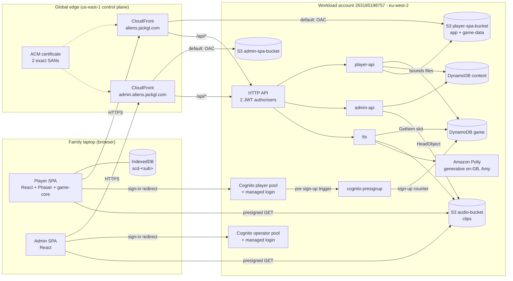
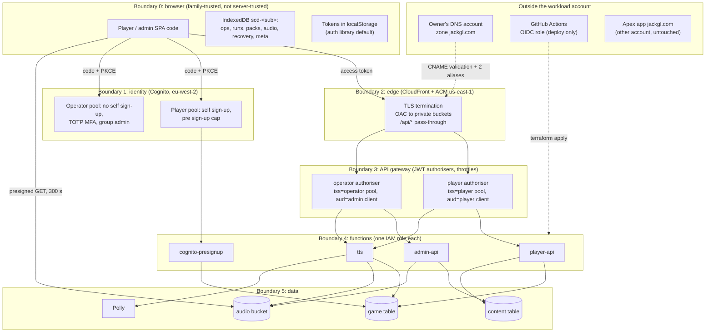
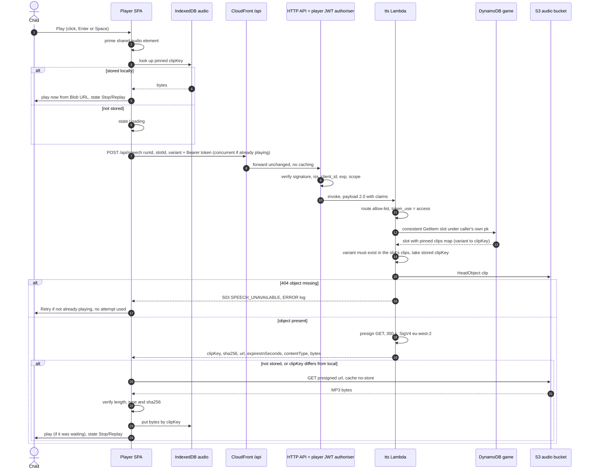
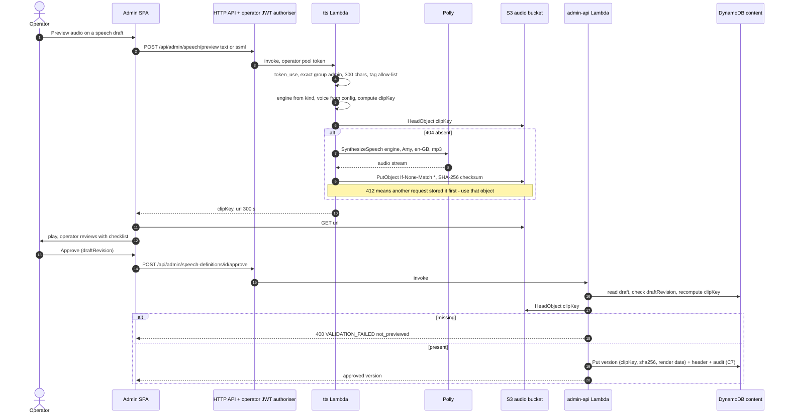
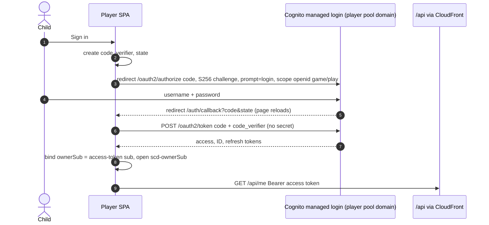
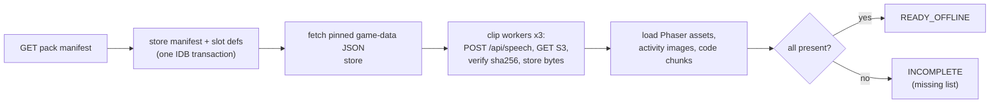

# E. Architecture and service boundaries

This section describes how the pieces fit together and where each boundary sits: the overall architecture, the trust
boundaries (including the existing DNS integration), the dedicated text-to-speech (TTS) flow, the split between React,
Phaser and the pure game core, the four Lambda functions and their IAM, authentication and authorisation, offline
preparation, audio caching and the family-level trust model.

It does not repeat material other sections own. State machines, checkpoint rules, DynamoDB keys and transactions are in
[F. State and data](F-state-and-data.md). Every route's request and response fields are in [G. API contracts](G-api-contracts.md).
Terraform layout, workflows, release order, monitoring and the DNS hand-off procedure are in
[H. Infrastructure and delivery](H-infrastructure-and-delivery.md). Screens and the phonics review workflow are in
[D. UX and content operations](D-ux-and-content-operations.md).

Spec anchors: architecture and trust-boundary diagrams including DNS (`prompt.md:1306`), dedicated TTS design and offline audio
(`prompt.md:1304`), section E brief (`prompt.md:61-62`).

Canon: names, states, keys, routes and rules come from the design spine, [00-spine.md](00-spine.md) (v0.3). Research evidence
cited here is published under [sources/](sources/).

---

## E.1 Architecture at a glance

### E.1.1 Component diagram

Reading the diagram: each app is a static build in its own private bucket behind its own CloudFront distribution. Both
distributions also forward `/api/*` to the one HTTP API, so the browser only ever talks to its own hostname for API calls.
The browser goes directly to two other places: the Cognito managed-login pages (a full-page redirect) and the audio bucket
(a short-lived presigned GET). Four Lambda functions sit behind the API and the player pool; none calls another. `tts`
reads only the `game` table (one slot item) and the audio bucket; it has no `content` access (spine
[S1](00-spine.md#s1-system-shape)).

### E.1.2 Component list

| Component | Purpose | Label |
|---|---|---|
| Player SPA at `aliens.jackgl.com` | Game, learning panels, profile, sync engine | hostname **[CONFIRMED]** `prompt.md:105` |
| Admin SPA at `admin.aliens.jackgl.com` | Content administration, speech preview and approval | hostname **[CONFIRMED]** `prompt.md:107` |
| Two private S3 site buckets + two CloudFront distributions + Origin Access Control | Static hosting; OAC on a regular bucket origin, not the website endpoint | **[CONFIRMED]** `prompt.md:803-805`, `prompt.md:819` |
| One ACM certificate in us-east-1, two exact SANs | CloudFront viewer certificate | **[CONFIRMED]** region rule `prompt.md:819`; two-SAN shape **[PROPOSAL]** |
| One HTTP API in eu-west-2, payload format 2.0, `$default` stage | All authenticated application endpoints | **[CONFIRMED]** API Gateway HTTP API `prompt.md:807`; details **[PROPOSAL]** |
| Two Cognito user pools (players, operators), managed login on Essentials | Sign-up, sign-in, operator MFA | **[PROPOSAL]** (D-10; runner-up one pool + group) |
| Four Python 3.14 arm64 zip Lambdas | `player-api`, `admin-api`, `tts`, `cognito-presignup` | Python Lambda **[CONFIRMED]** `prompt.md:809`; 3.14, arm64 and the split **[PROPOSAL]** |
| DynamoDB `game` and `content` tables | Player-owned records; operator-owned content | DynamoDB **[CONFIRMED]** `prompt.md:811`; two tables **[PROPOSAL]** — see [F](F-state-and-data.md) |
| S3 audio bucket + Amazon Polly (generative engine, en-GB, voice Amy; phonemes and letter names on `tts_phoneme_engine`, default neural) | Reviewed MP3 clips under `tts/v1/`, content-addressed, synthesised once ever and never overwritten | Polly + private S3 **[CONFIRMED]** `prompt.md:563`, `prompt.md:813`; engine and voice **[CONFIRMED by owner]** (E.4.1a); key scheme **[PROPOSAL]** |
| S3 artifacts bucket (created in the **bootstrap root**, beside the existing module call) | Lambda zips by content hash, release manifests, archived builds, saved plans under `plans/<run_id>/` | **[PROPOSAL]** — see [H §H.5](H-infrastructure-and-delivery.md#h5-bootstrap-changes-you-make-no-replacement-bootstrap) |
| CloudWatch logs and alarms → SNS e-mail; AWS Backup | Operations | **[CONFIRMED]** `prompt.md:815-817`; details in [H](H-infrastructure-and-delivery.md) |

Explicitly absent: VPC/NAT, containers, queues, streams, schedulers, WebSockets, GraphQL, Redis, a service worker, a Cognito
identity pool, and any AWS SDK for Polly or S3 in the browser. The infrastructure exclusions are **[CONFIRMED]** `prompt.md:826`,
and so is "no AWS service credentials in the browser" (`prompt.md:589`). Leaving out the service worker follows from
`prompt.md:719` (no offline cold start is promised), and leaving out the identity pool follows from `prompt.md:589`; both are
**[PROPOSAL]**.

### E.1.3 Names

All names follow the reference conventions in spine [S1.1](00-spine.md#s11-naming-verified-reference-conventions-applied-as-proposal) **[PROPOSAL]**: project `space-tower-defence`, environment `prod`,
region `eu-west-2`, account `263185198757` (**[VERIFIED]** [common.auto.tfvars.json:2-3](../../infrastructure/envs/common.auto.tfvars.json#L2-L3),
[prod.tfvars.json:2-3](../../infrastructure/envs/prod.tfvars.json#L2-L3)). Examples: Lambda `space-tower-defence-prod-eu-west-2-tts`,
tables `space-tower-defence-prod-game|content`, pools `space-tower-defence-prod-players|operators`, buckets
`263185198757-eu-west-2-prod-audio-bucket` and similar. [H](H-infrastructure-and-delivery.md) owns the full list.

---

## E.2 Same-origin API through CloudFront

### E.2.1 The pattern

The API has no hostname of its own. Each app calls the relative path `/api/...`. Its CloudFront distribution has an ordered
cache behaviour `/api/*` whose origin is the HTTP API's AWS-generated endpoint (`<api-id>.execute-api.eu-west-2.amazonaws.com`).
This is the reference project's pattern, applied to API Gateway instead of a Lambda Function URL **[VERIFIED]** in
`jacks-productivity-tool/infrastructure/modules/cloudfront/main.tf:194-208` (sibling repository: `path_pattern = "/api/*"`,
`CachingDisabled`, `AllViewerExceptHostHeader`). The reference also attaches a viewer-request function that strips the `/api`
prefix (`main.tf:204-207`); this design deliberately does not, because the route keys keep `/api` (table below). The spec asks to follow that pattern and says a custom API hostname is not
required **[CONFIRMED]** `prompt.md:109`.

| `/api/*` behaviour setting | Value | Why |
|---|---|---|
| Origin | HTTP API default endpoint, HTTPS only | No API certificate or DNS record needed |
| Cache policy | managed `CachingDisabled` | Every API response is per-user; nothing may be cached at the edge |
| Origin request policy | managed `AllViewerExceptHostHeader` | Forwards `Authorization` and the body; API Gateway needs its own `Host` |
| Allowed methods | all seven | `PUT`, `PATCH`, `DELETE`, `POST` are used |
| Path rewrite | none — HTTP API route keys include `/api` (e.g. `POST /api/runs/{runId}/ops`) | No viewer-request function to keep in step with routes |
| `x-origin-verify` secret header | not used | Authentication is the JWT at the gateway, not "came through CloudFront" |

All **[PROPOSAL]** (spine [S1](00-spine.md#s1-system-shape)), modelled on the reference. In the reference, `/api/*` goes to a
Lambda Function URL behind a prefix-stripping CloudFront Function; here it goes to the HTTP API default endpoint and the route
keys keep `/api`. We borrow the same-origin idea, not the origin type.

What this buys: no CORS on the API at all, builds that contain no environment values (the API base is always `/api`), and
one CSP `connect-src` entry (`'self'`) for API calls. The trade-off: the `execute-api` endpoint stays reachable directly.
That is acceptable because every route requires a valid access token with the right scope, and stage/route throttles apply
either way. AWS WAF cannot be attached to an HTTP API stage (Terraform provider docs, [sources/05-cognito-auth.md](sources/05-cognito-auth.md) §9, **[VERIFIED]** there),
and HTTP APIs have no resource policy to close it either (**[VERIFIED]** API Gateway developer guide, "Choose between REST
APIs and HTTP APIs", Authorization table: resource policies and AWS WAF are not supported for HTTP APIs). The endpoint cannot be disabled because CloudFront uses it.

`AllViewerExceptHostHeader` forwarding `Authorization` is documented ("all headers except Host") and works in the reference,
but has not been tested against API Gateway in this account **[UNVERIFIED]** — the release smoke check (it iterates
`contracts/routes.json` and expects 401 without a token for every route on both distributions) plus a Milestone 1
authenticated call settles it (see "Unverified items to check" at the end).

### E.2.2 Why custom error responses must not be distribution-wide

The reference distribution maps origin `403 → 200 /index.html` (SPA deep links) and `502/503/504 → 503 /504.html`
(maintenance page) using `custom_error_response` blocks **[VERIFIED]** `jacks-productivity-tool/infrastructure/modules/cloudfront/main.tf:223-249`.
`CustomErrorResponses` belong to the whole distribution, not to a cache behaviour (**[VERIFIED]** against the CloudFront
`DistributionConfig` API reference during planning research). Copied here, they would also rewrite API responses:

| API response | What the browser would receive if copied | Damage |
|---|---|---|
| `403 FORBIDDEN` (operator-pool token without the exact `admin` group on an admin route, AC-04; a player token is already refused by the gateway with 401) | `200` with `index.html` | Client parses HTML as JSON; access-control tests pass for the wrong reason |
| `503 SPEECH_UNAVAILABLE`, `503 THROTTLED` | `503` with maintenance HTML, no error envelope | Client cannot tell "retry" from "speech missing"; Retry/RETRYING logic breaks |
| `502 SPEECH_SYNTHESIS_FAILED` (preview) | `503` maintenance page | Operator sees an outage instead of "try again" |

So **[PROPOSAL]** (spine [S1](00-spine.md#s1-system-shape)): no `custom_error_response` on either distribution. Deep-link fallback is done by a small
**CloudFront Function attached to the default behaviour only** (viewer request): a URI with no file extension, not under
`/api/`, is rewritten to `/index.html`. Missing hashed assets then still return a real 403/404, which is what you want.
`/api/*` responses reach the browser exactly as API Gateway or Lambda produced them, including the gateway's own
envelope-less 401 and 429 (error table in [G](G-api-contracts.md)).

### E.2.3 What the browser loads from where

| Path (same origin) | Source | Cache rule (owner: [H](H-infrastructure-and-delivery.md)) |
|---|---|---|
| `/index.html`, `/config.json` | site bucket | no-cache; written last by the release |
| `/assets/*` (hashed JS, CSS, images, atlases) | site bucket | immutable; never deleted, so an open old tab still finds its chunks |
| `/game-data/<kind>/<version>.json` (kinds `ruleset`, `campaign`, `asset-manifest`, `bounds`) | player site bucket | immutable paths **[PROPOSAL]** spine [S5.1](00-spine.md#s51-pins-and-game-data) |
| `/game-data/current.json` | player site bucket | no-cache; names versions for new runs; invalidated by the release together with `index.html` and `config.json` **[PROPOSAL]** |
| `/api/*` | HTTP API | never cached |

`config.json` (`region`, `userPoolId`, `clientId`, `authDomain`, `scope`, `apiBase: "/api"`, `releaseId`; exact list in
[H §H.8.5](H-infrastructure-and-delivery.md#h85-static-publish-order-step-6)) is written by the release from
`terraform output -json` and fetched before the auth library is configured **[PROPOSAL]** spine [S11.1](00-spine.md#s111-workflows).

An already-open older tab can read a newer `current.json`. Before it sends `POST /api/runs`, the client checks that
`game-core` supports the named ruleset's `mechanics`; if not, it shows "Reload to update" instead of creating a run it
cannot play (H §H.8.5) **[PROPOSAL]**. If the server does not know the versions the client names (for example after a
rollback), `POST /api/runs` returns `409 CONTENT_VERSION_UNSUPPORTED` and the client re-reads `current.json`
([G](G-api-contracts.md)).

---

## E.3 Trust boundaries and DNS integration

### E.3.1 Trust-boundary diagram

Reading the diagram: each arrow that crosses a boundary carries one kind of credential. The browser holds only Cognito
user-pool tokens and, briefly, a presigned URL. The gateway decides "which pool and which app client issued this token"
(boundary 3); the function decides "is this caller allowed this record" (boundary 4); IAM decides "which tables, prefixes and
services can this function touch at all" (boundary 4→5). The DNS account and GitHub Actions only touch configuration, never
runtime requests. GitHub Actions is the **only** deployment path for the main stack: no local `terraform apply`; local
`fmt`/`validate`/`plan` and read-only AWS calls are fine; the bootstrap root is the one exception, applied locally by the owner
**[CONFIRMED by owner]** (spine [S0.1](00-spine.md#s01-way-of-working-confirmed-by-owner-2026-11-14)). The existing app on the
apex `jackgl.com` lives in another account and shares nothing with this design except the parent zone (E.3.3).

### E.3.2 What each boundary enforces

| Boundary | Enforces | Does not enforce | Label |
|---|---|---|---|
| 0 Browser | Local judging offline, one playing tab (`scd-play` Web Lock), one account per page load, reducer preconditions | Anything the server must rely on (all of it is inspectable and modifiable) | trust model **[CONFIRMED]** `prompt.md:745-759`; mechanisms **[PROPOSAL]** |
| 1 Identity | Who the user is (`sub`); operator membership only by IAM-authorised admin APIs; operator MFA | Ownership of records; per-route permission | **[PROPOSAL]** |
| 2 Edge | HTTPS, private origins via OAC, no caching of `/api/*` | Authentication (it forwards `Authorization` untouched) | **[PROPOSAL]** |
| 3 Gateway | Signature, `iss`, audience (`client_id`), expiry, route scope; throttles | `token_use`, groups, ownership | **[VERIFIED]** authoriser checks — [sources/05-cognito-auth.md](sources/05-cognito-auth.md) §3.2 |
| 4 Functions | `token_use = access`, exact `admin` group, route-key allow-list, ownership by `sub`, schemas, limits, ordering, bounds, idempotency | — | **[PROPOSAL]** spine [S2](00-spine.md#s2-trust-model-confirmed-family-level-trust-mechanisms-proposal), [S7.1](00-spine.md#s71-envelope-and-per-op-processing) |
| 4→5 IAM | Per-function table, key-prefix and action limits | Which voice/engine Polly uses (IAM cannot restrict it — code allow-list, **[CONFIRMED by owner]**) | **[VERIFIED]** Polly IAM limits — [sources/06-polly-tts.md](sources/06-polly-tts.md) §8.1 |

### E.3.3 DNS integration points (no redesign)

DNS stays in the owner's DNS account, and the owner integrates it **[CONFIRMED]** `prompt.md:27`, `prompt.md:822`. This plan
adds no Route 53 zone and no DNS record of its own; it only exposes the inputs below **[PROPOSAL]** spine
[S1](00-spine.md#s1-system-shape). The reference
project looks the zone up in the same account (`data "aws_route53_zone"` at `jacks-productivity-tool/infrastructure/main/data.tf:6-9`)
and creates the records itself (`aws_route53_record` at `jacks-productivity-tool/infrastructure/modules/cloudfront/main.tf:83`,
`:315`, `:328`) **[VERIFIED]**. That same-account lookup cannot work as-is, because the zone sits in another account.
`prompt.md:822` asks to reuse the owner's established lookup/provider pattern, and the owner will handle that integration, so the
owner applies their approach to the outputs below.

| # | Integration point | Record(s) in `jackgl.com` | Terraform supplies (output) | When | Label |
|---|---|---|---|---|---|
| 1 | ACM DNS validation for `aliens.jackgl.com` and `admin.aliens.jackgl.com` (one certificate, us-east-1) | One validation CNAME per SAN (name → value) | `acm_validation_records` (name, type, value) | Before the certificate can be issued, so before the distributions can use it | **[CONFIRMED]** integration; output name **[ASSUMPTION]** |
| 2 | Player hostname | `aliens.jackgl.com` alias → player distribution | distribution domain name + CloudFront hosted zone ID | After the player distribution exists | hostname **[CONFIRMED]** `prompt.md:105`; alias **[PROPOSAL]** spine S1 |
| 3 | Admin hostname | `admin.aliens.jackgl.com` alias → admin distribution | same, for the admin distribution | After the admin distribution exists | hostname **[CONFIRMED]** `prompt.md:107`; alias **[PROPOSAL]** spine S1 |

Points that need no DNS work: the API (same-origin, E.2), the Cognito managed-login pages (Cognito prefix domains on
`amazoncognito.com`, **[PROPOSAL]** [sources/05-cognito-auth.md](sources/05-cognito-auth.md) §11), and the audio bucket (regional S3 endpoint). Whether the aliases are
A only or A + AAAA depends on enabling IPv6 on the distributions — a routine choice **[ASSUMPTION]**: enable IPv6 and
create both. The owner creates all of these records in the DNS account from the Terraform outputs; the workload stack has
no DNS-account provider alias (H §H.3.1, §H.15) **[PROPOSAL]**. If the owner later wires the DNS account into Terraform,
the records become resources behind one extra provider alias, and the integration points above stay the same. The ordering
consequence (a small foundation apply for the certificate first, then the normal release) and the exact hand-off steps are
in [H §H.15](H-infrastructure-and-delivery.md#h15-dns-hand-off).

### E.3.4 Coexisting with the existing apex app

An HTTPS app (a separate app and API, in another account) already serves the apex `jackgl.com`; `aliens.jackgl.com` and
`admin.aliens.jackgl.com` do not exist yet **[CONFIRMED by owner]** (spine
[S1.0](00-spine.md#s10-dns-hand-off-facts-confirmed-by-owner-2026-11-14-unless-marked)). The two never collide at runtime:
different hostnames are different browser origins, so storage, the `scd-play` Web Lock and IndexedDB are not shared.

| Interaction with the apex | Effect on this design | Action | Label |
|---|---|---|---|
| CAA records on `jackgl.com`, if any | ACM can only issue the certificate if CAA allows `amazon.com` | Check CAA before requesting the certificate (H §H.15) | **[CONFIRMED by owner]** checklist item |
| A wildcard alternate domain name `*.jackgl.com` on the apex CloudFront distribution | Could block adding `aliens.jackgl.com` to a distribution in another account | Inspect the apex distribution's alternate domain names before M1 | **[UNVERIFIED]** (see the final table) |
| Apex cookies set with `Domain=jackgl.com` | The browser also sends them to our hostnames | None: our API authenticates with bearer tokens, never cookies | **[CONFIRMED by owner]** harmless |
| HSTS `includeSubDomains` on the apex | Forces HTTPS on our hostnames | None: CloudFront serves HTTPS only | **[CONFIRMED by owner]** fine |
| Apex and `www` records | Belong to the other app | Never touched; no record is ever created with `allow_overwrite` | **[CONFIRMED by owner]** |

---

## E.4 The dedicated TTS service

The spec requires a visible Play button that calls an API endpoint, which invokes a dedicated Python TTS Lambda and delivers
audio to the browser (`prompt.md:561`); the API route plus that Lambda are "the microservice", with no forwarding Lambda
(`prompt.md:585`) **[CONFIRMED]**. Here that service is the `tts` function behind `POST /api/speech` (players) and
`POST /api/admin/speech/preview` (operator).

### E.4.1 One render path, three uses

| Use | Route / caller | Calls Polly? | Writes | Label |
|---|---|---|---|---|
| Preview (operator) | `POST /api/admin/speech/preview` → `tts` | Yes, only if the clip object is absent | S3 `PutObject If-None-Match: *` only | **[PROPOSAL]** spine [S5.2](00-spine.md#s52-activities-templates-speech) |
| Approve (operator) | `POST /api/admin/speech-definitions/{id}/approve` → `admin-api` | Never | `content`: speech version (with clip key, `sha256` of the MP3 bytes, render date, review record, `fromDraftRevision`) + header + audit (C7) | **[PROPOSAL]** spine S5.2 |
| Play / pack preparation (player) | `POST /api/speech` → `tts` | **Never** | nothing | **[PROPOSAL]** spine S5.2; narrows `prompt.md:577` (owner decision D-12) |

The clip key is the SHA-256 of the canonical synthesis input (text/SSML, locale, voice, engine, output format, generation
number), computed by one shared Python module used by `tts` and `admin-api` **[PROPOSAL]** spine S5.2. That satisfies the
cache-identity rule (`prompt.md:591`): nothing personal is ever part of the input. Because the key is content-addressed and
objects are written with `If-None-Match: *` and never deleted, **the bytes the operator heard in preview are byte-for-byte
the bytes children hear**. That is the reason Play never synthesises: a cache miss at play time would produce unreviewed
audio.

Content addressing also gives reuse for free: a clip is **synthesised once ever** and shared by every activity that uses the
same text + voice + engine + settings, and the browser stores those bytes once per `clipKey` **[CONFIRMED by owner]**. Note the
two different hashes: `clipKey` hashes the synthesis *input*; `sha256` hashes the MP3 *bytes* and lets the client check a
download (E.9).

### E.4.1a Voice and engine configuration

| Setting | Value | Label |
|---|---|---|
| Engine for ordinary speech (`kind` WORD, INSTRUCTION, DICTATION) | Terraform variable `tts_engine`, default `generative` (Polly's newest engine) | **[CONFIRMED by owner]** |
| Engine for isolated sounds (`kind` PHONEME, LETTER_NAME) | `tts_phoneme_engine`, default `neural`, because AWS documentation contradicts itself on `<phoneme>` support in the generative engine. The M0 listening bake-off decides; if generative passes, the variable is set to `generative` | **[CONFIRMED by owner]**; generative `<phoneme>` support **[UNVERIFIED]** |
| Voice and locale | `tts_voice_id`, default `Amy`; en-GB | **[CONFIRMED by owner]** |
| Where the variables go | Lambda environment of `tts` (renders) and `admin-api` (recomputes the key at approval) | **[CONFIRMED by owner]** |
| Who chooses | Server configuration only; the request never names a voice or engine. The allow-list is code, because IAM cannot restrict Polly voice or engine | **[CONFIRMED by owner]** |
| Speech definition fields | `kind` (WORD \| PHONEME \| LETTER_NAME \| INSTRUCTION \| DICTATION), `provider` (`"polly"`), `engine`, `voiceId`, text/SSML; the approved version also records the render date | **[CONFIRMED by owner]** |
| Changing a variable | Affects **new previews only**: voice and engine are part of the clip identity, so a change produces new keys. Approved clips keep their bytes until an operator re-previews and re-approves them; there is no silent re-voicing | **[CONFIRMED by owner]** |
| Sounds that fail the listening test | Human recordings are the fallback. A machine check refuses a PHONEME definition whose sound has a `word-only` verdict in `content/listening-verdicts.json` (to create) | fallback **[CONFIRMED by owner]**; check **[PROPOSAL]** |
| Rejected alternative | Amazon Nova Sonic: conversational speech-to-speech, no SSML, not in eu-west-2, experimental Python SDK ([sources/11-voice-engine.md](sources/11-voice-engine.md)) | **[CONFIRMED by owner]** |

Engine and voice evidence: [sources/06-polly-tts.md](sources/06-polly-tts.md) §2–§3. The review checklist and the listening
workflow are in [D](D-ux-and-content-operations.md).

Deviation to flag: the spec's proposed flow has the player path synthesise on a cache miss (`prompt.md:577`). Here a missing
object on the player path returns `503 SPEECH_UNAVAILABLE`, logs at ERROR, and fires the `SPEECH_UNAVAILABLE` alarm
**[PROPOSAL]**, recorded as owner decision D-12 in [B](B-scope-and-decisions.md). It can only happen if a clip was deleted or
an approval was faked, both of which the design prevents.

### E.4.2 Online Play sequence

The Play rule **[CONFIRMED by owner]** (spine [S5.2](00-spine.md#s52-activities-templates-speech)): if the bytes for the
slot's pinned `clipKey` are already stored locally, playback starts **immediately** from those bytes and `POST /api/speech`
is sent concurrently, so the authenticated TTS call is still made on every online Play (AC-19) without the child waiting for
it. Only when the bytes are not stored does the client wait for the response, download, verify and store before playing.

Reading the diagram: the local lookup comes first, so a prepared clip plays at once; the API call still happens on every
online Play (`prompt.md:587`, AC-19). When nothing is stored, the child waits for the service and the download. If the
response names a different `clipKey` from the stored one, the mismatch is logged, the server's clip is downloaded and stored,
and it is used from the next Play; the current Play is not interrupted. The browser downloads from S3 directly, never through
the API. Any failure leads to Retry (when nothing is playing) and never to an attempt (`prompt.md:615`, AC-22).

Rules inside `tts` on the player path **[PROPOSAL]** spine [S3.3](00-spine.md#s33-activity-slot), S9, [S2](00-spine.md#s2-trust-model-confirmed-family-level-trust-mechanisms-proposal) ("Speech is resolved,
never free text": the clip comes from the slot's pinned clips map); the field-level contract is [G R15](G-api-contracts.md#r15-post-apispeech-player):
- The request carries identifiers only: `{runId, slotId, variant}`. It never carries text or SSML (`prompt.md:589`, AC-20).
- Ownership is the key: the slot is read under `U#<token sub>`, so another player's `runId` simply is not found.
- The slot pin is the only authority: `variant` must be a key of the slot's pinned `clips` map (each entry
  `{speechId, speechVersion, clipKey}`, copied from the activity version at slot creation, [F §4.2](F-state-and-data.md#42-slot-fields-and-write-rules));
  the clip key signed is the one stored there, never one built from the request. So the player path is one `GetItem` on
  `game` plus one `HeadObject` (which also supplies `bytes`), with no `content` read — `tts` has no `content` permission at all.
- "Object missing" means HeadObject returned 404. The `tts` role has `s3:ListBucket` scoped by `s3:prefix` `tts/v1/*`, so S3
  answers a missing key with 404 rather than 403 (**[VERIFIED]** S3 API reference, HeadObject, Permissions). A 404 gives
  `503 SPEECH_UNAVAILABLE` and the ERROR log; a 403 is a real permission fault and is handled as an internal error, not as
  "missing" (E.6.4).
- The response carries `sha256` of the MP3 bytes so the client can verify the download (E.9). Because `tts` has no `content`
  access and the slot pin holds only `{speechId, speechVersion, clipKey}`, I'd suggest the value comes from S3 itself: preview
  writes the object with `ChecksumAlgorithm = SHA256`, and the same `HeadObject` call (with `ChecksumMode = ENABLED`) returns
  it, converted to hex. `admin-api` records the same value on the speech version at approval **[PROPOSAL]**; S3 returning the
  stored checksum on HeadObject is **[UNVERIFIED]** here (final table).
- Slot status is not checked (pack preparation fetches clips for future slots).
- Every failure of ownership, slot or variant returns the same `404 NOT_FOUND`, so the route cannot be used to probe.
- The URL is returned once and never logged; log lines carry the spine S2 allow-listed fields only.

### E.4.3 Preview and approve sequence (operator)

Reading the diagram: only preview can create audio, and only an object that already exists can be approved. Both `tts` and
`admin-api` hold prefix-scoped `s3:ListBucket`, so "absent" and "missing" are true 404s; a 403 is a real permission fault and
surfaces as an error, never as "not previewed". The engine is chosen from the definition's `kind` (E.4.1a); because voice and
engine are part of the key, a changed `tts_*` variable simply produces a new key on the next preview. Approval binds the
speech version to a clip key and the bytes' `sha256`. A stale `draftRevision` returns `409 DRAFT_CONFLICT`; a repeat whose
`draftRevision` equals the stored `fromDraftRevision` returns the existing version (safe retry). Activity publication later
ConditionChecks that every referenced speech version is approved (C4 in [F](F-state-and-data.md)). The review checklist and
quality gate are in [D](D-ux-and-content-operations.md).

Preview validation is code, not IAM: Polly has no service-specific condition keys and `SynthesizeSpeech` without lexicons
needs `Resource: "*"`, so voice, engine, length and tags can only be limited in the function **[VERIFIED]**
[sources/06-polly-tts.md](sources/06-polly-tts.md) §8.1. SSML is parsed with an XML parser that rejects DTDs and entities
**[PROPOSAL]**. The preview route is throttled to 2 rps / burst 5 (spine [S9.5](00-spine.md#s95-limits-one-shared-limits-file-read-by-client-and-handlers-numbers-assumption), **[ASSUMPTION]** numbers).

In M0 the listening bake-off renders candidate clips with the AWS CLI from the same canonical inputs, before any of this
exists; in M1 the approved clips are re-rendered through the real preview route ([J](J-execution-backlog.md)) **[PROPOSAL]**.

### E.4.4 Offline Play

Offline, Play reads the bytes for the slot's pinned `clipKey` from IndexedDB and plays them; no request is attempted and the
UI never claims to have reached the service (`prompt.md:707`, `prompt.md:717`) **[CONFIRMED]**. A missing clip offline is an
availability problem (`prompt.md:713`): an audio-dependent activity whose clip is not held is not shown as ready
(`prompt.md:617`) and the run stops at that boundary (`OFFLINE_PACK_INCOMPLETE`, spine [S7.4](00-spine.md#s74-offline-rules)).

---

## E.5 React, Phaser and game-core

The spec splits responsibilities between React and Phaser (`prompt.md:824`) **[CONFIRMED]**. The plan adds a third piece, a
pure TypeScript `game-core` package, so the rules can be tested without a browser and mirrored by Python **[PROPOSAL]** spine
[S10](00-spine.md#s10-react--phaser-split-proposal).

Why a pure core: the simulation and the rules reducer are the parts that must give the same answer every time (on any
frame rate, in tests, and on the server). A "pure" module takes inputs and returns outputs with no hidden reads of the
screen, the clock or the network, which is what makes it repeatable and unit-testable.

### E.5.1 Workspace layout (all to create)

**[PROPOSAL]** spine [S10](00-spine.md#s10-react--phaser-split-proposal). The extra `web/shared` contents (audio playback module, API client) are a proposal from this section.

| Package | Contains | Must not import |
|---|---|---|
| `web/game-core` (to create) | fixed-timestep simulation, rules reducer, next-phase rule, seeded RNG | Phaser, React, DOM, `fetch`, IndexedDB |
| `web/player` (to create) | React app + Phaser scene + sync engine | — |
| `web/admin` (to create) | React admin app (incl. preview-solve, which renders the shared learning panel) | Phaser |
| `web/shared` (to create) | API types, limits file, answer canonicaliser, test vectors, the **shared learning panel** (React, the six interaction types), audio playback module, API client | Phaser |
| `contracts/` (to create) | JSON Schemas, `routes.json` (the route list the release smoke check and the plan route-key gate compare against), `golden/` (additive-only), shared op-sequence and answer fixtures (run by Vitest and pytest) | — |

Why the learning panel lives in `web/shared` **[PROPOSAL]**: the operator's preview-solve must show exactly what a child will
see, so the admin app renders the same component instead of a look-alike. Keeping it free of Phaser lets the admin build stay
small.

The other top-level folders belong to [H §H.2](H-infrastructure-and-delivery.md#h2-repository-layout-after-this-plan): the
Python Lambda source is `api/` (to create; `api/functions/{player_api,admin_api,tts,cognito_presignup}/` plus a shared
`api/shared/` package), and game-data JSON is authored in `game-data/` (to create) and published to `/game-data/` on the
player site. `web/` and `contracts/` are owned here.

### E.5.2 Who owns what

| Concern | React (`player`) | Phaser scene | `game-core` |
|---|---|---|---|
| Routing, sign-in/out, profile, run list | ✔ | | |
| HUD, shop, upgrade/sell/targeting panels, dialogs | ✔ (HUD updates ≤ 10 Hz) | | |
| Learning panels (six interaction types), Play button, audio | ✔ (components and answer canonicaliser from `web/shared`) | | |
| Keyboard shortcuts and accessible controls | ✔ (DOM) | keyboard capture disabled | |
| Battlefield rendering, animation, pointer-to-pad mapping | | ✔ | |
| Simulation tick (60 Hz fixed step), wave RNG from `(seed, wave)` | | drives the loop | ✔ logic |
| Economy mutations (place, upgrade, sell) | sends command | forwards | ✔ validated at tick boundaries (AC-09) |
| Run rules (which op is legal now, next phase) | asks | | ✔ reducer |
| Sync status, op queue, IndexedDB | ✔ (sync engine) | | creates ops via reducer |

**[PROPOSAL]** spine [S10](00-spine.md#s10-react--phaser-split-proposal). Nothing per-frame crosses into React, and nothing during combat is sent to the API (`prompt.md:824`,
spine S3.2 "Nothing is persisted during combat").

### E.5.3 The bridge

`GameBridge` is a small typed command/event interface **[PROPOSAL]** spine [S10](00-spine.md#s10-react--phaser-split-proposal). Commands go React → game; events are
past-tense facts going game → React.

| Commands | Events |
|---|---|
| `loadRun`, `startWave`, `pause`, `resume`, `setSpeed`, `place`, `upgrade`, `sell`, `setTargeting`, `usePower`, `selectPad` | `hud`, `selectionChanged`, `waveCleared{snapshot, stats}`, `defeated{wave}`, `commandRejected` |

The simulation has its own pause flag: page hidden or a dialog open pauses it, and only an explicit Resume clears it, because
Phaser auto-resumes on tab return otherwise (**[VERIFIED]** during planning research). Fixed-step details (integer
accumulator in 1/60,000 s units, at most 30 steps per frame, the remainder discarded when the cap is hit) are in spine S10 and
[C](C-game-and-learning-design.md). The 30/60/144 Hz determinism test follows from `prompt.md:303` and AC-13 and is in
[I](I-validation.md); AC-42 is only the busiest-wave performance target.

---

## E.6 Lambda and API boundaries

### E.6.1 Why these four functions

The spec asks for "a small number of cohesive Python Lambda boundaries for player/run operations, content administration
and dedicated speech" (`prompt.md:809`) **[CONFIRMED]**. The split follows data ownership and IAM blast radius **[PROPOSAL]**:

| Function | Why it exists as its own function | Why it is not split further |
|---|---|---|
| `player-api` | Owns every write to player records; a run op's transaction (session fence + run + slot + summary + profile) must be decided in one place | Splitting profile/runs/session would duplicate the fence and ownership logic and need cross-function calls |
| `admin-api` | Only writer of `content`; its role never touches `game`, so a bug in admin code cannot reach children's saves | Content lifecycle is one cohesive domain |
| `tts` | Spec-mandated dedicated speech microservice; the only role with `polly:SynthesizeSpeech` and `s3:PutObject` on clips; never writes DynamoDB and never reads `content` | Player Play and operator preview share the clip-key module and the render path; separate roles would be possible later (same package, two functions) |
| `cognito-presignup` | Cognito triggers are invoked by Cognito, not by the API; it needs one conditional write and nothing else | — |

### E.6.2 Why no Lambda calls another

| Reason | Detail |
|---|---|
| Spec | No forwarding Lambda that merely calls another Lambda (`prompt.md:585`) **[CONFIRMED]** |
| Latency and timeouts | HTTP API integrations stop at 30 s (**[VERIFIED]** [sources/06-polly-tts.md](sources/06-polly-tts.md) §10.2); a chained call stacks cold starts and timeouts inside that budget. Every API-facing function's timeout therefore sits below 30 s: `player-api` 25 s (spine [S1](00-spine.md#s1-system-shape), superseding the earlier "< 60 s"), `admin-api` and `tts` 15 s ([H §H.4.4](H-infrastructure-and-delivery.md#h44-lambda_function-called-four-times)). The 60 s WHOLE_PROFILE reset lease (spine [S8.2](00-spine.md#s82-resets-post-apimeresets-type-confirm-confirm-must-equal-type-idempotent-200-only-when-finished)) outlasts the 25 s timeout |
| IAM clarity | Each role describes everything its function can do; `lambda:InvokeFunction` on another function would quietly extend it |
| Failure modes | One request = one function = one log stream and one error code; no partial failure between two functions |
| Sharing | Shared logic (clip key, generators, reducer, group check, limits, logging allow-list) is the Python package `api/shared/` (to create), bundled into each of the four zips at build time ([H §H.2](H-infrastructure-and-delivery.md#h2-repository-layout-after-this-plan)), not a network call |

So `admin-api` never asks `tts` to synthesise, and `tts` never asks `player-api` about ownership: it reads the slot item
itself (`GetItem` only). **[PROPOSAL]** spine [S1](00-spine.md#s1-system-shape).

### E.6.3 Route → function → authoriser

Full contracts are in [G](G-api-contracts.md). Summary **[PROPOSAL]** spine
[S9](00-spine.md#s9-api-surface-proposal-all-routes-under-api-json-authorization-bearer-access-token). The scope names are the
resource-server scopes `game/play` (player pool) and `ops/content` (operator pool), set by the Terraform variables
`player_route_scope` and `operator_route_scope` ([H §H.3.2](H-infrastructure-and-delivery.md#h32-variablestf)), recorded in
spine [S1](00-spine.md#s1-system-shape) and used the same way in
[G §1.1](G-api-contracts.md#11-transport-base-path-and-authentication) **[PROPOSAL]**.

| Routes | Function | Authoriser | Scope required **[PROPOSAL]** | Extra checks in code |
|---|---|---|---|---|
| `GET /api/me`, `GET /api/me/progress`, `PUT/PATCH /api/me/profile`, `POST /api/me/resets` | player-api | player | `game/play` | token_use; DOB write-only |
| `GET /api/planets`, `GET/POST /api/runs`, `GET /api/runs/{runId}`, `GET …/pack`, `POST …/ops`, `POST …/endless` | player-api | player | `game/play` | ownership by `sub`; fence; limits |
| `PUT/DELETE /api/session` | player-api | player | `game/play` | ownership of `runId` |
| `POST /api/speech` | tts | player | `game/play` | slot ownership; variant in pinned map |
| `POST /api/admin/speech/preview` | tts | operator | `ops/content` | exact group `admin`; input validation |
| `/api/admin/speech-definitions…`, `/api/admin/activities…`, `GET /api/admin/bank-status` | admin-api | operator | `ops/content` | exact group `admin` |

Shared handler rules **[PROPOSAL]** spine S2, S9.5:
- Authorisation is decided from the route key **before** any lookup; a route key not in the function's table is denied.
- `/api/admin/*` requires the operator authoriser **and** the group check in code; a contract test asserts every admin route
  returns 403 (or the gateway's 401) for a player token (AC-04).
- Bodies are size-checked on the raw body (64 KB for `/ops` and the admin activity draft `PUT`, 8 KB elsewhere, including
  `/endless` and the speech draft; [G §1.4](G-api-contracts.md#14-request-limits-applied-before-any-business-logic)) and parsed
  against strict per-route schemas; handlers write named attributes only, never a merged body.
- Logging is allow-list only (requestId, routeKey, sub, runId, slotId, opId, op type, result/code, revision, generation,
  duration; the exact field names and the admin audit fields are in [G §15](G-api-contracts.md#15-logging-allow-list)). Never
  raw events, bodies, `Authorization`, presigned URLs, answers, nicknames or DOB.
- Throttles: stage 20 rps / burst 40; `POST /api/runs` 1/5; `POST /api/speech` 20/40; admin speech 2/5 **[ASSUMPTION]** numbers.
  HTTP API throttles are shared by all callers and best-effort, not per user ([sources/06-polly-tts.md](sources/06-polly-tts.md) §10.2).
- Access logs carry the same allow-listed fields plus the diagnostic fields `integrationLatency`, `integrationError` and
  `authorizerError`, which hold no player data (spine S1).
- The set of route keys in the Terraform plan must equal `contracts/routes.json`; gate G-12 (H.10) checks it, so a route
  cannot exist without an authoriser and a contract ([H](H-infrastructure-and-delivery.md), [I](I-validation.md)).

### E.6.4 Per-function IAM

One role per function, named `…-<component>-role` **[PROPOSAL]** spine [S1](00-spine.md#s1-system-shape), S1.1. Every role
also gets write access to its own log group only.

| Function | DynamoDB | S3 | Other | Never |
|---|---|---|---|---|
| `player-api` | `game`: GetItem, Query, PutItem, UpdateItem, DeleteItem, ConditionCheckItem, BatchWriteItem with `dynamodb:LeadingKeys` limited to `U#*`; `content`: GetItem, Query, BatchGetItem | player site bucket: GetObject on `game-data/*` (bounds files; H §H.4.4) | — | `SYS#*` keys, `content` writes, Polly, audio bucket, any Cognito API |
| `admin-api` | `content`: GetItem, Query, BatchGetItem, PutItem, UpdateItem, DeleteItem (R31 activity delete, owner decision 2026-11-16; R32 speech delete, owner ask 2026-11-16), ConditionCheckItem | audio bucket: GetObject on `tts/v1/*` + ListBucket with `s3:prefix` `tts/v1/*` (so a missing key is 404, not 403) | env `tts_voice_id`, `tts_engine`, `tts_phoneme_engine` (to recompute the key) | `game` (any action), Polly, PutObject, DeleteObject, Cognito |
| `tts` | `game`: GetItem only; **no `content` access** | audio bucket: GetObject, PutObject on the clip prefix `tts/v1/*` (H §H.4.6) + ListBucket with `s3:prefix` `tts/v1/*` | `polly:SynthesizeSpeech` on `*`, with `aws:RequestedRegion = eu-west-2`; env `tts_voice_id`, `tts_engine`, `tts_phoneme_engine` | any DynamoDB write, `content`, DeleteObject, other buckets, Cognito |
| `cognito-presignup` | `game`: UpdateItem with `dynamodb:LeadingKeys = SYS#SIGNUPS` | — | — | everything else, including all Cognito permissions |

Notes:
- The exact action list per function is **[PROPOSAL]**; the "Data access" column of spine S1 is the authority.
- `tts` has no `content` permission: the player path resolves the clip from the slot's pinned clips map (E.4.2) and preview
  reads nothing from DynamoDB (spine S1, S2; G R15).
- Reserved concurrency is not set at first; a new account's Lambda concurrency quota may be too low to reserve any, so H
  checks Service Quotas in Milestone 0 ([H §H.4.4](H-infrastructure-and-delivery.md#h44-lambda_function-called-four-times))
  **[PROPOSAL]**. Polly cost is capped instead by preview being the only Polly path and its 2/5 route throttle.
- Transactions are authorised per contained action (PutItem/UpdateItem/DeleteItem/ConditionCheckItem); there is no
  `TransactWriteItems` IAM action, so it is not listed (**[VERIFIED]** DynamoDB developer guide, "Using IAM with DynamoDB
  transactions"). The policy can optionally be tightened further with the `dynamodb:EnclosingOperation` condition key.
  The first transaction against the real table still proves the policy (moto does not enforce IAM).
- `s3:ListBucket` on the audio bucket ARN with `Condition StringLike s3:prefix = "tts/v1/*"` is granted to both `tts` and
  `admin-api`. Without it, HeadObject on a missing key returns 403, not 404 (**[VERIFIED]** S3 API reference, HeadObject,
  Permissions), and "missing" could not be told apart from "forbidden".
- No role has `cognito-idp:AdminAddUserToGroup`, `AdminCreateUser`, `AdminSetUserPassword` or `UpdateUserPool*`; operator
  creation and password resets are owner runbook steps with the owner's own credentials
  ([sources/05-cognito-auth.md](sources/05-cognito-auth.md) §4.4) **[PROPOSAL]**.
- The CI role (`space-tower-defence-prod-github-oidc`, AdministratorAccess) is a deploy-time identity, not a runtime one, and
  the only identity that applies the main stack **[CONFIRMED by owner]**. Its trust narrowing (`trusted_subs`, the GitHub
  environment design settled by the M0 OIDC smoke test) is in [A](A-repository-findings.md) and
  [H](H-infrastructure-and-delivery.md).

---

## E.7 Authentication and authorisation

### E.7.1 Design summary

| Decision | Value | Label |
|---|---|---|
| Pools | Two: players (self sign-up) and operators (AdminCreateUser only, TOTP MFA required, group `admin`) | **[PROPOSAL]** D-10; runner-up one pool + `admin` group |
| Sign-in flow | Cognito managed login, authorisation code + PKCE, public clients with no secret | **[CONFIRMED]** `prompt.md:777` |
| Tier | Essentials (managed login needs it; first 10,000 MAU free) | **[VERIFIED]** [sources/05-cognito-auth.md](sources/05-cognito-auth.md) §2.1 (price to re-check) |
| Player identifier | Username + password only; `case_sensitive = false`; no e-mail/phone; auto-confirm by pre sign-up within a daily cap | **[PROPOSAL]** spine [S1](00-spine.md#s1-system-shape), [S1.2](00-spine.md#s12-sign-up-control-proposal-numbers-assumption) |
| Sign-up control | `cognito-presignup` counts `PreSignUp_SignUp` events in `game` `SYS#SIGNUPS`/`<yyyy-mm-dd UTC>` against the Terraform variable `signup_daily_cap` (default 20); at the cap, or on a write failure, it raises a child-safe error (fails closed, never leaves an UNCONFIRMED user). Kill switch: the variable `player_signup_closed` drives `allow_admin_create_user_only`, changed only through a normal release ([H §H.3.2](H-infrastructure-and-delivery.md#h32-variablestf)) | **[PROPOSAL]** spine S1.2; cap value **[ASSUMPTION]** |
| Password recovery | Owner runs `AdminSetUserPassword` (permanent) — no self-service, account recovery `admin_only` | **[CONFIRMED]** admin-managed `prompt.md:225`; **[VERIFIED]** `ForgotPassword` needs a verified contact ([sources/05](sources/05-cognito-auth.md) §0.2) |
| Token sent to the API | Access token only | **[CONFIRMED]** "intended access tokens" `prompt.md:777` |
| Profile data | Never a Cognito attribute (attributes leak into ID tokens); identity = access-token `sub` | **[PROPOSAL]**; leak **[VERIFIED]** [sources/05](sources/05-cognito-auth.md) §3.1 |
| Browser library | `aws-amplify` v6, `aws-amplify/auth` only, configured by hand from `config.json` | **[PROPOSAL]** [sources/05](sources/05-cognito-auth.md) §8 |
| Token lifetimes | access/ID 60 min; refresh 90 days (player), 30 days (operator, owner 2026-11-18, [ADR-0042](../decisions/0042-admin-trusted-browser.md); was 1 day); revocation on; rotation off for players, on for operators | **[PROPOSAL]** [sources/05](sources/05-cognito-auth.md) §3.5 |

Why two pools: a player's token comes from a different issuer, so the operator authoriser rejects it at the gateway even if
a handler forgot its group check; operator MFA comes from managed login with no app code; and the two login domains do not
share the one-hour login cookie ([sources/05](sources/05-cognito-auth.md) §4.3).

### E.7.2 Sign-in sequence

Reading the diagram: the password is only ever typed on Cognito's page; the app receives a short-lived code and swaps it,
with the PKCE verifier, for tokens. `prompt=login` forces the password prompt even if a previous child's one-hour Cognito
cookie is still in the browser. The callback is a fresh page load, which is when the page binds to one account.

Verified protocol facts this relies on ([sources/05](sources/05-cognito-auth.md) §2.3, **[VERIFIED]**): only `S256` is accepted as challenge method; the
authorisation code lives five minutes; the token endpoint is CORS-enabled for browser SPAs; a public client sends
`client_id` in the body with no secret; `prompt=login` is supported by managed login; `/logout` clears the Cognito session
cookie but revokes no tokens. Cognito does not document a setting that makes PKCE mandatory, so "Cognito enforces PKCE" must
not be claimed — the library always sends it.

### E.7.3 Token checks: gateway versus function

| Check | Where | Why there |
|---|---|---|
| Signature, `iss` = the pool, `exp`/`nbf`/`iat` | JWT authoriser | Standard JWT validation **[VERIFIED]** [sources/05](sources/05-cognito-auth.md) §3.2 |
| Audience: authoriser `audience` = app client ID, matched against `client_id` (access tokens have no `aud`) | JWT authoriser | **[VERIFIED]** [sources/05](sources/05-cognito-auth.md) §0.4, §3.2 |
| Route scope (`game/play` or `ops/content`) | JWT authoriser | Rejects ID tokens and tokens from SDK sign-in (which carry only `aws.cognito.signin.user.admin`) **[VERIFIED]** [sources/05](sources/05-cognito-auth.md) §3.3 |
| `token_use == "access"` | Every handler | An ID token has the same issuer and audience (`aud` = client ID), so only the route scope stops it at the gateway (ID tokens carry no `scope`). The handler check keeps that safe if a route ever loses its scope **[VERIFIED]** AWS advice, [sources/05](sources/05-cognito-auth.md) §3.2; check placement **[PROPOSAL]** |
| `cognito:groups` contains exactly `admin` | `admin-api`, `tts` preview | Scopes are per app client, never per user; only group membership proves operator status **[VERIFIED]** [sources/05](sources/05-cognito-auth.md) §0.6 |
| Ownership (`U#` key) | `player-api`, `tts` | A supplied run ID is not permission (`prompt.md:765`) **[CONFIRMED]** |

`cognito:groups` serialisation in the payload 2.0 event is **[UNVERIFIED]** (AWS examples show only string claims; community
reports describe a bracketed string). The group helper parses either a list or a string, compares whole names exactly and
never substring-matches. The Milestone 0 auth spike captures a real event and keeps it as a test fixture ([sources/05](sources/05-cognito-auth.md) §12).
The status code for a missing scope (401 or 403) is also **[UNVERIFIED]**; the client treats it like a gateway 401
(refresh once, then `AUTH_REQUIRED`; [G §1.3](G-api-contracts.md#13-responses-the-gateway-or-cloudfront-generate-no-envelope))
and the spike records which one occurs.

### E.7.4 Sign-out, shared-laptop switching and "one page load = one account"

The laptop is shared by siblings; one child's progress, queue, credentials or profile must never appear to another
(`prompt.md:227`, AC-05) **[CONFIRMED]**. Mechanisms **[PROPOSAL]** spine [S7.2](00-spine.md#s72-client-sync-engine), [S7.3](00-spine.md#s73-local-database-scd-sub-indexeddb-schema-versioned):

1. **One page load = one account.** At start-up the page binds `ownerSub` from the access token and opens only the
   IndexedDB database `scd-<ownerSub>`. Another child's data lives in a database this page never opens, so a forgotten
   filter cannot leak it.
2. **Check before every request.** The API client compares the current token's `sub` with `ownerSub` before every ops,
   session, speech and pack request, and on visibility change and cross-tab sign-in/out events (`storage`/BroadcastChannel).
   Mismatch or sign-out anywhere → send nothing more, stop everything, reload (offline: a blocking "a different player is
   signed in" screen). An identity change never marks a queue REJECTED or DIVERGED.
3. **Sign-out.** Warn if ops are pending (**[CONFIRMED]** warning, `prompt.md:227`) → flush if possible → `DELETE /api/session` → Amplify
   `signOut()`, which navigates to Cognito `/logout?client_id=…&logout_uri=…` → Cognito returns to `/` → fresh page load.
   Going through `/logout` matters: without it, the one-hour managed-login cookie lets the next child press Sign in and become
   the previous child without a password ([sources/05](sources/05-cognito-auth.md) §7.6). `prompt=login` on every sign-in is the second guard.
4. **Sign-out never deletes `scd-`.** Pending progress stays for that child's next sign-in. Only a successful
   WHOLE_PROFILE reset deletes it.
5. **One playing tab.** An origin-wide Web Lock `scd-play` is acquired before any network call; a second tab shows "already
   open in another tab" (spine [S3.4](00-spine.md#s34-play-session-account-wide-lease-with-fencing-token)).

Redirect sign-in and sign-out unload the page ([sources/05](sources/05-cognito-auth.md) §7.4). Consequences **[PROPOSAL]**:
- Re-authentication is never started automatically during combat. On `AUTH_REQUIRED` the sync status shows "Sign in again to
  finish saving"; the redirect starts only from BUILD, an activity, or when the child chooses. A wave interrupted that way
  restarts from its wave-start snapshot, the same rule as Save and exit.
- Every op is in IndexedDB before it matters (durability rule, spine S4), so the reload loses nothing durable.
- The OAuth `state` carries only a short "where to return" hint, never game data.
- Offline, sign-out is shown disabled with the reason "Connect to the internet to sign out", because the `/logout` redirect
  and the reload both need the network and no offline cold start is promised (`prompt.md:719`). Sign-out is on the
  connection-required list in spine [S7.4](00-spine.md#s74-offline-rules) and in D's copy.

Expired authentication offline is harmless on its own: play continues and ops queue. On reconnect the library refreshes; if
the refresh token has expired, the child signs in again, and the queue is uploaded only if the new `sub` equals the queue's
owner (`prompt.md:723`, AC-33) — guaranteed by point 1, since a different child opens a different database.

### E.7.5 Main risk: managed-login sign-up

Managed login's sign-up page for a username-only pool that auto-confirms through a pre sign-up trigger is undocumented
**[UNVERIFIED]** ([sources/05](sources/05-cognito-auth.md) §2.2). The managed-login text is fixed adult English (**[VERIFIED]** [sources/05](sources/05-cognito-auth.md) §2.2) and may not
suit five-year-olds. Both are settled by the Milestone 0 auth spike: a throwaway pool, sign-up with username + password only,
token decoding, a captured authoriser event, scope/ID-token/other-pool negative calls, refresh with scopes, and sign-out/sign-in
switching with and without `/logout` and `prompt=login` (full list in [sources/05](sources/05-cognito-auth.md) §12; task in [J](J-execution-backlog.md)).

Fallbacks, in order:
1. Keep managed login for sign-in; add an in-app sign-up form calling the public `SignUp` API, then start managed login with
   `login_hint` (still PKCE for sign-in) **[PROPOSAL]**.
2. In-app sign-in with `USER_SRP_AUTH` for players. This is **a deviation from `prompt.md:777`** and needs the owner's approval
   **[PROPOSAL]**; the operator side stays on managed login. The backend is indifferent: identity is `sub`, the handler checks
   `token_use`, and the route scope is a Terraform variable (SRP tokens carry only `aws.cognito.signin.user.admin`).

---

## E.8 Offline preparation

Accepted offline scope: continue a previously authenticated, prepared finite campaign through a connection loss and sync
later; no offline cold start (`prompt.md:697`, `prompt.md:719`) **[CONFIRMED]**. The pack is prepared while online and
holds audio bytes, not URLs (`prompt.md:699`) **[CONFIRMED]**. There is no service worker, and everything the run needs is
downloaded and loaded into the page in this page session **[PROPOSAL]** spine [S3.6](00-spine.md#s36-offline-readiness-per-run-client-only).

### E.8.1 What "ready offline" means

| Requirement | Stored where | Label |
|---|---|---|
| Pack manifest (`GET /api/runs/{runId}/pack`) incl. `protocolVersion`, `packHash` and `packStatus` ([G R10](G-api-contracts.md#r10-get-apirunsrunidpack-content-pack--offline-readiness-manifest)) | IndexedDB `packs` | **[PROPOSAL]** |
| Every planned slot definition, with local answer-checking data | IndexedDB `packs` | **[PROPOSAL]** |
| Every clip's bytes, keyed by `clipKey`, stored once per key and `sha256`-verified | IndexedDB `audio` | **[CONFIRMED]** bytes not URLs `prompt.md:699`; once per key **[CONFIRMED by owner]** |
| Pinned ruleset and campaign JSON | IndexedDB `packs` | **[PROPOSAL]** |
| Every Phaser asset, activity image and code chunk for the run | **in memory** for this page session | **[CONFIRMED]** no offline cold start |

Readiness states (client only) **[PROPOSAL]** spine S3.6: `NOT_PREPARED` → `PREPARING(n of m)` → `READY_OFFLINE` or
`INCOMPLETE(missing list)`; `PREPARE_FAILED` offers Retry. Re-enter `PREPARING` when the slot list grows (endless) or the pack
changes (a new `packHash`). Endless shows "Ready offline up to wave N". Online play is allowed in any state.

### E.8.2 Preparation pipeline

Reading the diagram: data that must survive a reload (manifest, definitions, game data, audio bytes) goes to IndexedDB;
things that only need to survive a connection drop (assets, chunks) are loaded into memory. Only when both are complete is
the run declared ready.

Rules **[PROPOSAL]** ([sources/06-polly-tts.md](sources/06-polly-tts.md) §11.2):
- Clip work: three parallel pipelines, each "request URL → download immediately → check → store". On 429/503 back off with
  jitter and halve the concurrency for the rest of the pack. Skip clips whose `clipKey` is already stored. Resumable.
- Interactive Play presses jump ahead of background pack work.
- Order clips so the first waves' clips arrive first; the child can start playing while the rest downloads.
- Never `await fetch()` inside an IndexedDB transaction: download first, then write. An IndexedDB transaction commits as soon
  as the browser sees no pending request on it, so awaiting a network call inside one ends it early.
- Code chunks: one "game" chunk, and every dynamic import the run can need is awaited during preparation.
- Lazy loading by planet and mode (`prompt.md:1040`) **[PROPOSAL]**: Phaser and the battlefield scene are a dynamic-import
  "game" chunk, and each planet's atlas comes from that planet's asset manifest (`assetManifestVersion`, spine S5.1). Both
  are loaded only at P7 / Continue for the chosen run, so sign-in, Home, profile and the galaxy map never load Phaser. The
  admin app is a separate build (`web/admin`, E.5.1) and ships no Phaser at all. "Initial load without the game chunk" is
  measured with the first prototype performance measurement in M2 (the same run that sets the AC-42 target), and the result
  is recorded under `docs/validation/performance/` (to create); C14 and [I](I-validation.md) own the measurement list.
- Call `navigator.storage.persist()` once after the first successful preparation; quota or open errors switch to online-only
  mode with the `LOCAL_STORAGE_UNAVAILABLE` banner (spine S3.5, S7.3).
- Connection-required actions (shown disabled with the reason offline): sign-in/sign-up, sign-out, profile setup, new run,
  choose endless, resets, pack preparation, first fetch of a clip (spine S7.4).

---

## E.9 Audio caching and playback

| Aspect | Decision | Label |
|---|---|---|
| Local store | IndexedDB `audio` store inside `scd-`, keyed by `clipKey`: `{clipKey, sha256, contentType, byteLength, bytes}`; one entry per clip however many activities use it | **[PROPOSAL]** spine [S7.3](00-spine.md#s73-local-database-scd-sub-indexeddb-schema-versioned); once per key **[CONFIRMED by owner]** |
| Play rule | Pinned `clipKey` stored → play at once from local bytes and send `POST /api/speech` concurrently; not stored → wait, download, verify, store, play; response `clipKey` differs → log it, store the server's clip, use it from the next Play; offline → local bytes only (E.4.2, E.4.4) | **[CONFIRMED by owner]** |
| Download integrity | Before storing, check length, `Content-Type` and the `sha256` from the response; a mismatch is a failed download (Retry), never stored | **[PROPOSAL]** |
| URL lifetime | Presigned GET, `ExpiresIn = 300` s; effective lifetime is the shorter of that and the signing credentials' remaining life | **[VERIFIED]** credential bound ([sources/06-polly-tts.md](sources/06-polly-tts.md) §6.1); 300 s **[PROPOSAL]** |
| URL handling | Used once, immediately; never stored, never logged, never put in React state or error messages | **[CONFIRMED]** `prompt.md:583`, `prompt.md:623` |
| S3 403 on download | Re-request the URL once, then Retry | **[PROPOSAL]** |
| Download call | `fetch(url, { cache: "no-store" })`, no custom headers (a simple CORS request) | **[PROPOSAL]** |
| Bucket CORS | One rule: `AllowedOrigins` = `https://aliens.jackgl.com`, `https://admin.aliens.jackgl.com`; methods GET, HEAD; no allowed headers | **[CONFIRMED]** need `prompt.md:621`; rule **[PROPOSAL]** [sources/06](sources/06-polly-tts.md) §6.4 |
| Signing | SigV4, regional virtual-hosted endpoint `*.s3.eu-west-2.amazonaws.com` (a unit test asserts the host) | **[PROPOSAL]** [sources/06](sources/06-polly-tts.md) §6.3 |
| Object metadata | `Content-Type: audio/mpeg`, `Cache-Control: private, no-store`, SSE-S3, never overwritten (`If-None-Match: *`), no lifecycle expiry on the clip prefix | **[PROPOSAL]** |
| Playback | **One shared `HTMLAudioElement`** per page, fed from a Blob object URL; Web Audio is the fallback if the spike shows Safari rejecting `play()` after an await | **[PROPOSAL]** [sources/06](sources/06-polly-tts.md) §7.1 |

Why CORS is needed even though the API needs none: an `<audio src>` can play a cross-origin URL without CORS, but script
cannot read the bytes, and the bytes must be kept ([sources/06](sources/06-polly-tts.md) §6.4).

Playback module rules **[PROPOSAL]** ([sources/06](sources/06-polly-tts.md) §7.2–7.5; lives in `web/shared` so the admin preview uses it too):
- In the click/keydown handler, prime the shared element **synchronously** before the first `await`; this keeps the gesture
  for Safari (whether Safari honours `play()` after an awaited fetch is **[UNVERIFIED]**; Milestone 0 tests it).
- One element means a new clip ends the old one (`prompt.md:619`); a monotonically increasing play token drops a slow
  earlier load; an `AbortController` cancels in-flight requests on Stop, on leaving the activity, and on sign-out.
- Revoke each object URL on `ended`, `error`, Stop and replacement; revoke all on sign-out.
- Button states Play → Loading → Stop/Replay, and Retry (`prompt.md:587`); Loading ignores re-presses (that is the debounce).
  When the clip is stored locally, Play goes straight to Stop/Replay; the concurrent `POST /api/speech` (debounced, so rapid
  replays do not multiply calls) runs in the background, and its failure never stops a clip that is already playing — it is
  logged, and Retry appears only when there was nothing local to play.
- If `play()` rejects with `NotAllowedError`, the bytes are already held: show Play again; the second press plays at once.
- Never auto-play on page load, activity display or tab return. Stop audio when the page is hidden.

---

## E.10 Family-level trust model

The family-level trust model is **[CONFIRMED]** (`prompt.md:745-759`): combat runs in the browser, offline answers are checked
locally, and the backend owns authentication, ownership, accepted run state, recorded attempts, reward accounting and
permanent progress. It is not proof that every reported battle happened, and local answer data is inspectable.

### E.10.1 What the server guarantees regardless of the client

The guarantees follow from the trust model **[CONFIRMED]** `prompt.md:751-753`; every mechanism below is **[PROPOSAL]** (spine [S2](00-spine.md#s2-trust-model-confirmed-family-level-trust-mechanisms-proposal), S3, S6, S7).

| Guarantee | Mechanism | Owner section |
|---|---|---|
| No access to another account's data | Every `game` key built from the token `sub`; no request field names an owner; other IDs return `NOT_FOUND` (AC-03) | [F](F-state-and-data.md), [G](G-api-contracts.md) |
| Admin power only for operators | Operator pool + scope at the gateway, exact `admin` group in code (AC-04) | E.7 |
| No phase skipping, no out-of-order ops | Per-op phase/wave/current-slot checks; `expectedRevision` | [F](F-state-and-data.md) |
| No reward twice; no fourth attempt | Slot condition `#status = :unresolved`; attempt identity = `opId` | [F](F-state-and-data.md) |
| No income beyond per-wave ceilings | Bounds against the stored snapshot (`value ≤ stored + maxBounty[w]`) | [F](F-state-and-data.md) |
| Rewards, badges, unlocks, summary keys never from payloads | Server derives them from pinned ruleset and `highestCompletedWave` | [F](F-state-and-data.md) |
| One accepted writer | Session lease with fencing generation | [F](F-state-and-data.md) |
| DOB private | Write-only: enters only in `PUT/PATCH /api/me/profile`, read only by `player-api` to derive age/age band; never in a response, log, local store, op, speech request, audio key or Cognito attribute | spine S2 |
| No credentials in public assets | No AWS SDK or keys in bundles; built-asset scan (E.10.3, gate G-6) | [H](H-infrastructure-and-delivery.md#h10-quality-gates) |

### E.10.2 Accepted tampering gains

Stated so nobody mistakes the bounds for anti-cheat **[PROPOSAL]** spine [S2](00-spine.md#s2-trust-model-confirmed-family-level-trust-mechanisms-proposal): a modified client **can**, within its own account
only, report the maximum bounty and full colony health every wave, answer activities from the pack data, and drop wrong
attempts before they sync. There is no leaderboard, so nobody else is affected. It **cannot** touch another account, skip a
phase, receive a reward twice, record a fourth attempt, or exceed the per-wave income ceilings. No server-side combat
simulation or anti-cheat is added (`prompt.md:759`) **[CONFIRMED]**.

### E.10.3 Browser hardening that is still worth doing

| Measure | Why | Label |
|---|---|---|
| Content-Security-Policy via a CloudFront response headers policy: `script-src 'self'`; `connect-src 'self'` + the pool's Cognito domain + the audio bucket host; no third-party scripts. Shipped as `Content-Security-Policy-Report-Only` first and enforced after M1; the admin variant also allows the audio host for previews | Tokens sit in `localStorage`, readable by any script on the page | **[PROPOSAL]** [sources/05](sources/05-cognito-auth.md) §8; Terraform in the `static_site` module ([H §H.4.2](H-infrastructure-and-delivery.md#h42-static_site-called-twice)) |
| Content strings rendered as plain text by React (never `dangerouslySetInnerHTML`) | Operator-entered content cannot inject script | **[PROPOSAL]** |
| `Strict-Transport-Security`, `X-Content-Type-Options`, frame denial, `Referrer-Policy: no-referrer` | Standard headers; `no-referrer` also keeps URLs out of referrers | **[ASSUMPTION]**; same policy (H §H.4.2) |
| Built-asset scan in the release: no `AKIA`, `ASIA`, `aws-sdk`, `polly` or `speechSynthesis` in `dist/` | Proves no AWS credentials or SDK, and no browser speech fallback, ship to the browser (`prompt.md:589`) | **[PROPOSAL]**; gate G-6 in [H §H.10](H-infrastructure-and-delivery.md#h10-quality-gates) |

---

## E.11 Acceptance criteria touched by this section

| AC | How this section supports it | Tests in |
|---|---|---|
| AC-01 | Self sign-up with auto-confirm, managed login + PKCE | [I](I-validation.md) |
| AC-02 | `AdminSetUserPassword` runbook; no self-service recovery | [H](H-infrastructure-and-delivery.md) |
| AC-03 | `sub`-built keys; NOT_FOUND for others' IDs | [I](I-validation.md) |
| AC-04 | Operator pool + scope + exact group; route allow-list | [I](I-validation.md) |
| AC-05 | One page load = one account; `scd-`; `/logout` + `prompt=login` | [I](I-validation.md) |
| AC-19, AC-20, AC-22 | Every online Play calls `tts` (concurrently when the clip is stored locally); identifiers only; failures never an attempt | [I](I-validation.md) |
| AC-21 | Preview is the only Polly path; approve requires the reviewed object | [D](D-ux-and-content-operations.md) |
| AC-30, AC-34 | Offline readiness; local bytes only offline; stop at the missing-content boundary | [I](I-validation.md) |
| AC-33 | Refresh first; re-auth before upload; same-`sub` check | [I](I-validation.md) |

---

## Unverified items to check

Facts this section relies on that could not be checked during planning. Each has a planned check; until then the design
already tolerates either answer.

| Item | Why it matters | How / when to check | Milestone |
|---|---|---|---|
| `AllViewerExceptHostHeader` on the `/api/*` behaviour forwards `Authorization` to the HTTP API (E.2.1) | If not, every API call fails with 401 behind CloudFront | Release smoke check (every route in `contracts/routes.json` returns 401 without a token on both distributions) plus one authenticated call through each distribution | M1 |
| A wildcard alternate domain name `*.jackgl.com` on the apex app's CloudFront distribution (E.3.4) | Could block adding `aliens.jackgl.com` to a distribution in this account | Owner inspects the apex distribution's alternate domain names (read-only) before the DNS hand-off; also confirm CAA allows `amazon.com` | before M1 |
| `cognito:groups` serialisation in the payload 2.0 event (E.7.3) | The group helper must parse it correctly or operators are refused (or a substring match lets the wrong group in) | M0 auth spike captures a real authoriser event and keeps it as a test fixture | M0 |
| Status code for a token without the route scope: 401 or 403 (E.7.3) | Client error handling and contract tests | M0 auth spike records it; client treats both like a gateway 401 meanwhile | M0 |
| Managed-login sign-up for a username-only, auto-confirmed pool (E.7.5) | Main auth risk; fallbacks change the sign-up UX and possibly `prompt.md:777` | M0 auth spike with a throwaway pool | M0 |
| Safari honours `play()` after an awaited fetch when the element was primed synchronously (E.9) | Decides `HTMLAudioElement` versus the Web Audio fallback for clips that are not yet stored | M0 IndexedDB/presigned-audio spike, on Safari and Chromium | M0 |
| Generative engine support for `<phoneme>` and isolated sounds (E.4.1a) | Decides `tts_phoneme_engine` (`neural` or `generative`) | M0 listening bake-off, rendered with the AWS CLI from the same canonical inputs | M0 |
| S3 returns the stored SHA-256 checksum on `HeadObject` with `ChecksumMode = ENABLED` for objects written with `ChecksumAlgorithm = SHA256` (E.4.2) | Lets `tts` return `sha256` without `content` access | M0 IndexedDB/presigned-audio spike: put one object with a checksum, head it, compare with a local hash; if it fails, store the hash as user metadata at `PutObject` instead | M0 |
