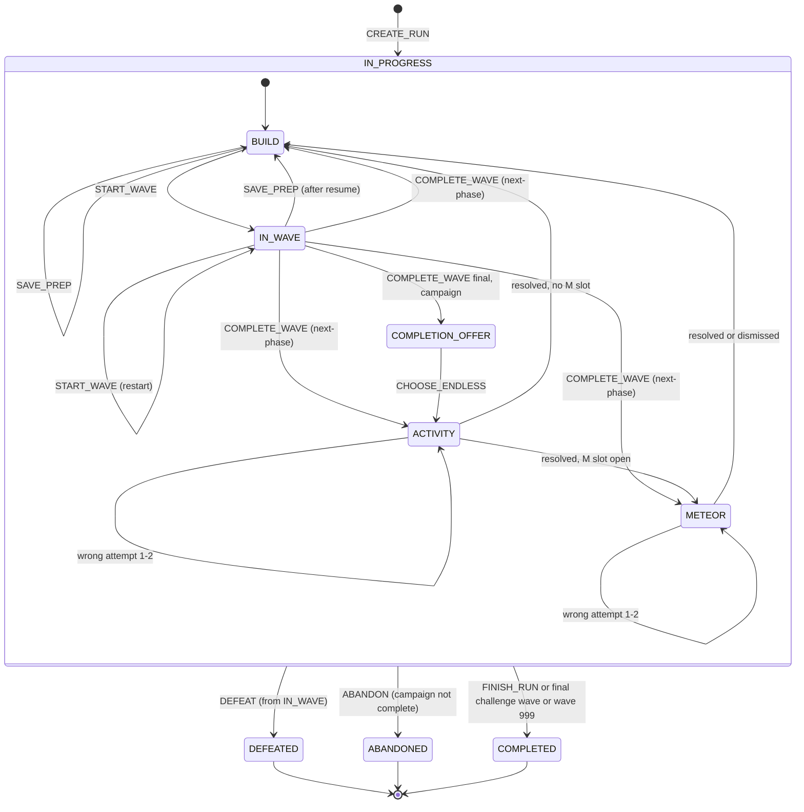
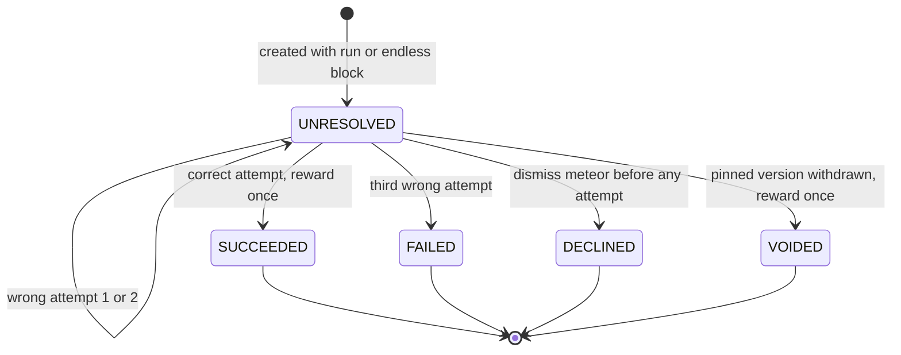
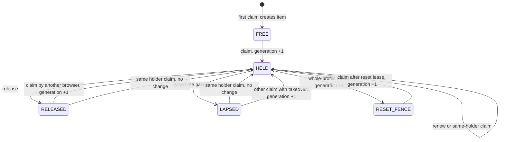
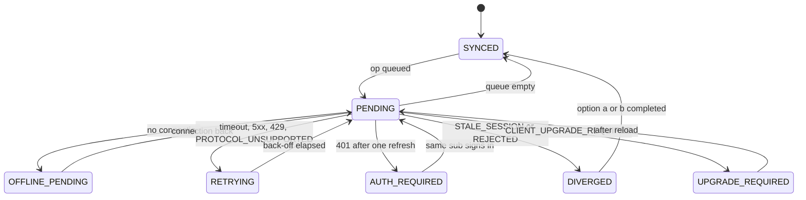
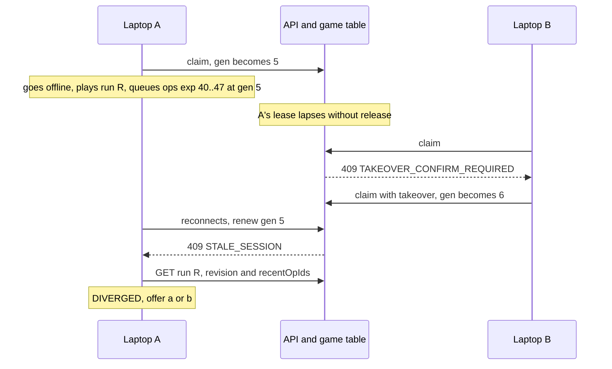

# F. State and data

This section defines how a run, its learning activities and the account-wide play session change state. It also covers what a checkpoint
holds, how duplicate or late requests are made harmless, how an offline laptop's progress is reconciled, how old saves keep working
after a release, what survives defeat or a reset, and the DynamoDB design underneath all of it.

Route shapes, request and response fields and the error envelope are owned by [G. API contracts](G-api-contracts.md). Offline pack
preparation and audio caching are owned by [E. Architecture](E-architecture.md). Backup and restore *operations* (Terraform, runbook,
drill) are owned by [H. Infrastructure and delivery](H-infrastructure-and-delivery.md). Test mapping is in [I. Validation](I-validation.md).
Here we cover the data rules those sections rely on. Every name, state, key, route and code follows the canonical
[design spine v0.3](00-spine.md); where this section adds detail, the spine wins on any conflict.

Nothing in this section exists yet. The repository has no application code, no tables and no tests; the only project resources in AWS are
the two Terraform state buckets (main stack and the bootstrap's own), the CI role and the GitHub OIDC provider (see
[A. Repository findings](A-repository-findings.md#3-aws-reality-after-the-bootstrap-apply)). Everything below is
planned work, written in the future tense where it describes behaviour.

---

## 1. Three patterns used throughout (read this first)

These three ideas carry the whole section. Each is a well-known pattern, so I'll explain the purpose briefly before the details.

| Pattern | What it is | Why we need it here |
|---|---|---|
| **Pure reducer** | One function `reduce(view, op) → newView` or a refusal. It has no I/O and no clock, so the same input always gives the same output. | The browser has to keep playing while offline, so it must work out the effect of each action itself. The server then re-applies the *same* rules to the *same* ops when they arrive. If both sides run the same logic (TypeScript in `game-core`, mirrored in Python, both checked against one set of shared JSON fixtures) they agree on the result. A disagreement shows up as a test failure, not as a corrupted save. Ops are created **only** by calling the reducer. If the reducer refuses an action, no op exists, so a server rejection always means the two sides have diverged and is never just "retry later". **[PROPOSAL]** |
| **Operation IDs (idempotency keys)** | Every change the client asks for gets a random UUID `opId` the moment it is created. The server records which opIds it has applied. | Networks lose responses. The client cannot tell "the server never got it" from "the server did it but the reply was lost", so it must be able to resend safely. With an opId the server recognises a resend and answers "already done, here is what happened" rather than doing it twice. That is how "duplicate delivery, double-clicks and reconnect batches produce one logical effect" (prompt.md:689) is met. **[CONFIRMED requirement; mechanism PROPOSAL]** |
| **Fencing token** | A number (`generation`) on the account's single `SESSION` item that only ever goes up. Each claim of the play session by a new browser increments it. Every write must present the generation it was issued under, and the database refuses a write whose generation is old. | A lease ("this browser may play until 12:03") on its own depends on clocks. A laptop that went to sleep or offline still *believes* it holds the lease. The fencing token moves the check into the database's conditional write. However confused a stale browser is about time, its writes carry an old number and DynamoDB rejects them. Clocks decide only *when* another browser may take over. Correctness never depends on them (prompt.md:733-735). **[CONFIRMED requirement; mechanism PROPOSAL]** |

A fourth, smaller idea is the per-run **`revision`**: a counter on the run that increases by one for every applied op. Each op says
which revision it expects to apply on top of (`expectedRevision`). This is optimistic concurrency control. It keeps one run's ops in
order and makes "someone else changed this run since you last looked" detectable.

---

## 2. Spec state concepts → this design

The spec allows a simpler representation "if the same transitions remain unambiguous" (prompt.md:679-681). The mapping:

| Spec concept (prompt.md:680) | Representation here | Label |
|---|---|---|
| PREPARING | `phase = BUILD` | **[PROPOSAL]** |
| ACTIVITY_PENDING | `phase = ACTIVITY` (normal slot) or `phase = METEOR` (meteor slot) | **[PROPOSAL]** |
| READY | not a state: the `START_WAVE` transition itself | **[PROPOSAL]** |
| IN_WAVE | `phase = IN_WAVE` (stored snapshot = wave-start snapshot) | **[PROPOSAL]** |
| PAUSED | client-only simulation flag; never persisted | **[PROPOSAL]** |
| SUSPENDED | derived: `status = IN_PROGRESS` and not the session's current run | **[PROPOSAL]** |
| DEFEATED / ABANDONED | `status` values (terminal) | **[PROPOSAL]** |
| CAMPAIGN_COMPLETE | `campaignCompletedAt` set + `phase = COMPLETION_OFFER` | **[PROPOSAL]** |
| ENDLESS | `stage = ENDLESS` | **[PROPOSAL]** |
| (completed challenge / finished campaign) | `status = COMPLETED` | **[PROPOSAL]** |

The spec asks for authentication state, profile, saved run, active session and learning attempts as separate concepts
(prompt.md:629). They are Cognito, `PROFILE`, `RUN#`, `SESSION` and `SLOT#` respectively (§12).

---

## 3. Run state machine

### 3.1 Persisted run fields

| Field | Values / meaning | Label |
|---|---|---|
| `runId` | client-generated UUID, one per "create run" intent (so a retried create finds the same run) | **[PROPOSAL]** |
| `planetId`, `waveSetId`, `mode` | pinned at creation; `mode` = `CAMPAIGN` \| `CHALLENGE`, copied from the wave set | **[PROPOSAL]** |
| `status` | `IN_PROGRESS` \| `DEFEATED` \| `ABANDONED` \| `COMPLETED`. The last three are terminal and never left. | **[PROPOSAL]** |
| `stage` | `AUTHORED` (inside the pinned wave set) \| `ENDLESS` (only after a CAMPAIGN wave set) | **[PROPOSAL]** |
| `phase` | only while IN_PROGRESS: `ACTIVITY` \| `METEOR` \| `BUILD` \| `IN_WAVE` \| `COMPLETION_OFFER` | **[PROPOSAL]** |
| `wave` | 1-based. Invariant: `wave = highestCompletedWave + 1` in every phase except `COMPLETION_OFFER`, where `wave = finalWave` | **[PROPOSAL]** |
| `highestCompletedWave` | 0..n. "Best wave" always means highest **completed** wave (prompt.md:199) | **[CONFIRMED]** |
| `campaignCompletedAt` | set when the final wave of a CAMPAIGN wave set is cleared; never unset | **[PROPOSAL]** |
| `plannedThrough` | highest interval whose slots have been selected; `finalWave − 1` after creation | **[PROPOSAL]** |
| `snapshot` | exactly one snapshot (§6); its role depends on `phase` | **[PROPOSAL]** |
| `revision` | +1 for every APPLIED op, including no-op outcomes | **[PROPOSAL]** |
| `recentOps` | last 32 `{opId, revision}`; kept forever on the item (≈2 KB), terminal runs included | **[PROPOSAL]** |
| `writerGeneration` | session generation of the last applied op (diagnosis only) | **[PROPOSAL]** |
| pins | `ageBand`, `seed`, `rulesetVersion`, `campaignVersion`, `assetManifestVersion`, `selection{algorithmVersion, bankReadAt, packId}`, `protocolVersion` at creation | **[PROPOSAL]** |
| `createdAt`, `lastPlayedAt` | server UTC. `lastPlayedAt` is stamped on every applied op, so for a terminal run it is the end time. | **[PROPOSAL]** |

This covers the spec's minimum checkpoint list (prompt.md:631-655). "Available astronaut classes" is **derived** from the pinned unlock
schedule and `highestCompletedWave`, not stored. "Cooldown state" is empty by rule (§6.2). "Save revision and active-session generation"
are `revision` and `writerGeneration`.

**Wave sets.** The pinned planet document (`campaignVersion`) holds a `waveSets` map: `campaign` (mode CAMPAIGN, 50 waves, meteors
after 9, 19, 29, 39, 49) plus any number of challenges (mode CHALLENGE, a short `waves[]`). `finalWave = len(waves)`. The milestone 1
"small wave set" is simply a short wave set; no separate engine is involved (prompt.md:443). **[PROPOSAL]** Wave contents, prices and
meteor powers are in [C. Game and learning design](C-game-and-learning-design.md).

### 3.2 Diagram



How to read it: a run is created in `BUILD` for wave 1, because there is no activity before wave 1 (prompt.md:519). Each cleared wave
uses the shared next-phase rule (§3.4) to choose between the normal activity, the meteor offer or straight back to preparation. Only
`DEFEAT` (during a wave), `ABANDON` (before campaign completion) and `FINISH_RUN` or the end of a wave set (after it) leave
`IN_PROGRESS`, and nothing ever comes back. `CHOOSE_ENDLESS` normally lands in `ACTIVITY` for slot `N-050`. If the bank was exhausted
it lands in `BUILD` instead (§3.6).

### 3.3 Operations (the only ways run state changes)

The canonical op table is spine [S3.2](00-spine.md#s32-operations-the-only-ways-run-state-changes); this section adds the reasoning.

Two ops are **online-only**: they are never queued and never applied optimistically. They are `CREATE_RUN` (`POST /api/runs`) and
`CHOOSE_ENDLESS` (`POST /api/runs/{runId}/endless`), because both need the server to select content. All other ops are queueable:
the client's reducer applies them first. **[PROPOSAL]**

| Op | Allowed when | Effect | Label |
|---|---|---|---|
| `CREATE_RUN` | profile exists; pinned `rulesetVersion`/`campaignVersion` released and loadable (else `409 CONTENT_VERSION_UNSUPPORTED`; the client re-reads `current.json` and retries); planet unlocked (else `CONTENT_UNAVAILABLE{reason: PLANET_LOCKED}`); wave set available for the caller's age band; fewer than 5 IN_PROGRESS runs (soft cap); session free or held by this `sessionId`, with the same takeover rule as the session claim (§5.3): a lapsed, unreleased lease held by another `sessionId` needs `takeover: true`, else `409 TAKEOVER_CONFIRM_REQUIRED` | run `IN_PROGRESS`, `stage=AUTHORED`, `phase=BUILD`, `wave=1`, snapshot from the wave set's start values; slots `N-001..N-(finalWave−1)` plus `M-<p>` for each `p` in `meteorAfter`, all `UNRESOLVED`; session claimed in the same transaction | **[PROPOSAL]** |
| `SAVE_PREP` | phase `BUILD` or `IN_WAVE` | payload `{credits, placements[]}` replaces those snapshot fields; `phase=BUILD` | **[PROPOSAL]** |
| `START_WAVE` | phase `BUILD` or `IN_WAVE`, `payload.wave == run.wave` | payload `{credits, placements[]}` → snapshot (this is the wave-start snapshot); `phase=IN_WAVE` | **[PROPOSAL]** |
| `COMPLETE_WAVE` | phase `IN_WAVE`, `payload.wave == run.wave` | snapshot := payload `{credits, placements, colony, powers}` (after bounds, §6.3); `highestCompletedWave = wave`; PROFILE updated only if something changes (best wave, badge, milestone). Then: if `wave == finalWave` and `stage = AUTHORED`: CAMPAIGN → set `campaignCompletedAt`, `phase=COMPLETION_OFFER`; CHALLENGE → `status=COMPLETED`, and this final `COMPLETE_WAVE` may write PROFILE `badges` **only** (never `planets` or eligibility). Otherwise `wave += 1`; if `stage = ENDLESS`, plan blocks (§3.6); `phase` := next-phase rule for interval `wave − 1`. Wave 999 → `status=COMPLETED` | **[PROPOSAL]** |
| `SUBMIT_ATTEMPT` | phase `ACTIVITY`/`METEOR`; `payload.slotId` is the current slot and `UNRESOLVED` | if the pinned version is withdrawn or missing → VOID (§4.4). Otherwise record attempt `{n, attemptId = opId, answer (canonical), correct, recordedAt}`. Correct → `SUCCEEDED` + reward + summary; 3rd incorrect → `FAILED` + summary. On resolution, `phase` := next-phase rule. A meteor success when that power is already at its cap (2): slot `SUCCEEDED` and counted, no charge added (endless only) | **[CONFIRMED rules prompt.md:505-517; mechanism PROPOSAL]** |
| `DISMISS_SLOT` | current slot `UNRESOLVED` and (meteor slot **before any attempt**, or pinned version withdrawn) | withdrawn → `VOIDED` (+ reward); otherwise `DECLINED`; `phase` := next-phase rule | **[PROPOSAL; owner decision D-11]** |
| `DEFEAT` | phase `IN_WAVE`, `payload.wave == run.wave` | `status=DEFEATED`; REMOVE snapshot | **[CONFIRMED terminal prompt.md:675]** |
| `ABANDON` | `campaignCompletedAt` not set; any persisted phase | `status=ABANDONED`; REMOVE snapshot | **[PROPOSAL]** |
| `CHOOSE_ENDLESS` | phase `COMPLETION_OFFER` | `stage=ENDLESS`, `wave = finalWave + 1`; plan blocks (§3.6); `phase` := next-phase rule for interval `finalWave` | **[PROPOSAL]** |
| `FINISH_RUN` | `campaignCompletedAt` set, phase not `IN_WAVE` | `status=COMPLETED`; REMOVE snapshot | **[PROPOSAL]** |

Points that are easy to miss:

- **A replayed op that names an already-`VOIDED` slot** (SUBMIT_ATTEMPT or DISMISS_SLOT) is an APPLIED no-op (revision +1, outcome
  `NO_OP_VOIDED_SLOT`) in any IN_PROGRESS phase. This keeps an offline branch's revision chain aligned after a withdrawal (§11.4).
  **[PROPOSAL]**
- **Save-and-exit mid-wave writes nothing.** The stored snapshot is already the wave-start snapshot, and resuming never writes either.
  That is why `SAVE_PREP` and `START_WAVE` are accepted from `IN_WAVE`. After a resume the child is back in preparation, but the server
  still says `IN_WAVE`, and the next preparation op moves it on. **[PROPOSAL; replaces the v0.1 REWIND_WAVE op]**
- **Nothing is persisted during combat**, locally or in the cloud. **[PROPOSAL; consistent with prompt.md:663-669]**
- **Restart** ("reset the current run") = `ABANDON` followed by a new `CREATE_RUN`. It needs a connection. After campaign completion
  the equivalent is `FINISH_RUN`. **[PROPOSAL]**
- **Terminal ops do not touch `SESSION`.** The client releases the lease when it shows the terminal screen. **[PROPOSAL]**

### 3.4 Next-phase rule and current slot

One shared function, implemented in both `game-core` (TypeScript, under `web/`) and the Python reducer mirror (`api/shared/`, to create;
repository layout in [H](H-infrastructure-and-delivery.md)), and covered by the shared fixtures:

```
nextPhase(run, i):                      # i = the interval just reached (wave − 1)
  if slot N-<i> exists and is UNRESOLVED:  return ACTIVITY
  if slot M-<i> exists and is UNRESOLVED:  return METEOR
  return BUILD
```

- **Current slot** is derived and never stored: `N-<wave−1>` in `ACTIVITY`, `M-<wave−1>` in `METEOR`, none in any other phase.
  **[PROPOSAL]**
- There is no "LOCKED/OPEN" slot status. Whether a slot can be answered follows only from `phase` and `wave`. This removes the class
  of bug where a slot is never opened and the run is stuck (a failure mode found in design review). **[PROPOSAL]**
- The rule tolerates a missing or already-resolved slot: it simply falls through. That is how an endless interval with no content
  goes straight to `BUILD` (§3.6).
- The normal activity must resolve (succeeded, failed or voided) before `BUILD`. It is untimed and may stay pending across sessions
  (prompt.md:503, 505-517). The meteor is optional (prompt.md:439). **[CONFIRMED]**

Numbering check (campaign, meteors after 9/19/29/39/49):

| After clearing wave | Normal slot | Meteor slot | Then |
|---|---|---|---|
| (run created) | — | — | BUILD for wave 1 |
| 1–8, 10–18, 20–28, 30–38, 40–48 | `N-00w` / `N-0ww` | — | ACTIVITY → BUILD |
| 9, 19, 29, 39, 49 | `N-0w9` | `M-0w9` | ACTIVITY → METEOR → BUILD for the boss wave |
| 50 | — | — | COMPLETION_OFFER (badge already committed) |
| 50, then CHOOSE_ENDLESS | `N-050` | — | ACTIVITY → BUILD for wave 51 (prompt.md:519) |
| 51–58, 60–68, … | `N-0ww` (if content left) | — | ACTIVITY or straight to BUILD |
| 59, 69, … | `N-0w9` | `M-0w9` (if content left) | as for 9 |

Normal and meteor slots have separate IDs and separate reward markers (prompt.md:1162). **[CONFIRMED]**

### 3.5 Full phase × op matrix

`→X` = allowed, resulting phase/status X. `PM` = `REJECTED PHASE_MISMATCH {phase, wave, currentSlotId}`. `RT` = `REJECTED RUN_TERMINAL`.
`VN` = names a slot that is already VOIDED → APPLIED no-op. `n/a` = not sent through `/ops` (CREATE_RUN has its own route).
This matrix applies after the earlier checks in §8.1 (duplicate, fence, revision, pins).

| Phase / status | SAVE_PREP | START_WAVE | COMPLETE_WAVE | SUBMIT_ATTEMPT | DISMISS_SLOT | DEFEAT | ABANDON | CHOOSE_ENDLESS | FINISH_RUN |
|---|---|---|---|---|---|---|---|---|---|
| BUILD | →BUILD | →IN_WAVE (wave match) | PM | PM (VN if voided) | PM (VN if voided) | PM | →ABANDONED if campaign not complete, else PM | PM | →COMPLETED if campaign complete, else PM |
| IN_WAVE | →BUILD | →IN_WAVE (wave match) | →next-phase / COMPLETION_OFFER / COMPLETED | PM (VN) | PM (VN) | →DEFEATED (wave match) | as BUILD | PM | PM (never mid-wave) |
| ACTIVITY | PM | PM | PM | current `N-` slot: record / resolve; any other slot PM (VN) | current slot withdrawn: →VOIDED; else PM | PM | as BUILD | PM | as BUILD (endless only) |
| METEOR | PM | PM | PM | current `M-` slot: record / resolve; any other slot PM (VN) | no attempts yet: →DECLINED; withdrawn: →VOIDED; else PM | PM | as BUILD | PM | as BUILD (endless only) |
| COMPLETION_OFFER | PM | PM | PM | PM (VN) | PM (VN) | PM | PM (campaign complete) | →ENDLESS, next-phase for interval `finalWave` | →COMPLETED |
| DEFEATED / ABANDONED / COMPLETED | RT | RT | RT | RT | RT | RT | RT | RT | RT |

A resend of an op that was already applied never reaches this matrix. It is answered `ALREADY_APPLIED` at step (a) of §8.1, even on a
terminal run. That is what makes a lost response on a final `DEFEAT` safe (§11.2). **[PROPOSAL]**

### 3.6 Endless block planning

The spec forbids preloading infinite content and forbids silent repeats (prompt.md:721). The design keeps a finite buffer of selected
slots ahead of the child. **[PROPOSAL]**

- Block size `K = 10` intervals: one normal slot per interval, plus a meteor slot for the interval ending in 9 (`M-059`, `M-069`, …).
- **When:** `CHOOSE_ENDLESS` and every endless `COMPLETE_WAVE` plan blocks *inside the same transaction* while
  `plannedThrough < (wave − 1) + K`. Each block advances `plannedThrough` by 10.
- **From what:** the bank as published at that moment, for the pinned age band, excluding every activity and template instance
  already used in the run (selection rules in [C](C-game-and-learning-design.md)).
- **Exhausted bank:** for an interval with nothing unused left, **no slot is written** (never a repeat). The next-phase rule then
  goes straight to `BUILD`, and the client shows "You have done every activity we have for now" (owner decision D-6; subject fallback
  order maths → phonics → spelling first). **[PROPOSAL]**
- **Worked numbers:** at `CHOOSE_ENDLESS`, `wave = 51` and `plannedThrough = 49`, so two blocks are planned (intervals 50–59 and 60–69:
  20 normal + 2 meteor slots). After that, one block is planned whenever `wave` reaches 61, 71, … The child therefore always has 10–19
  planned intervals beyond the current one.
- **Client side:** Ready for endless wave *w* is enabled only when interval *w*'s slot definitions and clips are held locally.
  Otherwise the client pauses in `BUILD` with "Reconnect to get more activities" (prompt.md:721; AC-34). When an acknowledged view
  shows `plannedThrough` beyond the local pack, the pack is refreshed in the background. **[CONFIRMED behaviour; mechanism PROPOSAL]**
- **Hard cap:** `COMPLETE_WAVE` at wave 999 sets `status=COMPLETED`, which keeps slot IDs at three digits. **[ASSUMPTION]**
  Planning must stop at interval 998 too: without a cap, the block planned when `wave` reaches 991 would cover intervals 1000–1009 and
  produce four-digit slot IDs that fail `^[NM]-[0-9]{3}$`. So no slot is planned for an interval above 998 (`N-999`/`M-999` are never
  written, because wave 999 ends the run). **[PROPOSAL; spine [S5.3](00-spine.md) and S3.2]**

### 3.7 The Milestone 1 wave set (data view)

[B](B-scope-and-decisions.md) fixes Milestone 1 at one short wave set with exactly one activity interval and no `meteorAfter` entry
(two waves, slot `N-001` only), because one activity and the no-repeat rule cannot fill more. The state machine handles that set in
either mode. The plan uses `mode = CHALLENGE`. **[PROPOSAL; recorded as J-1 in [J](J-execution-backlog.md)]**

| | `CHALLENGE` (chosen) | `CAMPAIGN` |
|---|---|---|
| End of wave 2 | `COMPLETE_WAVE` sets `status = COMPLETED` directly | `phase = COMPLETION_OFFER`; Milestone 1 then also needs `FINISH_RUN`, and an offer screen whose `CHOOSE_ENDLESS` would find an exhausted bank |
| Ops Milestone 1 must build | `SAVE_PREP`, `START_WAVE`, `COMPLETE_WAVE`, `SUBMIT_ATTEMPT`, `DEFEAT`, `ABANDON` | the same plus `FINISH_RUN` (and `CHOOSE_ENDLESS` or a hidden offer) |
| `PROFILE` writes on `COMPLETE_WAVE` | no `planets` write (best wave and campaign badges are `CAMPAIGN`-only, §10.2); the final `COMPLETE_WAVE` may write PROFILE `badges` only, if the set carries a challenge badge ([C §C12](C-game-and-learning-design.md#c12-badges)) | best wave and the completion badge |
| `CREATE_RUN` transaction (§12.3) | 4 actions (SESSION, RUN, one slot, PROFILE check) | 4 actions |

The trade-off: `CHALLENGE` keeps Milestone 1 to the smallest set of ops but leaves the `planets` (best wave) update path for Milestone 2. The
planet document still uses the normal `waveSets` map; it simply holds one challenge set and no `campaign` entry until the campaign is authored.

---

## 4. Activity-slot state machine

### 4.1 Diagram



How to read it: a slot starts unanswered and ends in exactly one of four final states. Two of those grant the slot's reward (SUCCEEDED,
VOIDED) and two do not (FAILED, DECLINED). A slot can only be changed while it is the run's current slot. The only exception is the
VOIDED no-op, which changes nothing on the slot.

### 4.2 Slot fields and write rules

| Field | Meaning | Label |
|---|---|---|
| `slotId` | `^[NM]-[0-9]{3}$`; `N-<i>` normal after wave *i*, `M-<i>` meteor after wave *i* | **[PROPOSAL]** |
| `kind` | `NORMAL` \| `METEOR` | **[PROPOSAL]** |
| `subject`, `topicId`, `activityId`, `activityVersion` | pinned at creation; `activityVersion` is the non-reusable version ID, a UTC publish timestamp such as `20261114T100000Z`; the content sort key is `V#<activityVersion>` (§12.6; same form as G's `versionId`) | **[PROPOSAL]** |
| `resolved` | materialised template instance, or null for a hand-authored activity | **[PROPOSAL]** |
| `presentation` | option/tile order fixed at creation, so a reload shows the same layout | **[PROPOSAL]** |
| `intro` | `AUTO` \| `ON_REQUEST` | **[PROPOSAL]** |
| `clips` (the clips map) | variant → speech ref `{speechId, speechVersion, clipKey}`. Copied from the pinned activity version at slot creation, so `tts` signs the URL for the `clipKey` stored here with one `GetItem` (G11) and reads no `content` item on the player path | **[PROPOSAL]** |
| `reward` | from the pinned ruleset by `(kind, interval)`; never from content or the client. Challenge slots use the ruleset's campaign interval table (there is no per-wave-set reward table) | **[PROPOSAL]** |
| `attempts[]` | `{n, attemptId (= opId), answer (canonical: one string ≤ 64 chars, §4.3), correct, recordedAt}`; at most 3 | **[CONFIRMED ≤3 prompt.md:511]** |
| `status` | `UNRESOLVED` → `SUCCEEDED` \| `FAILED` \| `DECLINED` \| `VOIDED` | **[PROPOSAL]** |

**Write rules [PROPOSAL]:**

- A slot is created only by `Put … attribute_not_exists(pk)`.
- A slot is updated only by `Update … attribute_exists(pk) AND #status = :unresolved`.
- No unconditioned slot write exists anywhere. The status condition is also the reward's idempotency marker: once a slot has left
  `UNRESOLVED`, no second transaction can grant `(runId, slotId)`'s reward again.

### 4.3 Attempt rules

- One `SUBMIT_ATTEMPT` = the whole answer, including multi-step activities. A correct answer on any attempt → SUCCEEDED, reward exactly
  once. A third incorrect answer → FAILED, no reward, no penalty. There is no timer. **[CONFIRMED prompt.md:503, 505-517]**
- **Never consumes an attempt:** an empty or incomplete answer, playing audio, a demonstration, a network or speech failure, a refresh.
  None of these creates an op. **[CONFIRMED prompt.md:503; AC-15, AC-22]**
- **Client-only "tried that" guard:** options already tried are greyed out, and an identical typed or arranged resubmission is blocked
  with a gentle message and creates no op. The server counts every `SUBMIT_ATTEMPT` it receives and has no identical-answer rule.
  Choice activities need ≥ 4 options (publish validation) so failure stays possible. **[PROPOSAL; owner decision D-8]**
- **Answer judging:** the answer is canonicalised once, in TypeScript (in `web/shared`, used by both the player app and the admin
  preview-solve), and compared by exact equality with the pinned version's accepted canonical answers. Python validates only the shape.
  There is no second normaliser that could disagree. **[PROPOSAL]**
- **Canonical answer shape:** a single string of at most 64 characters for every interaction type. ARRANGE uses tile values; two-step
  answers are joined by `|`. The reserved separators `;` `=` `,` `|` are refused inside answer values at publish validation, so a joined
  answer can never be ambiguous. There is no "array of option IDs" form. **[PROPOSAL; spine [S3.3](00-spine.md#s33-activity-slot)]**

### 4.4 VOID (exceptional invalid content)

The spec distinguishes ordinary retirement from "exceptional invalid-content recovery" and forbids charging a broken question as a
failure (prompt.md:556). **[CONFIRMED requirement; mechanism PROPOSAL]**

- **Withdrawal writes nothing to the `game` table.** An operator's withdraw (`C6`) only marks the content version.
- A slot becomes `VOIDED` only through a run op:
  1. `SUBMIT_ATTEMPT` on a slot whose pinned version is withdrawn or missing. This is checked before judging: no attempt is counted,
     the slot → `VOIDED`, the reward is granted once, and the phase advances. Outcome `VOIDED`.
  2. `DISMISS_SLOT` on the current slot when it is withdrawn. Same effect.
  3. A later `SUBMIT_ATTEMPT` or `DISMISS_SLOT` naming the now-VOIDED slot is an APPLIED no-op (`NO_OP_VOIDED_SLOT`).
- The run view carries `withdrawn: true` on the current slot. An online client shows "This one had a mistake, so we took it away.
  You still get your reward." and sends `DISMISS_SLOT`.
- The learning summary is unchanged by VOID or DECLINED (§10).
- **"Missing" equals "withdrawn".** A pinned version that cannot be found (ConsistentRead, after draining `UnprocessedKeys`) is treated
  exactly like a withdrawn one and logged at ERROR.
- **Limitation:** only UNRESOLVED slots are voided. A slot already SUCCEEDED or FAILED on that version stays as recorded
  (owner decision D-9). An offline branch that already moved past the slot keeps what it saw locally (§11.4).
- **Speech is different.** Withdrawing a speech clip in v1 is a runbook, not a route, and there is no "used by" index
  ([D §D9.6](D-ux-and-content-operations.md#d96-when-a-clip-turns-out-to-be-wrong-later)). It writes nothing to `game` either.
  **[PROPOSAL]**

---

## 5. Play-session state machine (account-wide lease with fencing token)

The spec requires one accepted account-wide game, blocking a second while the first is valid, deliberate recovery after a crash, and a
generation token (prompt.md:725-741). **[CONFIRMED requirement; mechanism PROPOSAL]** The canonical summary is spine
[S3.4](00-spine.md#s34-play-session-account-wide-lease-with-fencing-token); this section is the detail it points to.

### 5.1 The `SESSION` item

One per account (`U#<sub>` / `SESSION`), never deleted. Fields: `generation` (only increases), `sessionId`, `runId` (information only),
`leaseExpiresAt`, `released` (bool), `deviceLabel`, `lastRenewedAt`.

`sessionId` is a random UUID per browser profile, kept in the IndexedDB `meta` store (with a `sessionStorage` fallback when IndexedDB is
unavailable). It identifies *this browser*. `generation` identifies *this tenure* of the lease.

### 5.2 Diagram (from the item's point of view)



How to read it: the generation goes up whenever a *different* tenure begins (a new browser, a takeover or a reset), and never when the
same browser extends or re-claims its own lease. A lease that ran out without a clean release (`LAPSED`) can be taken by another browser
only after an explicit "Play here instead?" confirmation. A cleanly `RELEASED` lease needs no prompt.

### 5.3 Requests

| Request | Conditions (tried in order) | Result | Label |
|---|---|---|---|
| `PUT /api/session {mode: claim, runId, sessionId, takeover?, deviceLabel}` | first a consistent `GetItem RUN` under the caller's pk: missing → `404 NOT_FOUND`, terminal → `409 RUN_TERMINAL` (status from [G](G-api-contracts.md) R13). Then (1) `sessionId = :s` → extend, set `runId`, `released = false`, generation unchanged. (2) `attribute_not_exists(sessionId) OR released = true OR leaseExpiresAt <= :now` (the last clause only with `takeover: true`) → take over: `ADD generation 1`, set holder | claim granted, returns `{generation, leaseExpiresAt}` | **[PROPOSAL]** |
| (2) fails, item returned via `ReturnValuesOnConditionCheckFailure = ALL_OLD` | `leaseExpiresAt > now` | `409 ACTIVE_SESSION_ELSEWHERE {retryAfterSeconds, deviceLabel}` (`deviceLabel` feeds the "Being played on <device>" copy) | **[PROPOSAL]** |
| | expired, `released = false`, holder ≠ caller, no `takeover` | `409 TAKEOVER_CONFIRM_REQUIRED {deviceLabel, lastSeenSecondsAgo}`. The client asks "This game may have unsaved progress on <device>. Play here instead?" and repeats with `takeover: true` | **[PROPOSAL]** |
| `PUT /api/session {mode: renew, sessionId, generation}` | `sessionId = :s AND generation = :g` (no clock check) | extend lease, `released = false`, set `runId` (as G R13); failure → `409 STALE_SESSION`. **A failed renew never falls back to a claim.** | **[PROPOSAL]** |
| `DELETE /api/session {sessionId, generation}` | same as renew | `leaseExpiresAt = now, released = true`; G answers `204` even when the condition does not match (nothing of ours to release) | **[PROPOSAL]** |

The exact condition expressions are a sketch. The splitting of (2)'s failure into the two 409s is done in the handler from the returned
old item, which saves a second read. `ReturnValuesOnConditionCheckFailure` is available on single-item writes and on every
transaction action **[VERIFIED [sources/08-aws-data-ops.md](sources/08-aws-data-ops.md) §a.1, AWS API reference]**.

- **Interrupted reset holder.** A holder whose `sessionId` starts `RESET#` (a `WHOLE_PROFILE` reset that died before its release
  step, §12.5) is treated as released by the claim: no takeover prompt naming a "device" that is really the reset. In condition (2)
  this is one more clause, `begins_with(sessionId, :resetPrefix)`. **[PROPOSAL; spine S3.4]**

- **Timing [ASSUMPTION; tune in playtest]:** lease 180 s. Renew every 60 s, **only while the page is visible and there was input in the
  last 5 minutes**, so an idle tab left open does not block a sibling forever.
- **Second tab:** an origin-wide Web Lock `scd-play` allows one playing tab per browser profile. It is acquired before any network call.
  **[PROPOSAL]**
- **Transient failures:** a heartbeat that hits `TransactionConflict` or throttling is retried in the handler. If it still fails, the
  answer is `503`, never `STALE_SESSION`, so a DynamoDB hiccup is never mistaken for a takeover. **[PROPOSAL]**
- **`CREATE_RUN` and a lapsed lease.** The claim inside the create-run transaction (access pattern G7,
  [§12.2](#122-game-entities-and-access-patterns)) applies the same takeover rule as the claim above (spine
  [S3.2](00-spine.md#s32-operations-the-only-ways-run-state-changes)). `POST /api/runs` accepts `takeover`. A lease that lapsed
  without release and is held by another `sessionId` needs `takeover: true`, else `409 TAKEOVER_CONFIRM_REQUIRED`. Without this,
  starting a new game could fence another device without the "Play here instead?" question. **[PROPOSAL]**

### 5.4 The fence, and why `runId` is not in it

Every op transaction includes `ConditionCheck SESSION: sessionId = :s AND generation = :g`, and nothing else. **[PROPOSAL]**

- **The lease is per account, not per run.** The holder may write to any of the account's runs. Each run's own `revision` orders that
  run's ops.
- **Why not `runId`?** An earlier draft also checked `SESSION.runId = :runId`. That produced a false conflict: a child plays run A
  offline, comes back online, opens run B, and the claim rebinds `runId` to B. The still-queued ops for A then fail the fence, and the
  child is told "this game was continued somewhere else" although no other device exists (a false conflict found in design review). The spec's purpose is
  "one accepted account-wide game" (prompt.md:725). Generation already proves the writer is the current tenure, and revision already
  orders each run, so `runId` added only failure modes. It stays on `SESSION` for display ("being played on <device>").
- **Clocks.** Correctness never depends on clocks. The lease time only decides when *another* browser may claim. A holder whose lease
  ran out but whom nobody replaced can still save, because its generation is still current. That is deliberate: a child who left the
  laptop for ten minutes should not lose anything.
- **Honest limitation [CONFIRMED prompt.md:741]:** an offline browser cannot be stopped. The guarantee is one **accepted** writer, not
  physical exclusion.

### 5.5 Generation stamping (why each op stores its generation)

Every queued op stores the generation that was current **when it was queued**. A batch is sent with that stored generation, never the
device's newer one, and a batch never mixes generations. **[PROPOSAL]**

Without this rule, a superseded laptop that re-claims the session later (generation 5 → someone else had 6 → it now gets 7) would flush
its old branch under generation 7, and the old branch would be silently merged. That is exactly what prompt.md:737 forbids. With the
rule, the old ops carry generation 5 and fail the fence. The child then sees the divergence choice (§9) instead.

### 5.6 What Milestone 1 needs

[B](B-scope-and-decisions.md) assumes Milestone 1 already uses the real ops envelope with the session fence, while takeover handling
and the offline queue wait for Milestone 5. From the data side that split works, with one condition. **[PROPOSAL]**

- **From Milestone 1 (server):** the `SESSION` item, claim/renew/release, the fence in every G5 transaction and the claim inside G7.
  None of these can be left out, because `CREATE_RUN` claims the session and every op is fenced. The server already returns
  `TAKEOVER_CONFIRM_REQUIRED` and `STALE_SESSION` when they apply.
- **From Milestone 1 (client):** ops stamped with their generation (§5.5), one serial queue, and a plain fallback for the session 409s
  (for example "This game is open somewhere else. Try again" with no option (b)). Without stamping, adding it later would change how
  queued ops are stored.
- **Can wait for Milestone 5:** the takeover dialog, the divergence options and the `recovery` panel (§9), and offline play itself.

---

## 6. Checkpoint semantics

### 6.1 One snapshot

```json
{ "credits": 120,
  "placements": [{"padId": "p03", "classId": "nova", "level": 2, "targeting": "FRONT"}],
  "colony": {"health": 20, "shield": 0},
  "powers": {"shield-burst": 1} }
```
(illustrative values only; IDs follow the spine key-ID pattern `^[a-z0-9-]{1,40}$`, targeting is one of `FRONT` | `FAST` |
`CROWD` | `STRONG`)

| Phase | The snapshot means | Written by |
|---|---|---|
| `BUILD`, `ACTIVITY`, `METEOR` | build state between waves, including any learning rewards already granted | `SAVE_PREP`, resolving `SUBMIT_ATTEMPT` / `DISMISS_SLOT` (reward added server-side), `COMPLETE_WAVE` |
| `IN_WAVE` | the **wave-start snapshot**, captured when Ready was pressed (prompt.md:657) | `START_WAVE` |
| `COMPLETION_OFFER` | post-wave-50 state | `COMPLETE_WAVE` |
| terminal | removed | `DEFEAT`, `ABANDON`, `FINISH_RUN` |

- **BUILD ops carry only `{credits, placements}`.** The server carries colony and powers forward, and available classes are always
  derived. `COMPLETE_WAVE` carries the full snapshot. **[PROPOSAL]**
- **Bounds** (anti-nonsense, not anti-cheat; [E](E-architecture.md) owns the trust model). Each op is checked against the *stored*
  snapshot with `value(s) = credits + invested(placements)`:
  - BUILD ops: `value(new) ≤ value(stored)`, because there is no income in preparation and learning rewards are already in the stored
    value.
  - `COMPLETE_WAVE(w)`: `value(new) ≤ value(stored) + maxBounty[w]`, with health, shield and power counts within caps.
  - A violation → `REJECTED CHECKPOINT_OUT_OF_BOUNDS`. **[PROPOSAL]**

### 6.2 Rules the game design must keep

- No timer or cooldown crosses a wave boundary. Wave randomness derives from `(run seed, wave number)`. That is why the snapshot needs
  no cooldown or RNG state, and why a restarted wave plays out the same way. If [C](C-game-and-learning-design.md) ever needs
  otherwise, the snapshot gains those fields and the spine ([S4](00-spine.md)) is amended. **[PROPOSAL]**

### 6.3 Preparation persistence

- The local snapshot is written to IndexedDB on **every** purchase, sale, upgrade or targeting change. **[PROPOSAL]**
- `SAVE_PREP` is *sent* debounced, about 2 s after the last change. At most one unsent `SAVE_PREP` sits at the queue tail: a newer one
  replaces it. **[ASSUMPTION]**
- Queuing `START_WAVE` cancels the pending debounce. Otherwise a late `SAVE_PREP` would land in `IN_WAVE` and silently move the run back
  to `BUILD`. **[PROPOSAL]**

### 6.4 Durability rule

> An op is **durable** when it is written to the local op log **or** acknowledged by the server. Feedback to the child and advancement of
> the game wait for durability. **[PROPOSAL]**

- With IndexedDB available, the op and the derived view are written in one IndexedDB transaction before the child sees "correct" or
  "try again". A refresh therefore cannot un-happen an attempt the child saw (AC-17).
- In online-only mode (no IndexedDB, flag `LOCAL_STORAGE_UNAVAILABLE`), attempt feedback waits for the server acknowledgement, so AC-17
  holds without local storage. **[PROPOSAL]**
- If local writes start failing mid-run, the client switches to online-only mode. If it is also offline, it holds at the next boundary
  with "Not saved yet — keep this page open and reconnect". **[PROPOSAL]**
- **Cloud save** = the result of the last acknowledged op. Anything unacknowledged is "Saved on this device — waiting to sync" only
  (prompt.md:711; AC-31). **[CONFIRMED wording]**

### 6.5 Exactly what is lost, by event

| Event | Kept | Lost | Label |
|---|---|---|---|
| Save and exit in `BUILD` | everything (local write per change; `SAVE_PREP` flushed before release) | nothing | **[PROPOSAL]** |
| Save and exit in `ACTIVITY` / `METEOR` | recorded attempts, the same question, the same layout | nothing | **[CONFIRMED prompt.md:661]** |
| Save and exit in `IN_WAVE` (after a confirmation dialog) | the wave-start snapshot, including learning rewards granted before Ready, exactly once | **exactly the current wave**: partial kills, credits earned, purchases, sales, upgrades, damage and power use, all rolled back together | **[CONFIRMED prompt.md:663-671; AC-24-26]** |
| Crash, refresh or tab close in `IN_WAVE` | as above | exactly the current wave | **[CONFIRMED prompt.md:673]** |
| Crash in `BUILD`, IndexedDB available | everything (local snapshot) | nothing | **[PROPOSAL]** |
| Crash in `BUILD`, online-only mode | the last acknowledged `SAVE_PREP` | preparation changes from the last ~2 s debounce plus flight time | **[PROPOSAL]** |
| Crash between pressing Submit and the op becoming durable | — | the attempt never happened (no feedback was shown); same attempt count on reload | **[PROPOSAL]** |
| Device lost with pending ops | the cloud save | everything since the last acknowledgement (it only ever existed "on this device") | **[PROPOSAL; follows from prompt.md:673]** |
| Restore from the daily backup | the recovery point | everything since that backup (§13.4); never described as wave-level recovery (prompt.md:1026) | **[CONFIRMED]** |

### 6.6 Resume per persisted phase

| Phase found | Shows | Writes on resume |
|---|---|---|
| `BUILD` | preparation from the snapshot | none |
| `IN_WAVE` | preparation from the snapshot, with "Wave N will start again from the beginning" | none |
| `ACTIVITY` / `METEOR` | the current slot, with recorded attempts and already-tried options greyed out | none |
| `COMPLETION_OFFER` | the offer again (badge already committed) | none |
| terminal | results screen; never offered by Continue (AC-27) | none |

**Order when entering a run online [PROPOSAL]:**

1. Renew the lease, or claim if this browser holds none.
2. Flush this account's queue to empty.
3. Adopt the returned authoritative view.
4. Only then act on the phase.

Doing it in this order means the first op after resume never races a late flush from this same device.

---

## 7. Client sync state machine (per account, client-only)



How to read it: transient problems (`RETRYING`, `OFFLINE_PENDING`, `AUTH_REQUIRED`, `UPGRADE_REQUIRED`) keep the queue intact and resend
**the same ops unchanged**. Only a definite answer from the server (`STALE_SESSION` or a per-op `REJECTED`) leads to `DIVERGED`, which is
never retried automatically. Copy per state ("Saved to the cloud", "Saving…", "Saved on this device — waiting to sync", "Couldn't save —
trying again", "Sign in again to finish saving", …) is in [D](D-ux-and-content-operations.md). `LOCAL_STORAGE_UNAVAILABLE` is a flag
shown as a banner, not a state. **[PROPOSAL]** The state table with its copy is spine [S3.5](00-spine.md).

- **`409 PROTOCOL_UNSUPPORTED`** (the server is older than the client's stored `protocolVersion`, which happens only after a rollback)
  puts the queue in `RETRYING` with the copy "Saving paused while the game updates". The same ops are resent unchanged once the server
  catches up; the queue is never marked `REJECTED` or `DIVERGED`. **[PROPOSAL]**
- **One serial queue per account** carries op batches and claim, renew and release requests, with one request in flight. Only the tab
  holding `scd-play` runs it. Pending ops for any of the account's runs flush in the background whichever run is on screen.
  **[PROPOSAL]**
- **Same account check:** one page load = one account (`ownerSub`). Before every request, and on visibility or cross-tab sign-in/out
  events, the token's `sub` is compared with `ownerSub`. On a mismatch the page sends nothing more and reloads. An identity change never
  marks a queue as diverged; the previous child's queue simply waits in that child's own database (prompt.md:723; AC-05, AC-33).
  **[PROPOSAL]**
- **Re-sign-in from `AUTH_REQUIRED`.** Managed login is a full-page redirect, so [D](D-ux-and-content-operations.md)
  offers it only at a preparation boundary. Before redirecting, the client lets the request in flight settle (acknowledgement, error
  or timeout) and sends nothing new. The request that produced the second 401 was refused at the gateway, so it applied nothing. With
  IndexedDB the queue survives the redirect unchanged. In online-only mode the unacknowledged ops live only in memory and are lost by
  the redirect; that is acceptable because, by the durability rule (§6.4), the child was never shown their effect. In that mode D's redirect
  copy should say that the last change may need doing again. **[PROPOSAL]**

---

## 8. Attempt and reward idempotency

### 8.1 Per-op processing order (server)

One write path: `POST /api/runs/{runId}/ops`. The body is an ordered batch of 1–25 ops, ≤ 64 KB:
`{protocolVersion, sessionId, generation, ops[]}`, where each op is `{opId, expectedRevision, type, payload, clientTime}`
(canonical in spine [S7.1](00-spine.md#s71-envelope-and-per-op-processing)).
The `protocolVersion` is checked first, at batch level: newer than the server supports → `409 PROTOCOL_UNSUPPORTED` (§7); older than
supported → `426 CLIENT_UPGRADE_REQUIRED` (§10.1). Other envelope-level problems (size, JSON, op count, unknown op type, `CHOOSE_ENDLESS`/`CREATE_RUN` sent to `/ops`, ops for another run)
are refused before any op is looked at, with `400 VALIDATION_FAILED` ([G](G-api-contracts.md) §5.5). Each op's own payload schema is
checked later, at step (g), so a bad op is a per-op `REJECTED` that stops the batch without discarding the ops before it. Then, **for
each op in order** (every `game` read is `ConsistentRead`):

| Step | Check | On failure | Why it sits here | Label |
|---|---|---|---|---|
| (a) | read `SESSION`, `RUN` and the addressed `SLOT`; is `opId` in `RUN.recentOps`, or is it an `attemptId` in `SLOT.attempts`? | `ALREADY_APPLIED` + the original logical result; **writes nothing** | first, so a resend after the run went terminal, or after a takeover, is still recognised as "already done" rather than an error | **[PROPOSAL]** |
| (b) | fence `sessionId`, `generation` | `STALE_SESSION`; stop | no new effect from a stale tenure | **[PROPOSAL]** |
| (c) | run not terminal | `REJECTED RUN_TERMINAL` | terminal is final (AC-27) | **[PROPOSAL]** |
| (d) | `expectedRevision == revision` | `REJECTED STALE_REVISION` | ordering within a run | **[PROPOSAL]** |
| (e) | pinned versions loadable (`playable`, §10.1), except for `ABANDON`/`FINISH_RUN` | `REJECTED CONTENT_VERSION_UNSUPPORTED` | a run the server cannot interpret must not advance, but may always be closed | **[PROPOSAL]** |
| (f) | phase, wave and current-slot identity (§3.5; VOIDED-slot no-op exempt) | `REJECTED PHASE_MISMATCH {phase, wave, currentSlotId}` | state machine | **[PROPOSAL]** |
| (g) | payload schema for this op type and `protocolVersion`, plus values against pinned data (answer shape for the interaction type, pad IDs, levels) | `REJECTED VALIDATION_FAILED` | schema and semantic validation | **[PROPOSAL]** |
| (h) | bounds (§6.1) | `REJECTED CHECKPOINT_OUT_OF_BOUNDS` | plausibility | **[PROPOSAL]** |
| (i) | the apply-one-op transaction (access pattern `G5`, §12.2–12.3) | **any** cancellation (condition race, `TransactionConflict`, throttling) → jittered 20–100 ms pause, back to (a); at most 3 tries, then `503 THROTTLED` | the re-read turns the loser of a duplicate-delivery race into `ALREADY_APPLIED` via (a) | **[PROPOSAL]** |

- The first `REJECTED` or `STALE_SESSION` stops the batch; later ops come back `NOT_PROCESSED`.
- The response always contains the per-op list `[{opId, result, code?, outcome?, appliedRevision}]` plus the authoritative run view
  (including `recentOpIds`) after the last applied op.
- HTTP status is 200 whenever the request was processed, even with a rejection. 409 means the *first* op failed the fence (or the batch
  was refused as `PROTOCOL_UNSUPPORTED`). 503 means retries were exhausted. 409 and 503 still carry the results decided so far.
  **[PROPOSAL]**

`outcome` values (APPLIED only): `VOIDED`, `NO_OP_VOIDED_SLOT`, `INCORRECT`, `RESOLVED_SUCCEEDED`, `RESOLVED_FAILED`, `DECLINED`.
There is no `CORRECT` outcome: a correct answer always resolves the slot, so it is `RESOLVED_SUCCEEDED`. **[PROPOSAL]**

### 8.2 Stable identities

| Thing (prompt.md:685-687) | Identity | Enforced by |
|---|---|---|
| answer submission | `attemptId = opId` | `recentOps` + the attempt record on the slot (permanent) |
| activity reward | `(runId, slotId)` | slot condition `#status = :unresolved` in the resolving transaction |
| learning-summary update | the same resolving transaction | it commits once or not at all (AC-18) |
| milestone / badge | `badges.<badgeId>` map key | `SET badges.#b = if_not_exists(badges.#b, :now)` |
| best wave | `planets.<planetId>.bestCompletedWave` | max computed in code from a consistent read; never a ConditionExpression |
| run finalisation | terminal `status` | only reachable from `IN_PROGRESS` under the revision condition |
| run creation | client `runId` | `Put RUN attribute_not_exists`; a repeat returns the existing run |

All **[PROPOSAL]**. TTL is never used for any of these (prompt.md:693). The `game` table's only TTL is the sign-up counter's tidy-up.
**[CONFIRMED rule]**

### 8.3 "Original logical result"

An `ALREADY_APPLIED` answer carries `{result: ALREADY_APPLIED, appliedRevision}` (from the `recentOps` entry) plus the *current* run view.
For an attempt it also carries `{n, correct, slotStatus, rewardGranted}`, rebuilt from the slot's attempt record. The client treats
`ALREADY_APPLIED` exactly like `APPLIED`. So "Repeating an HTTP request for an already recorded answer does not consume another attempt"
(prompt.md:1154) holds, and the child sees the same feedback. **[PROPOSAL]**

### 8.4 Why 32 recent opIds are enough

`recentOps` is a bounded list on the run (≈2 KB). It is safe because of four client rules **[PROPOSAL]**:

1. Only one batch is in flight per account.
2. The client commits the local trim of an acknowledged batch *before* sending the next batch.
3. A batch holds ≤ 25 ops, which is fewer than 32.
4. `recentOps` survives finalisation (only `snapshot` is removed).

So the only ops a client can ever resend are those of its single unacknowledged batch. Any of them that were applied are among the last
≤ 25 applied on that run, and therefore still in the window. Attempts are doubly covered, because their `attemptId` is stored on the
slot for the life of the run.

One boundary case: a batch is applied, the response is lost, *another* browser takes over and applies more than 32 ops to the same run,
and then the first browser resends. The opIds have left the window, so step (a) misses and step (b) answers `STALE_SESSION`. Nothing is
applied twice. The only imprecision is that the first browser's recovery store will hold ops that did in fact land. This is acceptable,
and the recovery panel's copy allows for it: "some of this may already be saved" (§9.2). **[PROPOSAL]**

---

## 9. Offline conflict handling (divergence)

### 9.1 Client sync engine rules (summary) [PROPOSAL]

- **Local truth for a run** = last acknowledged view + pending ops replayed through the reducer.
- **Home/Continue:** runs with pending ops use the local view. A locally DEFEATED or ABANDONED run is not resumable. With an empty queue,
  the cloud view wins.
- **Offline attempts** are judged locally from pack data. The server judges the same canonical bytes on sync.
- **Missing pack content offline:** the client stops at the first interval or wave whose content is missing (`OFFLINE_PACK_INCOMPLETE`,
  client-only) and never invents content.
- **Connection-required actions:** sign-in/sign-up, sign-out, profile setup, new run, choose endless, resets, pack preparation and the
  first fetch of a clip are disabled with the reason while offline (spine [S7.4](00-spine.md#s74-offline-rules)). Sign-out is on the
  list because the Cognito `/logout` redirect and the reload need the network ([E](E-architecture.md)). It changes no data rule: the
  queue stays in `scd-<sub>` either way. **[PROPOSAL]**

### 9.2 Divergence procedure (`STALE_SESSION` or any `REJECTED`)

1. **Stop** flushing. Stop play at the next boundary: at once in `ACTIVITY`/`BUILD`, at wave end in combat.
2. **Report** the server's per-op results, and drop ops reported `APPLIED`/`ALREADY_APPLIED`.
3. **Offer**, in child-level words:
   - **(a) Use the cloud save.** Remaining ops move to the `recovery` store and the authoritative view is adopted. This is always
     available.
   - **(b) Keep this device's progress.** This is offered only when **all** of the following hold:
     - the cause was `STALE_SESSION`, not a `REJECTED`;
     - after skipping leading frozen ops whose opIds the server already holds (`recentOpIds` from `GET /api/runs/{runId}`), the next
       remaining op's `expectedRevision` equals the cloud `revision`, meaning nobody advanced the run in the meantime;
     - the device makes a deliberate claim, including the takeover confirmation if the other browser's lease lapsed without release.

     The frozen ops are then re-stamped with the new generation and replayed in order. This is explicit and never automatic.
   - A `REJECTED` divergence offers (a) only. If a `REJECTED` response carries a terminal run view, the client adopts it, moves leftovers
     to recovery and returns to `SYNCED`.
4. **Recovery store.** A "Progress that was not saved" panel shows run, wave reached, date and reason code, with "Download recovery file"
   (JSON). Entries are deleted only on explicit dismissal. The copy is honest that they cannot be replayed once the cloud run has advanced
   (prompt.md:739), and that "some of this may already be saved" (a lost response followed by a takeover can leave ops in recovery that
   did land, §8.4).
5. **Logging.** One structured server log line per `REJECTED` op. A metric filter on `result=REJECTED` raises an alarm, because it
   always means a rule mismatch between the two reducers or tampering ([H](H-infrastructure-and-delivery.md)).

All of the above is **[PROPOSAL]** satisfying the **[CONFIRMED]** rules at prompt.md:737-741. The canonical procedure is spine
[S7.5](00-spine.md#s75-divergence-procedure-stale_session-or-any-rejected).

**Why (b) is safe.** Its eligibility test proves the cloud run is exactly where the frozen branch started. Replaying the branch is then
indistinguishable from the branch having been flushed before the takeover. No other device's accepted work is overwritten or merged. If
the test fails, (b) is not offered at all.

- **Several runs:** when frozen ops exist for more than one run, (b) is offered only if every such run passes the check; otherwise (a)
  only. One choice keeps the dialog child-simple. (b) is therefore **all-or-nothing**. **[PROPOSAL; spine S7.5]**

### 9.3 Local database `scd-<sub>`

IndexedDB stores: `ops` (pending, each with its stored generation and `protocolVersion`), `runs` (acknowledged view + revision), `packs`,
`audio` (clip bytes, one entry per `clipKey`, verified against the `sha256` from `POST /api/speech`), `recovery` (frozen branches), `meta`
(sessionId, schema version, cached nickname/avatar/ageBand, never DOB). Canonical list: spine
[S7.3](00-spine.md#s73-local-database-scd-sub-indexeddb-schema-versioned).

- **Audio is stored once per clip.** A clip is synthesised once ever (content-addressed key), and the browser keeps its bytes once per
  `clipKey`, pre-fetched at run preparation, however many slots or activities use it. On Play, if the slot's pinned `clipKey` is stored
  locally, playback starts at once from local bytes and `POST /api/speech` is sent concurrently (AC-19 is still met). If it is not
  stored, the client waits for the response, downloads, verifies `sha256`, stores and plays. A response whose `clipKey` differs from the
  stored one is logged, and the server's clip is downloaded and used from the next Play. Offline: local bytes only. The flow is owned by
  [E](E-architecture.md); for data it means the `audio` store is keyed by `clipKey` alone, never by slot. **[CONFIRMED by owner]**

- Sign-out never deletes the database, and another account never opens it (AC-05).
- After a successful `WHOLE_PROFILE` reset the device deletes it.
- The client requests persistent storage. A quota error switches to online-only mode.
- Schema upgrades must preserve `ops` and `recovery`.

**[PROPOSAL]**

---

## 10. Content-version compatibility and progression

### 10.1 What a run pins, and `playable(run)`

| Pin | Where it lives | How it stays available | Label |
|---|---|---|---|
| `ageBand` | run | from DOB on the creation date (Europe/London); birthdays affect new runs only (AC-06) | **[CONFIRMED prompt.md:221]** |
| `seed` | run | 64 random bits from the server | **[PROPOSAL]** |
| `rulesetVersion`, `campaignVersion`, `assetManifestVersion` | run | immutable files `/game-data/<kind>/<version>.json` on the player site; never deleted | **[PROPOSAL]** |
| bounds file per `(rulesetVersion, campaignVersion)` | site bucket beside game data | numbers only (maxBounty per wave, prices, unlock waves, pads, caps), emitted from `game-core` by a build script; `player-api` reads it via `load_bounds(version)`; never deleted | **[PROPOSAL]** |
| `activityId` + `activityVersion` per slot | slot | content versions are immutable and never deleted (`content` table) | **[CONFIRMED prompt.md:552; AC-23]** |
| template instance | slot `resolved` | materialised at creation; the browser never runs a generator | **[PROPOSAL]** |
| clip refs | slot `clips` map | content-addressed, never-overwritten audio objects under `tts/v1/`; the approved speech version records the MP3's `sha256`; `tts` has no S3 delete permission. Changing `tts_voice_id`, `tts_engine` or `tts_phoneme_engine` affects new previews only, so a pinned clip never changes under a run (no silent re-voicing) | **[PROPOSAL]**; voice rule **[CONFIRMED by owner]** |
| `protocolVersion` | run (creation) and every op envelope | API accepts the current and previous version (strict schema per version); newer than supported → `409 PROTOCOL_UNSUPPORTED` | **[PROPOSAL]** |

**Mechanics compatibility [PROPOSAL].** The spec warns that "a changed rules file alone does not maintain compatibility if the new
runtime cannot execute it" (prompt.md:884).

- Each ruleset declares `mechanics` (an integer). `game-core` declares the mechanics numbers it supports.
- Support is **additive forever**. "Supported" is separate from "used for new runs" (`/game-data/current.json`).
- From the data-freeze point, golden scenarios (2–3 scripted per mechanics number, in `contracts/golden/` (to create), additive-only like
  game data) run in CI ([I](I-validation.md)).

**`playable(run)`** = the server can load the run's bounds file **and** the client supports its ruleset's mechanics. A non-playable run:

- stays `IN_PROGRESS` and untouched (no silent mid-run rebalance);
- is listed with `playable: false, reason: CONTENT_VERSION_UNSUPPORTED`;
- is skipped by Continue;
- refuses every op except `ABANDON`/`FINISH_RUN`.

Runbook rule: never roll back past a mechanics or protocol addition while an IN_PROGRESS run pins it or a queued client needs it.
A rollback re-deploys an earlier release's archived artefacts (release workflow input `artefacts_from=<release_id>`) on top of current
`main` Terraform; game-data files are never deleted, so every pin still resolves. Release mechanics are in
[H](H-infrastructure-and-delivery.md). **[PROPOSAL]**

**Protocol evolution [PROPOSAL].**

- An older client gets a `426`-style `CLIENT_UPGRADE_REQUIRED`. This **never freezes the queue**: after reload, the stored ops are
  flushed with their stored `protocolVersion`.
- A client *newer* than the server (possible only after a rollback) gets `409 PROTOCOL_UNSUPPORTED` at batch level. The queue waits in
  `RETRYING` ("Saving paused while the game updates") and is never marked `REJECTED` (§7).
- The IndexedDB schema is versioned.
- CI replays a recorded previous-release batch against the new handler (AC-35).

### 10.2 Permanent vs run progression

The spec defines permanent progression as best completed waves, badges, planet unlocks and learning summaries, and run resources as
credits, astronauts, upgrades, unlocked classes and powers (prompt.md:195-197, 455-469). **[CONFIRMED]**

| Data | Stored as | Defeat | Abandon | Finish / Completed | Reset: current run | Reset: `CAMPAIGN_PROGRESS` | Reset: `LEARNING_HISTORY` | Reset: `WHOLE_PROFILE` |
|---|---|---|---|---|---|---|---|---|
| Run resources (credits, placements, levels, targeting, colony, powers) | `RUN.snapshot` | removed | removed | removed | removed (via ABANDON/FINISH) | kept (runs continue) | kept | deleted |
| Available classes | derived from pinned unlocks + `highestCompletedWave` | — (run terminal) | — | — | — | unchanged (derived per run) | unchanged | deleted with runs |
| Run record (status, waves, pins) | `RUN#` | kept, terminal | kept, terminal | kept, terminal | kept, terminal | kept | kept | deleted |
| Attempt records | `SLOT#` | kept (pruned with the run after 50 newer ends) | kept | kept | kept | kept | kept | deleted |
| Best completed wave per planet | `PROFILE.planets` | kept (written by each `COMPLETE_WAVE`) | kept | kept | kept | **cleared** (`{}`), re-earned as runs continue | kept | deleted |
| Next-planet eligibility | derived `bestCompletedWave ≥ 20` | kept | kept | kept | kept | cleared with best wave | kept | deleted |
| Badges incl. campaign completion | `PROFILE.badges` | kept (AC-12) | kept | kept | kept | **cleared**, re-earned by threshold | kept | deleted |
| Learning summaries | `SUM#<subject>#<topicId>` | kept (prompt.md:469) | kept | kept | kept | kept | **deleted** | deleted |
| Nickname, avatar, DOB | `PROFILE` | kept | kept | kept | kept | kept | kept | deleted |
| Session lease | `SESSION` | unchanged | unchanged | unchanged | unchanged | unchanged | unchanged | kept; generation +1 |

- **Best wave, eligibility and campaign badges are updated only for `mode = CAMPAIGN` runs.** In a `CHALLENGE` run, only the final
  `COMPLETE_WAVE` may write PROFILE, and only `badges` (its challenge badge), never `planets` or eligibility
  ([C §C12](C-game-and-learning-design.md#c12-badges)). **[PROPOSAL]**
- **Badges in v1** are the campaign/progress badges and the challenge badges. The five learning-outcome badges are dropped from v1, so no
  badge is ever written from a slot resolution or a `SUM#` change. **[PROPOSAL]**
- **Milestones and badges are thresholds re-evaluated on every `COMPLETE_WAVE`.** So after a `CAMPAIGN_PROGRESS` reset, a still-running
  run re-earns what it reaches; the reset dialog says so. **[PROPOSAL]**
- **Learning summaries** change only on `SUCCEEDED`/`FAILED`, in the resolving transaction. `DECLINED` and `VOIDED` never count; meteor
  results count (owner decision D-5). An interrupted activity is not a failure (prompt.md:469). **[CONFIRMED + PROPOSAL]**

---

## 11. Four scenarios, step by step

Revision numbers are illustrative. "Gen" is `SESSION.generation`.

### 11.1 Refresh after two wrong answers (AC-16, AC-17, AC-18; prompt.md:1142-1154)

Starting point: laptop L holds the session (gen 3). Run R has just cleared wave 4; the cloud says `phase=ACTIVITY`, `wave=5`,
`revision=40`, and slot `N-004` (a maths slot: rotation index (4 − 1) mod 3 = 0) is `UNRESOLVED` with no attempts.

| # | What happens | Local (IndexedDB) | Server |
|---|---|---|---|
| 1 | Child picks "7"; Submit latches; reducer accepts | op `u1 SUBMIT_ATTEMPT {slotId N-004, answer}` exp 40, gen 3, written with the derived view in one IDB transaction → durable → "Not quite — try again", option greyed | — |
| 2 | Queue flushes `[u1]` | — | (a) not seen … (f) current slot ok → transaction: SLOT attempt n=1, RUN rev 41 → `APPLIED INCORRECT rev 41` |
| 3 | Ack received | `u1` trimmed; acknowledged view rev 41 | — |
| 4 | Child picks "9" | `u2` exp 41 durable → "Not quite"; flush sent… | applies: attempt 2, rev 42 — **response lost** |
| 5 | Child presses F5 | page reloads; `ops` still holds `u2`; local view = ack view (rev 41) + `u2` via reducer = 2 attempts, 1 left | — |
| 6 | Resume: renew (gen 3 ok) → flush `[u2]` | — | (a) `u2` in `recentOps` → `ALREADY_APPLIED rev 42 {n 2, correct false, slotStatus UNRESOLVED}`; nothing written |
| 7 | Same question, same option order (pinned `presentation`), "7" and "9" greyed, **1 attempt left** | view rev 42 | — |
| 8 | Third wrong answer `u3` exp 42 | durable → "Let's see the answer" (D-4) | transaction: SLOT → `FAILED`, `SUM#maths#<topic>` completed+1 failed+1, RUN rev 43, phase := next-phase(4) = BUILD → `APPLIED RESOLVED_FAILED`; no reward |
| 9 | Ready is enabled | — | — |

In online-only mode, step 1's feedback waits for step 2's acknowledgement, so the same guarantee holds. A double-click at step 1 never
creates a second op, because Submit latches until the op is appended. If a duplicate HTTP request does arrive, it is the same opId and
gets `ALREADY_APPLIED`.

### 11.2 Lost response on a final DEFEAT batch (AC-27, AC-32)

Starting point: run R at `wave=17`, `phase=IN_WAVE`, `highestCompletedWave=16`, `revision=80`, gen 3. PROFILE already has
`planets.<p>.bestCompletedWave = 16`, written by `COMPLETE_WAVE(16)`.

| # | What happens | Client | Server |
|---|---|---|---|
| 1 | Colony destroyed in wave 17 | reducer: `d1 DEFEAT {wave 17}` exp 80 durable; local view DEFEATED; defeat screen shows (with IndexedDB); Continue no longer lists R | — |
| 2 | Flush `[d1]` | — | transaction (`G5`: ConditionCheck SESSION + Update RUN `status=DEFEATED`, REMOVE snapshot, rev 81, `recentOps += d1`) commits — **response lost (timeout)** |
| 3 | Client → `RETRYING`, back-off | — | (meanwhile the lease may lapse; the terminal screen will release it anyway) |
| 4 | Resend the **same** batch, same stored gen 3 | — | (a) runs **first**: `d1` in `recentOps` (kept on terminal runs) → `ALREADY_APPLIED rev 81` + terminal view |
| 5 | Ack | `d1` trimmed; view adopted; `SYNCED`; `DELETE /api/session` | lease released |
| 6 | Child refreshes the defeat page | local and cloud both DEFEATED | any op → `RUN_TERMINAL`; Continue never revives it |

Why the order matters: if the terminal check (c) or the revision check (d) ran before (a), step 4 would answer `REJECTED RUN_TERMINAL`
or `STALE_REVISION`. That would send a perfectly healthy client into the divergence dialog (an ordering bug found in design review). If another browser had
taken over between steps 2 and 4, (a) still answers first, so the result is the same. In online-only mode the defeat screen shows
"Saving…" until step 5, so defeat is never shown as final before it is acknowledged. Best wave stays 16 (prompt.md:199). New runs start
fresh (Example F).

### 11.3 Offline laptop A vs online laptop B, same account (AC-28, AC-29, AC-32)



How to read it: A's lease lapses while A is offline. B can take over only after the child confirms the warning. When A returns, its very
first request (the renew) is refused because the generation moved on. A never flushes anything under the new generation.

| Step | Detail |
|---|---|
| 1 | A holds gen 5. It goes offline mid-campaign on run R (cloud `revision=40`). It plays waves and activities: ops exp 40…47 queued, each stamped gen 5. Status: "Saved on this device — waiting to sync". |
| 2 | 180 s after A's last renew, the lease lapses (`released = false`). |
| 3 | B (same account) opens the game; `GET /api/me` shows `activeElsewhere: false` (the lease has expired). B tries to claim for run R or another run Q → `409 TAKEOVER_CONFIRM_REQUIRED {deviceLabel: "A", lastSeenSecondsAgo}` → "This game may have unsaved progress on A. Play here instead?" → child confirms → `takeover: true` → gen 6. |
| 4a | **B plays only run Q.** R stays at revision 40. |
| 4b | **B plays run R.** For example B applies 3 ops, so R is now at revision 43. |
| 5 | A reconnects. Its first call is renew `{sessionId A, gen 5}` → `409 STALE_SESSION`. A enters `DIVERGED` and stops at the next boundary (at wave end if mid-combat). A fetches `GET /api/runs/R` for `revision` and `recentOpIds`. |
| 6a | In case 4a: no frozen opId is in `recentOpIds`, and the first frozen op's `expectedRevision 40 == 40`. **Option (b) is offered** alongside (a). If the child picks (b): A claims. If B still holds a valid lease → `ACTIVE_SESSION_ELSEWHERE {retryAfterSeconds, deviceLabel}` ("Being played on B"); once B releases or lapses, A claims (with takeover confirmation if B lapsed unreleased) → gen 7. A re-stamps its eight ops with gen 7 and flushes; all apply (rev 48). B's next renew or op fails the fence (`STALE_SESSION`) → B diverges; any ops B still holds for Q go through the same (a)/(b) eligibility check. |
| 6b | In case 4b: the first frozen op expects 40, but the cloud is at 43. **Only (a) is offered.** A's eight ops move to `recovery` (inspectable, downloadable) and A adopts B's view of R. Nothing from A is merged (prompt.md:737). |
| 7 | Either way, exactly one branch is accepted, nothing is silently lost, and the child is told in plain words. |

Without per-op generation stamping (§5.5), A could have re-claimed at step 5 instead of renewing, got gen 7, and flushed its branch in
case 4a as if nothing had happened. In case 4b it would have got `STALE_REVISION` with misleading copy. The explicit `mode: renew` /
`mode: claim` split and the stored generation make the divergence visible every time.

### 11.4 Withdrawn activity reached offline (prompt.md:556; AC-23)

Starting point: laptop L prepared run R's offline pack on Monday. Slot `N-012` (a spelling slot: (12 − 1) mod 3 = 2) pins activity `sp-0112@20261110T090000Z` (illustrative ID). On Tuesday
the operator withdraws that version (`C6`), which writes only to the `content` table. L is offline and knows nothing about it.

| # | What happens | Local | Server on sync |
|---|---|---|---|
| 1 | L clears wave 12 offline → ACTIVITY on `N-012`; the pack still has the definition | child sees the old question | — |
| 2 | Wrong, then correct: `u1` exp 60 (INCORRECT), `u2` exp 61 (SUCCEEDED, reward +R credits locally) | phase BUILD locally; credits include +R | — |
| 3 | `SAVE_PREP` exp 62, `START_WAVE(13)` exp 63, `COMPLETE_WAVE(13)` exp 64 … | queued, gen unchanged | — |
| 4 | Reconnect: renew ok → flush `[u1, u2, s, st, cw, …]` | — | `u1`: (f) current slot `N-012` ok; pinned version withdrawn → **VOID**: no judging, slot `VOIDED`, reward +R into snapshot, phase := BUILD, rev 61, outcome `VOIDED` |
| 5 | | — | `u2`: names a VOIDED slot → **APPLIED no-op**, rev 62, outcome `NO_OP_VOIDED_SLOT` |
| 6 | | — | `SAVE_PREP` exp 62 == 62 ✓, phase BUILD ✓, bounds ✓ (cloud value already includes +R). The rest apply in order. |
| 7 | Ack; view adopted | the learning summary does not count `N-012` (VOIDED never counts); the child keeps the reward they saw | `SUM#` untouched for `N-012` |

Why the no-op rule exists: without it, `u2` would be `PHASE_MISMATCH` (the run is already in BUILD on the server), the whole tail of
honest offline play would be rejected, and the child would land in the divergence dialog because of an operator's correction.

Variant, online: on resume the run view shows `withdrawn: true` on `N-012`. The client shows the "we took it away" message and sends
`DISMISS_SLOT` → `VOIDED` + reward.

Variant, three wrong answers offline: the local branch shows FAILED with no reward. The server voids on `u1` and grants +R, then `u2` and
`u3` are no-ops. The next `SAVE_PREP` carries the lower local credits, which passes the bounds check (lower is always allowed), so the
cloud ends with what the child saw. That fits "an offline branch keeps what it saw locally", and it is the accepted rule: the local
result is kept and the VOID reward does not stick (spine [S3.3](00-spine.md#s33-activity-slot); pairs with D-9). Making the reward stick
would need the reducer to know about a withdrawal it cannot see offline. **[PROPOSAL]**

---

## 12. DynamoDB design

The spec asks for access patterns before table choice (prompt.md:830). The patterns are listed first in §12.2 and §12.6. The choice
of two tables is justified in §12.1.

### 12.1 Tables and why two

| Table | Name | Owner | Keys | Settings |
|---|---|---|---|---|
| `game` | `space-tower-defence-prod-game` | players (+ one system partition) | `pk` (S), `sk` (S); no GSI, no LSI | on-demand; deletion protection; PITR; `prevent_destroy`; TTL attribute `ttl` (only for `SYS#SIGNUPS`) |
| `content` | `space-tower-defence-prod-content` | operator | `pk` (S), `sk` (S); no GSI, no LSI | on-demand; deletion protection; PITR; `prevent_destroy`; no TTL |

**[PROPOSAL]** Names follow the reference convention `space-tower-defence-prod-<thing>` (project and environment from
[common.auto.tfvars.json:2](../../infrastructure/envs/common.auto.tfvars.json#L2) and
[prod.tfvars.json:2](../../infrastructure/envs/prod.tfvars.json#L2)). Terraform is in [H](H-infrastructure-and-delivery.md).
Deletion protection and `prevent_destroy` are on from the first apply; the plan-guard CI check enforces them from the data-freeze point.
**[PROPOSAL]**

Why two tables rather than one:

- **IAM blast radius at table level.** `admin-api` never gets `game`. `player-api` gets only read on `content`. `tts` gets only
  `GetItem` on `game` and nothing on `content`: it resolves the clip from the slot's pinned clips map (G11).
- **Independent restore.** `game` can be restored alone, because content versions are never deleted, so every pin still resolves.
- **No relational need.** Nothing queries across the two tables.

Transactions may span tables in the same account and Region **[VERIFIED [sources/08-aws-data-ops.md](sources/08-aws-data-ops.md)
§a.1]**, but none needs to.

### 12.2 `game` entities and access patterns

| Entity | pk | sk | Attributes |
|---|---|---|---|
| Profile | `U#<sub>` | `PROFILE` | nickname, avatarId, dob, createdAt, `planets{planetId:{bestCompletedWave}}`, `badges{badgeId: earnedAt}` (both initialised `{}`) |
| Session | `U#<sub>` | `SESSION` | generation, sessionId, runId, leaseExpiresAt, released, deviceLabel, lastRenewedAt |
| Run | `U#<sub>` | `RUN#<runId>` | §3.1 |
| Slot | `U#<sub>` | `SLOT#<runId>#<slotId>` | §4.2 |
| Learning summary | `U#<sub>` | `SUM#<subject>#<topicId>` | completed, succeeded, failed, lastResolvedAt |
| Sign-up counter | `SYS#SIGNUPS` | `<yyyy-mm-dd>` | count, ttl |

`<sub>` always comes from the access token, never from a request field. Another player's `runId` simply misses under the caller's pk and
returns `NOT_FOUND` (AC-03). **[PROPOSAL]**

| # | Pattern (prompt.md:852-878) | Operation | Consistency |
|---|---|---|---|
| G1 | load profile and dashboard (`GET /api/me`; optional `?sessionId=` lets the handler compute `activeElsewhere` against this browser) | GetItem PROFILE; GetItem SESSION; Query `pk = U#<sub> AND begins_with(sk, "RUN#")` with a projection of summary fields; loop `LastEvaluatedKey` | strong |
| G2 | list resumable runs and recent results, paginated | same Query; filter/sort by `lastPlayedAt` and slice in the handler; opaque offset cursor | strong |
| G3 | load a run / its pack | GetItem RUN; Query `begins_with(sk, "SLOT#<runId>#")` (loop); de-duplicated BatchGetItem of pinned content versions in chunks of ≤ 100 keys, draining `UnprocessedKeys` and checking returned against requested | strong |
| G4 | claim / renew / release the session | conditional UpdateItem SESSION (§5.3); retry `TransactionConflict`/throttle; failed heartbeat = 503 | strong |
| G5 | apply one op (checkpoint, attempt, reward, milestone) | TransactWriteItems (§12.3) | strong reads before |
| G6 | progress view | Query `begins_with(sk, "SUM#")` + PROFILE `planets`/`badges` | strong |
| G7 | create run | consistent GetItem RUN (exists → return it as the original result); else one TransactWriteItems (§12.3): the SESSION claim with the §5.3 takeover rule, Put RUN, ConditionCheck PROFILE, slot Puts; `CCF` on RUN → replay path; on SESSION → session error (`ACTIVE_SESSION_ELSEWHERE` or `TAKEOVER_CONFIRM_REQUIRED`); on PROFILE → `PROFILE_NOT_FOUND`. Soft-cap count from the G1 Query | strong |
| G8 | resets | §12.5 | strong |
| G9 | prune | best effort after a terminal op commits: for runs beyond the 50 most recently ended, BatchWriteItem-delete their slots in 25s (retry `UnprocessedItems`), then the RUN item **last**; failures logged, never change the op result | — |
| G10 | sign-up cap | conditional UpdateItem on `SYS#SIGNUPS`/`<date>`: `ADD #count :one` if `attribute_not_exists(#count) OR #count < :cap` | — |
| G11 | speech ownership (`tts`) | consistent GetItem `U#<sub>` / `SLOT#<runId>#<slotId>`; the clip comes from the slot's clips map | strong |

The canonical entity and pattern list is spine S8.1 in [00-spine.md](00-spine.md).

**Rules [PROPOSAL]:**

- **Every `game` read is `ConsistentRead = true`**, enforced in one data-access helper. Base-table strong reads are supported; strong
  reads on a GSI are not, which is one more reason for having no GSI **[VERIFIED [sources/08-aws-data-ops.md](sources/08-aws-data-ops.md)
  §a.4]**.
- **The op path never Queries slots.** It reads one addressed slot by key.
- **Why the per-op reads (SESSION, RUN, SLOT) need not be one snapshot:** they are separate strongly consistent `GetItem`s and are not
  isolated from each other. Correctness does not need them to be. The transaction re-asserts each fact it relies on as a condition
  (fence on SESSION, `revision = :expected` on RUN, `#status = :unresolved` on SLOT). If anything moved in between, the transaction is
  cancelled and the op is re-decided from (a).

### 12.3 Transaction composition and action counts

The limit is 100 actions and 4 MB aggregate per `TransactWriteItems`, with each item ≤ 400 KB **[VERIFIED
[sources/08-aws-data-ops.md](sources/08-aws-data-ops.md) §a.1]**.

| Op / route | Actions | Count |
|---|---|---|
| `SAVE_PREP`, `START_WAVE` | ConditionCheck SESSION (fence) · Update RUN (`#revision = :expected`; SET snapshot fields, phase, revision, recentOps, lastPlayedAt, writerGeneration) | 2 |
| `SUBMIT_ATTEMPT`, incorrect, not final | fence · Update RUN · Update SLOT (`attribute_exists(pk) AND #status = :unresolved`; `SET attempts = list_append(attempts, :a)`) | 3 |
| `SUBMIT_ATTEMPT` resolving (SUCCEEDED/FAILED) | fence · Update RUN (+ reward into snapshot, phase) · Update SLOT (status) · Update `SUM#` (`SET completed = if_not_exists(completed, :0) + :1`, …) | 4 |
| `SUBMIT_ATTEMPT` / `DISMISS_SLOT` → VOIDED | fence · Update RUN (+ reward) · Update SLOT | 3 |
| `DISMISS_SLOT` → DECLINED | fence · Update RUN · Update SLOT | 3 |
| VOIDED-slot no-op | fence · Update RUN (revision, recentOps) | 2 |
| `COMPLETE_WAVE` (authored) | fence · Update RUN · [Update PROFILE `attribute_exists(pk)` only if best/badge/milestone changes; for a `CHALLENGE` run only on the final wave and only `badges`] | 2–3 |
| `COMPLETE_WAVE` (endless, block due) | fence · Update RUN (plannedThrough) · [PROFILE] · ≤ 11 × Put SLOT (`attribute_not_exists(pk)`) | ≤ 14 |
| `CHOOSE_ENDLESS` | fence · Update RUN · ≤ 22 × Put SLOT (two blocks) | ≤ 24 |
| `DEFEAT`, `ABANDON`, `FINISH_RUN` | fence · Update RUN (status, REMOVE snapshot; keep recentOps) | 2 |
| `CREATE_RUN` (campaign) | Update SESSION (the claim itself; the only SESSION action) · Put RUN (`attribute_not_exists(pk)`) · 49 × Put `N-` · 5 × Put `M-` · ConditionCheck PROFILE `attribute_exists(pk)` | 57 |

- Every op is **one transaction**, so a reward, its slot status and its summary counter commit together or not at all (prompt.md:691).
  Terminal ops are fixed-size, which is why pruning is a separate best-effort pass and never part of finalisation. **[PROPOSAL]**
- **Wave-set limit.** Any wave set must satisfy `3 + (finalWave − 1) + len(meteorAfter) ≤ 100`. The campaign uses 57. The game-data build
  (the TypeScript script that also emits the bounds files) refuses a wave set that breaks it, so an oversized set can never reach
  `CREATE_RUN` (spine [S5.1](00-spine.md#s51-pins-and-game-data); the gate belongs with the quality gates in [H](H-infrastructure-and-delivery.md)).
  **[PROPOSAL]**
- **The PROFILE ConditionCheck in `CREATE_RUN`** (`attribute_exists(pk)`) stops a create racing a whole-profile reset from writing a
  run under a deleted profile. It is what brings the campaign count to 57 (1 SESSION + 1 RUN + 1 PROFILE + 49 + 5). **[PROPOSAL]**
- **Size.** The largest transaction (`CHOOSE_ENDLESS`, ~24 × ≤ 2 KB plus a RUN ≤ 8 KB) is far below 4 MB.
- **`recentOps`** is written as `SET recentOps = :newList`. The handler builds and trims the list to 32 entries, under the revision
  condition. After creation, RUN is changed **only** by that revision-conditioned Update.
- **PROFILE update shape.** The handler reads PROFILE consistently, computes the new best and any new badges in code, and adds the Update
  only when something changes. It uses `SET planets.#p = :planetMap, badges.#b = if_not_exists(badges.#b, :now)` with
  `attribute_exists(pk)`. Writing the whole per-planet sub-map, rather than `planets.#p.bestCompletedWave`, matters: after a
  `CAMPAIGN_PROGRESS` reset `planets` is `{}`, and a nested path into a missing key would fail (a nested map cannot be updated when its
  parent map does not exist, **[VERIFIED [sources/08-aws-data-ops.md](sources/08-aws-data-ops.md) §a.3]**). **[PROPOSAL; the exact
  shape is confirmed by the M0 transaction fixtures, see the final table]**
- **Cancellation handling.** `TransactionCanceledException.CancellationReasons` is ordered like the request
  **[VERIFIED [sources/08-aws-data-ops.md](sources/08-aws-data-ops.md) §a.1]**. For logging, the handler maps each reason to the failed action (SESSION → stale, RUN/SLOT → race).
  Behaviourally, *every* cancellation goes back to step (a) (§8.1), which keeps one code path. `ClientRequestToken` is not relied on:
  its 10-minute window does not cover offline replays **[VERIFIED [sources/08-aws-data-ops.md](sources/08-aws-data-ops.md) §a.1]**.
- **Test level.** These transaction shapes are exercised against DynamoDB Local in CI (a service container); locally the integration
  tests are optional, since no Docker or Java is assumed on the laptop ([I](I-validation.md)). **[PROPOSAL]**

### 12.4 Expression rules [PROPOSAL]

- **Every attribute name goes through `ExpressionAttributeNames`.** Several of ours are reserved words: `status`, `state`, `level`,
  `value`, `text`, `type`, `snapshot`, `session` as listed by spine S8.1 ([00-spine.md](00-spine.md)), and `count`/`ttl` should be
  treated the same (list not re-checked; see the final table). Using `#name` everywhere removes the need to remember which.
- Handlers write named attributes only. A request body is never merged into an item.
- IDs used in keys match patterns without `#` (UUIDs; `^[NM]-[0-9]{3}$`; `^[a-z0-9-]{1,40}$`), so a crafted ID cannot forge a key
  prefix.
- Only `PUT /api/me/profile` creates PROFILE: `UpdateItem SET` fields + `if_not_exists` containers. Every other PROFILE write carries
  `attribute_exists(pk)`, so a write racing a whole-profile reset cannot resurrect a half profile.
- Best wave is computed in code, never as a ConditionExpression. An always-false condition would cancel the whole op.

### 12.5 Resets (`POST /api/me/resets {type, confirm}`)

`confirm` must equal `type`. Resets are idempotent, return 200 only when finished, and the client repeats on error. They need a
connection and an empty queue. `WHOLE_PROFILE` may discard pending progress after the confirmed warning (prompt.md:227-231).
**[CONFIRMED distinct operations; mechanism PROPOSAL]**

| Reset | DynamoDB steps | Leaves |
|---|---|---|
| Current run | an `ABANDON` op (or `FINISH_RUN` if the campaign is complete) through the normal op path | everything else |
| `CAMPAIGN_PROGRESS` | UpdateItem PROFILE `attribute_exists(pk)`: `SET planets = :empty, badges = :empty` | runs (continue and re-earn by threshold), `SUM#`, SESSION, nickname/avatar/DOB |
| `LEARNING_HISTORY` | Query `begins_with(sk, "SUM#")` → BatchWriteItem deletes | everything else, including slot attempt records |
| `WHOLE_PROFILE` | (1) **fence**: UpdateItem SESSION `ADD generation 1, SET sessionId = "RESET#<requestId>", leaseExpiresAt = now+60, released = false` (2) Query and delete all `RUN#`, `SLOT#`, `SUM#` (3) DeleteItem PROFILE **last** (4) release if `sessionId` is still ours | SESSION item (never deleted, so the generation keeps rising), Cognito user |

- **Why fence first:** any device mid-flush now fails step (b) and diverges instead of re-creating data under a half-deleted profile.
- **Why PROFILE last:** a reset interrupted half-way still shows a profile, so the client knows to repeat.
- **Timeout.** [H](H-infrastructure-and-delivery.md) sets the `player-api` timeout to 25 s, under the HTTP API's 30 s integration
  limit and well inside the 60 s reset lease, so the lease always outlives the handler. A reset on an account at the bounds (§12.8)
  may not finish in one invocation. The client then sees an error and repeats; each repeat re-fences (generation + 1 again, which is
  harmless) and deletes what is left, and PROFILE goes last, so the work converges.
- **If the handler dies before step (4)**, SESSION is left with `sessionId = RESET#<requestId>` and `released = false`. The next claim
  treats a `RESET#` holder as released (§5.3), so the child is never asked "Play here instead?" about a device that is really the reset.
  **[PROPOSAL]**
- Offline devices still holding queued ops for a reset account get `NOT_FOUND`/`PROFILE_NOT_FOUND` on flush → recovery, option (a) only.
  The reset dialog says plainly that "a device that was offline may still add its saved progress when it reconnects" (for the partial
  resets). **[PROPOSAL]**

### 12.6 `content` table (summary; lifecycle UX in [D](D-ux-and-content-operations.md))

| Entity | pk | sk | Notes |
|---|---|---|---|
| Activity header | `ACT` | `<activityId>` | title, subject, topicId, rewardCategory, minAge, maxAge, interactionType, authoringMode, domainSize, state, publishedVersion, fromDraftRevision, updatedAt |
| Activity draft | `ACT#<activityId>` | `DRAFT` | working copy + `draftRevision` |
| Activity version | `ACT#<activityId>` | `V#<UTC timestamp>` | immutable definition, resolved speech refs, review record `{checklist, previewSolvedDraftRevision}`, publishedBy, fromDraftRevision, `withdrawn{at, reason}?` |
| Speech header | `SPEECH` | `<speechId>` | title, kind, state, approvedVersion, fromDraftRevision, updatedAt, publishRefs (R27 adds 1 per publish that resolves it; R32 delete conditions on it) |
| Speech draft / version | `SPEECH#<speechId>` | `DRAFT` / `V#<timestamp>` | `kind` (`WORD` \| `PHONEME` \| `LETTER_NAME` \| `INSTRUCTION` \| `DICTATION`), `provider` (`"polly"`), text/SSML, `voiceId`, `engine`, clipKey; versions add the `sha256` of the MP3 bytes, the render date, the review record and fromDraftRevision |
| Audit | `AUDIT#<yyyy-mm>` | `<timestamp>#<id>` | publish / retire / withdraw / approve |

The canonical table is spine [S8.3](00-spine.md#s83-table-content-no-gsi). **Speech fields [CONFIRMED by owner]:** `engine` and `voiceId`
are copied from server configuration at preview time (`tts_engine`, default `generative`; `tts_voice_id`, default `Amy`, en-GB; and
`tts_phoneme_engine`, default `neural`, for `PHONEME` and `LETTER_NAME`, until the M0 listening bake-off decides). Because both are part of the clip identity, changing a variable
affects new previews only; an approved version keeps its bytes until it is re-previewed and re-approved. The voice/engine allow-list is
enforced in code, because IAM cannot restrict Polly by voice or engine.

| # | Pattern | Operation |
|---|---|---|
| C1 | selection, bank status, admin list (prompt.md:872-874) | Query `pk = ACT` (consistent, full partition, a few hundred items, loop pages) and filter in code |
| C2 | read pinned versions | BatchGetItem (as G3) |
| C3 | save draft | Update DRAFT with `draftRevision = :r` (+ header `updatedAt`, in one transaction); mismatch → `409 DRAFT_CONFLICT` |
| C4 | publish | (replay check on `fromDraftRevision`) Put `V#ts` `attribute_not_exists` + Update header + ConditionCheck DRAFT `draftRevision = :r` + ConditionCheck each referenced speech version is approved + Put audit |
| C5 | retire (prompt.md:876) | Update header `state = RETIRED` + audit; versions untouched |
| C6 | withdraw `{version, reason}` | Update `V#version` (`attribute_exists`) `withdrawn` + audit; if it is the published version, also retire |
| C7 | approve speech | (replay check on `fromDraftRevision`) Put speech `V#ts` (with `sha256` and render date) + Update speech header (draftRevision condition) + audit (after `HeadObject` on the clip) |
| C8 | seed / import | create-only conditional Puts through the draft → publish path; never overwrites operator content |

Version IDs are non-reusable timestamps; "v3" is derived for display by counting. **[PROPOSAL]**

Header fields and rules, as recorded in spine [S5.2](00-spine.md#s52-activities-templates-speech), so D, G and the handlers use one set:

| Field / rule | Choice | Label |
|---|---|---|
| Activity header `state` | `DRAFT` (never published) · `PUBLISHED` · `RETIRED`. Withdrawal is recorded per version (`withdrawn{at, reason}`), not as a header state. Same values as [D](D-ux-and-content-operations.md). | **[PROPOSAL]** |
| Speech header `state` | `DRAFT` (never approved) · `APPROVED` (`approvedVersion` set) | **[PROPOSAL]** |
| Immutable after the first published version | `subject`, `topicId`, `rewardCategory`, `authoringMode` and `interactionType`; a change is `400 VALIDATION_FAILED` rule `locked_after_publish`. Selection and the pack schema both branch on the last two, so a header that changed them would describe old versions wrongly. | **[PROPOSAL]** |
| Draft concurrency | every save, publish and approve names `draftRevision`; a stale one is `409 DRAFT_CONFLICT` | **[PROPOSAL]** |
| Publish and approve replay | C4 and C7 also write `fromDraftRevision` on the new version and the header. A repeat whose `draftRevision` equals the header's `fromDraftRevision` returns the existing version instead of writing a second one, which makes R21/R27 safe to retry. | **[PROPOSAL]** |
| Publish review record | the version stores `review{checklist, previewSolvedDraftRevision}` and `publishedBy` from the token | **[PROPOSAL]** |
| Speech `PHONEME` guard | a machine check at approve/publish refuses a `PHONEME` definition whose sound has a `word-only` verdict in `content/listening-verdicts.json` (to create) | **[PROPOSAL]** |

### 12.7 Why no GSI (either table)

- **`game`:** every access is "this player's items". `pk = U#<sub>` from the token gives all of them, with strong consistency. The only
  list (runs) is bounded at ≤ 55 items and is cheaper to sort in memory than to index. A GSI would add eventual consistency exactly where
  read-after-write matters (a run just created, a session just claimed).
- **`content`:** the whole activity catalogue is a few hundred header items in one partition (`ACT`). Run creation and the admin list
  read it in full and filter in code. Filtering by subject × age band × state in a GSI would need composite keys that change when an
  activity is retired, for no measurable gain at this size.
- **Revisit when:** the header partition exceeds a few thousand items, or `POST /api/runs` latency from C1 becomes noticeable.
  **[PROPOSAL]**

### 12.8 Bounded growth (with numbers)

| What | Bound | Size estimate | Label |
|---|---|---|---|
| IN_PROGRESS runs per account | 5 (soft cap; `RUN_LIMIT_REACHED`) | — | **[ASSUMPTION]** |
| Retained terminal runs per account | newest 50 by `lastPlayedAt`; older ones pruned by G9 | — | **[ASSUMPTION]** |
| RUN item | fixed fields + one snapshot + 32 `recentOps` | ≤ ~8 KB (400 KB limit) | **[PROPOSAL]** |
| SLOT item | pinned refs + ≤ 3 attempts | ≤ ~2 KB | **[PROPOSAL]** |
| Slots per campaign run | 49 normal + 5 meteor = 54 | ~108 KB | **[PROPOSAL]** |
| Slots per endless run | ≤ 998 normal + ≤ 99 meteor (cap at wave 999) | ≤ ~2.2 MB, split over ~1,100 small items | **[PROPOSAL]** |
| `SUM#` items | one per (subject, topic) actually resolved: ~3 × a few dozen | tiny | **[PROPOSAL]** |
| Typical account | 55 runs × 55 items | ~3,000 items, ~6 MB | estimate |
| `SESSION`, `PROFILE` | one each; PROFILE maps bounded by planets × badges | < 10 KB | **[PROPOSAL]** |
| Sign-up counter | one item per day; `ttl` tidies it (correctness from the date key) | negligible | **[PROPOSAL]** |

No single item grows with play: an endless run adds *new small items*, never a longer list on one item. That meets prompt.md:880.
Responses stay bounded the same way: [G](G-api-contracts.md) returns the full slot list only from `GET /api/runs/{runId}` (one compact
entry per slot), keeps it out of every ops response, and puts only `UNRESOLVED` slots in the pack.
`recentOps` is the bounded idempotency window and the slot attempt records are the controlled history. Persistent progress, summaries and
resumable runs remain until a reset; retention applies only to terminal runs beyond the newest 50 (prompt.md:882). **[PROPOSAL]**

### 12.9 Backup and restore — data aspects (operations in [H](H-infrastructure-and-delivery.md))

- **Protection:** AWS Backup takes a daily snapshot of both tables and keeps 7 recovery points (prompt.md:1020-1022). PITR is enabled on
  both. **[CONFIRMED retention; PITR PROPOSAL]**
- **A restore always creates a new table.** Tags, TTL, PITR, deletion protection, alarms and IAM are not restored
  **[VERIFIED [sources/08-aws-data-ops.md](sources/08-aws-data-ops.md) §b.4]**. Canonical summary: spine
  [S8.4](00-spine.md#s84-backup-and-restore).
- **`game` restore:** restore to a new table, verify, then either copy the needed `U#<sub>` items back (H.13.3 A, the default) or cut
  over (Terraform variable `table_name_overrides`, which feeds the Lambdas' table-name environment; H.13.3 B). Data consequences to
  state honestly:
  - Everything after the recovery point is gone from the cloud.
  - Children whose devices still hold acknowledged-and-trimmed ops cannot resend them, so that progress is lost.
  - Devices with *pending* ops will hit `STALE_REVISION` or `NOT_FOUND` and go to recovery (a).
  - **`SESSION.generation` and `recentOps` go back in time.** A restored generation could equal one a device already used for a
    different branch. The rule is that a restored `SESSION` must carry a generation above any the account has issued, so every
    pre-restore branch fails the fence and goes through the divergence dialog.
    - *Selective copy-back:* H's step A.4 writes the live generation + 1 on the copied `SESSION`. That satisfies the rule; F confirms
      it. **[PROPOSAL]**
    - *Whole-table cut-over:* before the override is released, set each restored `SESSION.generation` to the old table's value + 1
      (the old table is kept for forensics, so it can be read), or `ADD generation 1000` where it cannot. H.13.3 step B.4a does
      this. **[PROPOSAL; spine S8.4: either way, every `SESSION.generation` is bumped]**
- **`content` restore:** never roll `content` back behind `game`. Restore to a scratch table and copy needed items back. Verification:
  every `activityId@version` pinned by an IN_PROGRESS run resolves (a Query of each account's runs and slots, then a BatchGet against the
  restored or live table). **[PROPOSAL]**
- Audio objects and game-data files are never deleted, so no S3 restore is part of normal recovery. **[PROPOSAL]**

---

## 13. Acceptance criteria touched by this section

| AC | Where satisfied |
|---|---|
| AC-03 | §12.2 keys from token `sub` |
| AC-06 | §10.1 `ageBand` pin |
| AC-12, AC-14 | §10.2 |
| AC-16, AC-17, AC-18 | §4.3, §6.4, §8, scenario §11.1 |
| AC-23, AC-35 | §10.1, scenario §11.4 |
| AC-24, AC-25, AC-26 | §6.5 |
| AC-27 | §3.5 terminal row, scenario §11.2 |
| AC-28, AC-29 | §5, scenario §11.3 |
| AC-31, AC-32, AC-33 | §6.4, §7, §8.4, §9 |
| AC-34 | §3.6 |
| AC-39 | §12.9 (data aspects); drill in [H](H-infrastructure-and-delivery.md) |

Test design for each is in [I. Validation](I-validation.md).

---

## Unverified items to check

Everything else in this section is either settled in the [spine](00-spine.md) or a labelled proposal. These are the facts that could not
be checked while writing it.

| Item | Why it matters | How / when to check | Milestone |
|---|---|---|---|
| The DynamoDB reserved-word list used in §12.4 (`status`, `state`, `level`, `value`, `text`, `type`, `snapshot`, `session`, plus `count`, `ttl`) was taken from the spine and not re-checked **[UNVERIFIED]** | Low risk while every name goes through `ExpressionAttributeNames`, but the list should not be quoted elsewhere as fact until checked | Compare against the DynamoDB "Reserved words" page in the developer guide when writing the data-access helper | M0 |
| Nested-map `SET planets.#p = :planetMap` after a `CAMPAIGN_PROGRESS` reset leaves `planets = {}` (§12.3) **[UNVERIFIED]** | If adding a key to an existing empty map behaves differently from the documented rule, the first `COMPLETE_WAVE` after a reset would cancel the whole op | A DynamoDB transaction fixture: create PROFILE with `planets = {}`, apply the `COMPLETE_WAVE` update shape, assert the map holds the new planet (DynamoDB Local in CI, then once against the real table) | M0 (fixtures); re-run in M4 when the reset ships |
| The 10 GB item-collection size limit applies only to tables with a local secondary index, so it does not constrain `game` or `content` (§12.7, §12.8) **[UNVERIFIED]** | If it applied without an LSI, a heavy endless account (~6 MB estimate) would still be far below it, but the bound in §12.8 would need restating | Read the DynamoDB "Item collections" / LSI limits page; no test needed | M0 |
