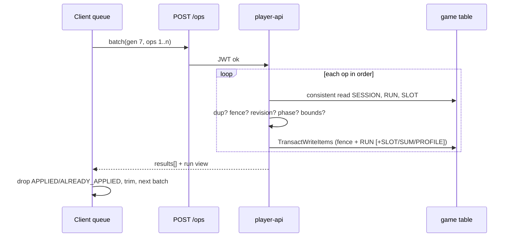
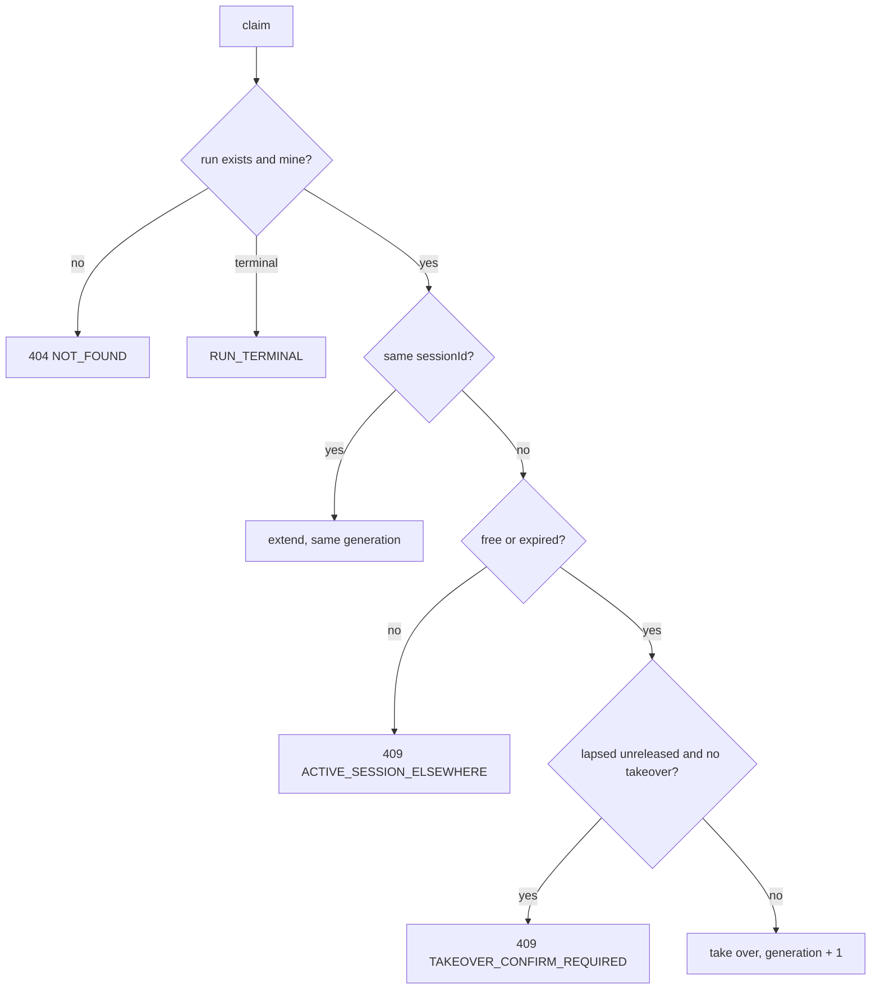

# G. API contracts

This section defines every HTTP route the two web apps call: who may call it, what goes in, what comes out, which errors are
possible and how retries behave. It does not contain handler code. The rules behind the contracts (state machines,
checkpoint semantics, fencing, DynamoDB transactions) are owned by [F. State and data](F-state-and-data.md); the trust
boundaries and authoriser wiring are owned by [E. Architecture](E-architecture.md); the Terraform for routes, throttles and
access logs is owned by [H. Infrastructure and delivery](H-infrastructure-and-delivery.md). Here they appear only as far as a
caller can observe them.

Spec reference: `prompt.md:886-957` (API contracts to plan), `prompt.md:67-68` (what section G must contain), `prompt.md:1308`.

## 1. Conventions that apply to every route

### 1.1 Transport, base path and authentication

| Rule | Detail | Label |
|---|---|---|
| Base path | Every route sits under `/api` on the same hostname as the app that calls it (`aliens.jackgl.com` for players, `admin.aliens.jackgl.com` for the operator). CloudFront's `/api/*` behaviour forwards to the HTTP API with caching disabled. No CORS, no API hostname. | **[PROPOSAL]** (spine S1) |
| Format | JSON request and response bodies, UTF-8, `Content-Type: application/json`. | **[ASSUMPTION]** |
| Token | `Authorization: Bearer <access token>` from the Cognito pool that owns the app. ID tokens are refused: the route requires a scope (ID tokens carry none) and the Lambda also checks `token_use = access`. | **[PROPOSAL]** (spine S1; research 05 §3.2) |
| Authorisers | `player` (issuer = player pool, audience = player app client) on every player route and `POST /api/speech`; `operator` (issuer = operator pool, audience = admin app client) on every `/api/admin/*` route. | **[PROPOSAL]** (spine S1) |
| Route scopes | Every route requires a scope: `game/play` (player pool resource server) on every player route and `POST /api/speech`; `ops/content` (operator pool) on every `/api/admin/*` route. Names come from research 05 and are set by the Terraform variables `player_route_scope` / `operator_route_scope` ([H §H.3.2](H-infrastructure-and-delivery.md#h32-variablestf)); per-route table in [E §E.6.3](E-architecture.md#e63-route--function--authoriser). | **[PROPOSAL]** (spine S1 requires a scope; names not yet in the spine) |
| Caller identity | The access-token `sub`. No request field ever names an owner; every `game` key is built from `sub`. | **[CONFIRMED]** AC-03 · spine S2 |
| Operator check | Operator routes additionally require `cognito:groups` to contain exactly `admin` (parsed, never substring-matched), decided from the route key before any data access. | **[CONFIRMED]** "admin role/group" · mechanism **[PROPOSAL]** |
| Unknown routes | Denied. The HTTP API has no `$default` route, so an unknown path gets a gateway 404 (body format **[UNVERIFIED]**, check in the Milestone 0 auth spike). Inside each Lambda, an unrecognised route key is answered `404 NOT_FOUND`. | **[PROPOSAL]** |
| Caching | Every API response carries `Cache-Control: no-store` (CloudFront already uses `CachingDisabled`; this stops the browser keeping copies of profile and run data). | **[PROPOSAL]** |
| Time | All timestamps are server UTC, ISO 8601 with `Z` (`2026-11-14T10:00:00Z`). `clientTime` fields are informational and never ordered on. | **[PROPOSAL]** (spine S7.1) |
| IDs | `runId`, `opId`, `sessionId`: UUID strings generated by the client. `slotId`: `^[NM]-[0-9]{3}$`. Every other ID that ends up in a DynamoDB key: `^[a-z0-9-]{1,40}$` (so it can never contain `#`). | **[ASSUMPTION]** (spine S9.5) |

A word on why the client generates IDs: if the browser invents the `runId` or `opId` *before* it sends anything, then a
retry after a lost response carries the same ID, and the server can recognise "I have already done this" instead of doing
it twice. That is what "idempotency key" means throughout this section.

### 1.2 The error envelope

Errors produced by our Lambdas always use one shape **[PROPOSAL]** (spine S9):

```json
{
  "error": {
    "code": "VALIDATION_FAILED",
    "message": "Request body failed validation",
    "details": [{ "field": "nickname", "rule": "max_length" }],
    "requestId": "Kx2Fh3abLPEEMXw="
  }
}
```

| Field | Meaning |
|---|---|
| `code` | Stable machine code from §10. The client decides what to do and what to say from this alone. |
| `message` | Short English text for developers and the operator. Never shown to a child; never contains submitted values. |
| `details` | Optional. For `VALIDATION_FAILED` it is a list of `{field, rule}` and **never echoes values** (so a mistyped date of birth is never reflected back or logged). Some codes carry structured details (for example `retryAfterSeconds`); these are listed per route. |
| `requestId` | The API Gateway request ID (`requestContext.requestId` in the payload 2.0 event), so the operator can find the matching access-log line and Lambda log line. **[PROPOSAL]** |

Gateway-generated responses (401 from the JWT authoriser, 429 from route throttling, 404 for an unmatched route, and any
CloudFront-generated 5xx) do **not** use this envelope. See §1.3.

### 1.3 Responses the gateway or CloudFront generate (no envelope)

| Situation | Status | Body | What the client does |
|---|---|---|---|
| Missing, expired, malformed or wrong-issuer/audience token | 401 | Research 05 found AWS documentation showing `{"message":"Unauthorized"}` with a `www-authenticate` header. Treat the exact body as **[UNVERIFIED]** until the Milestone 0 auth spike records it. | Refresh the token once and resend the identical request; if it fails again → `AUTH_REQUIRED` (spine S7.2). |
| Token valid but lacks the route scope | 401 or 403 | **[UNVERIFIED]** — research 05 §3.3 could not find an AWS page; the CDK README says 403. Record it in the spike. | Treat like 401 (it means the wrong client or pool issued the token). |
| Route throttle exceeded | 429 | Probably `{"message":"Too Many Requests"}` — **[UNVERIFIED]**, record in the spike. | `RETRYING` with back-off and jitter; same request. |
| No matching route | 404 | **[UNVERIFIED]** | Bug; log in the console. |
| Lambda timed out or crashed before answering (function timeouts sit under the HTTP API's 30 s integration limit: `player-api` 25 s, `admin-api` and `tts` 15 s — [H §H.4.4](H-infrastructure-and-delivery.md#h44-lambda_function-called-four-times)) | 500 or 503 (exact status and body **[UNVERIFIED]**, record in the spike) | gateway body, not our envelope | `RETRYING`; same request. Safe because every write route is idempotent (§5, R5, R13). |
| CloudFront-side failure (origin unreachable, timeout) | 502 / 503 / 504 | HTML or empty, not JSON | `RETRYING` with back-off. |

The client rule that makes this safe: **branch on the HTTP status first, and read `error.code` only when the body parses as
our envelope.** Never parse the gateway body for meaning. A player token sent to an `/api/admin/*` route is refused here
with 401 (wrong issuer), never by the Lambda, because the two pools have different issuers (research 05, pool comparison) **[PROPOSAL]**.

### 1.4 Request limits applied before any business logic

Checked on the raw body before parsing, then by a strict per-route schema (unknown fields rejected). Full table in §14.

| Check | Failure |
|---|---|
| Body larger than the route's limit (64 KB for `/ops` and the admin activity draft `PUT`; 8 KB elsewhere, including the one-op `/endless` envelope — spine S9.5) | `400 VALIDATION_FAILED` `details: [{field: "body", rule: "max_bytes"}]` |
| Not JSON / wrong top-level type | `400 VALIDATION_FAILED` `[{field: "body", rule: "json"}]` |
| Unknown field, wrong type, pattern or range | `400 VALIDATION_FAILED` with one `{field, rule}` per problem |

Handlers then write **named attributes only**; a request body is never merged into an item (spine S9.5) **[PROPOSAL]**.

## 2. Route catalogue

| # | Method + path | Lambda | Authoriser | Who may call | Purpose |
|---|---|---|---|---|---|
| R1 | `GET /api/me` | player-api | player | any player | dashboard: profile, age band, planets, badges, session status, resumable runs |
| R2 | `GET /api/me/progress` | player-api | player | any player with a profile | learning summaries + planets + badges |
| R3 | `PUT /api/me/profile` | player-api | player | any player | create or complete own profile |
| R4 | `PATCH /api/me/profile` | player-api | player | player with a profile | change nickname, avatar or DOB |
| R5 | `POST /api/me/resets` | player-api | player | player with a profile | campaign progress / learning history / whole profile reset |
| R6 | `GET /api/planets` | player-api | player | player with a profile | planets and wave sets for the caller's age band |
| R7 | `GET /api/runs` | player-api | player | player with a profile | list own runs (paginated) |
| R8 | `POST /api/runs` | player-api | player | player with a profile | create a run (+ claim the session) |
| R9 | `GET /api/runs/{runId}` | player-api | player | owner of the run | authoritative run view with slots |
| R10 | `GET /api/runs/{runId}/pack` | player-api | player | owner of the run | content pack / offline readiness manifest |
| R11 | `POST /api/runs/{runId}/ops` | player-api | player | owner + current session holder | apply an ordered batch of queued ops |
| R12 | `POST /api/runs/{runId}/endless` | player-api | player | owner + current session holder | the online-only `CHOOSE_ENDLESS` op |
| R13 | `PUT /api/session` | player-api | player | owner of the named run | claim or renew the account's play lease |
| R14 | `DELETE /api/session` | player-api | player | current lease holder | release the lease |
| R15 | `POST /api/speech` | tts | player | owner of the run/slot | approved clip metadata + short-lived URL |
| R16 | `POST /api/admin/speech/preview` | tts | operator | operator in group `admin` | render draft speech (the only Polly path) |
| R17 | `GET /api/admin/speech-definitions` | admin-api | operator | operator | list speech definitions |
| R18 | `POST /api/admin/speech-definitions` | admin-api | operator | operator | create a speech definition (draft) |
| R19 | `GET /api/admin/speech-definitions/{id}` | admin-api | operator | operator | header + draft + versions |
| R20 | `PUT /api/admin/speech-definitions/{id}` | admin-api | operator | operator | save speech draft |
| R21 | `POST /api/admin/speech-definitions/{id}/approve` | admin-api | operator | operator | approve the previewed draft as a new version |
| R22 | `GET /api/admin/activities` | admin-api | operator | operator | list activity headers |
| R23 | `POST /api/admin/activities` | admin-api | operator | operator | create an activity (draft) |
| R24 | `GET /api/admin/activities/{id}` | admin-api | operator | operator | header + draft + versions |
| R25 | `PUT /api/admin/activities/{id}/draft` | admin-api | operator | operator | save activity draft |
| R26 | `POST /api/admin/activities/{id}/validate` | admin-api | operator | operator | run publish validation without publishing |
| R27 | `POST /api/admin/activities/{id}/publish` | admin-api | operator | operator | publish the draft as a new immutable version |
| R28 | `POST /api/admin/activities/{id}/retire` | admin-api | operator | operator | stop selecting the activity for new runs |
| R29 | `POST /api/admin/activities/{id}/withdraw` | admin-api | operator | operator | mark one version invalid |
| R30 | `GET /api/admin/bank-status` | admin-api | operator | operator | counts vs thresholds per age × subject × category |

All routes **[PROPOSAL]** (spine S9); the spec says its own route names are proposals (`prompt.md:888`).

### 2.1 How the spec's route list maps onto these routes

| Spec item (`prompt.md`) | Route(s) |
|---|---|
| Get own profile/dashboard (`:892`) | R1, R2 |
| Create/complete own profile after sign-up (`:894`) | R3 |
| Update permitted profile preferences (`:896`) | R4 |
| Separate reset operations (`:898`) | R5 (three types) + an `ABANDON`/`FINISH_RUN` op through R11 for "reset current run" |
| List available planets/modes (`:900`) | R6 |
| List, create, read own runs (`:904`) | R7, R8, R9 |
| Acquire, renew, release the play session (`:906`) | R13, R14 |
| Save/exit with expected revision (`:908`) | `SAVE_PREP` op through R11 (carries `expectedRevision`), then R14 |
| Submit activity attempts (`:910`) | `SUBMIT_ATTEMPT` op through R11 |
| Record wave completion, defeat, campaign completion (`:912`) | `COMPLETE_WAVE`, `DEFEAT`, `FINISH_RUN` ops through R11; `CHOOSE_ENDLESS` through R12 |
| Reconcile queued offline events/checkpoints (`:914`) | R11 (the same route; offline and online ops are the same thing) |
| Versioned content pack / offline readiness manifest (`:916`) | R10 |
| Request speech for authorised content; metadata + signed URL (`:920-922`) | R15 |
| Admin-only preview of draft speech (`:924`) | R16 |
| List/read activity definitions; create/edit drafts (`:928-930`) | R22-R25 |
| Validate, preview, publish, retire (`:932`) | R26, R27, R28 (+ R29 withdraw); "preview" of an activity is rendered by the admin app from the draft with the shared player components, and its audio through R16 |

Why one ops route instead of separate "save", "attempt", "complete wave" endpoints: every change to a run must be ordered
against every other change to the same run (that is what `revision` does), and offline play produces a *sequence* of
changes that must be replayed in order. One ordered batch route gives one place to enforce ordering, fencing and
duplicate detection. **[PROPOSAL]** (spine S7.1)

## 3. Profile and dashboard routes

### R1 `GET /api/me`

| Aspect | Contract |
|---|---|
| Request | No body. Optional query `sessionId` (UUID) so the server can tell whether the lease belongs to *this* browser — see the open point at the end. |
| Success | `200` |
| Response | `nickname`, `avatarId`, `age` (integer, completed years, Europe/London), `ageBand` (`5`, `6` or `7`; `null` when the age is outside 5–7), `planets{planetId: {bestCompletedWave}}`, `badges{badgeId: earnedAt}`, `session{activeElsewhere, runId, deviceLabel, leaseExpiresAt}` (only these four — never `sessionId` or `generation`), `runs[]` = summaries of every `IN_PROGRESS` run (shape `RunSummary`, §4.1). |
| Never returned | `dob`, `sub`, Cognito username, any other player's data. **[CONFIRMED]** DOB write-only (spine S2). |
| Errors | `404 PROFILE_NOT_FOUND` before the profile is set up (the client routes to profile setup, or to recovery if local ops exist); `500 INTERNAL`. |
| Idempotency | Safe read. All `game` reads are `ConsistentRead` (spine S7.1). |
| Notes | Access pattern G1. `IN_PROGRESS` runs are bounded by the soft cap of 5, so no pagination is needed here. The client caches `nickname`, `avatarId` and `ageBand` in `meta` but never DOB. |

### R2 `GET /api/me/progress`

| Aspect | Contract |
|---|---|
| Request | No body. |
| Success | `200` |
| Response | `summaries[]` of `{subject, topicId, completed, succeeded, failed, lastResolvedAt}`, plus `planets` and `badges` as in R1. Topic display names are resolved by the client (topic registry owned by [C](C-game-and-learning-design.md)). |
| Errors | `404 PROFILE_NOT_FOUND`, `500 INTERNAL`. |
| Idempotency | Safe read (access pattern G6). |
| Notes | Summaries hold counts only — no answers, attempt numbers or age band (research 09). Bounded by the number of topics, so not paginated. |

### R3 `PUT /api/me/profile`

| Aspect | Contract |
|---|---|
| Request | `{nickname, avatarId, dob}` — all required. `nickname` 1–20 characters after trimming (letters, digits, space, hyphen); `avatarId` from the shipped avatar list; `dob` = `YYYY-MM-DD`, a real calendar date, not in the future, not more than 100 years ago **[ASSUMPTION]**. |
| Success | `200` with the R1 response shape (no 201: the same request always gets the same answer, which keeps retries trivial). **[PROPOSAL]** |
| Effect | Creates PROFILE if missing (`SET` the three fields, `if_not_exists` for `planets`/`badges` containers, `createdAt`); if it exists, sets the three fields. The only route allowed to create PROFILE (spine S8.1). |
| Errors | `400 VALIDATION_FAILED` (`details` name the field and rule, never the value); `500 INTERNAL`. |
| Idempotency | Naturally idempotent: repeating the same body leaves the same item. |
| Notes | A DOB change affects new runs only; existing runs keep their pinned `ageBand` (**[CONFIRMED]** AC-06, `prompt.md:221`). Connection required (spine S7.4). |

### R4 `PATCH /api/me/profile`

| Aspect | Contract |
|---|---|
| Request | Any non-empty subset of `{nickname, avatarId, dob}` with the R3 rules. Correcting DOB means typing the whole date again; the screen never shows the stored date. |
| Success | `200` with the R1 shape. |
| Errors | `400 VALIDATION_FAILED` (including an empty body); `404 PROFILE_NOT_FOUND` (update conditioned on `attribute_exists(pk)`); `500 INTERNAL`. |
| Idempotency | Idempotent (plain `SET` of named fields). |

### R5 `POST /api/me/resets`

| Aspect | Contract |
|---|---|
| Request | `{type, confirm}`; `type` ∈ `CAMPAIGN_PROGRESS` \| `LEARNING_HISTORY` \| `WHOLE_PROFILE`; `confirm` must be the identical string. **[PROPOSAL]** (spine S8.2) |
| Why `confirm == type` | It makes a reset impossible to trigger by a mistaken click or a replayed generic request: the client has to send the name of the thing it means to destroy twice, once from the dialog the child's grown-up actually confirmed. |
| Success | `200 {type, completedAt}` — only when every step has finished. |
| Effect | Per spine S8.2 (detail in [F](F-state-and-data.md)): `CAMPAIGN_PROGRESS` clears `planets` and `badges`; `LEARNING_HISTORY` deletes every `SUM#` item; `WHOLE_PROFILE` fences the session (bumps `generation`), deletes runs, slots and summaries, deletes PROFILE last, releases the lease if still the reset's. SESSION and the Cognito user are kept. |
| Errors | `400 VALIDATION_FAILED` (unknown type, `confirm ≠ type`); `404 PROFILE_NOT_FOUND` for `CAMPAIGN_PROGRESS`/`LEARNING_HISTORY` without a profile; `503 THROTTLED` / `500 INTERNAL` mid-way (the client repeats). |
| Idempotency | Repeat-safe by construction: each step deletes or clears what is still there. A repeated `WHOLE_PROFILE` after success finds nothing and still returns `200` **[PROPOSAL]**. |
| Client rules | Connection and an empty queue required; `WHOLE_PROFILE` may discard pending progress after the **[CONFIRMED]** warning. After a successful `WHOLE_PROFILE` the device deletes `scd-<sub>`. Afterwards `GET /api/me` returns `404 PROFILE_NOT_FOUND`. |
| Notes | "Reset current run" is not a type here: it is an `ABANDON` op (or `FINISH_RUN` when the campaign is complete) through R11, so it obeys the same fence and revision as every other run change. `player-api` times out at 25 s ([H §H.4.4](H-infrastructure-and-delivery.md#h44-lambda_function-called-four-times)), inside both the 30 s gateway limit and the 60 s reset fence. A `WHOLE_PROFILE` reset on a very large account may not finish in one call: the client then sees a gateway 5xx (§1.3) and repeats the same request, and the repeat carries on where the last one stopped. |

### R6 `GET /api/planets`

| Aspect | Contract |
|---|---|
| Request | No body. |
| Success | `200 {ageBand, planets[]}`; each planet `{planetId, name, unlocked, waveSets[]}`; each wave set `{waveSetId, mode (CAMPAIGN \| CHALLENGE), name, finalWave, available, reason?}`. |
| `available`/`reason` | `false` with `reason` `AGE_OUT_OF_RANGE` or `BANK_NOT_READY` when selection could not fill a run for the caller's age band (spine S5.3). The client shows honest copy and never offers another age band (**[CONFIRMED]**). |
| Which planets | Only released planets are listed; an unreleased placeholder is never shown as playable (`prompt.md:437`). `unlocked` is derived from `bestCompletedWave ≥ 20` on the preceding planet. |
| Errors | `404 PROFILE_NOT_FOUND` (no age band without a DOB); `500 INTERNAL`. |
| Notes | Uses the versions named in `/game-data/current.json` (spine S5.1) and the current bank (C1). Read-only. |

## 4. Runs

### 4.1 Shapes shared by the run routes

**`RunSummary`** (R1, R7) **[PROPOSAL]**:
`runId, planetId, waveSetId, mode, status, stage, phase?, wave, finalWave, highestCompletedWave, campaignCompletedAt?,
lastPlayedAt, createdAt, revision, playable, reason?` (`reason = CONTENT_VERSION_UNSUPPORTED` when `playable` is false).

**`RunView`** (R8, R9, R11, R12) **[PROPOSAL]** — everything the client reducer needs to continue the run:

| Field | Notes |
|---|---|
| All `RunSummary` fields | |
| `plannedThrough` | highest interval with selected slots |
| `snapshot` | `{credits, placements[{padId, classId, level, targeting}], colony{health, shield}, powers{powerId: charges}}`; absent on terminal runs |
| `seed` | returned for spine S4 compatibility; [C §C2.5](C-game-and-learning-design.md#c25-check-against-spine-s4-no-timer-or-cooldown-crosses-a-wave-boundary-wave-randomness-from-seed-wave) uses no wave randomness (authored waves, endless a pure function of the wave number), so the client does not need it today |
| `pins` | `{ageBand, rulesetVersion, campaignVersion, assetManifestVersion, protocolVersion}` |
| `currentSlot` | `null`, or `{slotId, kind, status, attempts[{n, answer, correct}], withdrawn}` — `withdrawn: true` tells an online client to show "this one was removed" and send `DISMISS_SLOT` |
| `recentOpIds` | the opIds in the run's 32-entry `recentOps` window, oldest first (used by divergence option (b)) |

**`RunDetail`** (R9 only) = `RunView` + `slots[]`: every slot of the run as one compact entry `{slotId, kind, status,
attemptsUsed}`. Recorded answers appear only for the current slot (in `currentSlot.attempts`), because that is the only
place the client needs them. The full slot list lets the offline reducer apply the next-phase rule (which needs to know
which slots exist); it is not repeated in every ops response, which keeps those small. Near wave 999 an endless run has
about 1,100 slots, so R9 stays at roughly 40-50 KB and the ops responses stay small (bounded-response reasoning in
[F §12.8](F-state-and-data.md#128-bounded-growth-with-numbers)). **[PROPOSAL]**

Returning the child's own recorded answers is deliberate: the "already tried" options are greyed out after a refresh
(AC-17). Answers are never logged (§15).

### R7 `GET /api/runs`

| Aspect | Contract |
|---|---|
| Request | Query `state` = `open` (IN_PROGRESS) \| `done` (DEFEATED, ABANDONED, COMPLETED) — required; `limit` 1–50, default 20 **[ASSUMPTION]**; `cursor` opaque, optional. |
| Success | `200 {items: RunSummary[], nextCursor: string \| null}` |
| Order | `lastPlayedAt` descending, ties by `runId`. For terminal runs `lastPlayedAt` is the end time (spine S3.1). |
| Errors | `400 VALIDATION_FAILED` (bad `state`, `limit`, or a cursor that does not decode or was made for the other `state`); `404 PROFILE_NOT_FOUND`; `500 INTERNAL`. |
| Idempotency | Safe read. |
| Notes | See §8 for how the cursor works and why it is safe here. |

### R8 `POST /api/runs` (CREATE_RUN — online only)

| Aspect | Contract |
|---|---|
| Request | `{runId (UUID), planetId, waveSetId, rulesetVersion, campaignVersion, sessionId (UUID), deviceLabel (≤40)}` |
| Preconditions | Profile exists; the versions are released and loadable (the client copied them from `current.json`); the wave set is available for the caller's age band; fewer than 5 `IN_PROGRESS` runs (soft cap); the session is free (no holder, or lease expired) or already held by this `sessionId`. |
| Success | `201` when this request created the run; `200` when the `runId` already existed (replay). Body identical in both cases: `{run: RunView, session: {sessionId, generation, leaseExpiresAt, leaseSeconds, renewAfterSeconds}}`. The client treats 200 and 201 the same. **[PROPOSAL]** |
| Effect | One transaction (G7): claim/extend SESSION, `Put RUN attribute_not_exists`, put every slot for the authored wave set (`N-001…N-(finalWave−1)` and the meteor slots), all `UNRESOLVED`. Pins age band, seed, versions, selection. |
| Errors | `400 VALIDATION_FAILED`; `404 PROFILE_NOT_FOUND`; `409 RUN_LIMIT_REACHED`; `409 CONTENT_UNAVAILABLE {reason: AGE_OUT_OF_RANGE \| BANK_NOT_READY}`; `409 ACTIVE_SESSION_ELSEWHERE {retryAfterSeconds, deviceLabel}`; gateway `429` (route throttle 1 rps / burst 5); `503 THROTTLED`; `500 INTERNAL`. Unreleased versions: see open points. |
| Idempotency | **Client `runId`.** The handler first does a consistent `GetItem` on `RUN#<runId>` under the caller's `pk`; if it exists it returns that run unchanged — it does not compare the body. One `runId` per create *intent*: the client generates it when the child presses "Start" and stores it until it gets a response, so a lost response and a retry still produce exactly one run. A different player using the same UUID addresses a different key and cannot collide. |
| Notes | Never queued, never applied optimistically. Disabled offline with the reason shown (spine S7.4). After success the client fetches R10 to prepare the pack. |

### R9 `GET /api/runs/{runId}`

| Aspect | Contract |
|---|---|
| Request | Path `runId` (UUID). |
| Success | `200 RunDetail` |
| Errors | `404 NOT_FOUND` for a missing run **and** for any other player's run ID — the key is built from the caller's `sub`, so the two cases are literally the same lookup (**[CONFIRMED]** AC-03); `400 VALIDATION_FAILED` for a malformed ID; `500 INTERNAL`. |
| Idempotency | Safe read; **reads never mutate** — a withdrawn version is reported through `currentSlot.withdrawn`, not acted on (spine S3.3). |

### R10 `GET /api/runs/{runId}/pack` (content pack / offline readiness manifest)

The pack is what the browser stores so a prepared run can continue offline (AC-30). It is the only place the client gets
activity definitions, so it is also where the allow-list matters most.

| Aspect | Contract |
|---|---|
| Request | Path `runId`. |
| Success | `200` with the manifest below. |
| Errors | `404 NOT_FOUND` (missing or not owned); `500 INTERNAL`; `503 THROTTLED`. A non-playable run still returns its pack with `packStatus.state = INCOMPLETE` so the list can explain why. |
| Idempotency | Safe read. |

Manifest fields **[PROPOSAL]**:

| Field | Meaning |
|---|---|
| `protocolVersion` | The protocol the pack was written for (§9). |
| `runId`, `revision`, `plannedThrough` | Which run state the pack was built from. |
| `packHash` | SHA-256 of the canonical pack body; the client re-enters `PREPARING` when it changes (spine S3.6). See open points. |
| `gameData` | `{rulesetVersion, campaignVersion, assetManifestVersion}` — the client fetches `/game-data/<kind>/<version>.json` itself (immutable paths). |
| `slots[]` | One entry per `UNRESOLVED` slot up to `plannedThrough` (resolved slots are not needed to play on). |
| `packStatus` | `{state: COMPLETE \| INCOMPLETE, missing: [{slotId, reason}]}`. `INCOMPLETE` reasons: `VERSION_MISSING` (pinned version not found — will be voided like a withdrawal), `CONTENT_VERSION_UNSUPPORTED` (pins not loadable). An interval with no slot because the endless bank was exhausted is *not* missing: the slot simply does not exist (spine S5.3). |

Each `slots[]` entry is built from an **allow-list**, never by copying the stored item (spine S9; review finding SEC-09):

| Included | Excluded (never in a pack) |
|---|---|
| `slotId`, `kind` (NORMAL \| METEOR), `subject`, `topicId`, `activityId`, `activityVersion` | review records, author/publisher identities, review checklists |
| `interactionType`, `prompt`, `visualAssetReferences`, `activityPayload`, `additionalSteps` | speech `text`/SSML source, voice, engine |
| `answerSpecification` (accepted canonical answers — needed for offline judging) | S3 bucket names and object keys |
| `resolved` (materialised template instance) and `presentation` (option/tile order) | other versions of the activity, drafts, `minAge`/`maxAge`, generator parameters |
| `intro` (`AUTO` \| `ON_REQUEST`) and `introductionContent` | anything about other players |
| `clips{variant: clipKey}` | presigned URLs (they expire; bytes are fetched through R15) |
| `reward` (from the pinned ruleset by `(kind, interval)`) | `definitionHash`, audit fields |
| `withdrawn` (`true` when the pinned version is withdrawn or missing; the definition is then omitted) | |

Shipping the accepted answers to the browser is a known, accepted consequence of offline judging under the family trust
model (spine S2 "accepted tampering gains"). Content strings are plain text and are rendered by React as text, never as HTML.

Example (trimmed):

```json
{
  "protocolVersion": 1,
  "runId": "4b1e…", "revision": 12, "plannedThrough": 49,
  "packHash": "9f2c…",
  "gameData": { "rulesetVersion": "r-2026-11-01", "campaignVersion": "c-luna-3", "assetManifestVersion": "a-17" },
  "slots": [{
    "slotId": "N-004", "kind": "NORMAL", "subject": "phonics", "topicId": "phonics-gpc-consonant-digraphs",
    "activityId": "ph-0101", "activityVersion": "20261114T100000Z",
    "interactionType": "MULTIPLE_CHOICE", "prompt": { "text": "Which letters make this sound?" },
    "activityPayload": { "options": [{ "id": "a", "text": "sh" }, { "id": "b", "text": "ch" }, { "id": "c", "text": "th" }, { "id": "d", "text": "s" }] },
    "answerSpecification": { "accepted": ["a"] },
    "presentation": { "optionOrder": ["c", "a", "d", "b"] },
    "intro": "ON_REQUEST",
    "clips": { "prompt": "5e88…", "instruction": "a01d…" },
    "reward": { "credits": 30 },
    "withdrawn": false
  }],
  "packStatus": { "state": "COMPLETE", "missing": [] }
}
```

(Field contents inside `activityPayload`/`answerSpecification` are illustrative; the per-type schemas belong to
[C](C-game-and-learning-design.md). Version IDs follow spine S8.3; ruleset/campaign version strings are illustrative.)

## 5. The ops batch — `POST /api/runs/{runId}/ops` (R11)

This is the one write path for run state after creation. It carries ops queued while online and ops queued while offline in
exactly the same way.

### 5.1 Request envelope

```json
{
  "protocolVersion": 1,
  "sessionId": "c0a8…",
  "generation": 7,
  "ops": [
    { "opId": "e1f0…", "expectedRevision": 12, "type": "SUBMIT_ATTEMPT",
      "payload": { "slotId": "N-004", "answer": "a" }, "clientTime": "2026-11-14T10:01:02Z" },
    { "opId": "77aa…", "expectedRevision": 13, "type": "SAVE_PREP",
      "payload": { "credits": 140, "placements": [{ "padId": "p-03", "classId": "laser", "level": 2, "targeting": "FIRST" }] },
      "clientTime": "2026-11-14T10:01:40Z" }
  ]
}
```

| Field | Rule | Label |
|---|---|---|
| `protocolVersion` | current or previous (§9) | **[PROPOSAL]** |
| `sessionId`, `generation` | the values **stored with these ops when they were queued**, never the device's newer ones; a batch never mixes generations | **[PROPOSAL]** (spine S7.1; review finding CON-01) |
| `ops` | 1–25, all for this `runId`, in revision order; body ≤ 64 KB | **[ASSUMPTION]** limits |
| `opId` | UUID, generated when the op is created by the reducer; never changes | **[PROPOSAL]** |
| `expectedRevision` | the run revision the op was computed against; assigned once, never changed on retry | **[PROPOSAL]** |
| `type` | one of the queueable op types below (`CHOOSE_ENDLESS` and `CREATE_RUN` are refused here) | **[PROPOSAL]** |
| `clientTime` | informational only | **[PROPOSAL]** |

### 5.2 Op payloads (strict schemas; unknown fields rejected)

| `type` | `payload` | Server-side checks beyond schema (detail in [F](F-state-and-data.md)) |
|---|---|---|
| `SAVE_PREP` | `{credits, placements[]}` | phase BUILD or IN_WAVE; bounds: `value(payload) ≤ value(stored)` |
| `START_WAVE` | `{wave, credits, placements[]}` | phase BUILD or IN_WAVE; `wave == run.wave`; same bound |
| `COMPLETE_WAVE` | `{wave, credits, placements[], colony{health, shield}, powers{powerId: charges}}` | phase IN_WAVE; `wave == run.wave`; `value ≤ stored + maxBounty[wave]`; health/shield/power caps |
| `SUBMIT_ATTEMPT` | `{slotId, answer}` — `answer` is the TS-canonicalised answer: a string ≤ 64 chars or an array of ≤ 20 option IDs (spine S9.5). v1 sends the string form only, because every canonical answer is a single string ([C §C20.1](C-game-and-learning-design.md#c201-canonical-answers-one-normaliser-exact-equality)); the array form is reserved | slot is the current slot and `UNRESOLVED`; Python checks only the shape and compares by exact equality |
| `DISMISS_SLOT` | `{slotId}` | current slot, `UNRESOLVED`, and (meteor before any attempt, or pinned version withdrawn) |
| `DEFEAT` | `{wave}` | phase IN_WAVE; `wave == run.wave` |
| `ABANDON` | `{}` | `campaignCompletedAt` not set |
| `FINISH_RUN` | `{}` | `campaignCompletedAt` set; phase not IN_WAVE |

Common field rules: `credits` non-negative integer; `placements` ≤ 32 entries **[ASSUMPTION]** (the real cap is the pad count
in the bounds file); `padId`/`classId` match the key-ID pattern; `level` 1–3; `targeting` from the ruleset's enum
([C](C-game-and-learning-design.md)). The client never sends rewards, badge IDs, unlocks or available classes; the server
derives them (spine S2).

**How this answers "the API must not accept a client-provided final credit balance as unquestionable truth"
(`prompt.md:956`):** a client credit figure is accepted only if it passes the per-op bound against the *stored* snapshot —
no income during BUILD, at most the wave's `maxBounty` on `COMPLETE_WAVE`, and learning rewards added only by the server in
the resolving transaction. Anything above that is `REJECTED CHECKPOINT_OUT_OF_BOUNDS` (spine S6).

### 5.3 Processing order, per op

The handler processes ops strictly in order; every `game` read is consistent (spine S7.1):

| Step | Check | Result if it fails |
|---|---|---|
| (a) | `opId` already in the run's `recentOps` (or, for an attempt, already recorded as an `attemptId` on the slot) | `ALREADY_APPLIED` with the original logical result; nothing is written; **checked before everything else** |
| (b) | SESSION `sessionId = :s AND generation = :g` | `STALE_SESSION` — stop |
| (c) | run not terminal | `REJECTED RUN_TERMINAL` |
| (d) | `expectedRevision == revision` | `REJECTED STALE_REVISION` |
| (e) | pins loadable (skipped for `ABANDON`/`FINISH_RUN`) | `REJECTED CONTENT_VERSION_UNSUPPORTED` |
| (f) | phase / wave / current-slot identity | `REJECTED PHASE_MISMATCH {phase, wave, currentSlotId}` |
| (g) | payload schema for this op type and `protocolVersion`, plus values against the pinned data (answer shape for the interaction type, pad IDs, levels) | `REJECTED VALIDATION_FAILED` |
| (h) | plausibility bounds | `REJECTED CHECKPOINT_OUT_OF_BOUNDS` |
| (i) | the transaction (G5) | any cancellation → jittered 20–100 ms pause, back to (a); after 3 tries → stop with `503 THROTTLED` |

`VALIDATION_FAILED` therefore has two layers, the same split as [F §8.1](F-state-and-data.md#81-per-op-processing-order-server):
envelope problems (size, JSON, op count, unknown op `type`, `CHOOSE_ENDLESS`/`CREATE_RUN` sent to `/ops`, ops for another
run) are a `400` before any op is looked at; a bad op *payload* is a per-op `REJECTED` at step (g), so the ops before it
still count. **[PROPOSAL]**

Why (a) comes first: a phone that lost the response to a batch will send the same ops again, possibly after another device
has taken over. Those ops really were applied, so the honest answer is "already applied", not "stale session". It also
means the loser of a duplicate-delivery race answers `ALREADY_APPLIED` by the same rule.

"Activity resolved or attempts exhausted" (`prompt.md:946`) is covered by step (f): once a slot is `SUCCEEDED`/`FAILED`, it
is no longer the current slot, so a further attempt is `PHASE_MISMATCH`. There is no separate `ATTEMPTS_EXHAUSTED` code
(removed in spine S9.1). The exception: a replayed `SUBMIT_ATTEMPT` or `DISMISS_SLOT` naming an already-`VOIDED` slot is
`APPLIED` with outcome `NO_OP_VOIDED_SLOT` in any phase, which keeps offline branches aligned after a withdrawal.

### 5.4 Response

```json
{
  "results": [
    { "opId": "e1f0…", "result": "APPLIED", "appliedRevision": 13, "outcome": "INCORRECT",
      "attempt": { "n": 2, "correct": false, "slotStatus": "UNRESOLVED", "rewardGranted": false } },
    { "opId": "77aa…", "result": "REJECTED", "code": "PHASE_MISMATCH",
      "details": { "phase": "ACTIVITY", "wave": 5, "currentSlotId": "N-004" } }
  ],
  "run": { "runId": "4b1e…", "revision": 13, "phase": "ACTIVITY", "wave": 5, "…": "RunView" }
}
```

| Element | Contract |
|---|---|
| `results[]` | Exactly one entry per submitted op, same order. |
| `result` | `APPLIED` \| `ALREADY_APPLIED` \| `REJECTED` \| `STALE_SESSION` \| `NOT_PROCESSED` |
| `code` | On `REJECTED`: one of `RUN_TERMINAL`, `STALE_REVISION`, `CONTENT_VERSION_UNSUPPORTED`, `PHASE_MISMATCH`, `VALIDATION_FAILED`, `CHECKPOINT_OUT_OF_BOUNDS`. |
| `details` | `PHASE_MISMATCH` → `{phase, wave, currentSlotId}`; `VALIDATION_FAILED` → `[{field, rule}]`; otherwise absent. **[PROPOSAL]** placement of these details |
| `appliedRevision` | For `APPLIED`: the run revision after this op. For `ALREADY_APPLIED`: the revision the op originally produced (from `recentOps`). Absent otherwise. |
| `outcome` | `APPLIED` only: `VOIDED`, `NO_OP_VOIDED_SLOT`, `CORRECT`, `INCORRECT`, `RESOLVED_SUCCEEDED`, `RESOLVED_FAILED` (spine S7.1). Absent for ops with nothing extra to say (e.g. `SAVE_PREP`). |
| `attempt` | For `SUBMIT_ATTEMPT` ops that were `APPLIED` or `ALREADY_APPLIED` (not voided): `{n, correct, slotStatus, rewardGranted}` rebuilt from the slot. **[PROPOSAL]** including it on first application as well as on replay, so the client reads one shape. |
| `run` | The authoritative `RunView` **after the last applied op** (including `recentOpIds`). Present on every response that reached op processing, including 409 and 503. |

**Stop rule.** The first `REJECTED` or `STALE_SESSION` stops the batch; every later op is `NOT_PROCESSED` (it was not
looked at, so it is neither accepted nor refused).

**"Original logical result".** A replayed op gets `{result: ALREADY_APPLIED, appliedRevision}` plus the current run view,
and for attempts `{n, correct, slotStatus, rewardGranted}` rebuilt from the stored slot. The client treats `ALREADY_APPLIED`
exactly like `APPLIED`: drop the op from the queue. Nothing is applied twice — the reward identity is `(runId, slotId)`, the
attempt identity is the `opId` (AC-18, AC-32).

### 5.5 HTTP status of a batch

| Status | When | Body |
|---|---|---|
| `200` | Every request whose ops were processed, **even if one was `REJECTED` or a later op was `STALE_SESSION`** | `{results, run}` |
| `409 STALE_SESSION` | The **first** op fails the fence at step (b) (it was not a duplicate) | error envelope **plus** `results` (first `STALE_SESSION`, rest `NOT_PROCESSED`) and `run` |
| `503 THROTTLED` | Step (i) exhausted its 3 tries | error envelope plus `results` decided so far (earlier ops `APPLIED`/`ALREADY_APPLIED`, the exhausted op and the rest `NOT_PROCESSED`) and `run` |
| `400 VALIDATION_FAILED` | Envelope-level problem: size, JSON, op count, unknown op type, `CHOOSE_ENDLESS`/`CREATE_RUN` sent here, mixed run | envelope only; no op processed |
| `404 NOT_FOUND` | Run missing or not the caller's (including after a `WHOLE_PROFILE` reset) | envelope only |
| `426 CLIENT_UPGRADE_REQUIRED` | `protocolVersion` older than the previous version (§9) | envelope only; nothing processed |
| `500 INTERNAL` | Unexpected error | envelope only |
| gateway `401` / `429` | §1.3 | gateway body |

The combined 409/503 body (envelope plus `results` and `run`) is **[PROPOSAL]**; it lets the client drop the ops that did
land before it reacts to the failure.

```json
{
  "error": { "code": "STALE_SESSION", "message": "Session generation is no longer current", "requestId": "…" },
  "results": [
    { "opId": "e1f0…", "result": "STALE_SESSION" },
    { "opId": "77aa…", "result": "NOT_PROCESSED" }
  ],
  "run": { "runId": "4b1e…", "revision": 15, "…": "RunView" }
}
```

### 5.6 What the client does with each outcome

| Seen | Client sync state (spine S3.5) | Action |
|---|---|---|
| all `APPLIED` / `ALREADY_APPLIED` | `SYNCED` when the queue is empty, else `PENDING` | drop acknowledged ops and commit that trim locally **before** sending the next batch; adopt `run` |
| any `REJECTED` | `DIVERGED` | divergence procedure, option (a) only; if `run` is terminal, adopt it, move leftovers to `recovery`, `SYNCED` |
| `STALE_SESSION` (per-op or 409) | `DIVERGED` | divergence procedure, options (a) and (b) ([F](F-state-and-data.md)) |
| `NOT_PROCESSED` | — | stays queued only if the procedure keeps it; never resent automatically after a `REJECTED`/`STALE_SESSION` |
| `503 THROTTLED`, `500`, gateway `429`, network error, timeout | `RETRYING` | drop any ops the body reports as applied; back off; resend the rest unchanged |
| gateway `401` | — then `AUTH_REQUIRED` | refresh once, resend the identical batch; second 401 → `AUTH_REQUIRED`, queue kept (AC-33) |
| `426` | `UPGRADE_REQUIRED` | keep the queue, ask the player to reload |
| `404 NOT_FOUND` | `DIVERGED` | move the run's ops to `recovery`, option (a) only (spine S8.2) |

A `REJECTED` is never retried because ops are only created by the shared reducer: if the server's reducer disagrees, the
two have diverged, and resending would get the same answer forever.



Reading the diagram: the queue sends one batch at a time; the handler decides each op in order, writing one transaction
per accepted op; the response lists every op's fate plus the run as it now stands, and the client trims its queue before
sending anything else. One request in flight per account is what keeps the 32-entry duplicate window sufficient.

## 6. `POST /api/runs/{runId}/endless` (R12, CHOOSE_ENDLESS — online only)

| Aspect | Contract |
|---|---|
| Request | The R11 envelope with **exactly one** op of type `CHOOSE_ENDLESS`, `payload: {}`. |
| Preconditions | The client has flushed the account's queue (so `expectedRevision` is current); phase `COMPLETION_OFFER`. |
| Effect | `stage = ENDLESS`, `wave = finalWave + 1`, plans endless slot blocks in the same transaction, phase by the next-phase rule (spine S3.2, S5.3). |
| Success / errors | Exactly as R11 (§5.4-5.5), including `ALREADY_APPLIED` on a retried `opId`. |
| Notes | Never queued or applied optimistically: the slots it creates come from the bank at that moment, so the client cannot predict them. Disabled offline. After success the client refreshes R10 because `plannedThrough` grew. |

## 7. Session lease — R13 `PUT /api/session`, R14 `DELETE /api/session`

The lease is the "one active game per account" rule (AC-28) and the fence that stops a stale device overwriting a newer
one (AC-29). A **fencing token** is a number that only ever goes up (`generation`); every write carries the number it was
issued, and the database refuses writes carrying an old number. That makes correctness independent of clocks: the lease
expiry only decides *when someone else may take over*, never whether a write is safe.

### R13 `PUT /api/session`

| Aspect | Contract |
|---|---|
| Request | `{mode: "claim" \| "renew", runId, sessionId, generation?, takeover?, deviceLabel}` — `generation` required for `renew`; `takeover` boolean, only meaningful for `claim`; `deviceLabel` ≤ 40 characters (e.g. "Kitchen laptop"). |
| Success | `200 {sessionId, generation, leaseExpiresAt, leaseSeconds: 180, renewAfterSeconds: 60, runId}` |
| `claim` | 1. Consistent `GetItem` RUN under the caller's `pk`: missing → `404 NOT_FOUND`; terminal → `RUN_TERMINAL`. 2. Same holder (`sessionId` matches): extend, set `runId`, `released = false`, **generation unchanged**. 3. Else free or expired: take over with `generation + 1` — **unless** the previous holder is another `sessionId` whose lease lapsed **without** a release and `takeover` is not `true` → `409 TAKEOVER_CONFIRM_REQUIRED`. 4. Otherwise → `409 ACTIVE_SESSION_ELSEWHERE`. |
| `renew` | Condition `sessionId = :s AND generation = :g` → extend the lease, clear `released`, update `runId`. Failure → `409 STALE_SESSION`. A failed renew **never** falls back to a claim: the client must go through the divergence procedure first, because it may hold ops stamped with the old generation. |
| Errors | `400 VALIDATION_FAILED`; `404 NOT_FOUND`; `409 RUN_TERMINAL` (status not in spine S9.1; F §5.3 uses the same); `409 TAKEOVER_CONFIRM_REQUIRED {deviceLabel, lastSeenSecondsAgo}`; `409 ACTIVE_SESSION_ELSEWHERE {retryAfterSeconds, deviceLabel}`; `409 STALE_SESSION` (renew); `503 THROTTLED` when the conditional update keeps hitting transaction conflicts or throttling — a failed heartbeat is **never** reported as `STALE_SESSION` (spine G4). |
| Idempotency | A repeated `claim` from the same `sessionId` lands in step 2 and returns the same generation, so a lost claim response is harmless. `renew` is idempotent. |

How steps 3 and 4 are built in DynamoDB (one conditional update whose lapsed-lease clause is included only when
`takeover: true`, with the two 409s told apart from the returned old item) is in
[F §5.3](F-state-and-data.md#53-requests); the caller sees exactly the behaviour above. **[PROPOSAL]**

`TAKEOVER_CONFIRM_REQUIRED` exists because a lease that simply *ran out* on another device may hide unsynced progress on
that device. The client shows one plain question ("This game may have unsaved progress on Kitchen laptop. Play here
instead?") and repeats the claim with `takeover: true`. A lease that was cleanly released needs no question.

```json
HTTP/1.1 409
{ "error": { "code": "TAKEOVER_CONFIRM_REQUIRED", "message": "Previous session lapsed without release",
  "details": { "deviceLabel": "Kitchen laptop", "lastSeenSecondsAgo": 412 }, "requestId": "…" } }
```



Reading the flowchart: ownership comes first, then "is it already me?", then "is it free?"; only a lapsed-but-unreleased
lease held by someone else needs the extra confirmation. Every path that changes the holder increments `generation`.

### R14 `DELETE /api/session`

| Aspect | Contract |
|---|---|
| Request | `{sessionId, generation}` in the body. Whether CloudFront and the HTTP API pass a `DELETE` body through unchanged is **[UNVERIFIED]** — check in the Milestone 0 spike; the fallback is the same two values as query parameters (neither is a secret). |
| Effect | Condition `sessionId = :s AND generation = :g` → `leaseExpiresAt = now`, `released = true`. |
| Success | `204` whether or not the condition matched (a mismatch means someone else already holds the lease, so there is nothing of ours to release). **[PROPOSAL]** |
| Errors | `400 VALIDATION_FAILED`; `503 THROTTLED`; `500 INTERNAL`. |
| Idempotency | Idempotent. |
| Notes | Sent after the queue is flushed on save-and-exit, leaving the run screen, a terminal screen, and sign-out. A release on page close is best effort only (a browser cannot reliably send an authenticated request while unloading); lease expiry plus the takeover question cover that case. |

### 7.1 Lease timings

| Setting | Value | Label |
|---|---|---|
| Lease length | 180 s | **[ASSUMPTION]** |
| Renew interval | every 60 s, only while the page is visible and there was input in the last 5 minutes | **[ASSUMPTION]** |
| Order when entering a run online | renew (or claim if no lease) → flush the queue → adopt view → act on phase | **[PROPOSAL]** (spine S3.7) |
| Who sends | only the tab holding the Web Lock `scd-play`, through the same serial queue as op batches (one request in flight) | **[PROPOSAL]** |

## 8. Pagination

Only two lists can grow beyond a screenful: R7 (`GET /api/runs`) and the admin lists (R17, R22).

| Rule | Detail | Label |
|---|---|---|
| Style | `limit` + opaque `cursor`; response `nextCursor` (null on the last page). | **[PROPOSAL]** |
| How it works | The handler reads the whole bounded set (≤ 5 open + ≤ 50 retained terminal runs; a few hundred content headers), sorts it, and slices. The cursor is a base64url-encoded JSON position in that sorted list — `{v, state, offset}` for runs — not a DynamoDB `LastEvaluatedKey`. | **[PROPOSAL]** (spine S8.1 G2; review finding DDB-11) |
| Why not DynamoDB paging | DynamoDB's `Limit` is applied before a filter and items come back in sort-key order, so a filtered, re-sorted list cannot be paged with its native cursor. The sets are small enough to read whole. | |
| Cursor trust | The cursor is not a secret and grants nothing: the partition is always rebuilt from the token's `sub`. A cursor that does not decode, has the wrong `v`, or names the other `state` → `400 VALIDATION_FAILED`. | **[PROPOSAL]** |
| Consistency | Offset paging can repeat or skip an item if a run is played between page requests. At this size the default `limit` usually returns everything in one page, so this is accepted and documented. | **[ASSUMPTION]** |
| Admin lists | `limit` 1–200, default 100; optional filters `subject`, `state` (`DRAFT` \| `PUBLISHED` \| `RETIRED`), `ageBand` (activities) and `kind`, `state` (`DRAFT` \| `APPROVED`) (speech). State values as [F §12.6](F-state-and-data.md#126-content-table-summary-lifecycle-ux-in-d). | **[ASSUMPTION]** |

## 9. Versioning

| Item | Contract | Label |
|---|---|---|
| `protocolVersion` | Integer, starting at `1`. Carried in the ops envelope (R11, R12) and in the pack manifest (R10). Each queued op stores the version it was created under. | **[PROPOSAL]** |
| Accepted versions | Current and previous. Each version has a strict schema (unknown fields rejected *for that version*). | **[PROPOSAL]** (spine S5.1) |
| Older than previous | `426 CLIENT_UPGRADE_REQUIRED`, nothing processed. The client enters `UPGRADE_REQUIRED` ("Reload to update the game"), **keeps the queue**, and after reload flushes the stored ops with their stored version (which the new server still accepts as "previous"). It never freezes or discards the queue. | **[PROPOSAL]** |
| Other routes | Evolve additively: new optional response fields may appear; clients ignore response fields they do not know. Request schemas stay strict. | **[PROPOSAL]** |
| Content compatibility | Separate from protocol: a run whose pinned versions cannot be loaded is `playable: false` with `CONTENT_VERSION_UNSUPPORTED` (spine S5.1; detail in [F](F-state-and-data.md)). | **[PROPOSAL]** |
| Release order constraint | The API is updated before the static app (the workflow publishes `index.html` last), so the server is never behind the client in normal releases. Never roll back past a protocol addition while a queued client may need it (spine S11.2; [H](H-infrastructure-and-delivery.md)). | **[PROPOSAL]** |
| Contract test | CI replays a recorded previous-release batch against the new handler. | **[PROPOSAL]** ([I](I-validation.md)) |

A note on status 426: in HTTP it is formally "Upgrade Required" and is meant to come with an `Upgrade` header naming a
protocol. We use it only as a distinctive status that the client maps to "reload the app"; the client keys off the
`error.code`, so the missing header does not matter. **[PROPOSAL]**

## 10. Error table

One code list for the whole API (spine S9.1). "Per-op" means the code appears inside `results[]` of a `200`, not as the
response status.

| Code | Source | HTTP | Raised by | Client action | Spec category (`prompt.md:936-954`) |
|---|---|---|---|---|---|
| (no envelope) | JWT authoriser | 401 | any route | refresh once, resend; else `AUTH_REQUIRED` | Unauthenticated / token expired |
| (no envelope) | gateway throttle | 429 | any route | `RETRYING` | Request throttled |
| `THROTTLED` | Lambda | 503 | ops, session, resets, any DynamoDB-heavy route | `RETRYING`, same request | Request throttled |
| `FORBIDDEN` | Lambda | 403 | admin routes (operator token without the `admin` group) | show message (admin app only) | Not authorised |
| `NOT_FOUND` | Lambda | 404 | any route naming a run/slot/content ID; R15 for every ownership/variant failure | queued run → recovery option (a) | Wrong owner (indistinguishable from missing) |
| `PROFILE_NOT_FOUND` | Lambda | 404 | R1, R2, R4-R8 | profile setup (or recovery if local ops exist) | — |
| `VALIDATION_FAILED` | Lambda / per-op | 400 / 200 `REJECTED` | any route / step (g) | 400: bug, show generic error; per-op: divergence | Request invalid |
| `CLIENT_UPGRADE_REQUIRED` | Lambda | 426 | R11, R12 (and R10 if the client asks for an unsupported version) | `UPGRADE_REQUIRED`, keep queue | Unsupported version |
| `ACTIVE_SESSION_ELSEWHERE` | Lambda | 409 | R8, R13 | "Being played on <device>", retry after `retryAfterSeconds` | Another active session |
| `TAKEOVER_CONFIRM_REQUIRED` | Lambda | 409 | R13 | confirmation dialog, repeat with `takeover: true` | Another active session |
| `STALE_SESSION` | Lambda / per-op | 409 / 200 | R11, R12, R13 (renew) | divergence (a)/(b) | Stale generation |
| `STALE_REVISION` | per-op | 200 `REJECTED` | R11, R12 | divergence (a) | Stale save revision |
| `PHASE_MISMATCH` | per-op | 200 `REJECTED` | R11, R12 | divergence (a) | Activity resolved / attempts exhausted |
| `CHECKPOINT_OUT_OF_BOUNDS` | per-op | 200 `REJECTED` | R11 | divergence (a); alarm (spine S11.5) | Request invalid (credit plausibility) |
| `RUN_TERMINAL` | per-op (and R13 claim) | 200 `REJECTED` / 409 (R13 claim) | R11, R12, R13 | adopt terminal view | — |
| `CONTENT_VERSION_UNSUPPORTED` | per-op / list field | 200 `REJECTED` | R11, R12; `reason` on summaries | divergence (a); Continue skips the run | Unsupported/retired/missing version |
| `DRAFT_CONFLICT` | Lambda | 409 | R20, R21, R25, R27 (admin `draftRevision` mismatch) | admin app: "Someone saved this draft after you opened it. Reload to see their changes." ([D §D8.3](D-ux-and-content-operations.md#d83-activity-lifecycle)) | Stale save revision (admin) |
| `RUN_LIMIT_REACHED` | Lambda | 409 | R8 | honest message ("finish or end a game first") | — |
| `CONTENT_UNAVAILABLE {reason}` | Lambda | 409 | R8 (and `reason` in R6) | honest message; no other-age fallback | — |
| `SPEECH_UNAVAILABLE` | tts | 503 | R15 | Retry button; never an attempt | Speech unavailable |
| `SPEECH_SYNTHESIS_FAILED` | tts | 502 | R16 | operator retries | Synthesis failed |
| `INTERNAL` | Lambda | 500 | any | `RETRYING` | — |
| `OFFLINE_PACK_INCOMPLETE` | **client only** | — | never sent by the server | stop at the first wave/interval without content | Offline pack incomplete |
| `ALREADY_APPLIED` | per-op **result**, not an error | 200 | R11, R12 | treat as applied | Already processed (original logical result) |

Removed and never emitted: `ATTEMPTS_EXHAUSTED`, `DUPLICATE_ANSWER`, `CONTENT_WITHDRAWN` (as an op result) and
`INVALID_ANSWER_FORMAT` (spine S9.1). A withdrawn version is not an error: it becomes an `APPLIED` op with outcome `VOIDED`.

## 11. Speech

### R15 `POST /api/speech` (player)

| Aspect | Contract |
|---|---|
| Request | `{runId, slotId, variant}` — identifiers only. `variant` matches `^(prompt\|instruction\|answer\|option-[a-f]\|bin-[a-z0-9]{1,8}\|intro-[1-3])$` (research 09 §6.6). **No** text, SSML, voice, engine, locale or speech ID is accepted from a player. **[CONFIRMED]** AC-20 · fields **[PROPOSAL]** |
| Resolution | One consistent `GetItem` of `U#<sub>` / `SLOT#<runId>#<slotId>` (the caller's own key). The slot's pinned clip map is the only authority: `variant` must be one of its keys, and the URL is signed for the `clipKey` stored there — never a key built from the request. Slot status is **not** checked (pack preparation fetches clips for unresolved slots ahead of time; resolved slots may replay their answer clip). |
| Success | `200 {clipKey, url, expiresInSeconds: 300, contentType: "audio/mpeg", bytes}` — `bytes` is the object size from a `HeadObject` that also confirms the object exists before a URL is signed (signing is a local calculation and would happily sign a missing key — research 06 §6.3). |
| NOT_FOUND equivalence | Run not the caller's, slot missing, variant not in the slot's clip map, malformed IDs that pass the schema but match nothing → **one identical `404 NOT_FOUND`** with the same message. The caller cannot tell "not yours" from "does not exist". **[PROPOSAL]** (spine S9; review finding SEC-02 in the spine notes) |
| Other errors | `400 VALIDATION_FAILED` (schema); `503 SPEECH_UNAVAILABLE` when the clip object is missing (also logged at ERROR and alarmed); gateway `429` (route throttle 20 rps / burst 40); `500 INTERNAL`. |
| Never | Calls Polly; writes DynamoDB; logs the URL. |
| URL lifetime | 300 s. A presigned URL also stops working when the signing credentials expire, and the Lambda signs with its execution-role session credentials, so a URL signed late in a credential session can die earlier than 300 s (**[VERIFIED]** in AWS docs by research 06 §6.1; `prompt.md:583`). The client downloads immediately and never stores the URL. |
| Idempotency | No state change. Repeated calls return the same `clipKey` and a fresh URL. |
| Client use | Online, every Play (debounced) calls R15; locally stored bytes are played only if the returned `clipKey` matches a stored clip, otherwise the bytes are downloaded and stored under `clipKey`. Offline: local bytes only. Failure → Retry; never an attempt, never a reward (**[CONFIRMED]** AC-19, AC-22). The bytes come from the audio bucket directly (CORS GET/HEAD from the two exact origins). |

Two departures from the spec's proposed flow, both deliberate and recorded as owner decisions:

- The spec's request names "run, activity, published content version and audio variant" (`prompt.md:569`). Here the
  `slotId` stands in for activity and version, because the slot pins exactly one `activityId@version`; accepting them
  separately would only add a field the server must then check against the slot. **[PROPOSAL]** (recorded as N-9 in
  [B](B-scope-and-decisions.md))
- The spec's cache-miss step (synthesise on a miss, `prompt.md:577`) is narrowed: the player route never calls Polly;
  a missing approved clip is an operational fault (`503` + alarm). Owner decision D-12 (spine S5.2).

### R16 `POST /api/admin/speech/preview` (operator)

| Aspect | Contract |
|---|---|
| Request | `{speechId?, text}` **or** `{speechId?, ssml}` — exactly one of `text`/`ssml`; ≤ 300 characters; SSML restricted to the tag allow-list (`speak`, `phoneme`, `break`, `prosody`, `s`, `p`, `sub`, `w` — research 06 §12; final list from the Milestone 0 listening spike). `prosody` accepts only `rate` and `volume`, the attributes the neural engine supports; `pitch` and `amazon:max-duration` are rejected with `400 VALIDATION_FAILED` rather than left to fail at synthesis as `502 SPEECH_SYNTHESIS_FAILED`. `emphasis` and `amazon:effect` are not available for neural voices, so they stay off the list (Polly developer guide, "Supported SSML tags", https://docs.aws.amazon.com/polly/latest/dg/supportedtags.html; **[UNVERIFIED]** in this run, re-check the table in the spike). `speechId` is for logging only. Voice, engine, locale and output format come from server configuration, never the request. |
| Effect | Computes the content-addressed `clipKey` (SHA-256 of the canonical synthesis input), calls Polly **only if** the object is absent, stores it with `PutObject If-None-Match: *` (never overwrites). The only Polly path in the system. |
| Success | `200 {clipKey, url, expiresInSeconds: 300}` |
| Errors | `400 VALIDATION_FAILED` (length, tags, both or neither of text/ssml); `403 FORBIDDEN` (operator token without the `admin` group); gateway `401` for a player token (wrong issuer); `502 SPEECH_SYNTHESIS_FAILED` (Polly error); `503 THROTTLED` (Polly throttling, which Polly reports as HTTP 400 `ThrottlingException` — research 06 §4.4 — so the Lambda must translate it); gateway `429` (route throttle 2 rps / burst 5). |
| Idempotency | Content-addressed: the same input always gives the same `clipKey` and never a second synthesis. |

## 12. Administration routes

All `/api/admin/*` routes: operator authoriser + `token_use = access` + exact `admin` group check, decided from the route key
before any lookup (spine S2). A non-member operator gets `403 FORBIDDEN`; a player token never reaches the Lambda (401).
Every admin route is covered by a contract test that a player token is refused (AC-04, [I](I-validation.md)). Body limit
8 KB except `PUT …/draft` (64 KB). The draft *content* schemas are owned by [C](C-game-and-learning-design.md); the screens by
[D](D-ux-and-content-operations.md). Operator identity for audit fields (`createdBy`, `publishedBy`, `listenedBy`) always comes
from the token, never the body.

### 12.1 Speech definitions

| Route | Request | Success | Errors | Idempotency / notes |
|---|---|---|---|---|
| R17 `GET /api/admin/speech-definitions` | query `kind?`, `state?`, `limit`, `cursor` | `200 {items[{speechId, title, kind, state, approvedVersion, updatedAt}], nextCursor}` | 400, 403 | safe read; header partition `SPEECH` read whole |
| R18 `POST /api/admin/speech-definitions` | `{speechId, title, kind}` | `201` header + empty draft (`draftRevision: 0`); `200` with the existing item if `speechId` already exists | 400, 403 | **operator-chosen `speechId`** makes create idempotent **[PROPOSAL]** |
| R19 `GET /api/admin/speech-definitions/{id}` | — | `200 {header, draft{…, draftRevision}, versions[{versionId, approvedAt, clipKey, review}]}` | 403, 404 | safe read |
| R20 `PUT /api/admin/speech-definitions/{id}` | `{draftRevision, title?, text \| ssml}` (same validation as R16) | `200` draft with `draftRevision + 1` | 400, 403, 404, `409 DRAFT_CONFLICT` | optimistic concurrency on `draftRevision` |
| R21 `POST /api/admin/speech-definitions/{id}/approve` | `{draftRevision, reviewNote?}` | `200 {versionId, clipKey}` | 400 `VALIDATION_FAILED` rule `not_previewed` when the clip object does not exist; 403; 404; `409 DRAFT_CONFLICT` | admin-api recomputes the key from the **saved** draft and requires the previewed object, so the bytes approved are the bytes children hear (C7). Safe to retry: a repeat whose `draftRevision` equals the stored `fromDraftRevision` returns the existing version (`200`) instead of writing a second one ([F §12.6](F-state-and-data.md#126-content-table-summary-lifecycle-ux-in-d)) **[PROPOSAL]** |

### 12.2 Activities

| Route | Request | Success | Errors | Idempotency / notes |
|---|---|---|---|---|
| R22 `GET /api/admin/activities` | query `subject?`, `state?`, `ageBand?`, `limit`, `cursor` | `200 {items[{activityId, title, subject, topicId, rewardCategory, minAge, maxAge, interactionType, authoringMode, state (DRAFT \| PUBLISHED \| RETIRED), publishedVersion, updatedAt}], nextCursor}` | 400, 403 | safe read; C1 (whole `ACT` partition) |
| R23 `POST /api/admin/activities` | `{activityId, title, subject, topicId, rewardCategory, interactionType, authoringMode, minAge, maxAge}` | `201` header + draft; `200` with the existing item if `activityId` exists | 400, 403 | operator-chosen `activityId` (key-ID pattern) makes create idempotent **[PROPOSAL]** |
| R24 `GET /api/admin/activities/{id}` | optional query `version` | `200 {header, draft, versions[{versionId, displayNumber, publishedAt, publishedBy, withdrawn?}]}`; with `version`: that version's full immutable definition | 403, 404 | safe read |
| R25 `PUT /api/admin/activities/{id}/draft` | `{draftRevision, definition}` (≤ 64 KB; schema from [C](C-game-and-learning-design.md)) | `200` draft with `draftRevision + 1` | 400, 403, 404, `409 DRAFT_CONFLICT` | C3; identity fields (`subject`, `topicId`, `rewardCategory`, `authoringMode`, `interactionType`) cannot change once a version is published (400 rule `locked_after_publish`; list as [F §12.6](F-state-and-data.md#126-content-table-summary-lifecycle-ux-in-d)) |
| R26 `POST /api/admin/activities/{id}/validate` | `{draftRevision}` | `200 {valid, problems[{field, rule}], domainSize?, sample[]?}` — templates return a rendered sample for human review | 403, 404 | no write; same checks as publish (≥ 4 options for choice, approved speech, exhaustive template check ≤ 5,000) |
| R27 `POST /api/admin/activities/{id}/publish` | `{draftRevision, review{checklist{…seven booleans}, previewSolvedDraftRevision}}` | `201 {versionId, displayNumber}`; `200` with the same body on a replay | `400 VALIDATION_FAILED` with the problem list (incl. rules `speech_not_approved`, `checklist_incomplete`, `preview_solve_stale` when `previewSolvedDraftRevision ≠ draftRevision`); 403; 404; `409 DRAFT_CONFLICT` | C4: new immutable `V#<timestamp>`; `review` is stored in the version's review record with `publishedBy` from the token — it records the operator's own declaration and proves nothing more (checklist items in [D §D8.4](D-ux-and-content-operations.md#d84-activity-editor-a3a6)) **[PROPOSAL]**. Replay: a repeat whose `draftRevision` equals the stored `fromDraftRevision` returns the existing version ([F §12.6](F-state-and-data.md#126-content-table-summary-lifecycle-ux-in-d)) **[PROPOSAL]** |
| R28 `POST /api/admin/activities/{id}/retire` | `{}` | `200` header | 403, 404 | idempotent: already retired → 200 unchanged; pinned runs unaffected |
| R29 `POST /api/admin/activities/{id}/withdraw` | `{version, reason}` (`reason` ≤ 200 chars **[ASSUMPTION]**) | `200 {versionId, withdrawn{at, reason}}` | 400, 403, 404 (version not found) | idempotent: already withdrawn → 200 with the first record; if it was the published version, also retires (C6); affects `UNRESOLVED` slots via VOID only when a run op next touches them |
| R30 `GET /api/admin/bank-status` | — | `200 {ageBands[{ageBand, eligible, groups[{subject, rewardCategory, topicId?, count, threshold, ok}]}]}` | 403 | safe read; thresholds are server configuration (spine S5.3) |

Publish, retire, withdraw and approve each write an audit item (`AUDIT#<yyyy-mm>`) and an audit log line (§15).

## 13. Revisions, save semantics and sync — summary

The full rules live in [F. State and data](F-state-and-data.md); this is what a caller needs to know.

| Concept | Contract |
|---|---|
| Run `revision` | Integer on the run, +1 for every `APPLIED` op (including no-op outcomes). Every op names the `expectedRevision` it was computed against; a mismatch is `STALE_REVISION`. This is how two writers can never silently overwrite each other's state. |
| Session `generation` | Integer on the account's SESSION item, +1 on every change of holder (and on `WHOLE_PROFILE`). Every op batch carries the generation stored with its ops; a mismatch is `STALE_SESSION`. |
| Content `draftRevision` | Integer on each admin draft; every save/publish/approve names it (optimistic concurrency for the operator); a mismatch is `409 DRAFT_CONFLICT`. |
| What "saved" means | Cloud save = the result of the last acknowledged op. Unacknowledged progress is "saved on this device" only. The UI says which (AC-31; sync states in spine S3.5). |
| Save and exit | Flush the queue (the last `SAVE_PREP` carries `expectedRevision`), then R14. Mid-wave save-and-exit writes nothing: the stored snapshot is already the wave-start snapshot (AC-24, AC-25). |
| Resume | Never writes. Order: renew/claim → flush → adopt view → act on phase. |
| Duplicates | `opId` within the 32-entry `recentOps` window (kept on terminal runs too), and `attemptId = opId` on slots, give `ALREADY_APPLIED` with the original result. One batch in flight per account and ≤ 25 ops per batch keep the window sufficient. |
| Offline reconciliation | The same R11 route; ops queued offline are replayed in revision order with their stored generation and protocol version. |
| Online-only | `POST /api/runs` and `CHOOSE_ENDLESS` (R12), plus profile setup, resets, pack preparation and first clip fetch. |

## 14. Limits

One shared limits file is read by the client and by the handlers (spine S9.5; it sits in `web/shared` for the apps and is bundled into the Lambda zips through `api/shared/`, both to create — [E §E.5.1](E-architecture.md#e51-workspace-layout-all-to-create), [E §E.6.2](E-architecture.md#e62-why-no-lambda-calls-another)). Numbers are **[ASSUMPTION]** unless marked.

| Limit | Value |
|---|---|
| Request body | ≤ 64 KB for R11 and R25; ≤ 8 KB everywhere else, including R12 (checked on the raw body) |
| Ops per batch | 1–25 |
| `recentOps` window | 32 per run |
| Attempts per slot | 3 **[CONFIRMED]** |
| `IN_PROGRESS` runs | soft cap 5 (`RUN_LIMIT_REACHED`) |
| Retained terminal runs | newest 50 by `lastPlayedAt` (older pruned best-effort) |
| Endless | `COMPLETE_WAVE` at wave 999 completes the run |
| `limit` | runs 1–50 (default 20); admin lists 1–200 (default 100) |
| `nickname` | 1–20 characters: letters, digits, space, hyphen |
| `deviceLabel` | ≤ 40 characters |
| `answer` | canonical string ≤ 64 characters (the only form v1 sends, C20.1), or ≤ 20 option IDs (reserved) |
| `placements` | ≤ 32 entries (pad count from the bounds file is the real cap) |
| IDs | UUID (`runId`, `opId`, `sessionId`); `^[NM]-[0-9]{3}$` (`slotId`); `^[a-z0-9-]{1,40}$` (key IDs) |
| Admin preview text/SSML | ≤ 300 characters; tag allow-list |
| Template domain | exhaustive check cap 5,000 instances |
| Speech URL | 300 s (and no longer than the signing credentials) |
| Lease / renew | 180 s / 60 s |
| Throttles (Terraform; shared by all callers, best effort) | stage 20 rps / burst 40; `POST /api/runs` 1 / 5; `POST /api/speech` 20 / 40; admin speech 2 / 5 |

The throttles are shared by everyone using the API, not per user, and API Gateway documents them as best-effort targets
(**[VERIFIED]** by research 06 §10 from AWS docs). They exist to cap cost and Polly use, not to enforce fairness.

## 15. Logging allow-list

Logs are an **allow-list**: a field not in this table is never written by any of the four functions or the API access log
(spine S2) **[PROPOSAL]**.

| Allowed field | Where |
|---|---|
| `requestId`, `routeKey`, HTTP `status`, `durationMs` | every function line; the access log carries the same facts under the same keys as H §H.4.3 emits them: `requestId` (`$context.requestId`), `routeKey` (`$context.routeKey`), `status` (`$context.status`), `durationMs` (`$context.responseLatency`), `integrationLatency` (`$context.integrationLatency`), `integrationError` (`$context.integration.error`), `authorizerError` (`$context.authorizer.error`), `sub` (JWT claim; variable **[UNVERIFIED]**, M0 spike) ([H §H.4.3](H-infrastructure-and-delivery.md#h43-http_api)) |
| `sub` | every line (the access log via the authoriser claim, field `authorizer.claims.sub` in [H §H.4.3](H-infrastructure-and-delivery.md#h43-http_api)'s access-log format — the exact `$context` variable is **[UNVERIFIED]** until the Milestone 0 spike) |
| `runId`, `slotId`, `opId`, op `type` | player-api and tts |
| `result`, error/rejection `code` | every line |
| `revision`, `generation` | player-api |
| admin audit: `action`, `activityId`/`speechId`, `versionId` | admin-api audit lines (see open points: this extends the spine's list) |

Never logged: raw events, request or response bodies, the `Authorization` header or any token, presigned URLs, answers,
nicknames, date of birth, speech text/SSML, client IP addresses or user agents, cursors' decoded contents. One structured
line is written per processed op; a metric filter on `result=REJECTED` and another on `SPEECH_UNAVAILABLE` raise alarms
(spine S11.5). The DOB test (submit a known date, assert it appears in no response body and no captured log line) is in
[I](I-validation.md).

## Open points for the planner

- **Settled between sections but not yet in the spine** (record them there): route scopes `game/play` / `ops/content` (E, H,
  B E-05); `409` for `RUN_TERMINAL` on a claim (F §5.3 uses it); `deviceLabel` in `ACTIVE_SESSION_ELSEWHERE` (F §5.3);
  `409 DRAFT_CONFLICT` for an admin `draftRevision` mismatch (D's copy fits; chosen over reusing `STALE_REVISION`, which is a
  per-op `200 REJECTED` code and would blur the client mapping); publish/approve replay via `fromDraftRevision` (F §12.6);
  `interactionType` locked with the other identity fields (F §12.6); header `state` values (F §12.6, D); the
  `RunView`/`RunDetail` split with compact slot entries (F §12.8 agrees); `packHash`, pack holding `UNRESOLVED` slots only and
  the `packStatus.missing` reasons (spine S3.1 `selection.packId` is a different thing); the logging allow-list additions
  (HTTP `status`, `durationMs` for the spine's `duration`, admin audit `action`/`activityId`/`speechId`/`versionId`).
- **Review evidence on publish (R27).** `review{checklist, previewSolvedDraftRevision}` is added here at D's request; F's
  version "review record" should name these fields, and spine C4 should mention them. It records the operator's declaration only.
- **POST /api/runs over a lapsed-unreleased lease.** Spine S3.2 lets `CREATE_RUN` proceed when the session is "free" (expired
  counts as free), and the R8 body has no `takeover` field, so starting a new game can silently fence another device that
  lapsed with unsynced ops. I'd suggest R8 accepts `takeover` and returns `409 TAKEOVER_CONFIRM_REQUIRED` under the same rule
  as R13; F §5.3 agrees. Written here per the spine (no confirmation) until the spine changes.
- **POST /api/runs with unreleased or unknown `rulesetVersion`/`campaignVersion`.** The spine names no route-level code. I'd
  suggest `409 CONTENT_VERSION_UNSUPPORTED` (client re-reads `current.json`); currently unspecified in the text.
- **Locked planet in POST /api/runs.** No code for "planet not yet unlocked". Suggest adding reason `PLANET_LOCKED` to
  `CONTENT_UNAVAILABLE`. R6 uses an `unlocked` flag meanwhile.
- **Interrupted `WHOLE_PROFILE` reset and the next claim.** F suggests a `RESET#<requestId>` holder is treated as released, so
  R13 would not ask "Play here instead?" about the reset itself. Not in the spine; R13 follows F if adopted.
- **`GET /api/me` `activeElsewhere`** needs to know the caller's `sessionId`, but GET has no body and SEC-09 keeps
  `sessionId` out of responses. I proposed an optional `sessionId` query parameter; needs confirming.
- **`outcome` values.** `CORRECT` looks redundant with `RESOLVED_SUCCEEDED` (a correct answer always resolves); and
  `DISMISS_SLOT` → `DECLINED` has no outcome value. Suggest dropping `CORRECT` and adding `DECLINED`. G and F follow the
  spine list meanwhile.
- **Admin ID patterns vs research 09.** Research 09's `MA-0101` and `phoneme.sh` fail the spine key-ID pattern
  `^[a-z0-9-]{1,40}$`. G and D use `ma-0101`, `ph-0012`, `phoneme-sh`; section C must match. IDs are operator-chosen so
  create is idempotent (research 09 had the API assign them).
- **Speech response `sha256`.** Research 06/09 propose a SHA-256 of the MP3 bytes for a client integrity check; spine S9 has
  `{clipKey, url, contentType, bytes}` (`expiresInSeconds` added here). E §E.9 uses a length/type check meanwhile. Decide
  whether R15 and the speech version gain `sha256`.
- **No speech retire/withdraw route.** D §D9.6 covers a wrong clip with a manual runbook; if the owner wants "used by" or a
  speech withdrawal, G gains a route (and F the extra reads).
- **Protocol version newer than the server knows** (only possible after a rollback) has no defined response; suggest a
  batch-level response the client treats like `UPGRADE_REQUIRED` (hold the queue), never a per-op `REJECTED`.
- **[UNVERIFIED] items for the Milestone 0 spike:** gateway 401/403/404/429 bodies, the missing-scope status, and the status
  for a Lambda timeout; whether a `DELETE` body survives CloudFront + HTTP API; the access-log `$context` variable for the
  JWT `sub`; `cognito:groups` serialisation in the event (affects the `FORBIDDEN` check).
