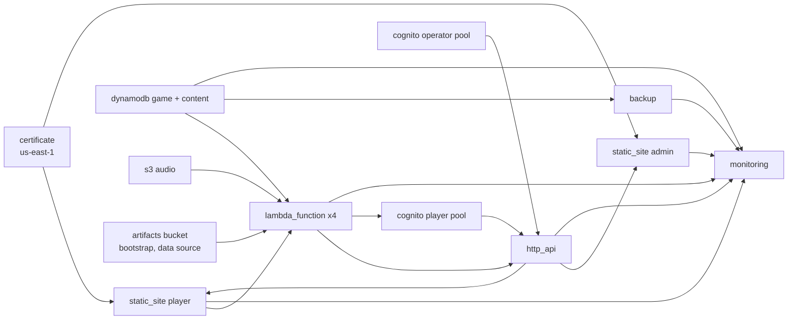
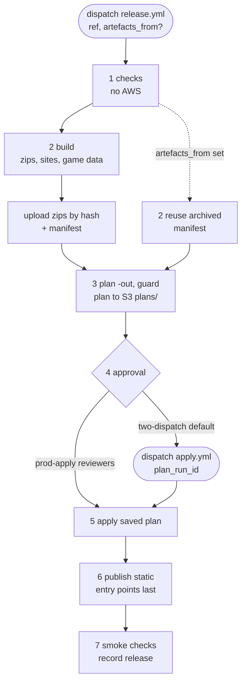
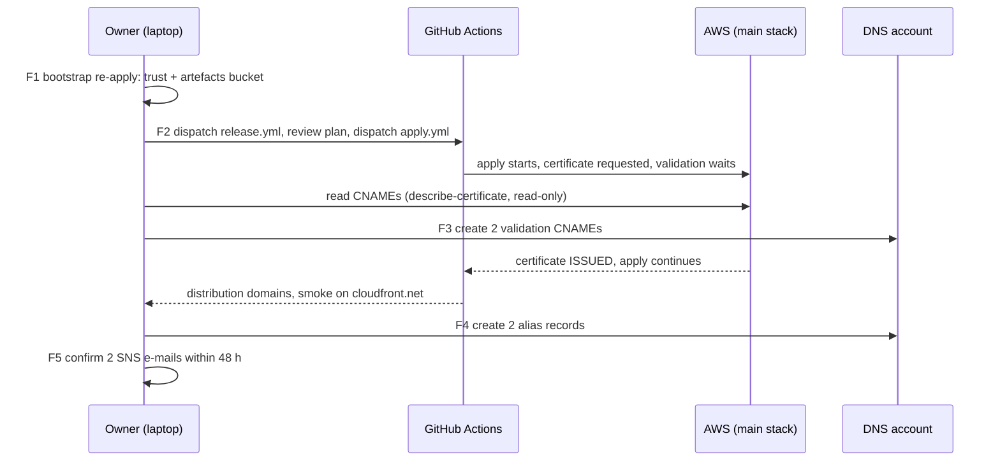

# H. Infrastructure and delivery

This section maps the Terraform and GitHub Actions work onto the repository as it actually is today. It covers the
`infrastructure/main` root, the modules, environment-file keys, the bootstrap changes **you** make, and the replacement
workflows. It also covers the manual release order, who owns each artefact, quality gates, data protection, compatible
rollback, monitoring, backup and restore, and the DNS hand-off.

Spec anchors: "Map Terraform/module changes to the actual existing repository. Explain manual release order, artifact
ownership, quality gates, data protection, compatible rollback, monitoring and daily backup/restore" (`prompt.md:71`);
"Terraform module/environment integration and the existing manual release workflow" (`prompt.md:1312`); the release
workflow brief (`prompt.md:958-1004`); operations (`prompt.md:1008-1026`); AC-36 to AC-40.

What this section does not repeat:

- **Repository evidence** (the tree, the bootstrap, AWS reality, line-by-line findings in the copied workflows, OIDC risk)
  is in [A. Repository findings](A-repository-findings.md). This section cites lines only where it decides what to do with them.
- **Architecture diagrams, the trust boundaries and the list of DNS integration points** are in
  [E. Architecture](E-architecture.md#e33-dns-integration-points-no-redesign).
- **Table keys, transactions and the data side of backup and restore** are in [F. State and data](F-state-and-data.md).
- **Route list and limits** are in [G. API contracts](G-api-contracts.md).
- **Test strategy and the AC mapping** are in [I. Validation](I-validation.md).
- **Task order and effort** are in [J. Execution backlog](J-execution-backlog.md).

Nothing described here exists yet unless it is marked **[VERIFIED]**. Every planned file is written in backticks with
"(to create)".

Canon: [00-spine.md](00-spine.md) (v0.3) is canonical for every name, key, route and rule used here. Evidence for AWS
service behaviour is in [sources/08-aws-data-ops.md](sources/08-aws-data-ops.md),
[sources/05-cognito-auth.md](sources/05-cognito-auth.md), [sources/06-polly-tts.md](sources/06-polly-tts.md) and
[sources/11-voice-engine.md](sources/11-voice-engine.md).

Way of working ([spine S0.1](00-spine.md#s01-way-of-working-confirmed-by-owner-2026-11-14)): Claude builds the app in
sequential build phases and you review the code at each phase gate. Work happens on `main`; Claude or you commit and push.
**Deployment happens only through the GitHub Actions pipelines in H.7 and H.8.** Locally, `terraform fmt`, `validate` and
`plan` and read-only AWS calls are fine; there is no local `terraform apply` on the main stack. The one exception is the
bootstrap root (H.5), which creates the CI's own trust and which you apply from your machine. **[CONFIRMED by owner]**

---

## H.1 Starting point in one table

The state of `main` at commit `f88439c`, after the Phase 0 commits `8e669ff` and `dee3f51`. **[VERIFIED]** (`git log`, `git ls-files`)

| Item | Today | Label |
|---|---|---|
| Bootstrap root | [main.tf](../../infrastructure/bootstrap/main.tf) calls the external module `terraform-bootstrap//modules/bootstrap?ref=v1.0.0` ([main.tf:19](../../infrastructure/bootstrap/main.tf#L19)). It is applied, and its state lives in `263185198757-eu-west-2-space-tower-defence-prod-bootstrap`. | **[VERIFIED]** |
| Main-stack state bucket | `prod-state-bucket-space-tower-defence`, from [locals.tf:2](../../infrastructure/bootstrap/locals.tf#L2). It exists, is versioned and is empty. | **[VERIFIED]** |
| CI role | `space-tower-defence-prod-github-oidc` with `AdministratorAccess` ([prod.tfvars.json:4](../../infrastructure/envs/prod.tfvars.json#L4)). The env file now sets `trusted_subs` to the immutable `…:environment:prod` subject ([common.auto.tfvars.json:5](../../infrastructure/envs/common.auto.tfvars.json#L5)); the applied trust was `repo:jacklavelle286/space-tower-defence:*` at the start of planning, and whether the narrowed value has been re-applied is settled in J M0-03. | **[VERIFIED]** file; applied trust **[UNVERIFIED]** |
| `infrastructure/main/` | Skeleton from `dee3f51`: [provider.tf](../../infrastructure/main/provider.tf), [variables.tf](../../infrastructure/main/variables.tf), the lock file, and an empty [main.tf](../../infrastructure/main/main.tf) (no resources) | **[VERIFIED]** |
| `infrastructure/modules/` | Does not exist | **[VERIFIED]** |
| Env files | `common.auto.tfvars.json` holds `project`, `region`, `trusted_subs`, `role_policy_arns`, `terraform_version` (`1.17.2`, [common.auto.tfvars.json:8](../../infrastructure/envs/common.auto.tfvars.json#L8)). `prod.tfvars.json` holds `environment`, `aws_account_id`, `role_policy_arns`. | **[VERIFIED]** |
| Terraform | Local CLI 1.17.2. The bootstrap root requires `>= 1.10.0` ([main.tf:2](../../infrastructure/bootstrap/main.tf#L2)) and AWS provider `>= 6.0, < 7.0` ([main.tf:7](../../infrastructure/bootstrap/main.tf#L7)); its lock file has 6.73.0. | **[VERIFIED]** |
| Workflows | The verbatim copies from the reference product arrived in `8e669ff` ([deploy.yml](https://github.com/jacklavelle286/space-tower-defence/blob/8e669ff/.github/workflows/deploy.yml), [tf-apply-destroy-env.yml](https://github.com/jacklavelle286/space-tower-defence/blob/8e669ff/.github/workflows/tf-apply-destroy-env.yml); [A §4](A-repository-findings.md#4-the-two-workflow-files-what-they-reference-that-does-not-exist-here)). `dee3f51` deleted `deploy.yml`, rewrote [tf-apply-destroy-env.yml](../../.github/workflows/tf-apply-destroy-env.yml) as the interim Phase 0 plan/apply pipeline (it still offers `destroy` until J M0-01 removes it) and added [oidc-smoke.yml](../../.github/workflows/oidc-smoke.yml). | **[VERIFIED]** |
| `.gitignore` | [.gitignore](../../.gitignore) exists (from `8e669ff`) and ignores `.terraform/` and `.terraform-*/`; H.16 is the checklist to review it against. | **[VERIFIED]** |

---

## H.2 Repository layout after this plan

Only the `infrastructure/`, `.github/`, `scripts/` and root files are owned here. `web/` and `contracts/` belong to
[E §E.5.1](E-architecture.md#e51-workspace-layout-all-to-create).

```
space-tower-defence/
├── .github/workflows/
│   ├── release.yml            (to create)  replaces the removed deploy.yml
│   ├── apply.yml              (to create)  apply-a-reviewed-plan (second dispatch)
│   ├── plan.yml               (to create)  plan-only drift check; replaces tf-apply-destroy-env.yml
│   ├── tf-apply-destroy-env.yml (exists)  interim Phase 0 pipeline; deleted by J M1-10
│   └── oidc-smoke.yml         (exists)  OIDC smoke test; kept afterwards as a manual workflow
├── infrastructure/
│   ├── bootstrap/             (exists; owner-applied only; small edits and the artefacts bucket in H.5)
│   ├── envs/                  (exists; keys added in H.6)
│   ├── main/                  (exists: provider.tf, variables.tf, lock file, empty main.tf; rest in H.3)
│   ├── modules/               (to create; H.4)
│   └── plan-guard.json        (to create; H.11)
├── api/                       (to create)  Python Lambda source and tests
│   ├── functions/{player_api,admin_api,tts,cognito_presignup}/
│   ├── shared/                (shared Python package: clip key, generators, reducer mirror, data access)
│   ├── tests/
│   └── requirements.txt, requirements-dev.txt
├── game-data/                 (to create)  rulesets, planet documents, asset manifests (JSON); published (H.8.5)
├── content/seed/              (to create)  seed activities and speech drafts (JSON) for the seed script; never published
├── content/listening-verdicts.json  (to create)  per-sound listening verdicts read by gate G-14
├── scripts/                   (to create)  build_lambdas.py, plan_guard.py, gamedata_lock_check.py, seed_content.py,
│                                       restore_copy.py, verify_pins.py
├── tools/sim/                 (exists)  balance simulator; `python3 -B tools/sim/selftest.py`
├── spikes/                    (to create)  M0 spikes (auth, listening bake-off, scaffold)
├── docs/runbooks/             (to create)  restore, operator password reset, sign-up kill switch, rollback, speech withdrawal
├── docs/releases/             (to create)  one short entry per production release
├── docs/decisions/            (to create)  ADRs, including the M0 OIDC outcome (H.5)
├── docs/validation/           (to create)  playtests/, performance/, acceptance/, browsers.md (owned by I)
├── .gitignore                 (exists; reviewed against H.16)
├── .nvmrc, .python-version    (to create; H.17)
└── web/, contracts/           (to create; owned by E; contracts/routes.json feeds gates G-12 and the smoke test)
```

The folder names are the ones recorded in [spine S1.3](00-spine.md#s13-configuration-names-and-repository-layout-proposal).
The simulator is [../../tools/sim/](../../tools/sim/).

| Choice | Why | Label |
|---|---|---|
| Python source in `api/`, outside `infrastructure/` | Tests and packaging live with the code. The reference product keeps small Lambda sources inside a Terraform module (`/home/jack/Documents/Projects/jacks-productivity-tool/infrastructure/modules/lambda/data.tf` lines 1-5), and that is what we are avoiding. `api/` matches the reference product's top-level name. | **[ASSUMPTION]** |
| One folder per function plus a `shared/` package, but **four zips** | [Spine S1](00-spine.md#s1-system-shape) has four functions with separate IAM roles. Each zip holds that function plus `shared/`. | **[PROPOSAL]** |
| Game data in a top-level `game-data/` | It is published by the release and read by both the client and `player-api` ([spine S5.1](00-spine.md#s51-pins-and-game-data)). It is neither web-only nor API-only. | **[ASSUMPTION]** |
| Seed content in `content/seed/`, **not** under `game-data/` | The seed files ([D §D8.6](D-ux-and-content-operations.md#d86-seeding-and-import)) go into the `content` table through the create-only draft → publish path (spine S8.3 C8). Keeping them out of `game-data/` means they are never uploaded to the site and never trip the game-data lock gate G-8. | **[PROPOSAL]** |

---

## H.3 `infrastructure/main/` (all to create)

The file split follows the reference root (`/home/jack/Documents/Projects/jacks-productivity-tool/infrastructure/main/`:
`provider.tf`, `variables.tf`, `locals.tf`, `data.tf`, `main.tf`, `outputs.tf`). The variables use your newer typed style
from [bootstrap/variables.tf](../../infrastructure/bootstrap/variables.tf).

### H.3.1 `provider.tf`

| Element | Content | Label |
|---|---|---|
| `terraform {}` | `required_version = ">= 1.11, < 2.0"`, because S3 native locking is GA from 1.11 ([sources/08-aws-data-ops.md](sources/08-aws-data-ops.md) §f.1). `required_providers { aws = { source = "hashicorp/aws", version = ">= 6.73, < 7.0" } }`, which matches the bootstrap's 6.x range and its locked 6.73.0. | **[PROPOSAL]** |
| Backend | `backend "s3" {}`, left empty. Values arrive at `init` (H.8.4), as in the reference and the bootstrap root ([main.tf:11](../../infrastructure/bootstrap/main.tf#L11)). | **[VERIFIED]** pattern |
| Default provider | `region = var.region`, `allowed_account_ids = [var.aws_account_id]`, and `default_tags { tags = local.default_tags }` | **[PROPOSAL]** |
| `us_east_1` alias | Same `default_tags` and `allowed_account_ids`, `region = "us-east-1"`. Used only by the certificate, the CloudFront alarms and their us-east-1 mirror SNS topic (H.14). The reference alias has `default_tags` but no `allowed_account_ids`; adding it is the proposal. | **[VERIFIED]** reference convention, applied as **[PROPOSAL]** |
| No `aws.dns` alias | The workload stack writes no DNS records (H.15). If you later wire your DNS account into Terraform, this is the one place an extra alias would go. | **[CONFIRMED]** owner owns DNS (`prompt.md:822`) |

```hcl
provider "aws" {
  alias               = "us_east_1"
  region              = "us-east-1"   # CloudFront viewer certificate + CloudFront metrics
  allowed_account_ids = [var.aws_account_id]
  default_tags { tags = local.default_tags }
}
```

`allowed_account_ids` puts the reference's CI-only account guard into Terraform itself. A laptop run with the wrong SSO
profile then fails before planning.

### H.3.2 `variables.tf`

| Variable | Type / default | Source | Notes | Label |
|---|---|---|---|---|
| `project`, `region` | string | common env file | as the bootstrap | **[VERIFIED]** keys exist |
| `environment`, `aws_account_id` | string | prod env file | `aws_account_id` feeds `allowed_account_ids` | **[VERIFIED]** keys exist |
| `trusted_subs`, `role_policy_arns` | `list(string)`, default `[]` | env files | **Declared but unused.** They are bootstrap keys that sit in the shared files, and declaring them stops the "undeclared variable" warning. The bootstrap does the same for `aws_account_id` ([variables.tf:16-22](../../infrastructure/bootstrap/variables.tf#L16-L22)). | **[PROPOSAL]** |
| `terraform_version` | string, default `null` | common env file | Declared but unused (read by CI, H.6) | **[PROPOSAL]** |
| `extra_tags` | `map(string)`, `{}` | env files (optional) | Same name as the bootstrap ([variables.tf:24-28](../../infrastructure/bootstrap/variables.tf#L24-L28)), so one key serves both roots | **[PROPOSAL]** |
| `domain_name` | string | prod env | `jackgl.com`. Used only in descriptions and outputs. | **[PROPOSAL]** key |
| `player_hostname`, `admin_hostname` | string | prod env | `aliens.jackgl.com`, `admin.aliens.jackgl.com` | **[CONFIRMED]** values |
| `notification_email` | string | prod env | SNS e-mail subscription | **[PROPOSAL]** |
| `tts_voice_id` | string, `"Amy"` | prod env | Polly voice for new previews; passed to the `tts` and `admin-api` environment (H.4.4) | **[CONFIRMED by owner]** |
| `tts_engine` | string, `"generative"` | prod env | Polly engine for words, instructions and dictation | **[CONFIRMED by owner]** |
| `tts_phoneme_engine` | string, `"neural"` | prod env | Engine for `PHONEME` and `LETTER_NAME` speech, because AWS documentation is contradictory on `<phoneme>` support in the generative engine. The M0 listening bake-off decides; if generative passes, set it to `"generative"` ([sources/11-voice-engine.md](sources/11-voice-engine.md)). | **[CONFIRMED by owner]** |
| `signup_daily_cap` | number, `20`, validation `>= 0` | prod env | Pre-sign-up cap ([spine S1.2](00-spine.md#s12-sign-up-control-proposal-numbers-assumption)) | **[ASSUMPTION]** value |
| `player_signup_closed` | bool, `false` | prod env | Kill switch → `allow_admin_create_user_only` on the player pool, changed only through a release (spine S1.2) | **[PROPOSAL]** |
| `player_auth_domain_prefix`, `operator_auth_domain_prefix` | string | prod env | Cognito prefix domains. They must not contain `aws`, `amazon` or `cognito` ([sources/05-cognito-auth.md](sources/05-cognito-auth.md) §9). | **[ASSUMPTION]** |
| `player_route_scope`, `operator_route_scope` | string, `game/play`, `ops/content` | defaults | Resource-server scopes required on every route ([G §1.1](G-api-contracts.md#11-transport-base-path-and-authentication)) | **[PROPOSAL]** |
| `lambda_artifacts` | `map(object({ s3_key = string, sha256_b64 = string }))` | generated `release.tfvars.json` (H.8) | A validation block requires exactly the four keys `player-api`, `admin-api`, `tts`, `cognito-presignup` | **[PROPOSAL]** |
| `table_name_overrides` | `map(string)`, `{}` | prod env, only during a restore cut-over | H.13.3 | **[PROPOSAL]** |
| `log_retention_days` | number, `7` | default | [Spine S1](00-spine.md#s1-system-shape) / B H-11. The `admin-api` log group overrides it with `audit_log_retention_days` (default `90`) because publication history must outlive a week (spine S8.3). | **[ASSUMPTION]** |

No variable is `sensitive`, and no `TF_VAR_*` secret exists. The stack has no third-party secrets.

### H.3.3 `locals.tf`

| Local | Value | Label |
|---|---|---|
| `name_prefix` | `"${var.project}-${var.environment}"` → `space-tower-defence-prod` | **[PROPOSAL]** [spine S1.1](00-spine.md#s11-naming-verified-reference-conventions-applied-as-proposal) |
| `default_tags` | `merge({ project = var.project, environment = var.environment }, var.extra_tags)`. This is the reference merge, and the provider applies it once. Modules do not repeat `tags = …`. | **[PROPOSAL]** |
| `bucket_prefix` | `"${var.aws_account_id}-${var.region}-${var.environment}"`. Bucket names are `<prefix>-<purpose>-bucket` (spine S1). | **[PROPOSAL]** |
| `origins` | `["https://${var.player_hostname}", "https://${var.admin_hostname}"]`, used for audio-bucket CORS and Cognito URLs | **[PROPOSAL]** |
| `lambda_names` | map key → `"${var.project}-${var.environment}-${var.region}-${key}"` | **[PROPOSAL]** spine S1 |
| `table_names` | `game`/`content` → `"${local.name_prefix}-<name>"`, unless `var.table_name_overrides` names something else | **[PROPOSAL]** |
| `artifacts_bucket_name` | `"${local.bucket_prefix}-artifacts-bucket"`. The bucket is created by the bootstrap root (H.5 B-6), so the main stack only refers to it. | **[PROPOSAL]** |

### H.3.4 `data.tf`

| Data source | Why | Label |
|---|---|---|
| `aws_cloudfront_cache_policy` × 2 (`Managed-CachingOptimized`, `Managed-CachingDisabled`), `aws_cloudfront_origin_request_policy` (`Managed-AllViewerExceptHostHeader`) | Looked up by name, never hard-coded. This keeps the reference habit. The lookups could also live in the `static_site` module; the root keeps them once for both sites. | **[PROPOSAL]** |
| `aws_s3_bucket` `artifacts` (bucket = `local.artifacts_bucket_name`) | The Lambda functions read their zips from it. A data source makes the plan fail loudly if the bootstrap has not created it yet. | **[PROPOSAL]** |
| No `aws_route53_zone` | The reference's same-account zone lookup cannot see your DNS account ([A §7](A-repository-findings.md#7-dns-integration-points-only)). H.15 covers the integration. | **[PROPOSAL]** |

### H.3.5 `main.tf` — module wiring



Reading the diagram: arrows show "provides an input to". Functions read their code from the artefacts bucket (created by the
bootstrap root and only looked up here) and their names and ARNs from the data stores. The pre-sign-up function feeds the player pool. The pools feed the API's two JWT
authorisers. The API endpoint becomes the `/api/*` origin of both sites. Monitoring consumes everything. The graph has no
cycle: the pre-sign-up function gets no pool ID (the event carries it), and `player-api` reads the player
site bucket name as an input only.

| Module call | Source | Notes | Label |
|---|---|---|---|
| `module.certificate` | `../modules/certificate` | `providers = { aws.us_east_1 = aws.us_east_1 }` | **[PROPOSAL]** |
| `module.player_site`, `module.admin_site` | `../modules/static_site` | One module called twice | **[PROPOSAL]** |
| `module.api` | `../modules/http_api` | | **[PROPOSAL]** |
| `module.player_api`, `module.admin_api`, `module.tts`, `module.cognito_presignup` | `../modules/lambda_function` | One call per function | **[PROPOSAL]** |
| `module.player_pool`, `module.operator_pool` | `../modules/cognito_pool` | One module called twice with different flags | **[PROPOSAL]** |
| `module.game_table`, `module.content_table` | `../modules/dynamodb_table` | | **[PROPOSAL]** |
| `module.audio_bucket` | `../modules/private_bucket` | The artefacts bucket is **not** in the main stack (H.5 B-6, [spine S11.1](00-spine.md#s111-workflows)) | **[PROPOSAL]** |
| `module.monitoring` | `../modules/monitoring` | Both providers passed | **[PROPOSAL]** |
| `module.backup` | `../modules/backup` | | **[PROPOSAL]** |
| Root resources | `aws_lambda_permission` for Cognito → pre-sign-up (beside the pool) | | **[PROPOSAL]** |

The module names differ slightly from the brief's list (`static_site` rather than `cloudfront`, `private_bucket` rather
than `s3`). They say what each module builds, and they leave room for a third bucket kind later. If you prefer the brief's
names, rename them; nothing else changes. **[ASSUMPTION]**

### H.3.6 `outputs.tf`

The workflow reads these with `terraform output -json` and never recomputes names ([spine S1.1](00-spine.md#s11-naming-verified-reference-conventions-applied-as-proposal)). The two exceptions, the state bucket and the artefacts bucket, are needed before any output exists (H.8.4).

| Output | Consumer | Label |
|---|---|---|
| `player_bucket`, `admin_bucket` | publish step | **[PROPOSAL]** |
| `player_distribution_id`, `admin_distribution_id` | publish (wait, invalidate), smoke | **[PROPOSAL]** |
| `player_distribution_domain`, `admin_distribution_domain`, `cloudfront_hosted_zone_id` | **you**: alias records (H.15); smoke | **[PROPOSAL]** |
| `acm_validation_records` (list of `{name, type, value}`), `acm_certificate_status` | **you**: validation CNAMEs (H.15) | **[PROPOSAL]**; name per [E §E.3.3](E-architecture.md#e33-dns-integration-points-no-redesign) |
| `player_config`, `admin_config` (objects: `region`, `userPoolId`, `clientId`, `authDomain`, `scope`) | `config.json` generation | **[PROPOSAL]** |
| `artifacts_bucket` (passed through from the data source), `audio_bucket` | runbooks, manifest cross-check | **[PROPOSAL]** |
| `lambda_function_names` (map) | smoke (`CodeSha256` check) | **[PROPOSAL]** |
| `game_table_name`, `content_table_name`, `backup_vault_name` | runbooks | **[PROPOSAL]** |
| `alerts_topic_arn`, `alerts_topic_use1_arn` | runbook (test alarm) | **[PROPOSAL]** |
| `api_endpoint` | smoke (direct check, optional) | **[PROPOSAL]** |

None of these is secret. Cognito public clients have no secret, and IDs are not credentials.

---

## H.4 `infrastructure/modules/` (all to create)

Each module has `main.tf`, `variables.tf` (typed and described) and `outputs.tf`, plus a `providers.tf` with
`configuration_aliases` only where an alias is used. The reuse verdict against the reference product is noted for each.

### H.4.1 Module summary

| Module | Builds | Reference verdict | Label |
|---|---|---|---|
| `certificate` | One ACM certificate in us-east-1 for `player_hostname` with SAN `admin_hostname`, `validation_method = "DNS"`, `create_before_destroy`; `aws_acm_certificate_validation` with **no** `validation_record_fqdns` (it waits for ACM to see the records you create) and a configurable create timeout | ADAPT from the reference `cloudfront` module, with records removed | **[PROPOSAL]** |
| `static_site` | Private bucket (public access block, BucketOwnerEnforced, SSE-S3, versioning, TLS-only + OAC read policy, no `force_destroy`, `prevent_destroy`), OAC, CloudFront Function (SPA fallback), response headers policy, distribution | ADAPT | **[PROPOSAL]** |
| `http_api` | HTTP API, `$default` stage with `auto_deploy`, access log group, two JWT authorisers, routes, integrations (payload 2.0), throttles, Lambda permissions | Mostly new; only the resource family is reused | **[PROPOSAL]** |
| `lambda_function` | Log group (created first), role, inline policy, function (zip from S3), `Errors` + `Throttles` alarms | ADAPT the "role beside the function" pattern | **[PROPOSAL]** |
| `cognito_pool` | User pool, prefix domain (`managed_login_version = 2`), resource server and scope, public app client, managed-login branding, optional group | NEW ([sources/05-cognito-auth.md](sources/05-cognito-auth.md) §9) | **[PROPOSAL]** |
| `dynamodb_table` | `pk`/`sk` strings, on-demand, PITR, deletion protection, `prevent_destroy`, optional TTL attribute | NEW | **[PROPOSAL]** |
| `private_bucket` | Private bucket with versioning, optional CORS and lifecycle rules, TLS-only policy, `prevent_destroy`. Called once (audio); the artefacts bucket is in the bootstrap root. | NEW. Only the CORS block shape comes from the reference. | **[PROPOSAL]** |
| `monitoring` | SNS topic + e-mail in eu-west-2, mirror topic in us-east-1, API / DynamoDB / CloudFront / Backup alarms, log metric filters | ADAPT; drop RDS/NAT/SFN | **[PROPOSAL]** |
| `backup` | Vault, daily plan, selection by table ARN, service role | NEW ([sources/08-aws-data-ops.md](sources/08-aws-data-ops.md) §b.3) | **[PROPOSAL]** |

### H.4.2 `static_site` (called twice)

| Setting | Player | Admin | Label |
|---|---|---|---|
| Bucket | `263185198757-eu-west-2-prod-player-spa-bucket` | `…-prod-admin-spa-bucket` | **[PROPOSAL]** [spine S1](00-spine.md#s1-system-shape) |
| Distribution `comment` | `space-tower-defence-prod-player` | `space-tower-defence-prod-admin` | **[PROPOSAL]** spine S1.1 |
| Aliases | `aliens.jackgl.com` | `admin.aliens.jackgl.com` | **[CONFIRMED]** |
| Viewer certificate | `module.certificate.certificate_arn` (from the **validation** resource, so a distribution can never be planned against an unissued certificate); `sni-only`; `TLSv1.2_2021` | same | **[PROPOSAL]** |
| `default_root_object` | `index.html` | same | **[PROPOSAL]** |
| Default behaviour | S3 origin via OAC; `CachingOptimized`; `redirect-to-https`; compress; viewer-request **CloudFront Function** that rewrites extension-less paths to `/index.html` | same | **[PROPOSAL]** spine S1 |
| `/api/*` ordered behaviour | HTTP API default endpoint as a custom HTTPS origin; all methods; `CachingDisabled`; `AllViewerExceptHostHeader` (this forwards `Authorization`); **no** function | same | **[PROPOSAL]** spine S1 |
| `custom_error_response` | **None.** It applies distribution-wide and would turn API 403/5xx into `index.html` ([sources/08-aws-data-ops.md](sources/08-aws-data-ops.md) §0.4). | none | **[VERIFIED]** fact; **[PROPOSAL]** |
| Response headers policy | HSTS, `nosniff`, frame denial, `Referrer-Policy: no-referrer` (as [E §E.10.3](E-architecture.md#e103-browser-hardening-that-is-still-worth-doing)). H owns this policy ([spine S1](00-spine.md#s1-system-shape)). The CSP starts as `Content-Security-Policy-Report-Only` (outline in [sources/08-aws-data-ops.md](sources/08-aws-data-ops.md) §c.4, with `connect-src 'self'` plus the audio bucket and Cognito hosts) and is enforced after M1 | admin variant also allows the audio host for previews | **[PROPOSAL]** |
| IPv6, price class | on, `PriceClass_100` | same | **[ASSUMPTION]** |
| `x-origin-verify` header | Not used. The JWT authoriser guards the API (spine S1). | — | **[PROPOSAL]** |

```js
// viewer-request, default behaviour only (cloudfront-js-2.0)
function handler(event) {
  var uri = event.request.uri;
  if (uri.indexOf('.') === -1) { event.request.uri = '/index.html'; }
  return event.request;
}
```

The function is small enough to show. It sits on the default behaviour only, so `/api/*` and genuine 404s for missing
assets keep their real status codes.

### H.4.3 `http_api`

| Element | Setting | Label |
|---|---|---|
| API | `space-tower-defence-prod-api`, protocol HTTP, no `cors_configuration` (same origin). Local development uses a Vite dev proxy, not CORS. | **[PROPOSAL]** / **[ASSUMPTION]** |
| Stage | `$default`, `auto_deploy = true`. `default_route_settings` with **both** throttle numbers set explicitly: rate 20, burst 40. A bare block may mean 0 ([sources/08-aws-data-ops.md](sources/08-aws-data-ops.md) §d.3, **[UNVERIFIED]**). | **[PROPOSAL]** [spine S9.5](00-spine.md#s95-limits-one-shared-limits-file-read-by-client-and-handlers-numbers-assumption) |
| Route throttles | `POST /api/runs` 1/5; `POST /api/speech` 20/40; `POST /api/admin/speech/preview` 2/5 | **[ASSUMPTION]** spine S9.5 |
| Authorisers | `player`: issuer `https://<player pool endpoint>`, audience = player client ID. `operator`: issuer = operator pool, audience = admin client ID. `identity_sources = ["$request.header.Authorization"]`. | **[PROPOSAL]** spine S1 |
| Routes | Every route from [G §2](G-api-contracts.md#2-route-catalogue), with route keys **including** `/api`. The route map is built from `contracts/routes.json` (to create), and gate G-12 checks that the planned route keys equal that file. Every route has `authorization_type = "JWT"` and `authorization_scopes = [<route scope>]`. No `$default` route, so unknown paths get the gateway 404. | **[PROPOSAL]** |
| Integrations | `AWS_PROXY` to the function ARN, **`payload_format_version = "2.0"` set explicitly** (the Terraform default is 1.0, [sources/08-aws-data-ops.md](sources/08-aws-data-ops.md) §0.3) | **[VERIFIED]** default; **[PROPOSAL]** |
| Permissions | One `aws_lambda_permission` per function, `source_arn = "${execution_arn}/*/*"` (format **[UNVERIFIED]**; confirm in M0) | **[PROPOSAL]** |
| Access log | Log group `/aws/apigateway/space-tower-defence-prod-api` with 7-day retention. JSON allow-list format using the field names of [G §15](G-api-contracts.md#15-logging-allow-list): `requestId` (`$context.requestId`), `routeKey`, `status`, `durationMs` (`$context.responseLatency`), `sub` (`$context.authorizer.claims.sub`, **[VERIFIED]** on the AWS "HTTP API access logging variables" page). Three diagnostic fields are added for failed requests: `integrationLatency` (`$context.integrationLatency`), `integrationError` (`$context.integrationErrorMessage`), `authorizerError` (`$context.authorizer.error`), all on the same page. They carry no player data and are part of the access-log allow-list in [spine S1](00-spine.md#s1-system-shape). **No** raw path, query string, IP, user agent or headers (spine S2). | **[PROPOSAL]** |
| Route list source | Routes are a map variable built in the root from one table, so adding a route is one line | **[PROPOSAL]** |

### H.4.4 `lambda_function` (called four times)

| Setting | `player-api` | `admin-api` | `tts` | `cognito-presignup` | Label |
|---|---|---|---|---|---|
| Name | `space-tower-defence-prod-eu-west-2-player-api` | `…-admin-api` | `…-tts` | `…-cognito-presignup` | **[PROPOSAL]** [spine S1](00-spine.md#s1-system-shape) |
| Runtime / arch | `python3.14` / `arm64` | same | same | same | **[PROPOSAL]** spine S10 |
| Memory / timeout | 512 MB / 25 s (under the 30 s HTTP API integration limit; it bounds the WHOLE_PROFILE reset, [spine S8.2](00-spine.md#s82-resets-post-apimeresets-type-confirm-confirm-must-equal-type-idempotent-200-only-when-finished)) | 256 MB / 15 s | 512 MB / 15 s | 128 MB / 5 s (Cognito's hard wait) | 25 s **[PROPOSAL]** spine S1; the rest **[ASSUMPTION]** |
| Code | `s3_bucket = artifacts bucket`, `s3_key = var.lambda_artifacts[key].s3_key`, `source_code_hash = …sha256_b64` | same | same | same | **[PROPOSAL]** spine S11.1 |
| Log group | `/aws/lambda/<name>`, created before the function, 7 days | 90 days (audit lines) | 7 days | 7 days | **[ASSUMPTION]** |
| `logging_config` | `log_format = "JSON"` | same | same | same | **[PROPOSAL]** |
| Environment | table names, player site bucket name + `game-data/` prefix (bounds files), `POWERTOOLS_SERVICE_NAME` | content table, audio bucket + clip prefix `tts/v1/`, `TTS_VOICE_ID`, `TTS_ENGINE`, `TTS_PHONEME_ENGINE` | game table (one GetItem on the caller's SLOT item for the pinned clips map), audio bucket + clip prefix `tts/v1/`, `TTS_VOICE_ID`, `TTS_ENGINE`, `TTS_PHONEME_ENGINE`, output format; **no** content table | game table, `SIGNUP_DAILY_CAP` | **[PROPOSAL]**; the three `TTS_*` values come from the `tts_*` variables (H.3.2) **[CONFIRMED by owner]** |
| Role | `space-tower-defence-prod-player-api-role`, etc. Data access exactly as [spine S1](00-spine.md#s1-system-shape)'s table; logs limited to `CreateLogStream`/`PutLogEvents` on its own group; no `CreateLogGroup` | | | | **[PROPOSAL]** |
| Extra on `player-api` role | `s3:GetObject` on `<player bucket>/game-data/*` (bounds files, spine S5.1) | | | | **[PROPOSAL]** |
| Extra on `tts` role | `dynamodb:GetItem` on `game` only; **no** `content` access (slots pin `clips{speechId, speechVersion, clipKey}`, so `tts` never reads content); `s3:GetObject`/`PutObject` on `<audio bucket>/tts/v1/*` (no Delete); `s3:ListBucket` on the audio bucket conditioned on `s3:prefix` `tts/v1/*`, so `HeadObject` on a missing clip returns 404 rather than 403; `polly:SynthesizeSpeech`. IAM cannot restrict the voice or engine, so the allow-list stays in code. | | | | **[PROPOSAL]** spine S1; allow-list in code **[CONFIRMED by owner]** |
| Extra on `admin-api` role | `s3:GetObject` plus `s3:ListBucket` conditioned on `s3:prefix` `tts/v1/*` (for the `HeadObject` before approval); never `game` | | | | **[PROPOSAL]** spine S1 |
| Alarms (in the module) | `…-lambda-<key>-errors`, `…-lambda-<key>-throttles` | | | | **[PROPOSAL]** |
| `publish` / alias | Off. API Gateway and Cognito invoke `$LATEST`, so there is exactly one rollback mechanism: redeploy earlier zips through a reviewed release (H.12) | | | | **[PROPOSAL]** |
| Reserved concurrency | Not set at first. A new account's concurrency quota may be too low to reserve any ([sources/08-aws-data-ops.md](sources/08-aws-data-ops.md) §e.3); check Service Quotas in M0. | | | | **[PROPOSAL]** |

`release_id` is **not** a Lambda environment variable or a resource tag. If it were, every release would change every
function and every tagged resource, and the plan would stop showing what really changed. **[PROPOSAL]**

### H.4.5 `cognito_pool` (called twice)

The settings are in [E §E.7](E-architecture.md#e7-authentication-and-authorisation) and [sources/05-cognito-auth.md](sources/05-cognito-auth.md) §11. Only the
infrastructure-relevant points are listed here.

| Setting | Player pool | Operator pool | Label |
|---|---|---|---|
| Name | `space-tower-defence-prod-players` | `space-tower-defence-prod-operators` | **[PROPOSAL]** [spine S1.1](00-spine.md#s11-naming-verified-reference-conventions-applied-as-proposal) |
| Tier, deletion protection | `ESSENTIALS`, `deletion_protection = "ACTIVE"`, `prevent_destroy` | same | **[PROPOSAL]** |
| Self sign-up | on; `allow_admin_create_user_only = var.player_signup_closed`; `lambda_config.pre_sign_up` = presignup ARN | off | **[PROPOSAL]** spine S1.2 |
| MFA | off | TOTP required | **[PROPOSAL]** |
| Group | — | `admin` (`aws_cognito_user_group`). Membership is managed by hand, never in Terraform ([sources/05-cognito-auth.md](sources/05-cognito-auth.md) §9). | **[CONFIRMED]** group; **[PROPOSAL]** manual membership |
| Domain | prefix `var.player_auth_domain_prefix` | `var.operator_auth_domain_prefix` | **[ASSUMPTION]** |
| App client | public, code + PKCE, callback `https://aliens.jackgl.com/auth/callback`, sign-out `https://aliens.jackgl.com/` | same on `admin.aliens.jackgl.com` | **[PROPOSAL]** |

Release-safety notes. Cognito update APIs reset unspecified settings to defaults ([sources/05-cognito-auth.md](sources/05-cognito-auth.md) §9), so pools are changed
**only** through Terraform, never in the console. The kill switch is a variable for that reason. Replacing an app client
changes its ID and signs everyone out, so app clients are in the plan guard's protected list (H.11).

### H.4.6 `dynamodb_table` (called twice) and `private_bucket` (called twice)

`private_bucket` is now called once, for the audio bucket; the heading is kept so that links from other sections still work.
The artefacts bucket moved to the bootstrap root (H.5 B-6).

| Resource | Settings | Label |
|---|---|---|
| `space-tower-defence-prod-game` | `pk`/`sk` (S), `PAY_PER_REQUEST`, PITR on, `deletion_protection_enabled = true`, `prevent_destroy`, TTL on attribute `ttl` (used only by `SYS#SIGNUPS`, [spine S1.2](00-spine.md#s12-sign-up-control-proposal-numbers-assumption)), no GSI | **[PROPOSAL]** [spine S8.1](00-spine.md#s81-table-game-pk-pk-sk-sk-both-strings-no-gsi-no-ttl-except-syssignups) |
| `space-tower-defence-prod-content` | Same, but no TTL | **[PROPOSAL]** spine S8.3 |
| Optional `on_demand_throughput` maxima | Set above the largest transaction's needs, as a cost ceiling (spine S9.5). Leave unset in M1. | **[ASSUMPTION]** |
| `263185198757-eu-west-2-prod-audio-bucket` | Private; versioning with noncurrent expiry 30 days; **no** expiry on clip keys; abort incomplete multipart after 1 day; CORS `GET`/`HEAD` from `local.origins` only, exposing `ETag`, `Content-Length`, `Content-Type` | **[PROPOSAL]** spine S1, [sources/08-aws-data-ops.md](sources/08-aws-data-ops.md) §h |
| Clip object keys | `tts/v1/<clipKey>.mp3`, flat under one prefix. `clipKey` ([spine S5.2](00-spine.md#s52-activities-templates-speech)) already hashes voice, engine, locale and format, so the path needs no further segments. Because the key is content-addressed, a clip is synthesised once ever and shared by every activity that uses the same text, voice, engine and settings; changing a `tts_*` variable through a release only affects new previews, and approved clips keep their bytes **[CONFIRMED by owner]**. `v1` leaves room for a future key scheme without mixing objects. The IAM statements in [E §E.6.4](E-architecture.md#e64-per-function-iam), the CORS rule and the Lambda environment all use this prefix. | **[PROPOSAL]** spine S1.3 |

Terraform **never writes DynamoDB items**: there is no `aws_dynamodb_table_item` anywhere. Content seeding is a dry-run-by-default
script (`scripts/seed_content.py`, to create, reading `content/seed/`) that uses create-only conditional writes through the draft → publish path ([spine S8.3](00-spine.md#s83-table-content-no-gsi) C8). So a release cannot overwrite
operator-authored questions (`prompt.md:1002`). **[PROPOSAL]**

### H.4.7 `backup`

| Element | Setting | Label |
|---|---|---|
| Vault | `space-tower-defence-prod-vault`, default encryption, `force_destroy = false`, `prevent_destroy` | **[PROPOSAL]** |
| Plan | One rule: `cron(0 3 ? * * *)` with `schedule_expression_timezone = "Europe/London"`, `start_window = 60`, `completion_window = 480`, `lifecycle { delete_after = 7 }`, no cold storage. Seven-day retention cannot use cold storage ([sources/08-aws-data-ops.md](sources/08-aws-data-ops.md) §b.1). | **[CONFIRMED]** daily, 7 points (`prompt.md:1020-1022`); times **[ASSUMPTION]** |
| Selection | Explicit ARNs of both tables, from the module outputs (not tags, because tags are not restored) | **[PROPOSAL]** |
| Role | `space-tower-defence-prod-backup-role`, trusted by `backup.amazonaws.com` (**[UNVERIFIED]** verbatim), with `AWSBackupServiceRolePolicyForBackup` and `…ForRestores` | **[PROPOSAL]** |
| Region setting | Not managed in Terraform. A one-off read-only check confirms advanced DynamoDB backup is on: `aws backup describe-region-settings` should show `"DynamoDB": true` ([sources/08-aws-data-ops.md](sources/08-aws-data-ops.md) §b.2). | **[PROPOSAL]** |

Acceptance wording for AC-39: "at least seven daily recovery points per table, none older than about eight days". Expiry is
asynchronous, so the vault may briefly show eight ([sources/08-aws-data-ops.md](sources/08-aws-data-ops.md) §b.1).

---

## H.5 Bootstrap changes you make (no replacement bootstrap)

The bootstrap is reused as it is. You apply it from your machine with your existing `bootstrap.sh`; it is the only root
applied locally ([spine S0.1](00-spine.md#s01-way-of-working-confirmed-by-owner-2026-11-14)). CI never touches it, and
nothing here creates a replacement (`prompt.md:976`, **[CONFIRMED]**). The changes below are additions to the existing root,
applied together in one local re-apply where the timing allows.

| # | Change | Where | When | Label |
|---|---|---|---|---|
| B-1 | **Fix the OIDC subject.** Run the M0 smoke workflow [oidc-smoke.yml](../../.github/workflows/oidc-smoke.yml) (exists since `dee3f51` **[VERIFIED]**; a `workflow_dispatch` job with `environment: prod` that assumes the role and runs `aws sts get-caller-identity`; kept afterwards as a manual workflow). If it is denied, print the token's `sub` claim (never the token) and set `trusted_subs` to exactly that subject. Expect `repo:jacklavelle286@<owner-id>/space-tower-defence@<repo-id>:environment:prod` if the repository uses the immutable format ([spine S0](00-spine.md#s0-verified-starting-point)). | [common.auto.tfvars.json:4](../../infrastructure/envs/common.auto.tfvars.json#L4) | M0, before any release | **[PROPOSAL]**; risk **[VERIFIED]** in GitHub docs |
| B-2 | **Narrow the trust** in the same re-apply. Default: the `environment:prod` subject only, and give the GitHub `prod` environment a deployment-branch rule allowing only `main`; without it, any branch could claim the environment ([A §5.3](A-repository-findings.md#53-recommended-narrowing)). If required reviewers are available, add a second environment `prod-apply` (with reviewers and the same `main`-only rule), used only by the apply job, and put **both** subjects (`…:environment:prod` and `…:environment:prod-apply`) in `trusted_subs` ([spine S11.1](00-spine.md#s111-workflows)). | same file + GitHub settings | M0 | **[PROPOSAL]** spine S11.1 |
| B-3 | **Fallback subject** if environments are not available for a private repository on your plan (**[UNVERIFIED]**; see the last section). Trust `repo:jacklavelle286/space-tower-defence:ref:refs/heads/main` instead (or, in the immutable format, `repo:jacklavelle286@<owner-id>/space-tower-defence@<repo-id>:ref:refs/heads/main`), and have **no** job declare an environment. Same wording as [A §5.3](A-repository-findings.md#53-recommended-narrowing). Spine S11.1 names this fallback; it is used only if the M0 smoke test shows environments are unavailable. Whichever of B-2 (with or without `prod-apply`) and B-3 applies is recorded as an ADR in `docs/decisions/` (to create). | same | only if needed | **[PROPOSAL]** spine S11.1 |
| B-4 | **Scope the CI role** before the data-freeze point. Replace `AdministratorAccess` in [prod.tfvars.json:4](../../infrastructure/envs/prod.tfvars.json#L4) with an inline policy. The module already accepts `role_inline_policy_json` (`terraform-bootstrap/modules/bootstrap/variables.tf` line 96); the root does not pass it yet ([main.tf:18-30](../../infrastructure/bootstrap/main.tf#L18-L30)), so the root gains one variable and one line. Outline in H.5.1. | bootstrap root + env file | Before the data freeze | **[PROPOSAL]** |
| B-5 | **Declare the new env-file keys in the bootstrap root.** `bootstrap.sh` passes both env files to the bootstrap root (`terraform-bootstrap/scripts/bootstrap.sh` line 177 in the uncommitted working copy; line 166 at tag v1.0.0), so the keys H.6 adds for the main stack (`terraform_version`, `domain_name`, `player_hostname`, `tts_voice_id`, …) would each raise an "undeclared variable" warning there. Declare them in [bootstrap/variables.tf](../../infrastructure/bootstrap/variables.tf) as unused variables with `default = null`, the same pattern as `aws_account_id` ([variables.tf:16-22](../../infrastructure/bootstrap/variables.tf#L16-L22)). This is a declaration-only edit; the plan stays empty. | bootstrap root | With H.6 | **[PROPOSAL]** |
| B-6 | **Add the Lambda artefacts bucket beside the module call** (not inside the external module, and not a replacement bootstrap): `263185198757-eu-west-2-prod-artifacts-bucket`, a few resources in a new file such as `infrastructure/bootstrap/artifacts.tf` (to create). Settings: public access block, BucketOwnerEnforced, SSE-S3, versioning, TLS-only bucket policy, `prevent_destroy`, no `force_destroy`; lifecycle: abort incomplete multipart after 1 day, and expire `plans/` objects after 30 days **[ASSUMPTION]**; nothing else expires. Add an output with the bucket name. Layout in H.8.3. Why here: you apply the bootstrap locally anyway for B-1/B-2, and the bucket then exists before the first release needs it, so the pipeline never needs a `-target` apply ([spine S11.1](00-spine.md#s111-workflows)). | bootstrap root | M0, in the same re-apply as B-1/B-2 | **[PROPOSAL]** spine S1, S11.1 |
| B-7 | Nothing else. | — | — | **[PROPOSAL]** |

### H.5.1 Scoped CI policy (outline, not JSON)

| Statement | Allows / denies | Label |
|---|---|---|
| State | `s3:GetObject`/`PutObject` on `prod-state-bucket-space-tower-defence/main/terraform.tfstate`; `Get`/`Put`/`DeleteObject` on `…/main/terraform.tfstate.tflock`; `ListBucket` on the bucket ([sources/08-aws-data-ops.md](sources/08-aws-data-ops.md) §f.1) | **[PROPOSAL]** |
| Artefacts bucket | `s3:GetObject`/`PutObject` on `263185198757-eu-west-2-prod-artifacts-bucket/{lambda,static,releases,plans}/*` and `ListBucket` on the bucket; no bucket-configuration or delete actions (the bucket is bootstrap-owned) | **[PROPOSAL]** |
| Application services | Full management of DynamoDB, Lambda, API Gateway, Cognito, CloudFront, ACM, CloudWatch, Logs, SNS, Backup and S3, limited where resource ARNs allow to `space-tower-defence-prod-*` names and `263185198757-eu-west-2-prod-*` buckets | **[PROPOSAL]** |
| IAM | Create, update and delete only `role/space-tower-defence-prod-*`; `iam:PassRole` only for those roles, with `iam:PassedToService` in `lambda.amazonaws.com`, `backup.amazonaws.com` | **[PROPOSAL]** |
| Explicit denies | Deleting the state buckets or the artefacts bucket, or changing their policies; `dynamodb:DeleteTable`; `cognito-idp:DeleteUserPool`; `backup:DeleteBackupVault`; any change to `space-tower-defence-prod-github-oidc` or the OIDC provider; attaching `AdministratorAccess` to any role | **[PROPOSAL]** |
| Escalation caveat | `CreateRole` + `PutRolePolicy` + `PassRole` without a permissions boundary can still reach administrator ([A §5.3](A-repository-findings.md#53-recommended-narrowing)). Add a boundary condition on role creation if you want the narrowing to mean something. | **[PROPOSAL]** |

---

## H.6 Environment-file keys

The key names match [A §10.2](A-repository-findings.md#102-environment-file-keys-to-add). Values you have not given are
left blank here.

| File | Key | Value | Read by | Label |
|---|---|---|---|---|
| `common.auto.tfvars.json` | `terraform_version` | `1.17.2` (your local CLI) | CI `setup-terraform`. Already set ([common.auto.tfvars.json:8](../../infrastructure/envs/common.auto.tfvars.json#L8)); the interim workflow reads it at [tf-apply-destroy-env.yml:70](../../.github/workflows/tf-apply-destroy-env.yml#L70) and passes it to `setup-terraform` at [line 101](../../.github/workflows/tf-apply-destroy-env.yml#L101). | **[VERIFIED]** |
| `common.auto.tfvars.json` | `trusted_subs` | narrowed (H.5 B-1, B-2) | bootstrap | **[PROPOSAL]** |
| `prod.tfvars.json` | `domain_name` | `jackgl.com` | main | **[CONFIRMED]** value |
| `prod.tfvars.json` | `player_hostname`, `admin_hostname` | `aliens.jackgl.com`, `admin.aliens.jackgl.com` | main | **[CONFIRMED]** values |
| `prod.tfvars.json` | `notification_email` | you supply | main | **[PROPOSAL]** |
| `prod.tfvars.json` | `signup_daily_cap` | `20` | main | **[ASSUMPTION]** |
| `prod.tfvars.json` | `player_signup_closed` | `false` | main | **[PROPOSAL]** |
| `prod.tfvars.json` | `player_auth_domain_prefix`, `operator_auth_domain_prefix` | you choose (globally unique per Region) | main | **[ASSUMPTION]** |
| `prod.tfvars.json` | `tts_voice_id`, `tts_engine`, `tts_phoneme_engine` | `Amy`, `generative`, `neural` (the last may become `generative` after the M0 bake-off) | main | **[CONFIRMED by owner]** |
| `prod.tfvars.json` | `role_policy_arns` | `[]` after B-4 | bootstrap | **[PROPOSAL]** |

A change to a `tts_*` key goes out through a normal release. It affects new previews only: voice and engine are part of
the clip identity, so approved clips keep their bytes until an operator re-previews and re-approves them. There is no
silent re-voicing ([spine S5.2](00-spine.md#s52-activities-templates-speech)). **[CONFIRMED by owner]**

Every key in the shared files must be declared in **both** roots (H.3.2 for the main root, H.5 B-5 for the bootstrap
root), or Terraform warns on every run. A new
environment later means one more `<env>.tfvars.json` plus one more option on the workflows' `env` input. Nothing else
changes, which keeps "additional environments" possible (`prompt.md:976`). **[PROPOSAL]**

---

## H.7 Workflows: what replaces the two copies

### H.7.1 Decisions

| # | Decision | Label |
|---|---|---|
| W-1 | `release.yml` takes over from the removed [deploy.yml](https://github.com/jacklavelle286/space-tower-defence/blob/8e669ff/.github/workflows/deploy.yml); `release.yml`, `apply.yml` and `plan.yml` together replace the interim [tf-apply-destroy-env.yml](../../.github/workflows/tf-apply-destroy-env.yml); `apply.yml` applies a reviewed plan; [oidc-smoke.yml](../../.github/workflows/oidc-smoke.yml) (M0) stays as a manual workflow. **No destroy workflow exists.** These pipelines are the only way anything reaches production ([spine S11.1](00-spine.md#s111-workflows)). | **[PROPOSAL]** spine S11.1; pipelines-only **[CONFIRMED by owner]** |
| W-2 | All four are `workflow_dispatch` only, with `permissions: id-token: write, contents: read` (the reference habit, [deploy.yml:50-52](https://github.com/jacklavelle286/space-tower-defence/blob/8e669ff/.github/workflows/deploy.yml#L50-L52)). The job that pushes the release tag widens to `contents: write`. | **[PROPOSAL]** |
| W-3 | Every job that assumes the CI role declares `environment: prod`, so its OIDC `sub` ends `:environment:prod` (spine S11.1). In the reviewer variant (W-5) only the apply job declares `prod-apply` instead. Under fallback B-3, no job declares an environment. Checks and builds that need no AWS access do not assume the role. | **[PROPOSAL]** spine S11.1 |
| W-4 | **Default approval: two dispatches.** `release.yml` stops after the plan. You read the plan in the run summary, then dispatch `apply.yml` with `plan_run_id`; it fetches the saved plan from the artefacts bucket under `plans/<plan_run_id>/` (H.8.2 step 5). The plan is never a GitHub artefact, because on a public repository anyone with read access could download it, and it holds `notification_email` and the whole configuration ([sources/08-aws-data-ops.md](sources/08-aws-data-ops.md) §f.4). This works whatever the repository's visibility (D-13). | **[PROPOSAL]** spine S11.1 |
| W-5 | If required reviewers are available and you want one dispatch, `release.yml` calls `apply.yml` as a reusable workflow (it has both `workflow_dispatch` and `workflow_call` triggers). Only the apply job uses the second environment `prod-apply`, which has the reviewers, so build, plan and publish never pause (H.5 B-2). The M0 OIDC smoke test settles whether this variant is available; the outcome is an ADR. | **[PROPOSAL]** spine S11.1 |
| W-6 | One `concurrency: { group: prod-release, cancel-in-progress: false }` shared by `release.yml` and `apply.yml`; `plan.yml` uses `-lock-timeout=5m` | **[PROPOSAL]** |
| W-7 | Same pinned runner image (`ubuntu-24.04`, not `ubuntu-latest`) and the same Terraform version in plan and apply, because a saved plan must be applied by the same Terraform, providers and OS ([sources/08-aws-data-ops.md](sources/08-aws-data-ops.md) §f.4) | **[PROPOSAL]** |
| W-8 | Account guard in two layers: `allowed-account-ids` on `aws-actions/configure-aws-credentials` (v6) and `allowed_account_ids` in the provider (H.3.1) | **[PROPOSAL]** |
| W-9 | Inputs reach shell through `env:`, never by interpolating `${{ inputs.* }}` into scripts (the reference does this at [deploy.yml:71-72](https://github.com/jacklavelle286/space-tower-defence/blob/8e669ff/.github/workflows/deploy.yml#L71-L72), [334](https://github.com/jacklavelle286/space-tower-defence/blob/8e669ff/.github/workflows/deploy.yml#L334) and elsewhere) | **[PROPOSAL]** |

### H.7.2 What is deleted from the copies

The full line-by-line findings are in [A §4](A-repository-findings.md#4-the-two-workflow-files-what-they-reference-that-does-not-exist-here).
This is the disposal list. The line links point at the original copies as committed in `8e669ff` (the `deploy.yml` copy is
byte-identical to the reference product's file), because `dee3f51` removed `deploy.yml` and rewrote `tf-apply-destroy-env.yml`. **[VERIFIED]**

| Copied lines | Content | Fate | Why | Label |
|---|---|---|---|---|
| [deploy.yml:19-48](https://github.com/jacklavelle286/space-tower-defence/blob/8e669ff/.github/workflows/deploy.yml#L19-L48) | `component`, `tag`, `also_tag_sha`, `run_terraform`, `deploy_backend`, `rebuild_apk` inputs | Delete | Partial deploys contradict one coordinated release; the rest are containers and an APK | **[VERIFIED]** lines |
| [deploy.yml:86-98](https://github.com/jacklavelle286/space-tower-defence/blob/8e669ff/.github/workflows/deploy.yml#L86-L98) | `refresh-apk` calling `shell-release.yml` | Delete | The called file does not exist here | **[VERIFIED]** |
| [deploy.yml:121](https://github.com/jacklavelle286/space-tower-defence/blob/8e669ff/.github/workflows/deploy.yml#L121), [128](https://github.com/jacklavelle286/space-tower-defence/blob/8e669ff/.github/workflows/deploy.yml#L128) | Node 20, Python 3.12 | Replace | Node 24, Python 3.14 (H.17) | **[VERIFIED]** |
| [deploy.yml:166](https://github.com/jacklavelle286/space-tower-defence/blob/8e669ff/.github/workflows/deploy.yml#L166), [218](https://github.com/jacklavelle286/space-tower-defence/blob/8e669ff/.github/workflows/deploy.yml#L218), [300](https://github.com/jacklavelle286/space-tower-defence/blob/8e669ff/.github/workflows/deploy.yml#L300), [352](https://github.com/jacklavelle286/space-tower-defence/blob/8e669ff/.github/workflows/deploy.yml#L352) | `role/github-federation` | Replace | The role is `space-tower-defence-prod-github-oidc` | **[VERIFIED]** |
| [deploy.yml:185](https://github.com/jacklavelle286/space-tower-defence/blob/8e669ff/.github/workflows/deploy.yml#L185) | `aws s3 sync … --delete` | Delete the flag | Old hashed assets must survive for open tabs and rollback | **[VERIFIED]** |
| [deploy.yml:194-203](https://github.com/jacklavelle286/space-tower-defence/blob/8e669ff/.github/workflows/deploy.yml#L194-L203) | Find the distribution by `Comment`, invalidate `/*`, **skip** if not found | Replace | IDs come from outputs; invalidate `/index.html`, `/config.json` and `/game-data/current.json` on the player site (the first two on the admin site, H.8.5 h), the three entry points of [spine S11.1](00-spine.md#s111-workflows); fail if an ID is missing | **[VERIFIED]** |
| [deploy.yml:205-261](https://github.com/jacklavelle286/space-tower-defence/blob/8e669ff/.github/workflows/deploy.yml#L205-L261) | ECR login, `docker build`, push | Delete | No containers | **[VERIFIED]** |
| [deploy.yml:268](https://github.com/jacklavelle286/space-tower-defence/blob/8e669ff/.github/workflows/deploy.yml#L268) | Terraform job `needs: config` only | Replace | Tests must gate everything | **[VERIFIED]** |
| [deploy.yml:276-292](https://github.com/jacklavelle286/space-tower-defence/blob/8e669ff/.github/workflows/deploy.yml#L276-L292) | `TF_VAR_*` secrets | Delete | No secrets in this stack | **[VERIFIED]** |
| [deploy.yml:312](https://github.com/jacklavelle286/space-tower-defence/blob/8e669ff/.github/workflows/deploy.yml#L312) | Terraform `1.8.5` | Replace | From `terraform_version` (H.6) | **[VERIFIED]** |
| [deploy.yml:317](https://github.com/jacklavelle286/space-tower-defence/blob/8e669ff/.github/workflows/deploy.yml#L317), [320](https://github.com/jacklavelle286/space-tower-defence/blob/8e669ff/.github/workflows/deploy.yml#L320), [322](https://github.com/jacklavelle286/space-tower-defence/blob/8e669ff/.github/workflows/deploy.yml#L322) | Wrong bucket formula, root key, `dynamodb_table` | Replace | H.8.4 | **[VERIFIED]** |
| [deploy.yml:332-334](https://github.com/jacklavelle286/space-tower-defence/blob/8e669ff/.github/workflows/deploy.yml#L332-L334) | `apply -auto-approve` with no saved plan | Replace | `plan -out` then `apply tfplan` | **[VERIFIED]** |
| [deploy.yml:374-390](https://github.com/jacklavelle286/space-tower-defence/blob/8e669ff/.github/workflows/deploy.yml#L374-L390) | `aws lambda update-function-code` | Delete | Terraform alone owns Lambda code (H.9) | **[VERIFIED]** |
| [tf-apply-destroy-env.yml:15-28](https://github.com/jacklavelle286/space-tower-defence/blob/8e669ff/.github/workflows/tf-apply-destroy-env.yml#L15-L28) | `action` (default **apply**) and `confirm` | Delete | Plan-only | **[VERIFIED]** |
| [tf-apply-destroy-env.yml:93-97](https://github.com/jacklavelle286/space-tower-defence/blob/8e669ff/.github/workflows/tf-apply-destroy-env.yml#L93-L97) | Fails without `POSTGRES_*` secrets | Delete | Would fail every run here | **[VERIFIED]** |
| [tf-apply-destroy-env.yml:137](https://github.com/jacklavelle286/space-tower-defence/blob/8e669ff/.github/workflows/tf-apply-destroy-env.yml#L137) | `terraform fmt -recursive` (rewrites, never fails) | Replace | `fmt -check -recursive` over `infrastructure/` | **[VERIFIED]** |
| [tf-apply-destroy-env.yml:161-183](https://github.com/jacklavelle286/space-tower-defence/blob/8e669ff/.github/workflows/tf-apply-destroy-env.yml#L161-L183) | Prod destroy behind typing `CONFIRM`; `apply -auto-approve` | Delete | No destroy path for children's data | **[VERIFIED]** |

Kept as patterns: the `config` job that reads the env JSON with `jq` ([deploy.yml:67-80](https://github.com/jacklavelle286/space-tower-defence/blob/8e669ff/.github/workflows/deploy.yml#L67-L80));
the account check ([deploy.yml:303-307](https://github.com/jacklavelle286/space-tower-defence/blob/8e669ff/.github/workflows/deploy.yml#L303-L307)), now in every job that assumes the role;
`index.html` uploaded last with `no-cache` ([deploy.yml:188-190](https://github.com/jacklavelle286/space-tower-defence/blob/8e669ff/.github/workflows/deploy.yml#L188-L190)); the two
explicit `-var-file` arguments ([deploy.yml:333-334](https://github.com/jacklavelle286/space-tower-defence/blob/8e669ff/.github/workflows/deploy.yml#L333-L334)); and the
`terraform_version // default` read ([tf-apply-destroy-env.yml:86](https://github.com/jacklavelle286/space-tower-defence/blob/8e669ff/.github/workflows/tf-apply-destroy-env.yml#L86)).

`deploy.yml` is already gone (`dee3f51`) **[VERIFIED]**. The rewritten `tf-apply-destroy-env.yml` stays as the interim plan/apply
pipeline, without its `destroy` action after J M0-01, and is deleted in the same commit that adds `release.yml`, `apply.yml` and
`plan.yml` (J M1-10). That way there is always exactly one working pipeline and never a destroy path once real resources exist. **[PROPOSAL]**

---

## H.8 The manual release (spine S11.1)

### H.8.1 Flow

The rules are in [spine S11.1](00-spine.md#s111-workflows); this section turns them into jobs.



Reading the diagram: everything up to the plan runs in one dispatch and changes nothing in production. The only uploads
are content-addressed zips, the manifest and the saved plan, which nothing uses yet. With `artefacts_from` (a rollback,
H.12) the build is skipped and that release's archived manifest is used instead. The approval is either a second dispatch
(default) or a reviewer on the `prod-apply` environment. Apply, publish and smoke always run in that order, in one run, so
the site never points at infrastructure that does not exist yet.

### H.8.2 Steps

| # | Job (AWS?) | Does | Fails the release when | Label |
|---|---|---|---|---|
| 0 | `config` (no) | Reads the env JSON; computes `release_id = <UTC yyyymmddThhmmZ>-<sha7>`; fails unless dispatched from `main`. Inputs: `ref` and optional `artefacts_from=<release_id>`. | env file missing, `aws_account_id` null, wrong branch | **[PROPOSAL]** |
| 1 | `checks` (no AWS; DynamoDB Local runs as a service container) | Quality gates G-1…G-5, G-8, G-9 and G-13…G-15 (H.10); G-6 runs in `build` | any gate red | **[PROPOSAL]** |
| 2 | `build` (yes, upload only) | Builds `player` and `admin` (environment-free), four reproducible Lambda zips (H.9.2), game-data and bounds files. Computes hashes. Uploads zips to `lambda/<key>/<sha256-hex>.zip` with `If-None-Match: *` (412 = already there), uploads the static archive, and writes `releases/<release_id>/manifest.json` plus a generated `release.tfvars.json` (`lambda_artifacts`). **With `artefacts_from`:** builds nothing; reads `releases/<artefacts_from>/manifest.json`, checks every object it names exists, and generates `release.tfvars.json` from it. | upload error; zip hash differs from an existing object of the same key (cannot happen for content-addressed keys unless the build is wrong); an archived object is missing | **[PROPOSAL]** spine S11.1, S11.2 |
| 3 | `plan` (yes) | `init` (H.8.4); `terraform plan -input=false -lock-timeout=5m -detailed-exitcode -out=tfplan` with the two env files plus `release.tfvars.json`. The step captures the exit code (`set +e; terraform plan …; rc=$?; set -e`) because Actions runs bash with `-e` and exit 2 means "changes": 0 (no changes) and 2 (changes) both pass and are recorded in the run summary and manifest; only 1 fails. Writes `terraform show -no-color tfplan` to the run summary. Runs the plan guard (G-7, H.11) and the route-key check (G-12). Tars `infrastructure/main` **including** `.terraform/` and `.terraform.lock.hcl` with `tfplan`, the var file and the manifest, records the tarball's SHA-256, and uploads it to the artefacts bucket as `plans/<run_id>/plan.tar.gz` (never a GitHub artefact) | plan error; guard violation (after freeze); route keys differ | **[PROPOSAL]** spine S11.1 |
| 4 | approval | Default: the run ends with "dispatch `apply.yml` with plan_run_id = N". Reviewer mode: the apply job, on environment `prod-apply`, waits. | — | **[PROPOSAL]** |
| 5 | `apply` (yes) | Downloads `plans/<plan_run_id>/plan.tar.gz` from the artefacts bucket; verifies it is for the same commit and that its SHA-256 matches the one recorded by the plan job; untars to the same path; `terraform apply -input=false tfplan`. If the state changed since the plan, Terraform refuses with "Saved plan is stale" ([sources/08-aws-data-ops.md](sources/08-aws-data-ops.md) §f.4); the answer is to re-run the release. Captures `terraform output -json`. | stale plan; digest mismatch; apply error | **[PROPOSAL]** |
| 6 | `publish` (yes) | H.8.5. With `artefacts_from`, publishes that release's archived static build and game data. | any upload or invalidation error | **[PROPOSAL]** |
| 7 | `smoke` + `record` (yes) | H.8.6; then write `releases/<release_id>/manifest.json` (final), `releases/latest.json`, a run summary, a git tag `release-<release_id>`, and a line in `docs/releases/` (in the next commit on `main`) | any smoke check | **[PROPOSAL]** |

Apply runs in step 5 even when the plan is empty (`-detailed-exitcode` 0). Static files can change without
infrastructure changes, and the approval still covers what is published. **[PROPOSAL]**

### H.8.3 Artefacts bucket layout

| Key | Content | Written by | Kept | Label |
|---|---|---|---|---|
| `lambda/<key>/<sha256-hex>.zip` | One function zip | build | forever (tiny) | **[PROPOSAL]** |
| `static/<build-hash>/player.tar.gz`, `…/admin.tar.gz` | The exact `dist/` trees published | build | forever | **[PROPOSAL]** |
| `releases/<release_id>/manifest.json` | H.8.7 | build, completed by record | forever | **[PROPOSAL]** |
| `releases/latest.json` | Pointer to the last successful release | record | overwritten | **[PROPOSAL]** |
| `plans/<run_id>/plan.tar.gz` (+ its SHA-256 in the manifest) | The saved plan with `.terraform/`, the lock file, the var file and the manifest | plan | 30 days (lifecycle rule, H.5 B-6) **[ASSUMPTION]** | **[PROPOSAL]** spine S11.1 |

The bucket itself is created by the bootstrap root (H.5 B-6). The build job runs before any `terraform output` exists, so
it computes the name `<aws_account_id>-<region>-<environment>-artifacts-bucket` from the env files and runs
`aws s3api head-bucket` first, exactly like the state bucket below. **[PROPOSAL]**

### H.8.4 Backend initialisation (every job that runs Terraform)

| Setting | Value | Label |
|---|---|---|
| `bucket` | `${environment}-state-bucket-${project}` → `prod-state-bucket-space-tower-defence`. Same formula as [locals.tf:2](../../infrastructure/bootstrap/locals.tf#L2), with a comment pointing there. Preceded by `aws s3api head-bucket`, so a typo fails loudly instead of initialising empty state ([A §6](A-repository-findings.md#6-state-bucket-naming-mismatch)). This and the artefacts bucket (H.8.3) are the two deliberate exceptions to [spine S1.1](00-spine.md#s11-naming-verified-reference-conventions-applied-as-proposal)'s "names come from `terraform output -json`": both are needed before any output exists ([B N-6](B-scope-and-decisions.md)). No separate `state_bucket_name` env key is added. | **[VERIFIED]** bucket; **[PROPOSAL]** guard |
| `key` | `main/terraform.tfstate` | **[PROPOSAL]** [spine S11.1](00-spine.md#s111-workflows) |
| `region`, `encrypt` | `eu-west-2`, `true` | **[PROPOSAL]** |
| `use_lockfile` | `true`. No `dynamodb_table`; that argument is deprecated and no lock table exists. | **[VERIFIED]** [sources/08-aws-data-ops.md](sources/08-aws-data-ops.md) §f.1 |
| Flags | `-input=false -lockfile=readonly` against the committed lock file (`-lockfile=readonly` is **[UNVERIFIED]**; see the last section) | **[PROPOSAL]** |

### H.8.5 Static publish order (step 6)

For each site (player, then admin):

| # | Action | Cache-Control | Why | Label |
|---|---|---|---|---|
| a | Wait for the distribution to be `Deployed` | — | Adapted from the reference wait step | **[PROPOSAL]** |
| b | Player only: upload `game-data/<kind>/<version>.json` and the bounds files, create-only (`If-None-Match: *`; a 412 for a file already published with the same bytes is fine, which is what a rollback sees) | `public, max-age=31536000, immutable` | Immutable versions; `player-api` and pinned runs need them before anything names them | **[PROPOSAL]** [spine S5.1](00-spine.md#s51-pins-and-game-data) |
| c | Upload `assets/*` (content-hashed) with **no** `--delete` | `public, max-age=31536000, immutable` | Old chunks stay for open tabs and rollback | **[PROPOSAL]** |
| d | Upload other unhashed files from `public/` | `no-cache` | Only hashed paths may be immutable | **[PROPOSAL]** |
| e | Player only: `game-data/current.json` | `no-cache` | It names the versions for new runs, so it goes after the files it names | **[PROPOSAL]** spine S5.1 |
| f | `config.json` from `terraform output -json` (`region`, `userPoolId`, `clientId`, `authDomain`, `scope`, `apiBase: "/api"`, `releaseId`) | `no-cache` | Builds stay environment-free | **[PROPOSAL]** spine S11.1 |
| g | `index.html` **last** | `no-cache` | The safe entry-point order (`prompt.md:996`) | **[VERIFIED]** reference pattern |
| h | Invalidate `/index.html`, `/config.json` and `/game-data/current.json` only (player site; `/index.html` and `/config.json` on the admin site) | — | Narrow invalidation; the three entry points change on every release, nothing else does | **[PROPOSAL]** spine S11.1 |

**Published game-data layout** (player site bucket, served on the same origin; H owns the paths, spine S5.1 the rule):

| Path | Content | Label |
|---|---|---|
| `/game-data/ruleset/<rulesetVersion>.json` | One ruleset (declares `mechanics`) | **[PROPOSAL]** |
| `/game-data/campaign/<campaignVersion>.json` | One planet document with its wave sets | **[PROPOSAL]** |
| `/game-data/asset-manifest/<assetManifestVersion>.json` | One asset manifest (as [D §D10.1](D-ux-and-content-operations.md#d101-conventions-proposal) assumes) | **[PROPOSAL]** |
| `/game-data/bounds/<rulesetVersion>__<campaignVersion>.json` | The numbers-only bounds file for one pair, read by `load_bounds` | **[PROPOSAL]** |
| `/game-data/current.json` | The versions used for new runs | **[PROPOSAL]** spine S5.1 |

So the `<kind>` segment of spine S5.1's `/game-data/<kind>/<version>.json` is one of `ruleset`, `campaign`, `asset-manifest`
or `bounds`. Version strings must match `^[a-z0-9.-]{1,40}$` so they are safe in paths and the `__` separator is unambiguous.
**[ASSUMPTION]**

One rule follows from (e) for the client side ([E](E-architecture.md), [F](F-state-and-data.md)). An already-open
older client can read a newer `current.json`. Before it sends `POST /api/runs`, it checks that it supports the named
ruleset's `mechanics`; if not, it shows "Reload to update". The other direction is covered by the server: if a client
names versions the server does not support (for example after a rollback), `POST /api/runs` returns
`409 CONTENT_VERSION_UNSUPPORTED` and the client re-reads `current.json` ([spine S5.1](00-spine.md#s51-pins-and-game-data)). **[PROPOSAL]**

### H.8.6 Smoke checks (step 7, read-only)

| Check | Pass condition | Label |
|---|---|---|
| Both distributions, by their `*.cloudfront.net` domain | `/` returns 200 HTML; `/config.json` returns 200 JSON with the expected `releaseId` | **[PROPOSAL]** |
| A deep link, for example `/play/abc` | 200 `index.html` (the CloudFront Function works) | **[PROPOSAL]** |
| A hashed asset named in `index.html` | 200 with the immutable header | **[PROPOSAL]** |
| Every route in `contracts/routes.json`, with no token, through **both** distributions | 401 from the gateway (every route has its authoriser and `/api/*` routing works on both sites) | **[PROPOSAL]** [spine S11.6](00-spine.md#s116-validation-gates) |
| `/missing.js` | 404 or 403, **not** 200 HTML (no distribution-wide rewrite) | **[PROPOSAL]** |
| Each Lambda | `LastUpdateStatus = Successful` and `CodeSha256` equals the manifest | **[PROPOSAL]** |
| Hostnames `aliens.jackgl.com`, `admin.aliens.jackgl.com` | Same checks once DNS resolves to the distribution. Reported as "skipped: DNS not live" until you have created the alias records, then required. | **[PROPOSAL]** |

An authenticated end-to-end smoke test (sign in, create a run, play one clip) is deferred until there is a dedicated smoke
account. Its password would be the pipeline's first secret. **[PROPOSAL]**

### H.8.7 Release manifest

| Field | Source | Label |
|---|---|---|
| `releaseId`, git SHA, `ref`, `artefactsFrom` (null unless a rollback), run IDs (release and apply), actor, start and finish times | workflow | **[PROPOSAL]** |
| Per function: `s3_key`, `sha256_b64`, post-apply `CodeSha256` | build, smoke | **[PROPOSAL]** [spine S11.1](00-spine.md#s111-workflows) |
| Static build hash per site and archive keys | build | **[PROPOSAL]** |
| Game-data versions published (rulesets, campaigns, asset manifests) and the `current.json` content | build | **[PROPOSAL]** |
| Terraform version, lock-file SHA-256, plan tarball key (`plans/<run_id>/plan.tar.gz`) and SHA-256, plan summary (add/change/destroy) | plan | **[PROPOSAL]** |
| Smoke results | smoke | **[PROPOSAL]** |

### H.8.8 `plan.yml` (drift check)

`plan.yml` runs on `main` with the Lambda keys from `releases/latest.json`. "No changes" therefore means "production
matches the last release and `main`". It never applies and never uploads a plan for `apply.yml`. It does not take part in
releases. **[PROPOSAL]**

---

## H.9 Artefact ownership

### H.9.1 One owner per artefact

| Artefact | Owner | Never touched by | Label |
|---|---|---|---|
| All AWS infrastructure except the bootstrap's | Terraform (main stack), applied only by the pipelines | console, CLI, workflow scripts, a local `terraform apply` | **[PROPOSAL]** [spine S11.1](00-spine.md#s111-workflows); pipelines-only **[CONFIRMED by owner]** |
| **Lambda code** | **Terraform**, via `s3_key` + `source_code_hash` from the manifest | the workflow (no `update-function-code` anywhere) | **[PROPOSAL]** spine S11.1, `prompt.md:1000` |
| Lambda zips, static archives, manifests and saved plans in the artefacts bucket | the build, plan and record jobs (create-only uploads, except `releases/latest.json`) | Terraform (it only references the zips) | **[PROPOSAL]** |
| Static files, game-data files, `config.json` | the publish job | Terraform (no `aws_s3_object`, so hundreds of build files stay out of state) | **[PROPOSAL]** |
| DynamoDB items | the application and seed or restore scripts | Terraform | **[PROPOSAL]** |
| Cognito users and `admin` group membership | you, through runbooks | Terraform | **[PROPOSAL]** |
| DNS records in `jackgl.com` | you, in your DNS account | this stack | **[CONFIRMED]** `prompt.md:822` |
| Bootstrap resources, including the artefacts bucket itself (H.5 B-6) | you, via `bootstrap.sh` | CI, the main stack | **[CONFIRMED]** `prompt.md:976`; bucket placement **[PROPOSAL]** |

Why Terraform owns the code: the reviewed plan shows exactly which functions get new bytes (the `s3_key` changes). The old
bytes stay in S3 for rollback. Nothing can drift, because there is only one writer. The alternatives (the workflow calling `update-function-code`, or
Lambda versions and aliases) would each add a second owner or a second rollback mechanism.

### H.9.2 Build rules that keep the plan honest

| Rule | Why | Label |
|---|---|---|
| Zips are reproducible: sorted entries, fixed timestamps, 644/755 permissions, no `__pycache__` | An unchanged function gets the same key, so the plan shows no change for it | **[PROPOSAL]** |
| Dependencies via `pip install --platform manylinux_2_28_aarch64 --implementation cp --python-version 3.14 --only-binary=:all: --target …` on an x86 runner | Correct arm64 wheels without an arm runner; it fails loudly if a wheel is missing | **[VERIFIED]** AWS docs command; **[PROPOSAL]** use |
| Pinned `api/requirements.txt`; test tools only in `requirements-dev.txt` | Reproducible zips; small artefacts | **[PROPOSAL]** |
| Static builds contain no environment values and no `VITE_*` API variable; the client reads `apiBase` from `config.json` (H.8.5(f)) only | One build for any environment, one source of truth for the API base ([spine S11.1](00-spine.md#s111-workflows)) | **[PROPOSAL]** |
| The `release.tfvars.json` var file is generated, never committed | It is release data, not configuration | **[PROPOSAL]** |

---

## H.10 Quality gates

The test content is in [I. Validation](I-validation.md). This table is only about where each gate sits in the release.

| # | Gate | Job | Required from | Label |
|---|---|---|---|---|
| G-1 | Lint (`oxlint`) and type-check (`tsc -b`) for all workspaces; `ruff` for `api/` | checks | M1 | **[PROPOSAL]** |
| G-2 | Unit tests: Vitest (`game-core`, apps), pytest + moto (`api/`) | checks | M1 | **[PROPOSAL]** |
| G-3 | Shared contract fixtures run by **both** reducers (op sequences, answer vectors) | checks | M2 | **[PROPOSAL]** [spine S7.2](00-spine.md#s72-client-sync-engine) |
| G-4 | `terraform fmt -check -recursive infrastructure/`; `terraform init -backend=false` + `validate` in `infrastructure/main` | checks | M1 | **[PROPOSAL]** |
| G-5 | Repository invariants: no `-auto-approve`, `destroy` or `update-function-code` in `.github/`; no `custom_error_response` in modules; every `lambda_function` call has alarms (structural); both tables in the backup selection | checks | M1 | **[PROPOSAL]** |
| G-6 | Built-asset scan of `dist/` (E §E.10.3): no key-shaped strings (`AKIA[0-9A-Z]{16}`, `ASIA[0-9A-Z]{16}`), no AWS SDK (`@aws-sdk/`, `aws-sdk`), no Polly endpoint or client (`polly.`…`amazonaws.com`, `PollyClient`, `SynthesizeSpeech`), no `speechSynthesis`. The bare word "Polly" is **not** matched, because the admin app may show it as a voice label. | build | M1 | **[PROPOSAL]** |
| G-7 | Plan guard (H.11): report mode before the freeze, enforcing from it | plan | report M1; enforce at freeze | **[PROPOSAL]** [spine S11.1](00-spine.md#s111-workflows) |
| G-8 | Game-data and golden lock against the last release tag `release-<last>`. `ref` must descend from `release-<last>` (`git merge-base --is-ancestor release-<last> <ref>`), and `git diff --diff-filter=MDR release-<last>..<ref> -- game-data/ contracts/golden/` must be empty, so only added files pass. **With `artefacts_from`** (rollback, H.12): every game-data file in the archived release must be byte-identical to the same path at `ref`; this always holds while the lock holds, because files are only ever added. | checks | data freeze | **[PROPOSAL]** [spine S11.4](00-spine.md#s114-data-freeze-point); the `artefacts_from` rule is H's addition |
| G-9 | Golden scenarios per `mechanics` number (`contracts/golden/`); recorded previous-release ops batch replay | checks | data freeze | **[PROPOSAL]** [spine S5.1](00-spine.md#s51-pins-and-game-data) |
| G-10 | Human plan review (the approval) | approval | M1 | **[CONFIRMED]** `prompt.md:992` |
| G-11 | Smoke checks (H.8.6), including every route in `contracts/routes.json` returning 401 without a token on both distributions | smoke | M1 | **[CONFIRMED]** `prompt.md:998`; route iteration **[PROPOSAL]** spine S11.6 |
| G-12 | Route keys in the plan equal `contracts/routes.json` (read from `terraform show -json tfplan`) | plan | M1 | **[PROPOSAL]** [spine S11.6](00-spine.md#s116-validation-gates) |
| G-13 | DynamoDB Local integration tests (transactions, conditions, fencing), as a CI service container. Optional on your machine, which has no Docker or Java. | checks | M1 | **[PROPOSAL]** spine S11.6 |
| G-14 | Speech-definition check: refuse a `PHONEME` definition whose sound has a `word-only` verdict in `content/listening-verdicts.json` (to create), over `content/seed/` | checks | M1 | **[PROPOSAL]** spine S5.2, S11.6 |
| G-15 | Game-data build check: refuse a wave set with `3 + (finalWave − 1) + len(meteorAfter) > 100`, because its create-run transaction would exceed DynamoDB's 100-action limit | checks | M1 | **[PROPOSAL]** |

A red gate stops every later job. That is the opposite of the reference, where Terraform did not wait for tests
([deploy.yml:268](https://github.com/jacklavelle286/space-tower-defence/blob/8e669ff/.github/workflows/deploy.yml#L268)). **[VERIFIED]** reference

---

## H.11 Data protection (spine S11.3)

### H.11.1 Layers per resource

The rules are in [spine S11.3](00-spine.md#s113-data-protection).

`prevent_destroy` catches a **replacement** at plan time. It does not help if someone deletes the resource block
([sources/08-aws-data-ops.md](sources/08-aws-data-ops.md) §0.6). The service-side flag covers that case and console accidents. So both are used.

| Resource | `prevent_destroy` | Service-side protection | In plan guard | Label |
|---|---|---|---|---|
| `game`, `content` tables | yes | `deletion_protection_enabled`, PITR | `aws_dynamodb_table` | **[PROPOSAL]** |
| Player and operator pools | yes | `deletion_protection = "ACTIVE"` | `aws_cognito_user_pool` | **[PROPOSAL]** |
| App clients, `admin` group, pool domains | — | — | `aws_cognito_user_pool_client`, `aws_cognito_user_group`, `aws_cognito_user_pool_domain` (a replaced client signs everyone out; a replaced group loses its members) | **[PROPOSAL]** |
| Audio and both site buckets | yes | versioning; no `force_destroy` | `aws_s3_bucket` (site buckets hold game-data versions that pinned runs need) | **[PROPOSAL]** |
| Artefacts bucket | yes, in the bootstrap root | versioning; no `force_destroy`; CI role denied delete (H.5.1) | n/a (bootstrap-owned, not in the main plan) | **[PROPOSAL]** |
| Backup vault | yes | `force_destroy = false`; recovery points expire only by lifecycle | `aws_backup_vault` | **[PROPOSAL]** |
| Distributions, certificate | — | — | `aws_cloudfront_distribution`, `aws_acm_certificate` (a replaced distribution gets a new domain and breaks your alias records) | **[PROPOSAL]** |
| State bucket | bootstrap-owned | versioning (bootstrap) | n/a | **[VERIFIED]** |

### H.11.2 Plan guard

`scripts/plan_guard.py` (to create) reads `terraform show -json tfplan`. It lists every `resource_changes` entry whose
`actions` contain `delete` (including replace) and whose `type` is in `infrastructure/plan-guard.json` (to create):
`{ "enforce": false, "protected_types": [ … ] }`.

- Before the freeze, `enforce: false`: the guard prints the list in the run summary as a warning.
- At the freeze, one commit flips `enforce: true`: the plan job then fails.
- A deliberate destructive change after the freeze needs a reviewed commit that changes the guard file. There is no
  workflow input that bypasses it. **[PROPOSAL]**

Protections (`prevent_destroy` and the service-side flags) are on from the **first** apply ([spine S11.3](00-spine.md#s113-data-protection)); only the plan guard waits for the freeze before it enforces. Before the freeze, wiping
playtest data is still possible, but deliberately: one commit turns protection off, a release applies it, and a later
release replaces the resource. This is slower than a toggle, and that is intended. **[PROPOSAL]**

### H.11.3 Data-freeze point (spine S11.4)

The freeze is the first release whose saves the children keep. [B §B3.4](B-scope-and-decisions.md#b34-the-data-freeze-point-proposal-spine-s114)
recommends no earlier than the end of M5. The checklist below must be complete before that release is dispatched.

| # | Item | Evidence | Label |
|---|---|---|---|
| F-1 | `plan-guard.json` has `enforce: true` | commit | **[PROPOSAL]** |
| F-2 | Game-data and `contracts/golden/` lock check (G-8) and golden scenarios (G-9) are required gates | workflow | **[PROPOSAL]** |
| F-3 | CI role scoped (H.5 B-4); trust narrowed (B-1, B-2) | bootstrap apply | **[PROPOSAL]** |
| F-4 | Restore drill done and recorded for both tables (H.13.4) | `docs/runbooks/restore.md` entry | **[CONFIRMED]** AC-39 |
| F-5 | At least seven recovery points visible per table; the backup-failure alarm has fired once in a test (`set-alarm-state`) and the e-mail arrived | vault listing, e-mail | **[PROPOSAL]** |
| F-6 | Archive complete: every release since M1 has manifest, zips and static archive | artifacts bucket listing | **[PROPOSAL]** |
| F-7 | The release is tagged `release-<id>` and noted as "data freeze" in `docs/releases/` | tag, doc | **[PROPOSAL]** |
| F-8 | Pre-freeze test data wiped deliberately (or kept knowingly) | decision note | **[PROPOSAL]** |

---

## H.12 Compatible rollback (spine S11.2)

### H.12.1 Mechanism

Rollback re-dispatches `release.yml` from `main` with `artefacts_from=<release_id>` ([spine S11.2](00-spine.md#s112-rollback)).
The run uses **current `main` Terraform** plus that release's archived manifest: its Lambda zips, its static build and its
game data. Nothing is rebuilt (H.8.2 step 2). Because the Terraform code is today's, the plan shows only the Lambda
`s3_key` values moving back; infrastructure added since that release stays. After review, apply and publish proceed as
usual. Publishing re-uploads that release's `index.html`, its `current.json`, and a `config.json` regenerated from the
current outputs. Old hashed assets were never deleted, so the earlier `index.html` finds every chunk it names.
**[PROPOSAL]** spine S11.2

Rolling back **Terraform code** is not a rollback in this sense. It is a normal forward commit on `main` (for example a
`git revert`), released and reviewed like any other change. **[PROPOSAL]** spine S11.2

**Player data is never rolled back by a release.** Restoring data is a separate, deliberate operator procedure (H.13)
(`prompt.md:1004`, AC-38). **[CONFIRMED]**

### H.12.2 What can and cannot be rolled back

| Situation | Rollback | Label |
|---|---|---|
| Bad front-end or Lambda code; data shapes unchanged | Normal rollback | **[PROPOSAL]** |
| The release added a game-data version or bounds file | Normal rollback. Files are never deleted, and the older `current.json` stops new runs from using the new version. A client that still names the newer version gets `409 CONTENT_VERSION_UNSUPPORTED` and re-reads `current.json`. | **[PROPOSAL]** [spine S5.1](00-spine.md#s51-pins-and-game-data) |
| The release added a ruleset `mechanics` number **and** an IN_PROGRESS run pins it | **Do not roll back past it.** The older client cannot play that run. Fix forward. Runbook check: scan IN_PROGRESS runs' pins first. | **[PROPOSAL]** spine S5.1 |
| The release raised `protocolVersion` and queued clients may hold new-version ops | Do not roll back past it; the API accepts current and previous versions only. Fix forward. If it happens anyway, the older server answers a newer batch with `409 PROTOCOL_UNSUPPORTED`; the client keeps its queue in `RETRYING` ("Saving paused while the game updates") and never marks it REJECTED, so nothing is lost once a newer release is out again. | **[PROPOSAL]** spine S5.1, [S7.2](00-spine.md#s72-client-sync-engine) |
| The release changed infrastructure (a new route, alarm, table attribute) | Not touched by an `artefacts_from` rollback, because Terraform stays at `main`. The older Lambda code must tolerate the addition (expand, then contract, below). To remove the addition, make a forward commit; review and the plan guard apply as usual. | **[PROPOSAL]** spine S11.2 |
| The release replaced a Cognito app client | Not possible after the freeze (guard). Before it, everyone signs in again. | **[PROPOSAL]** |

Design rule that keeps rollback possible: changes are **expand, then contract**. Additions (new attributes, routes,
supported mechanics) ship first. Removals ship in a later release, once nothing older depends on them. **[PROPOSAL]**

Break-glass: none in the console. Even an urgent rollback goes through plan and apply. It takes minutes, and it keeps one
owner. **[PROPOSAL]**

---

## H.13 Daily backup and restore runbook (spine S8.4)

### H.13.1 What the backups are, honestly

The data rules are in [spine S8.4](00-spine.md#s84-backup-and-restore); the data side is in
[F §12.9](F-state-and-data.md#129-backup-and-restore--data-aspects-operations-in-h).

- **AWS Backup**: one snapshot per table per day, seven kept. After a disaster, recovery from the latest daily backup
  loses everything since that backup ran.
- **PITR**: restore to any second up to about five minutes ago, within 35 days. It is the right tool for undoing a bad
  write.
- **Neither is wave-level recovery.** A child may lose the current wave on a normal interruption, by design, and a
  restore can lose more than that (`prompt.md:1026`). **[CONFIRMED]**

### H.13.2 What a restore gives you

A restore always creates a **new table**. It brings back the data and key schema. It does **not** bring back tags, TTL,
stream settings, PITR, deletion protection or alarms, and with selection by ARN the new table is not in the backup plan.
**[VERIFIED]** AWS docs, [sources/08-aws-data-ops.md](sources/08-aws-data-ops.md) §b.4. The runbook therefore always ends with Terraform reconfiguring the table, or
with copying items back into the Terraform-managed table.

### H.13.3 Procedures (`docs/runbooks/restore.md`, to create)

These are operator data procedures, not deployments: you run the restore calls and the dry-run-by-default scripts from
your machine with the `space-tower-defence` profile. Every Terraform change still goes through a release. The single
exception is the state edit in B.3, which no pipeline can do for you; treat it as break-glass and record it as an ADR in
`docs/decisions/`. **[PROPOSAL]**

**A. `game` table: selective recovery (default).** Use this for one account's data or a bad batch of writes.

| # | Step | Label |
|---|---|---|
| 1 | Choose the source: a PITR timestamp, or a vault recovery point | **[PROPOSAL]** |
| 2 | Restore to `space-tower-defence-prod-game-restore-<yyyymmdd>` (PITR `restore-table-to-point-in-time`, or AWS Backup `start-restore-job` with `targetTableName`) | **[VERIFIED]** APIs |
| 3 | Verify: table ACTIVE; item count explained by the restore time; the canary profile and run read back field by field | **[PROPOSAL]** |
| 4 | `scripts/restore_copy.py` (to create, dry-run by default, `--apply` to write) copies the chosen `U#<sub>` items back with conditional writes. It never lowers `SESSION.generation`: the SESSION item it writes carries the live generation + 1, so any device still holding the old lease is fenced ([spine S3.4](00-spine.md#s34-play-session-account-wide-lease-with-fencing-token); confirmed by [F §12.9](F-state-and-data.md#129-backup-and-restore--data-aspects-operations-in-h)). | **[PROPOSAL]** |
| 5 | Delete the scratch table once satisfied (restored tables have deletion protection off) | **[VERIFIED]** default |

**B. `game` table: whole-table cut-over.** Use this only if the live table is lost or corrupted beyond selective repair.

| # | Step | Label |
|---|---|---|
| 1 | Stop writers: ask the family to stop playing and sign out. There is no maintenance mode in v1. A release with `player_signup_closed = true` only stops **new sign-ups**; it does not stop existing players writing. Writes made between the restore point and the cut-over are lost (offline devices re-sync queued ops later, and may diverge). | **[PROPOSAL]** |
| 2 | Restore to a new name as in A.2 and verify (A.3) | **[PROPOSAL]** |
| 3 | You, locally (break-glass, see above): `terraform state rm 'module.game_table.aws_dynamodb_table.this'`. This edits state only; it changes no AWS resource. The old table stays, untracked and deletion-protected, for forensics. | **[PROPOSAL]** |
| 4 | Commit `table_name_overrides = { game = "<restored name>" }` plus an `import { to = module.game_table.aws_dynamodb_table.this, id = "<restored name>" }` block (`infrastructure/main/imports.tf`, to create; removed again afterwards) | **[PROPOSAL]** |
| 4a | Before the release in step 5: `scripts/restore_copy.py --bump-generations` (dry-run by default) sets every restored `SESSION.generation` to the old table's value + 1, read from the old, untracked table; where the old value cannot be read (the old table is damaged or gone) it does `ADD generation 1000`. A restored generation could otherwise equal one a device already used for another branch; after the bump every pre-restore branch fails the fence and goes through the divergence dialog ([F §12.9](F-state-and-data.md#129-backup-and-restore--data-aspects-operations-in-h)). | **[PROPOSAL]** spine S8.4 (every `SESSION.generation` is bumped on a restore) |
| 5 | Normal release. The plan shows the import plus in-place updates: tags, PITR, deletion protection, TTL, Lambda environment (table name), backup selection and alarm dimensions. Review it, then apply. | **[PROPOSAL]** |
| 6 | Run the smoke checks, then tell the family they can play again. Record the event in `docs/releases/`. | **[PROPOSAL]** |

**C. `content` table.** It is never rolled back behind `game` ([spine S1](00-spine.md#s1-system-shape)).

| # | Step | Label |
|---|---|---|
| 1 | Restore to a scratch table (as A.2) | **[PROPOSAL]** spine S8.4 |
| 2 | Copy back only the missing or damaged items, with create-only conditional writes. Versions are immutable, so a copy never overwrites a published version. | **[PROPOSAL]** |
| 3 | Verify: every `activityId@version` pinned by an IN_PROGRESS run's slots resolves in the live table (`scripts/verify_pins.py`, to create, read-only) | **[PROPOSAL]** spine S8.4 |

**D. Audio bucket.** It is versioned, and keys are never reused. Restore a deleted clip from its previous version. It is
not in AWS Backup. Re-synthesising is not guaranteed to give identical bytes ([sources/08-aws-data-ops.md](sources/08-aws-data-ops.md) §h), so reviewed clips are never
expired. Clients verify a downloaded clip against the `sha256` recorded on the approved speech version, so a restored
object must be the exact approved bytes. **[PROPOSAL]**

### H.13.4 Restore drill (AC-39)

Before the data freeze, and then once a quarter **[ASSUMPTION]**: restore the latest vault recovery point of **each** table
to a scratch table. Wait for ACTIVE. Compare item counts and read the canary items. For `content`, run the pin
verification against the scratch table. Record the elapsed time and the result in `docs/runbooks/restore.md`, then delete
the scratch tables. A managed restore-testing plan is a later option ([sources/08-aws-data-ops.md](sources/08-aws-data-ops.md) §b.5). **[PROPOSAL]**

---

## H.14 Monitoring and alarms (spine S11.5)

The alarm list is [spine S11.5](00-spine.md#s115-monitoring-alarms--sns-e-mail-sum--1-over-5-min-notbreaching-assumption).
All alarms publish to `space-tower-defence-prod-alerts` (eu-west-2) or its us-east-1 mirror
`space-tower-defence-prod-alerts-use1`. Both topics have one e-mail subscription to `notification_email`. The reference
product uses the same two-topic pattern, on the understanding that us-east-1 alarms need a topic in their own Region (that
rule is **[UNVERIFIED]** in AWS docs; see the last section). The shape is `Sum ≥ 1` over one 5-minute period with `treat_missing_data = notBreaching`,
unless noted. Thresholds are **[ASSUMPTION]**.

| Alarm name (`space-tower-defence-prod-…`) | Metric | Region | Why | Label |
|---|---|---|---|---|
| `lambda-<key>-errors` × 4 | `AWS/Lambda Errors`, `FunctionName` | eu-west-2 | Unhandled errors, including pre-sign-up cap hits (it raises by design) | **[PROPOSAL]** spine S11.5 |
| `lambda-<key>-throttles` × 4 | `AWS/Lambda Throttles` | eu-west-2 | Concurrency limits on a new account | **[PROPOSAL]** |
| `api-5xx` | `AWS/ApiGateway 5xx`, `ApiId` + `Stage` | eu-west-2 | **Primary AC-40 signal.** A handler that catches an error and returns 500 does not raise `Errors`. | **[VERIFIED]** metric name; **[PROPOSAL]** |
| `ops-rejected` | Metric filter `{ $.result = "REJECTED" }` on the `player-api` log group → `SpaceTowerDefence/OpsRejected` | eu-west-2 | A REJECTED op always means a rule mismatch or tampering (spine S7.5) | **[PROPOSAL]** |
| `speech-unavailable` | Metric filter `{ $.code = "SPEECH_UNAVAILABLE" }` on the `tts` log group | eu-west-2 | Play asked for an approved clip that is missing on the server. Under the Play rule in [spine S5.2](00-spine.md#s52-activities-templates-speech), a locally stored clip plays at once while `POST /api/speech` runs alongside, so the alarm can fire even when the child heard the sound; the server copy still needs attention (H.13.3 D). | **[PROPOSAL]**; Play rule **[CONFIRMED by owner]** |
| `ddb-<table>-throttled` × 2 | `AWS/DynamoDB ThrottledRequests`, `TableName` | eu-west-2 | Capacity or `on_demand_throughput` ceiling reached | **[PROPOSAL]** |
| `backup-job-failed` | `AWS/Backup NumberOfBackupJobsFailed` | eu-west-2 | Daily backup broken | **[PROPOSAL]** |
| `cloudfront-<site>-5xx-rate` × 2 | `AWS/CloudFront 5xxErrorRate`, `DistributionId` + `Region=Global`, Average > 5 % | **us-east-1** | Edge or origin failures | **[PROPOSAL]** spine S11.5 |
| Optional `backup-missing` | `NumberOfBackupJobsCompleted` Sum over 1 day < 1, `breaching` | eu-west-2 | Catches a silently missing schedule. The dimensions are **[UNVERIFIED]**; test before relying on it. | **[ASSUMPTION]** |

Notes:

- `ok_actions` go to the same topic, so a recovery is announced too. **[PROPOSAL]**
- **Both e-mail subscriptions must be confirmed within 48 hours** of the first apply, or SNS deletes them ([sources/08-aws-data-ops.md](sources/08-aws-data-ops.md)
  §g.5). This is on the first-release checklist (H.15.2). **[VERIFIED]**
- AC-40 evidence: after confirming the subscriptions, (1) `aws cloudwatch set-alarm-state` on `api-5xx` and see the
  e-mail; (2) cause one real failure, for example a direct `aws lambda invoke` of `player-api` with a malformed event that
  reaches the unhandled-error path, and see `lambda-player-api-errors` fire. Details are in [I](I-validation.md).
  **[PROPOSAL]**
- Log metric filters need the JSON logs from H.4.4 and the allow-listed fields from [G §15](G-api-contracts.md#15-logging-allow-list). **[PROPOSAL]**
- No dashboard is required. One `space-tower-defence-prod-overview` dashboard (API, Lambda, DynamoDB) is a cheap later
  addition. **[ASSUMPTION]**

---

## H.15 DNS hand-off

### H.15.1 What Terraform gives you, and what you create

The points are listed in [E §E.3.3](E-architecture.md#e33-dns-integration-points-no-redesign). The stack creates **no**
Route 53 zone or record. **[CONFIRMED]** owner-owned (`prompt.md:27`, `prompt.md:822`)

| # | Record you create in `jackgl.com` | Values from output | When | Notes | Label |
|---|---|---|---|---|---|
| 1 | Validation CNAME for `aliens.jackgl.com` | `acm_validation_records[*]` (`name`, `type`, `value` ending `.acm-validations.aws.`); during the very first apply, before outputs exist, read the same values with `aws acm describe-certificate` | During the first release's apply (H.15.2) | **Keep it forever.** ACM renews automatically while it stays. | **[VERIFIED]** ACM behaviour (AWS ACM DNS-validation docs) |
| 2 | Validation CNAME for `admin.aliens.jackgl.com` | same | same | same | **[VERIFIED]** |
| 3 | `aliens.jackgl.com` A + AAAA alias | `player_distribution_domain`, `cloudfront_hosted_zone_id` (`Z2FDTNDATAQYW2`), evaluate target health = false | After the first release | IPv6 is on, so both record types | **[VERIFIED]** alias facts ([sources/08-aws-data-ops.md](sources/08-aws-data-ops.md) §c.7) |
| 4 | `admin.aliens.jackgl.com` A + AAAA alias | `admin_distribution_domain`, same zone ID | M1, with the first release: a minimal admin app ships in M1 because clip approval needs it | | **[PROPOSAL]** |
| — | Nothing for the API, the Cognito prefix domains or the audio bucket | — | — | E §E.3.3 | **[PROPOSAL]** |

Hand-off checklist ([spine S1.0](00-spine.md#s10-dns-hand-off-facts-confirmed-by-owner-2026-11-14-unless-marked); detail in
[E §E.3.4](E-architecture.md#e34-coexisting-with-the-existing-apex-app)). An HTTPS app already serves the apex `jackgl.com`
from another account; `aliens` and `admin.aliens` do not exist yet, and different hostnames mean no clash. **[CONFIRMED by owner]**

| # | Check | Why | When | Label |
|---|---|---|---|---|
| DNS-1 | Never create, change or overwrite the apex or `www` records; never use `allow_overwrite` | They belong to the other app | always | **[CONFIRMED by owner]** |
| DNS-2 | If `jackgl.com` has CAA records, they must allow `amazon.com` | Otherwise ACM cannot issue the certificate | before the first release | **[CONFIRMED by owner]** check; whether CAA records exist is **[UNVERIFIED]** |
| DNS-3 | Look at the apex CloudFront distribution's alternate domain names for a wildcard `*.jackgl.com` | A wildcard alias in another account could block adding `aliens.jackgl.com` to our distribution | before M1 | **[UNVERIFIED]** |
| DNS-4 | Apex cookies scoped to `.jackgl.com` will be sent to our subdomains | Harmless: we authenticate with bearer tokens, not cookies | — | **[CONFIRMED by owner]** |
| DNS-5 | HSTS `includeSubDomains` on the apex | Fine: both our hostnames are HTTPS-only | — | **[CONFIRMED by owner]** |

### H.15.2 First-apply sequencing **[PROPOSAL]**

The problem: a distribution with `aliens.jackgl.com` as an alias needs an **issued** certificate. Issuing needs your
validation CNAMEs. Those CNAMEs are only known after the certificate is requested. And the first release needs the
artefacts bucket to exist before its build job can upload zips.

The artefacts bucket is solved by the bootstrap (H.5 B-6): it exists before any release. There is no local or targeted
apply of the main stack ([spine S0.1](00-spine.md#s01-way-of-working-confirmed-by-owner-2026-11-14),
[S11.1](00-spine.md#s111-workflows)). The certificate is solved inside the first release: Terraform requests it early
(it has no dependencies), and the validation resource waits while you create the CNAMEs.



Reading the diagram: the only local apply is F1, the bootstrap root, which you apply anyway for the trust fix. Every
main-stack change goes through the workflows. While the first apply job is waiting on the certificate, you read the
validation records with a read-only call and create them in your DNS account (F3, F4 are yours).

| Step | What | Done when | Label |
|---|---|---|---|
| F0 | Prerequisites: `.gitignore`, first commit, env keys (H.6), `prod` environment with a `main`-only branch rule (and `prod-apply` if reviewers are available) | committed and pushed to `main` | **[PROPOSAL]** |
| F1 | Bootstrap re-apply from your machine (H.5 B-1, B-2, B-5, B-6), then the OIDC smoke test | `oidc-smoke.yml` prints account `263185198757`; `aws s3api head-bucket` finds the artefacts bucket | **[PROPOSAL]** |
| F2 | First release. Set the validation resource's create timeout to `30m` and the apply job's `timeout-minutes` to 60, so the whole apply fits in the role session, which `configure-aws-credentials` requests for one hour by default (the role's maximum is in the last section). Run DNS-2 and DNS-3 (H.15.1) before dispatching. | apply reaches the validation wait | **[PROPOSAL]** |
| F3 | While the apply waits: `aws acm describe-certificate --region us-east-1 --certificate-arn …` (read-only) shows the two records; you create them | the certificate shows `ISSUED` (normally minutes; ACM gives up after 72 h) and the apply continues | **[VERIFIED]** 72 h (AWS ACM docs); **[PROPOSAL]** |
| F4 | You create alias records 3 and 4 | hostname smoke checks pass | **[PROPOSAL]** |
| F5 | Confirm both SNS subscriptions; fire a test alarm | e-mail received | **[PROPOSAL]** |

If you miss the 30-minute window, the apply fails part-way. State is saved, the certificate request survives, and once the
CNAMEs exist a re-run of the release (a fresh plan, then apply) finishes it; the validation then returns at once. Nothing
needs cleaning up. **[PROPOSAL]**

---

## H.16 `.gitignore` (to create, before the first `git add infrastructure/`)

Use this as a checklist for the `.gitignore` written in the first build phase ([J](J-execution-backlog.md)); you review it at that phase gate. **[PROPOSAL]**

```gitignore
# Terraform
.terraform/
# bootstrap.sh data dir, e.g. infrastructure/bootstrap/.terraform-prod/
.terraform-*/
*.tfstate
*.tfstate.*
*.tfplan
tfplan
crash.log
# generated per release
release.tfvars.json
# (do NOT ignore .terraform.lock.hcl or *.tfvars.json — both are committed)

# Node / web
node_modules/
dist/
coverage/
playwright-report/
test-results/
*.local
# no committed .env files are needed: runtime values come from config.json
.env
.env.*

# Python
.venv/
__pycache__/
*.pyc
.pytest_cache/
.ruff_cache/
build/

# OS / editor
.DS_Store
.idea/
.vscode/
```

`infrastructure/main/.terraform.lock.hcl` is committed. That is a deliberate change from the reference, which ignores it
([A §8.2](A-repository-findings.md#82-jacks-productivity-tool-reference-product-pattern-source-only)), so CI and your laptop use identical provider builds. **[PROPOSAL]**

---

## H.17 Version pins

| Tool | Pin | Where | Why | Label |
|---|---|---|---|---|
| Terraform | `1.17.2` exact in CI; `required_version = ">= 1.11, < 2.0"` | `terraform_version` key (H.6); `provider.tf` | Your local CLI; native S3 locking is GA from 1.11 ([sources/08-aws-data-ops.md](sources/08-aws-data-ops.md) §f.1); a saved plan needs the same version for apply | **[VERIFIED]** local version; **[PROPOSAL]** |
| AWS provider | `>= 6.73, < 7.0`, locked | `provider.tf`, committed lock file | Matches the bootstrap's 6.x and its 6.73.0 lock | **[PROPOSAL]** |
| Node | 24 LTS | `.nvmrc` (`24`); `setup-node` reads it; locally via nvm | Current LTS that every tool's `engines` accepts; Node 20 is end of life. Node 24 is already installed on your machine through nvm. | **[VERIFIED]** status; installed **[CONFIRMED by owner]**; **[PROPOSAL]** pin |
| Python | 3.14 (Lambda `python3.14`, CI tests and local) | `.python-version`; `setup-python` reads it | Test on what production runs; your laptop had 3.12.3 at the start of planning ([spine S0](00-spine.md#s0-verified-starting-point)), so install 3.14 | **[PROPOSAL]** |
| npm packages | As [E](E-architecture.md) (Vite 8, React 19, TypeScript ~7.0.2, Phaser 4.2.1, Vitest 5, Playwright 1.65) | `web/package-lock.json` | Owned by E | **[PROPOSAL]** |
| Python packages | Exact pins (Powertools 3.40.0, Pydantic 2.14.3; pytest 9.2.0, moto 5.2.5, ruff 0.17.5 in dev) | `api/requirements*.txt` | Reproducible zips | **[PROPOSAL]** |
| Actions | `actions/checkout@v7`, `setup-node@v7`, `setup-python@v7`, `aws-actions/configure-aws-credentials@v6`, `hashicorp/setup-terraform@v4` with `terraform_wrapper: false` | workflows | Current majors. Pinning to commit SHAs is optional hardening. | **[VERIFIED]** majors on 2026-11-14; **[PROPOSAL]** |
| Runner | `ubuntu-24.04` | workflows | Plan and apply on the same image | **[PROPOSAL]** |

---

## H.18 Acceptance criteria touched by this section

| AC | How this section supports it |
|---|---|
| AC-35 | Additive game data and supported mechanics; publish order H.8.5; rollback limits H.12.2 |
| AC-36 | Existing bootstrap, OIDC role and state bucket reused (H.5, H.8.4); protections H.11; Terraform never writes items |
| AC-37 | Gates G-1…G-15 (H.10); saved plan reviewed and applied exactly (H.8.2); deployment only through the pipelines |
| AC-38 | Rollback by `artefacts_from=<release_id>` with archived artefacts on current `main` Terraform; no data rollback (H.12) |
| AC-39 | Daily plan, 7 points, PITR (H.4.7); restore runbook and drill (H.13) |
| AC-40 | `api-5xx` and Lambda alarms, confirmed e-mail, test and real failure (H.14) |
| AC-02 | Operator password reset runbook (`AdminSetUserPassword`) lives in `docs/runbooks/` beside the restore runbook |

---

## Unverified items to check

Everything the decisions in [00-spine.md](00-spine.md) settle is applied in the body above. These are the facts that are
still unchecked.

| Item | Why it matters | How / when to check | Milestone |
|---|---|---|---|
| Whether GitHub Environments are available on this repository (visibility and plan) | Decides B-2 (`environment:prod`, optionally `prod-apply`) versus fallback B-3 (`…:ref:refs/heads/main`) | The M0 OIDC smoke test (`oidc-smoke.yml`) and Settings → Environments; record the outcome as an ADR in `docs/decisions/` | M0 |
| OIDC subject format (immutable `OWNER@ID/REPO@ID` or classic) | `trusted_subs` must match exactly, or every role-assuming job is denied | The smoke test prints the `sub` claim (never the token) | M0 |
| `source_arn` format for API Gateway → Lambda permissions (`${execution_arn}/*/*`) | A wrong pattern makes every route return 500 | Plan and apply in the first release; call one route through the gateway | M0/M1 |
| Whether a bare `default_route_settings` block means zero throttling | A zero limit would reject every request | H.4.3 sets both numbers explicitly anyway; confirm on the stage after the first apply (`aws apigatewayv2 get-stage`) | M1 |
| `terraform init -lockfile=readonly` behaviour | Plan and apply must use the committed provider builds | `terraform init -help` on 1.17.2; a CI run with an out-of-date lock file should fail | M0 |
| AWS Backup service-role trust principal string (`backup.amazonaws.com`) | A wrong principal means no backup job ever runs | AWS Backup docs; then the first daily job in the vault | M1 |
| `AWS/Backup` metric dimensions for the optional `backup-missing` alarm | A wrong dimension leaves the alarm permanently in INSUFFICIENT_DATA or never firing | `aws cloudwatch list-metrics --namespace AWS/Backup` after the first jobs | Before the data freeze |
| Whether us-east-1 CloudFront alarms need an SNS topic in us-east-1 | Decides whether the mirror topic is needed | AWS CloudWatch docs; fire `set-alarm-state` on a CloudFront alarm | M1 |
| CloudFront Function size limit | The SPA-fallback function must fit | AWS CloudFront quotas page (the function is a few lines) | M1 |
| Whether `code_sha256` should replace `source_code_hash` on AWS provider 6.73 | Decides which attribute makes the plan show code changes | Provider docs for `aws_lambda_function` at the locked version | M1 |
| The new account's Lambda concurrency quota | A low quota rules out reserved concurrency and makes throttles likely | Service Quotas, read-only | M0 |
| The CI role's maximum session duration | The first apply waits up to 30 minutes for the certificate (H.15.2); the session must outlast the whole apply job | `aws iam get-role` on `space-tower-defence-prod-github-oidc` (read-only) | M0 |
| Whether `jackgl.com` has CAA records (DNS-2) | If present and not allowing `amazon.com`, ACM cannot issue | `dig CAA jackgl.com` | Before the first release |
| Whether the apex CloudFront distribution has a wildcard alternate domain name `*.jackgl.com` (DNS-3) | Could block adding `aliens.jackgl.com` to our distribution | Read the apex distribution's alternate domain names in the other account (read-only) | Before M1 |
