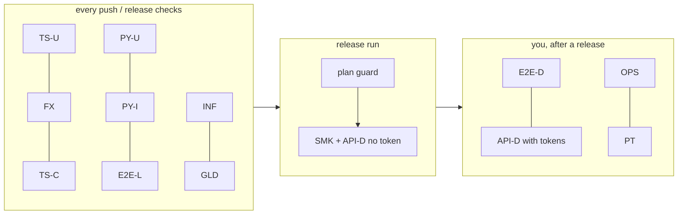
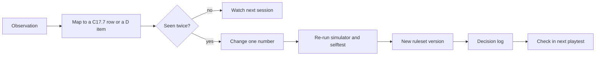

# I. Validation

This section says how we will know the game works: which tests exist at which level, how every acceptance criterion
(AC-01 to AC-43, `prompt.md:1206-1262`) is demonstrated, step-by-step scripts for the hard cases the spec names
(`prompt.md:74`), and a protocol for watching the children play. It owns test strategy and evidence. It does not repeat
the rules being tested: those live in [F. State and data](F-state-and-data.md) (state machines, op processing, fencing),
[G. API contracts](G-api-contracts.md) (routes, codes), [C. Game and learning design](C-game-and-learning-design.md)
(numbers, simulation rules, content), [D. UX and content operations](D-ux-and-content-operations.md) (screens, copy, the
phonics quality gate), [E. Architecture](E-architecture.md) (trust boundaries, offline, audio) and
[H. Infrastructure and delivery](H-infrastructure-and-delivery.md) (where each gate sits in the release). Task order is in
[J. Execution backlog](J-execution-backlog.md).

**Nothing in this section exists yet.** The repository has no application code and no tests
([A. Repository findings](A-repository-findings.md)). Every test, fixture, script and folder below is to be written, and
every path is "(to create)". No acceptance criterion has passed; the spec asks for meaningful coverage, not a claim of
success (`prompt.md:1261`).

Names, states, codes and rules come from the [design spine](00-spine.md) (v0.3); where this section and the spine disagree,
the spine wins.

**Who writes and runs what** **[CONFIRMED by owner]** ([spine S0.1](00-spine.md#s01-way-of-working-confirmed-by-owner-2026-11-14)):
Claude writes the tests alongside the code in sequential build phases, and you review them with the code at each phase
gate ([J. Execution backlog](J-execution-backlog.md) describes the first build phase and how to review one). The automated
levels run in the GitHub Actions release pipeline, which is the only route to deployment. The levels marked "you" in I.2.1
(E2E-D, API-D with tokens, OPS, PT) are run by you against the deployed system. A few OPS checks make AWS write calls
that are not deployments (for example `aws cloudwatch set-alarm-state`, `aws lambda invoke`, `admin-set-user-password`,
`aws logs put-log-events`): they change no Terraform-managed configuration, and each one is written into a runbook in
`docs/runbooks/` (to create) so it is done deliberately and the same way each time **[PROPOSAL]**.

How to read it:

- "Pass" always names something you can observe: an HTTP status, an op `result`, a field value, a string on screen, an
  e-mail arriving. If a pass condition cannot be observed, it is not a test.
- Test level codes (I.2.1) are used throughout, for example **PY-U** for a pytest unit test with moto.
- Milestones are the spine's M0–M6 ([spine S12](00-spine.md#s12-milestones-proposal-the-spec-heads-them-suggested);
  [B §B3.3](B-scope-and-decisions.md#b33-milestone-path)). "First" means the milestone
  where a test is first written; it then stays in the suite as a regression test.

---

## I.1 What the tests are for

The spec is direct: "Tests should protect behaviour, particularly ownership, saving, duplicate rewards and phonics
delivery. Do not create a large suite of tests that merely mirror implementation details" (`prompt.md:1006`)
**[CONFIRMED]**. That gives five working rules.

| # | Rule | What it means in practice | Label |
|---|---|---|---|
| 1 | Test behaviour at the boundary someone relies on | A test names an input a real caller sends (an op, a click, an HTTP request) and an outcome a real caller sees (a result code, a screen, an item). It never asserts which private function was called. | **[CONFIRMED]** `prompt.md:1006` |
| 2 | Write the risky rules once as data, run them everywhere | The run rules exist twice (TypeScript reducer in the browser, Python mirror on the server). One set of JSON fixtures in `contracts/` drives both, plus the real handler. A disagreement becomes a red test, not a corrupted save. | **[PROPOSAL]** [spine S7.2](00-spine.md#s72-client-sync-engine) |
| 3 | Fast tests first, slow tests few | Most confidence comes from pure unit tests that run in milliseconds. Browser end-to-end tests are a small set of journeys, one per hard case. | **[PROPOSAL]** |
| 4 | Real AWS where imitations lie | moto cannot show concurrency, TTL expiry or `ClientRequestToken` (**[VERIFIED]** during planning in the moto 5.2.5 source). Those few facts are checked against DynamoDB Local or the real service, not assumed. | **[PROPOSAL]** |
| 5 | Children are observed, never measured | Playtests tell us whether the game is readable and fair. They never grade a child (I.5). | **[PROPOSAL]** |

---

## I.2 Test strategy

### I.2.1 Test levels

| Code | Level | Tool | Proves | Lives in (all to create) | Runs | Gate ([H §H.10](H-infrastructure-and-delivery.md#h10-quality-gates)) | First |
|---|---|---|---|---|---|---|---|
| **TS-U** | Unit, pure TypeScript | Vitest (`node` environment) | `game-core`: simulation, economy, targeting, carriers, frame-rate independence and the fixed-step clock (integer accumulator, MAX 30 steps per frame); rules reducer; next-phase rule; selection-independent bounds generation. `web/shared`: answer canonicaliser ([spine S7.2](00-spine.md#s72-client-sync-engine), [S10](00-spine.md#s10-react--phaser-split-proposal)) | `web/game-core/src/**/*.test.ts` and `web/shared/src/**/*.test.ts` (next to the code, the Vitest default; [J task M0-09](J-execution-backlog.md)) | every push, release `checks` | G-2 | M0 |
| **FX** | Shared contract fixtures | Vitest **and** pytest reading the same files | The TS reducer, the Python reducer mirror and the real `player-api` handler agree on every op sequence; the TS canonicaliser and the Python shape check agree on every answer vector | `contracts/fixtures/` | every push, release `checks` | G-3 | M1 (small), required M2 |
| **TS-C** | Component and sync engine | Vitest + jsdom + React Testing Library + user-event + fake-indexeddb | Shared learning panel (tries, Play states including play-from-local-bytes, keyboard), sync chip copy, op queue ordering and stamping, account scoping, clip store and `sha256` check, IndexedDB schema upgrades. The real Phaser game is never mounted; the `GameBridge` is faked. | `web/shared/**/*.test.tsx` (the learning panel lives in `web/shared`, [spine S10](00-spine.md#s10-react--phaser-split-proposal)), `web/player/src/**/*.test.tsx` | every push | G-2 | M1 |
| **PY-U** | Handler unit | pytest + moto 5.2.5 (DynamoDB, S3) + an injected clock + a fake Polly client | Ownership, fence, revision, phase checks, attempt limits, at-most-once rewards, resets, speech authorisation, clip-key determinism, voice/engine selection, approve/publish gates | `api/tests/unit/` | every push | G-2 | M1 |
| **PY-I** | DynamoDB integration | pytest against DynamoDB Local | The real expression parser and transaction semantics for the handful of transactions that carry the guarantees; concurrent duplicate delivery from threads | `api/tests/integration/` (marker `ddblocal`) | release `checks` (CI service container); optional locally | G-13 | M1 (G5, G7), M5 (races) |
| **E2E-L** | Browser, faked back end | Playwright (Chromium in CI) against `vite preview` of the real build; API and token endpoint answered by `page.route` from recorded responses | Client behaviour the server cannot show on demand: offline, 401 sequences, 409/503 handling, divergence dialogs, keyboard-only play, axe scans | `web/player/e2e/local/` | release `checks` | G-2 | M1 |
| **E2E-D** | Browser, deployed | Playwright against `aliens.jackgl.com` with dedicated test accounts (I.2.10) | The joins only a real deployment proves: managed login, JWT authoriser, real `tts` and S3, real DynamoDB, CloudFront `/api/*` routing | `web/player/e2e/deployed/` | by you, from your laptop, after a release | — (evidence recorded per release) | M1 |
| **API-D** | Deployed API contract | pytest + `requests`, reading `contracts/routes.json` | Every route: 401 with no token; admin routes refused for a player token; ownership `NOT_FOUND`; group checks | `api/tests/deployed/` | no-token part (every route, both distributions) in release smoke; token part by you | G-11 (no-token part) | M1 |
| **INF** | Infrastructure checks | `terraform fmt`/`validate`, `scripts/plan_guard.py`, route catalogue vs plan, game-data and golden lock check, repository invariants | Terraform is well formed; nothing protected is destroyed; every deployed route has a catalogue entry; game data and golden files only grow; no forbidden commands in workflows | `scripts/`, `scripts/tests/` | release `checks` / `plan` | G-4, G-5, G-7, G-8, G-12, G-14, G-15 | M1 |
| **GLD** | Golden scenarios and replay | Vitest (simulation) and pytest (ops batch replay) | A new release can still execute every supported `mechanics` number and accept the previous protocol's queued batches | `contracts/golden/`, `contracts/replay/` | release `checks` | G-9 | written M4, required from the data freeze |
| **SMK** | Release smoke | workflow step 7 | Sites, deep links, `/api` routing, Lambda code hashes | `.github/workflows/release.yml` | every release | G-11 | M1 |
| **OPS** | Manual and operational | runbooks and checklists | Listening bake-off, restore drill, alarm delivery, rollback rehearsal, browser matrix, performance measurement, auth spike, OIDC smoke, DNS hand-off check | `docs/runbooks/`, `docs/validation/` | at named milestones | F-4, F-5 ([H §H.11.3](H-infrastructure-and-delivery.md#h113-data-freeze-point-spine-s114)) | M0 |
| **PT** | Child playtest | observation sheet (I.5) | Readability, fairness, whether a child can play without help | `docs/validation/playtests/` (notes without names) | at M1, M2, M4, M6 | — | M1 |

All levels and tools are **[PROPOSAL]**; tool versions are pinned in [H §H.17](H-infrastructure-and-delivery.md#h17-version-pins)
(Vitest, Playwright 1.65, pytest 9.2.0, moto 5.2.5).



Reading the diagram: everything on the left runs without AWS credentials and blocks a release when red. The release run
adds the plan guard and read-only smoke checks. The right-hand box needs real accounts or a person (sign-in through
managed login, listening, a child), so you run it and record the evidence. The pipeline holds no test-account secret
(H defers the first pipeline secret), so AC-03 and AC-04 at deployed level are manual evidence per release. Adding a
smoke-account secret later would let the token checks run in release step 7; that is a separate decision, recorded as an
ADR in `docs/decisions/` when it is taken **[PROPOSAL]**.

### I.2.2 The order the tools arrive in

Four test tools is a lot to take on at once. Each one arrives in the build with the first piece of code that needs it, so
at each phase gate you review one new kind of test at a time, in this order **[PROPOSAL]**:

| Step | Tool | First real use | Why then |
|---|---|---|---|
| 1 | Vitest on `game-core` | the fixed-timestep clock (task M0-09 in [J](J-execution-backlog.md)), then the next-phase rule and the first reducer op (M1) | Pure functions: input in, output out, results in milliseconds. The best place to learn what a good assertion looks like. |
| 2 | pytest + moto | the first `player-api` handler (`PUT /api/me/profile`, then `/ops`) (M1) | moto fakes DynamoDB inside the test process, so conditional writes can be tested without an AWS account. |
| 3 | Shared fixtures | the first op that both reducers implement (M1, `SUBMIT_ATTEMPT`) | Once two implementations exist, a fixture file is cheaper than two hand-written test suites. |
| 4 | React Testing Library | the first learning panel (M1) | Tests what a child can see and press, by role and name. |
| 5 | Playwright | once there is a deployed page to click through (M1, end) | Slowest and most fragile; keep it to journeys that nothing else can prove. |
| 6 | DynamoDB Local | the first race test (M1 for G5/G7 shape, M5 for concurrency) | Needs Docker or Java; neither is on your machine today (**[VERIFIED]** `which docker java podman` found nothing, 2026-11-14). CI provides it as a service container, and running it locally is optional ([spine S11.6](00-spine.md#s116-validation-gates)) **[PROPOSAL]**. |

### I.2.3 Shared contract fixtures (`contracts/`)

A *fixture* here is a JSON file that describes a starting state, a sequence of inputs and the expected outcome after each
one. The point is that the same file is read by both languages, so "what should happen" is written exactly once
**[PROPOSAL]** [spine S7.2](00-spine.md#s72-client-sync-engine), [S10](00-spine.md#s10-react--phaser-split-proposal).

| Fixture kind | File pattern (to create) | Read by | Asserts |
|---|---|---|---|
| Op sequences | `contracts/fixtures/ops/<name>.json` | Vitest (TS reducer), pytest (Python mirror), pytest (real handler over moto) | after each op: `result`, `code`, `outcome`, and selected view fields (`phase`, `wave`, `revision`, snapshot credits, current slot attempts, slot status) |
| Next-phase vectors | `contracts/fixtures/next-phase.json` | Vitest, pytest | `(slots, interval) → ACTIVITY \| METEOR \| BUILD`, including missing and already-resolved slots |
| Answer vectors | `contracts/fixtures/answers/vectors.json` | Vitest (canonicaliser), pytest (shape check; template generators) | raw input per interaction type → one canonical string of at most 64 characters (ARRANGE as tile values; two-step answers joined by `\|`), or "not canonicalisable"; Python accepts every canonical output and rejects every malformed one ([C §C20.1](C-game-and-learning-design.md#c201-canonical-answers-one-normaliser-exact-equality)) |
| Bounds vectors | `contracts/fixtures/bounds/<ruleset>.json` | Vitest (bounds generator), pytest (`load_bounds` + S6 checks) | snapshot pairs → accepted or `CHECKPOINT_OUT_OF_BOUNDS` ([spine S6](00-spine.md#s6-plausibility-bounds-proposal-per-op-against-the-stored-snapshot) rules 1–4) |
| Clip-key vectors | `contracts/fixtures/clip-keys.json` | pytest in `tts` and `admin-api` (one shared module) | synthesis input → SHA-256 key; changing any one input (text/SSML, voice, engine, format, locale, generation) changes the key; the same input from two different activities gives the same key (one clip, synthesised once ever) |
| Engine selection vectors | `contracts/fixtures/speech-engine.json` | pytest in `tts` and `admin-api` | speech `kind` + configuration (`tts_voice_id`, `tts_engine`, `tts_phoneme_engine`) → `(voiceId, engine)`: `PHONEME` and `LETTER_NAME` take `tts_phoneme_engine`, every other kind takes `tts_engine`; a voice or engine outside the in-code allow-list is refused ([spine S5.2](00-spine.md#s52-activities-templates-speech)) |
| Route catalogue | `contracts/routes.json` | PY-U, API-D, INF | every route key with its Lambda, authoriser and expected refusal codes (I.2.7) |
| Error codes | `contracts/errors.json` | TS-C, PY-U | every code in [G §10](G-api-contracts.md#10-error-table) with its HTTP status; the client maps each to a sync state |

A small op-sequence fixture, to show the shape (values illustrative):

```json
{ "name": "refresh-after-two-wrong",
  "start": "views/wave5-activity-maths.json",
  "steps": [
    { "op": {"type": "SUBMIT_ATTEMPT", "payload": {"slotId": "N-004", "answer": "7"}},
      "expect": {"result": "APPLIED", "outcome": "INCORRECT", "view": {"phase": "ACTIVITY", "slot.attempts": 1}} },
    { "resend": 0, "expect": {"result": "ALREADY_APPLIED", "attempt": {"n": 1, "correct": false}} },
    { "op": {"type": "SUBMIT_ATTEMPT", "payload": {"slotId": "N-004", "answer": "9"}},
      "expect": {"result": "APPLIED", "outcome": "INCORRECT", "view": {"slot.attempts": 2}} } ] }
```

Steps marked `resend` replay an earlier op by its `opId`; the pure reducers skip them (they have no duplicate memory) and
only the handler runner checks them. That is the one deliberate difference between the runners **[PROPOSAL]**.

Why three runners and not two: the TS and Python reducers can agree with each other and still disagree with what the
handler actually writes (a missing `attribute_exists`, a wrong condition). Running the same file through the handler over
moto closes that gap.

### I.2.4 Golden scenarios and replays

A *golden scenario* is a recorded run of the simulation with a known answer. It exists so that a later release can prove
it still plays an older ruleset exactly as before ([spine S5.1](00-spine.md#s51-pins-and-game-data); "a changed rules file alone does not maintain compatibility
if the new runtime cannot execute it", `prompt.md:884`) **[PROPOSAL]**.

| Item | Detail | Label |
|---|---|---|
| Content | a ruleset version, a campaign version, a wave number, a starting snapshot, a list of `(tick, command)` pairs, and the expected tick count, post-wave snapshot and a hash of the per-alien outcome list | **[PROPOSAL]** |
| How many | 2–3 per `mechanics` number: one ordinary wave, one carrier/splitter wave (42 or 48), one boss wave | **[PROPOSAL]** spine S5.1 |
| Where | `contracts/golden/m<mechanics>/<name>.json`; additive only, like game data: the game-data lock check (G-8) also covers `contracts/golden/` ([spine S11.4](00-spine.md#s114-data-freeze-point), S11.6) | **[PROPOSAL]** |
| Frame-rate check | the same scenario run with frame-delta sequences at 30, 60 and 144 Hz (with jitter) must give identical tick counts and snapshots. This is the spec's frame-rate rule (`prompt.md:303`, AC-13; [spine S10](00-spine.md#s10-react--phaser-split-proposal)), not part of AC-42, which is only the busiest-wave performance target | **[PROPOSAL]** |
| Clock cap check | TS-U on the fixed-step clock: the accumulator is an integer in units of 1/60,000 s (one step = 1,000 units); a frame delta is clamped at 250 ms; at most MAX = 30 steps run per frame and, when the cap is hit, the rest of the accumulator is discarded (the game slows rather than spiralling); paused or hidden adds nothing. Pass: a long run of 1/144 s deltas leaves no drift (accumulator exactly as computed), and one 2 s frame at 2x speed runs exactly 30 steps and leaves the accumulator at 0 | **[PROPOSAL]** spine S10 |
| Ops replay | at each release, the release job copies one recorded batch per op type, with its `protocolVersion`, into `contracts/replay/p<protocolVersion>/`; the next release's pytest replays it over moto and expects every op `APPLIED` (G §9 contract test) | **[PROPOSAL]** |
| When required | written in M4 when the campaign is authored; required gate G-9 from the data freeze | **[PROPOSAL]** [H §H.10](H-infrastructure-and-delivery.md#h10-quality-gates) |

### I.2.5 Python tests: moto, its gaps, and what covers them

moto is a library that imitates AWS inside the Python test process. It implements DynamoDB transactions and condition
expressions, which covers most of what we need **[VERIFIED]** during planning in the moto 5.2.5 source. It has three
known gaps and one unverified limit, each with a planned answer:

| moto gap (**[VERIFIED]**, moto 5.2.5 source) | Does the design depend on it? | How it is covered | Label |
|---|---|---|---|
| `ClientRequestToken` is ignored | No. The design uses `recentOps` and slot status as idempotency markers, because the token's 10-minute window cannot cover offline replays ([F §12.3](F-state-and-data.md#123-transaction-composition-and-action-counts)) | The fake-client wrapper records every DynamoDB call; a PY-U test asserts none carries `ClientRequestToken`, so nobody starts relying on it by accident | **[PROPOSAL]** |
| TTL never deletes items | No. Correctness never depends on TTL (`prompt.md:693`); only the sign-up counter uses it for tidy-up | Lease expiry and the sign-up date key are tested with an **injected clock**: every handler reads "now" from one function the test can set, so a 180 s lease expires in a test instantly and without sleeping | **[PROPOSAL]** |
| No concurrency: `TransactionConflictException` and throttling never occur | Yes: step (i) of op processing retries any cancellation ([F §8.1](F-state-and-data.md#81-per-op-processing-order-server)) | (1) **Fault injection** in PY-U: a wrapper around the DynamoDB client raises `TransactionCanceledException` with `TransactionConflict` reasons on chosen calls, so the retry loop, the jittered pause and the 503 after three tries are exercised. (2) **PY-I on DynamoDB Local**: two threads send the same batch at once; pass = one `APPLIED`, one `ALREADY_APPLIED`, one reward. Whether DynamoDB Local reports the loser as a conflict or as a condition failure is **[UNVERIFIED]**; the test asserts the outcome, not the mechanism, so either is fine. (3) **One OPS check against the real table** in M5 (I.4.3 step 9). | **[PROPOSAL]** |
| Item (400 KB) and transaction (4 MB, 100 actions) limits not known to be enforced | Partly (the campaign `CREATE_RUN` uses 57 actions, including the `ConditionCheck` on PROFILE) | The game-data build gate (G-15) refuses any wave set with `3 + (finalWave − 1) + len(meteorAfter) > 100` ([spine S5.1](00-spine.md#s51-pins-and-game-data); [F §12.3](F-state-and-data.md#123-transaction-composition-and-action-counts)), and a TS-U data test proves the gate catches a 101-action wave set; a PY-I test creates the largest run and the largest `CHOOSE_ENDLESS` on DynamoDB Local | **[PROPOSAL]**; moto enforcement **[UNVERIFIED]** |

Other PY-U conventions **[PROPOSAL]**:

- **Polly is never called in tests.** `tts` receives its Polly client through one factory; tests inject a fake that
  returns fixed bytes and counts calls, and records the `Engine` and `VoiceId` of each call. moto's Polly coverage of
  `SynthesizeSpeech` is **[UNVERIFIED]** and not needed.
- **`tts` never touches the `content` table.** The slot's pinned clips map is the only source of a player clip
  ([spine S2](00-spine.md#s2-trust-model-confirmed-family-level-trust-mechanisms-proposal)), and `tts` has no
  `content` permission; the fake-client wrapper fails any `tts` test that calls it.
- **JWT claims are injected into the payload 2.0 event** from captured fixtures. The Milestone 0 auth spike records a real
  authoriser event (E §E.7.3), including how `cognito:groups` is serialised, and that file becomes the template.
- **Every `game` read is checked for `ConsistentRead=True`** by the fake-client wrapper; a non-consistent read fails the
  test (F §12.2 rule).
- **Log capture.** Every handler test captures log output and asserts it contains only allow-listed keys
  ([G §15](G-api-contracts.md#15-logging-allow-list)). A fixed sentinel date of birth (for example `2019-03-17`) and a
  sentinel nickname are sent in profile tests; neither string may appear in any response body or log line (spine S2).
- **IDs are checked against the spine's formats** ([spine S9.5](00-spine.md#s95-limits-one-shared-limits-file-read-by-client-and-handlers-numbers-assumption)):
  UUIDs for `opId`, `sessionId`, `runId`; `slotId` `^[NM]-[0-9]{3}$`; every other key ID hyphenated lower case
  `^[a-z0-9-]{1,40}$` (for example `ma-0101`, `phoneme-sh`, `p01`, `nova`). A malformed ID is `400 VALIDATION_FAILED`
  before any lookup.

### I.2.6 Front-end tests: what runs where

| Concern | TS-C (jsdom, fake-indexeddb) | E2E-L (real Chromium, faked API) | E2E-D (deployed) |
|---|---|---|---|
| Learning panel tries, Play states, "tried" marking | ✔ | keyboard-only pass | one journey |
| Play rule: stored clip plays at once while `POST /api/speech` runs concurrently; not stored → wait, download, verify `sha256`, store, play; clipKey mismatch handling | ✔ (fake transport, fake audio element) | ✔ (delayed and failed responses via `page.route`) | ✔ (I.4.1 D) |
| Connection-required actions disabled offline, including sign-out | ✔ | ✔ (`setOffline(true)`) | — |
| `409 PROTOCOL_UNSUPPORTED` holds the queue in `RETRYING` | ✔ | ✔ | — |
| Sync engine: queue order, generation stamping, one request in flight, renew never falls back to claim | ✔ (fake transport) | ✔ (offline, 401, 409, 503 via `page.route`) | stale writer journey |
| IndexedDB schema upgrade keeps `ops` and `recovery` | ✔ | — | — |
| Account switching on one browser profile | ✔ (`ownerSub` binding) | ✔ (two faked identities) | ✔ (two test accounts) |
| Offline play and readiness | — | ✔ (`context.setOffline(true)`) | ✔ one prepared run |
| Managed login, real tokens, real audio | — | — | ✔ |
| Accessibility scan | — | ✔ axe on every screen | spot check |

How E2E-L fakes the back end without test code in the product **[PROPOSAL]**: the built app is served unchanged; a
`config.json` served by the test points the managed-login domain and `/api` at addresses that `page.route` answers. Token
responses carry crafted, unsigned JWTs. That works only if the auth library does not verify token signatures in the
browser, which is **[UNVERIFIED]** for the chosen Amplify version; check it in the M0 auth spike (see
[Unverified items to check](#unverified-items-to-check)). If it does verify, the auth-dependent E2E-L cases move to E2E-D
and the rest stay.

Playwright features relied on (all documented in the Playwright API reference; version pinned in
[H §H.17](H-infrastructure-and-delivery.md#h17-version-pins)): `browserContext.setOffline(true)` for offline,
`context.clock` for lease and idle timers, `route.fetch()` followed by `route.abort()` to let a request reach the server
and then lose its response, and separate browser contexts for "two laptops" (each context has its own IndexedDB).

### I.2.7 API contract tests

`contracts/routes.json` (to create) lists every route from [G §2](G-api-contracts.md#2-route-catalogue) (R1–R30): method,
path, Lambda, authoriser, and whether it is an owner route. Four things read it **[PROPOSAL]**; the smoke iteration and
the plan comparison are fixed gates in [spine S11.6](00-spine.md#s116-validation-gates):

| Reader | Check | Pass |
|---|---|---|
| PY-U (each Lambda's router) | every route key in the file is in exactly one function's allow-list; an unknown route key reaching a function is denied; every admin route key invoked with player claims, with operator claims lacking `admin`, or with groups `administrators`, `admin2` or `["admin-x"]` returns `403 FORBIDDEN` before any DynamoDB call (the fake client records zero calls) | all |
| API-D, no token (release smoke) | every route, through both distributions, with no `Authorization` header | gateway `401` for all 30; never 2xx, never HTML |
| API-D, with tokens (you, from your laptop) | player token on every `/api/admin/*` route; an ID token on a player route; operator token without the group | `401` from the gateway (wrong issuer or no scope) or `403 FORBIDDEN`; never 2xx |
| INF (plan job, G-12) | the route keys in `terraform show -json tfplan` equal the catalogue | a route added in Terraform without a catalogue entry (and so without tests) fails the release |

The spec's wording "every `/api/admin` route 403 for a player token" becomes "refused with 401 or 403, never 2xx",
because a player token is refused by the operator authoriser at the gateway (different issuer) before the Lambda's 403 can
happen ([G §1.3](G-api-contracts.md#13-responses-the-gateway-or-cloudfront-generate-no-envelope)). The Lambda's own 403 is
proved at PY-U level, so both layers are covered. **[PROPOSAL]**

### I.2.8 Infrastructure checks

| Check | Test of the check itself | Pass | Gate | Label |
|---|---|---|---|---|
| `terraform fmt -check -recursive`; `init -backend=false` + `validate` | — | exit 0 | G-4 | **[PROPOSAL]** |
| Repository invariants (no `-auto-approve`, `destroy`, `update-function-code` in `.github/`; no `custom_error_response`; alarms on every Lambda; both tables in the backup selection) | `scripts/tests/` feeds each rule a small bad file | each bad file is caught | G-5 | **[PROPOSAL]** |
| Plan guard (`scripts/plan_guard.py`) | pytest with three saved `terraform show -json` samples: an in-place update, a replace of `aws_dynamodb_table`, a delete of `aws_cognito_user_pool_client` | update passes; replace and delete are listed; with `enforce: true` the script exits non-zero | G-7 | **[PROPOSAL]** |
| Game-data and golden lock | pytest builds a throwaway git repository with a `release-<id>` tag, then a commit that modifies a file under `game-data/`, one that modifies a file under `contracts/golden/`, and one that only adds a file to each | both modifications fail, adds pass; rollback-ancestry rule as H states | G-8 | **[PROPOSAL]** [spine S11.4](00-spine.md#s114-data-freeze-point) |
| Wave-set action limit and campaign shape | the game-data build gate, with a TS-U test over every `game-data/campaign/*.json` and a deliberately oversized fixture | ≤ 100 actions per `CREATE_RUN` (the oversized fixture is refused); 50 campaign waves, bosses only on 10/20/30/40/50, one route | G-15 (action limit), G-2 (campaign shape) | **[PROPOSAL]** spine S5.1 |
| Route catalogue vs plan | INF reader in I.2.7 | sets equal | G-12 (plan job) | **[PROPOSAL]** spine S11.6 |
| Built-asset scan (no keys, no AWS SDK, no Polly client, no `speechSynthesis`) | a fixture `dist/` with each forbidden string | each is caught | G-6 | **[PROPOSAL]** |

### I.2.9 Manual and operational tests

| Test | When | Procedure | Evidence | Label |
|---|---|---|---|---|
| Auth spike | M0 | [E §E.7.5](E-architecture.md#e75-main-risk-managed-login-sign-up) list: username-only sign-up, token claims, captured authoriser event, negative calls, `/logout` + `prompt=login` switching, gateway 401/403/404/429 bodies | spike notes; the captured event becomes a PY-U fixture | **[PROPOSAL]** |
| OIDC smoke | M0; kept afterwards as a manual workflow | `oidc-smoke.yml` assumes the CI role and prints `sts get-caller-identity` ([B BL-1](B-scope-and-decisions.md#b7-genuine-blockers); [spine S11.1](00-spine.md#s111-workflows)); it also records which subject the trust policy accepts (`…:environment:prod`, or the `…:ref:refs/heads/main` fallback if environments are unavailable on a private repo) and whether required reviewers are available | account `263185198757` printed; an ADR in `docs/decisions/` recording the subject format and the environment design | **[PROPOSAL]** |
| Listening bake-off | M0, then per new sound | I.4.1 part A | per-sound verdicts in `content/listening-verdicts.json` (to create); the `tts_phoneme_engine` choice as an ADR | **[CONFIRMED]** need `prompt.md:1267-1268`; engine and voice **[CONFIRMED by owner]** |
| DNS hand-off check | M1, when you create the alias records; again M6 | read-only: `dig CAA jackgl.com` (if any CAA records exist, one allows `amazon.com`); `aliens.jackgl.com` and `admin.aliens.jackgl.com` resolve to their distributions and serve the ACM certificate; the apex `jackgl.com` app still answers as before (its records were not touched) ([H](H-infrastructure-and-delivery.md) owns the hand-off; [spine S1.0](00-spine.md#s10-dns-hand-off-facts-confirmed-by-owner-2026-11-14-unless-marked)) | command output in the release record; H smoke's hostname checks switch from "skipped" to required | **[CONFIRMED by owner]** facts; check **[PROPOSAL]** |
| Alarm delivery | first release, then data freeze | I.3 AC-40 row | e-mails received | **[PROPOSAL]** |
| Restore drill | before data freeze, then quarterly | [H §H.13.4](H-infrastructure-and-delivery.md#h134-restore-drill-ac-39) | entry in `docs/runbooks/restore.md` | **[CONFIRMED]** AC-39 |
| Rollback rehearsal | M6, before data freeze | I.3 AC-38 row | release record | **[PROPOSAL]** |
| Browser matrix | M1 (one clip per browser), M6 (full) | E2E-D on each browser the family actually uses; Safari's `play()` after an await is checked first ([E §E.9](E-architecture.md#e9-audio-caching-and-playback)) | table in `docs/validation/browsers.md` | **[CONFIRMED]** need `prompt.md:1046`; which browsers **[UNVERIFIED]** until you list the family's laptops |
| Speech latency | M1 (first measure), M6 (re-measure) | On the deployed speech path, 10 presses per browser: (a) time-to-audio, from the Play press to audio start when the clip is **not** stored locally (wait for `POST /api/speech`, download, `sha256` check, store, play); (b) cached replay latency, from the Play press to audio start when the clip **is** stored locally, which plays at once from local bytes; (c) the round trip of the concurrent `POST /api/speech` in case (b), recorded separately to show the call is still made on every online Play (AC-19) without the child waiting for it | median and worst-of-10 per browser in `docs/validation/performance/` (to create); the target is then written from this measurement and labelled "measured engineering goal, not a service guarantee" | **[CONFIRMED]** need `prompt.md:625`; Play rule **[CONFIRMED by owner]**; target **[PROPOSAL]** |
| Performance | M2 (first measure, which sets the AC-42 target), M6 (target met) | I.3 AC-42 row | recorded numbers and the laptop used, in `docs/validation/performance/` | **[CONFIRMED]** need `prompt.md:1032`, `prompt.md:1044` |
| Child playtests | M1, M2, M4, M6 | I.5 | observation sheets | **[PROPOSAL]** |

### I.2.10 Test accounts and test data

| Rule | Detail | Label |
|---|---|---|
| Children's accounts are never used by automated tests | E2E-D and API-D use dedicated accounts only | **[PROPOSAL]** |
| Test accounts are created by `AdminCreateUser` | so they do not count against the daily sign-up cap ([spine S1.2](00-spine.md#s12-sign-up-control-proposal-numbers-assumption)); usernames `test-player-1`, `test-player-2`; a test DOB per needed age band | **[ASSUMPTION]** names |
| One test operator | `test-operator` in the operator pool, **not** in group `admin`, for the 403 checks; the real operator account is used only for the admin journeys you run yourself | **[PROPOSAL]** |
| Passwords | in your local environment or password manager, never committed, never in CI until a secret is deliberately added (H §H.8.6) | **[PROPOSAL]** |
| Canary | `test-player-1` keeps one long-lived run (the canary) whose revision and snapshot are read before and after every release (AC-35, AC-36, AC-38) and in the restore drill | **[PROPOSAL]** matches H §H.13.3 "canary profile and run" |
| Sign-up test (AC-01) | creates a real self-signed-up user; delete it afterwards with `AdminDeleteUser` | **[PROPOSAL]** |
| Test content | the M1 phonics activity is real content; extra test-only activities are never published to the live bank, because they would be selectable for children | **[PROPOSAL]** |

---

## I.3 Acceptance criteria map (AC-01 to AC-43)

Every criterion below is **to be demonstrated**; none has passed. The criteria themselves are **[CONFIRMED]**
(`prompt.md:1209-1259`); every test case, level and milestone choice is **[PROPOSAL]** unless marked otherwise. "Playtest" is filled where watching a child adds
evidence a test cannot give. Hard cases point to their script in I.4.

### I.3.1 Identity and ownership

| AC | Levels | Test cases and observable pass condition | First | Playtest observation |
|---|---|---|---|---|
| AC-01 register, confirmed, profile, valid run | OPS, PY-U, E2E-D | (1) M0 auth spike: a username-only sign-up through managed login leaves the user `CONFIRMED` (`admin-get-user`) with no e-mail or phone asked. (2) PY-U pre sign-up: `PreSignUp_SignUp` under the cap → `autoConfirmUser = true` and the day's `count` +1; at the cap → the trigger raises (user not created); `PreSignUp_AdminCreateUser` → not counted. PY-U create-run: `POST /api/runs` before the profile exists → `404 PROFILE_NOT_FOUND` (the `ConditionCheck PROFILE attribute_exists(pk)` in G7), no RUN or SLOT item written. (3) E2E-D `signup.spec`: new username → callback → `GET /api/me` 404 `PROFILE_NOT_FOUND` → profile setup → `PUT /api/me/profile` 200 → New game → `POST /api/runs` 201 → battlefield in BUILD for wave 1 with the ruleset's starting credits; the run appears in `GET /api/runs?state=open`. User deleted afterwards. | M0 / M1 | With a grown-up beside them, can the child get through Cognito's adult-English page? Where do they stop? |
| AC-02 admin password recovery | OPS | Runbook drill on `test-player-2`: `admin-set-user-password --permanent`; sign-in with the new password succeeds and the old one fails; no e-mail involved. | M1, again M6 | — |
| AC-03 others' IDs | PY-U, API-D | PY-U: account A creates run R; with B's claims, `GET /api/runs/R`, `…/pack`, `POST …/ops`, `POST …/endless`, `PUT /api/session {runId: R}` and `POST /api/speech {runId: R}` each return `404 NOT_FOUND` with a body identical (apart from `requestId`) to the one for a random UUID; A's RUN item is byte-identical afterwards. No request field can name an owner (strict schemas reject `sub`, `owner`, `userId`). API-D: the same calls with the two test accounts. Script in I.4.9. | M1 | — |
| AC-04 normal account and admin powers | PY-U, API-D | I.2.7 and I.4.9: every admin route refused for a player token (401/403, never 2xx); `POST /api/admin/speech/preview` with a player token never reaches `tts` (no log line) and the fake Polly counts zero calls at PY-U level; draft content never appears in any player response (the pack allow-list test, G R10). | M1 (router and the minimal admin app's speech routes), M3 (all admin routes) | — |
| AC-05 switching accounts | TS-C, E2E-L, E2E-D | TS-C: the API client bound to `ownerSub` A refuses to send when the token's `sub` becomes B and triggers a reload. E2E-D: A plays with `/ops` held back by `page.route`, so ops are pending; A signs out (pending-ops warning shown, [D §J9](D-ux-and-content-operations.md#j9-switching-child-on-a-shared-laptop-ac-05) copy) → B signs in on the same browser profile. Pass: B's screens show no A nickname, avatar, run or badge; every request carries B's token and none names A's `runId`; `scd-A` is never opened (an init script wraps `indexedDB.open` and records names); A signs back in and A's pending ops upload `APPLIED`. Also: sign-in after `/logout` asks for a password (no silent re-entry as A). Offline, Sign out is shown disabled with its reason (it is connection-required, [spine S7.4](00-spine.md#s74-offline-rules)), so an offline sign-out can never strand A's queue. | M1 (basic), M5 (with queue) | Siblings on one laptop: does the younger child understand signing out; does either ever see the other's name? |
| AC-06 DOB-derived content, pinned runs | PY-U | Injected clock. (1) DOB giving age 5 → `ageBand 5`, run pins `ageBand 5`. (2) Move the clock past the sixth birthday → existing run still 5 (pack and new endless blocks drawn for 5); a new run pins 6. (3) `PATCH` DOB to another date → existing pins unchanged, new runs follow. (4) Europe/London boundary: 23:30 UTC on the eve of a summer birthday counts as the birthday. (5) Age 4 or 8 → `409 CONTENT_UNAVAILABLE {reason: AGE_OUT_OF_RANGE}`. (6) M0: `zoneinfo.ZoneInfo("Europe/London")` loads in the Python 3.14 Lambda runtime, else `tzdata` is bundled (**[UNVERIFIED]** today). | M1 (band), M3 (per-band content) | — |

### I.3.2 Combat and progression

| AC | Levels | Test cases and observable pass condition | First | Playtest observation |
|---|---|---|---|---|
| AC-07 pads only, stationary, undamageable | TS-U, E2E-L | TS-U: `place` on a non-pad, a closed pad or an occupied pad → `commandRejected`, credits unchanged. Property test over 200 seeded random command streams per wave: astronaut positions and levels change only through player commands; the ruleset schema has no field by which an alien affects an astronaut. E2E-L: clicking route tiles places nothing. | M1 (one class), M2 | Does the child try to place on the route? Do they expect astronauts to be hurt? |
| AC-08 six roles, three levels, previews | TS-U, OPS, PT | TS-U per class: each level changes at least one stat, and a behaviour test shows the effect (Pip slows an alien by the stated factor, Juno's blast hits every alien inside the radius, Mira adds shield points, Sol's buff raises damage by the rounding rule in [C §C2.2](C-game-and-learning-design.md#c22-determinism-and-arithmetic)). The preview circle radius comes from the same constant the simulation uses (one source, asserted). OPS M6: art review that each level is visibly different. | M2 | Can the child tell level 2 from level 1, and see that Sol does anything (C17.7 row "Sol")? |
| AC-09 purchases in combat, no negative credits | TS-U, E2E-L | TS-U: two `place` commands in one tick with credits for one → exactly one applied, one `commandRejected`, credits ≥ 0; an in-wave upgrade deducts the exact price at the next tick; selling returns the C5.7 refund. Property test: random command streams never make credits negative and never raise `credits + invested`. E2E-L: a rapid double-click on Upgrade with credits for one upgrade → one upgrade, HUD credits equal the expected figure. | M2 | Accidental sells; upset about the 70 % refund (C17.7 "Sell refund"). |
| AC-10 descendants resolve, no duplicates | TS-U, GLD | Invariants from [C §C17.5](C-game-and-learning-design.md#c175-other-checks) as tests: every spawned alien including descendants is resolved exactly once; a wave completes only when the spawn queue, release queue and live list are all empty; bounty earned equals bounty available when nothing leaks; descendant ids are unique. Restarting the wave from its wave-start snapshot and playing it out gives the same totals (no extra offspring or bounty). Golden scenarios for waves 42 and 48. | M2 | — |
| AC-11 fifty waves, bosses, fixed route | TS-U (data) | The campaign document validates: 50 waves, boss entries exactly at 10/20/30/40/50, every wave on the single route polyline, meteor slots after 9/19/29/39/49. Runs in G-2 on every `game-data/campaign/*.json`. | M4 | — |
| AC-12 completion, endless, badge survives | FX, PY-U, E2E-L | FX + PY-U: `COMPLETE_WAVE(50)` commits the campaign badge and `phase = COMPLETION_OFFER` in one transaction; a resent `COMPLETE_WAVE` → `ALREADY_APPLIED`, badge `earnedAt` unchanged; `CHOOSE_ENDLESS` → `stage ENDLESS`, `wave 51`; later `DEFEAT` in wave 57 → `PROFILE.badges` still has the badge, `highestCompletedWave 56`, `bestCompletedWave 56`. Badge set: only the campaign/progress and challenge badges of [C §C12](C-game-and-learning-design.md#c12-badges) exist in v1 (no learning-outcome badges); a schema test refuses any other badge ID. E2E-L: offer screen, Keep going, endless defeat overlay shows "You still have your Colony Hero badge". | M4 | Does the child understand the choice to keep going? |
| AC-13 same combat, funds and rewards at every age | PY-U, TS-U | PY-U: create runs for age bands 5, 6 and 7 with the same seed → identical starting snapshot and identical `(slotId, kind, subject, reward)` lists; only `activityId` differs. TS-U: no `game-core` simulation function takes an age argument (checked by the type signatures and a schema test that the ruleset has no age field). The C16 worked credit table is reproduced by a TS-U test. TS-U: the 30/60/144 Hz frame-rate check and the clock cap check (I.2.4), because frame rate must not change damage, movement or reward outcomes (`prompt.md:303`). | M0 (clock), M2 (frame rate), M3 (age bands) | Both children get the same game; does the younger one feel it is harder? (Observation, not a change trigger on its own.) |
| AC-14 failure resets run resources, keeps permanent progress | FX, PY-U | After `DEFEAT`: run `DEFEATED`, snapshot removed; `PROFILE.planets`, `PROFILE.badges` and `SUM#` items unchanged (compare before/after). A new run starts with the wave set's start credits and only the starting class available. Script in I.4.5. | M1 (defeat), M2 (classes) | How does losing feel? Does the child want to start again? |

### I.3.3 Learning and speech

| AC | Levels | Test cases and observable pass condition | First | Playtest observation |
|---|---|---|---|---|
| AC-15 one activity per interval, separate meteor IDs, waiting and audio free | PY-U, TS-C, E2E-L | PY-U: a campaign run has `N-001…N-049` and `M-009, M-019, …, M-049`, all distinct, meteor after normal (next-phase vectors). TS-C with fake timers: the panel open for 10 minutes and Play pressed 10 times → "Tries left: 3", reward line unchanged, zero ops queued. E2E-L: decline the meteor before any attempt → `DISMISS_SLOT` → `DECLINED`, boss wave available; after one attempt the decline button is gone (D-11). | M1 (normal), M4 (meteor) | Do children notice there is no hurry? Do they decline meteors, and why? |
| AC-16 three attempts, one reward, failure continues | FX, PY-U, E2E-D | FX: correct on attempt 2 → `SUCCEEDED`, reward once, `RESOLVED_SUCCEEDED`; three incorrect → `FAILED`, no reward, `phase BUILD`; a fourth `SUBMIT_ATTEMPT` → `REJECTED PHASE_MISMATCH`. E2E-D (M1 slice): three wrong answers then Ready is enabled and wave 2 starts. | M1 | Reaction to "Good try. No credits this time". |
| AC-17 refresh after two wrong | FX, PY-U, E2E-L, E2E-D | Script in I.4.2. | M1 | — |
| AC-18 duplicate/delayed submissions | FX, PY-U, PY-I, E2E-L, OPS | Script in I.4.3. | M1, M5 | — |
| AC-19 Play calls the TTS API online; no browser speech | E2E-D, E2E-L, INF | E2E-D: press Play three times (waiting for each clip to end) on a clip already stored locally → audio starts from local bytes each time and three `POST /api/speech` appear in the network log, each `200`, the matching `tts` log lines found by `requestId`; an init script replaces `speechSynthesis.speak` with a spy and the spy records zero calls. E2E-L: the speech response is delayed by 3 s via `page.route` → audio still starts before the response arrives, and the request is still sent ([spine S5.2](00-spine.md#s52-activities-templates-speech) Play rule **[CONFIRMED by owner]**). INF G-6: no `speechSynthesis` in `dist/`. Part of I.4.1. | M1 | Does the child find Play? |
| AC-20 TTS only for approved content | PY-U, API-D | PY-U `tts`: a body with `text`, `ssml`, `voice` or `speechId` → `400 VALIDATION_FAILED`; a `variant` not in the slot's clip map → `404`; another player's run → `404`; the signed key always equals the slot's stored `clipKey`, whatever the request says, and the response's `sha256` equals the approved speech version's. Preview with player claims → 403; preview over 300 characters, with a disallowed tag, or with a DTD → 400. API-D: a player token on preview → 401. | M1 | — |
| AC-21 preview before publication; bad sounds stay unpublished | OPS, PY-U, E2E-D | Script in I.4.1 (listening matrix, approve gate, publish gate). | M0 (matrix), M1 (one clip), M3 (full gate) | One child names shortlisted sounds unprompted (I.4.1 A). |
| AC-22 speech failure, replay, loading free | TS-C, E2E-L | TS-C, clip not stored: Play → Loading (second press ignored, one request) → Stop → Play again; a failure shows "We couldn't get the sound." with Try again; tries and credits unchanged; zero `SUBMIT_ATTEMPT` ops created. TS-C, clip stored: Play goes straight to Stop/Replay; rapid replays send one debounced request; a failed concurrent request does not stop the clip, is logged, and shows no Retry ([E §E.9](E-architecture.md#e9-audio-caching-and-playback)). E2E-L with the clip not stored: `/api/speech` answers `503 SPEECH_UNAVAILABLE`, then the S3 GET answers 403, then the download's `sha256` does not match → Retry shown each time, nothing stored, "Tries left: 3", HUD credits unchanged; an audio-required activity keeps its answer area hidden until the clip plays (D6.5). | M1 | Does a failed sound upset or confuse the child? |
| AC-23 versions, active saves keep definitions and audio | PY-U, E2E-D | Script in I.4.7. | M3 | — |

### I.3.4 Saving and disconnection

| AC | Levels | Test cases and observable pass condition | First | Playtest observation |
|---|---|---|---|---|
| AC-24 save and exit mid-wave restores wave-start state | FX, E2E-L, E2E-D | Script in I.4.4. | M1 (slice variant), M4 (full, with power) | Is "Wave N will start again" understood, or a surprise? |
| AC-25 partial-wave rewards do not survive | FX, TS-U, E2E-L | Script in I.4.4. | M1 (slice variant), M4 (full) | — |
| AC-26 completed learning rewards survive once | FX, E2E-L | Script in I.4.4 (step 6). | M1 (slice variant), M4 (full) | — |
| AC-27 defeat terminal across refresh and reconnect | FX, PY-U, E2E-L, E2E-D | Script in I.4.5. | M1 | — |
| AC-28 several runs; second active game blocked | PY-U, E2E-L, E2E-D | PY-U claim matrix ([F §5.3](F-state-and-data.md#53-requests)): same holder extends with the same generation; a valid lease held elsewhere → `409 ACTIVE_SESSION_ELSEWHERE {retryAfterSeconds, deviceLabel}`; lapsed and released → takeover without prompt, generation +1; lapsed unreleased without `takeover` → `409 TAKEOVER_CONFIRM_REQUIRED`; a `RESET#<requestId>` holder → treated as released (no prompt); a claim naming a terminal run → `409 RUN_TERMINAL`. The same matrix runs through `POST /api/runs`, which accepts `takeover` and applies the same rule ([spine S3.2](00-spine.md#s32-operations-the-only-ways-run-state-changes) `CREATE_RUN`). `GET /api/me?sessionId=<own>` → `activeElsewhere: false`; with another device's live lease → `true` with its `deviceLabel`. E2E-L: a second tab shows "already open in another tab" before any network call (Web Lock `scd-play`). E2E-D: two browser contexts on one account; the second gets "You're already playing on …". Several runs: create two runs, play each alternately; each keeps its own revision and snapshot and both are listed open. | M1 (fence), M5 (takeover UX) | — |
| AC-29 stale session cannot overwrite | FX, PY-U, TS-C, E2E-D | Script in I.4.6. | M1 (fence), M5 | — |
| AC-30 prepared campaign continues offline | E2E-L, E2E-D | E2E-D: prepare the pack (`READY_OFFLINE`), `setOffline(true)` mid-campaign, play three waves and three activities including a phonics Play from local bytes. Pass: zero network requests while offline (request listener), chip "Saved on this device — waiting to sync", ops in the `ops` store; on reconnect every op `APPLIED` and the cloud revision equals local. E2E-L: a pack missing one clip stops at that interval with "We need the internet to get the next activity" (`OFFLINE_PACK_INCOMPLETE`). | M5 | — |
| AC-31 UI distinguishes cloud, local, failed | TS-C, E2E-L | TS-C: each sync state renders its D7.1 icon and exact words. E2E-L walks `SYNCED → PENDING` (slow route) `→ OFFLINE_PENDING` (offline) `→ RETRYING` (503) `→ SYNCED`, and `→ DIVERGED` ("We couldn't save some progress") on a `REJECTED`. "Saved to the cloud" appears only after the acknowledgement. | M1 (three states), M5 (all) | Do children notice the chip at all? (Expected: no; it is for grown-ups. Only a problem if it worries them.) |
| AC-32 reconnection applies queued ops in order, no duplicate rewards | FX, PY-U, E2E-L, E2E-D | Ops queued for two runs while offline. Pass: per run, batches leave in revision order; never two `/ops` requests in flight (request listener); the local trim of an acknowledged batch is committed before the next send (fake-indexeddb spy); final credits equal the expected sum; each resolved slot changes its `SUM#` counters exactly once; re-sending the last batch → all `ALREADY_APPLIED`. Part of I.4.3. | M5 | — |
| AC-33 expired auth: re-authenticate before upload, keep progress | TS-C, E2E-L, E2E-D | Script in I.4.8. | M1 (refresh-once), M5 | — |
| AC-34 offline endless exhaustion pauses clearly | PY-U, E2E-L | PY-U: block planning writes no slot for an interval with nothing unused; no slot above interval 998. E2E-L: pack holds intervals up to 69, offline, reach BUILD for wave 70 → Ready disabled, "Reconnect to get more activities", no op created, no `/api/speech`; reconnect → pack refreshed → Ready enabled. Online with the bank used up → "You have done every activity we have for now", then BUILD. | M4 (planning), M5 (offline) | — |
| AC-35 saves resume after a compatible release | GLD, PY-U, E2E-D | Script in I.4.7 part C. Canary read before and after every release. | M4 (goldens), data freeze (required) | — |

### I.3.5 Deployment and usability

| AC | Levels | Test cases and observable pass condition | First | Playtest observation |
|---|---|---|---|---|
| AC-36 existing bootstrap, OIDC, state; data survives a release | OPS, INF, SMK, E2E-D | OIDC smoke (M0). Release run log shows backend `prod-state-bucket-space-tower-defence`, key `main/terraform.tfstate`, role `space-tower-defence-prod-github-oidc` assumed through OIDC, and Lambda zips read from the artefacts bucket that the bootstrap root holds ([spine S11.1](00-spine.md#s111-workflows)). Plan guard lists no delete/replace of protected types; protection flags (`prevent_destroy`, deletion protection) are present from the first apply (G-5 structural check). Canary read before and after the release: same `revision`, same snapshot, profile badges unchanged. | M1 | — |
| AC-37 release checks cover front end, back end, Terraform, plan review | INF | The release workflow runs G-1…G-10 and G-12…G-15 before apply, G-11 (smoke) after it ([H §H.10](H-infrastructure-and-delivery.md#h10-quality-gates)); a deliberately failing unit test, committed to `main` and dispatched, stops the release at `checks` and nothing later runs; the next commit reverts it (one-off demonstration, recorded); `terraform show` of the saved plan is in the run summary, the plan is stored in the artefacts bucket under `plans/<run_id>/` (not as a GitHub artefact), and `apply.yml`, dispatched with that run ID, applies that exact plan file (default two-dispatch design). | M1 | — |
| AC-38 restore previous artefacts without rolling back data | OPS | Rehearsal before the freeze: release N, then dispatch `release.yml` with `artefacts_from = <N−1's release_id>` (current `main` Terraform plus N−1's archived manifest; nothing rebuilt, [spine S11.2](00-spine.md#s112-rollback)). Pass: the plan changes only Lambda `s3_key`s (nothing protected); the site serves N−1's `index.html` and all its hashed chunks load; the canary's revision has not decreased and its new ops still apply; roll forward to N again. | M6 | — |
| AC-39 daily backups, 7 points, restore verified | OPS, INF | G-5: both tables are in the backup selection. After seven days the vault lists ≥ 7 recovery points per table. Restore drill ([H §H.13.4](H-infrastructure-and-delivery.md#h134-restore-drill-ac-39)): each table restored to a scratch table, `ACTIVE`, item counts explained, canary items read back field by field, pin verification (`scripts/verify_pins.py`) against the scratch `content` table returns zero unresolved pins. PY-U for `restore_copy.py`: dry-run writes nothing; `--apply` writes each `SESSION` item with live generation + 1. PY-U for the cut-over by `table_name_overrides`: every `SESSION.generation` in the restored table is bumped before it serves traffic ([spine S8.4](00-spine.md#s84-backup-and-restore)), so a pre-restore device fails the fence. | M6 (before freeze) | — |
| AC-40 a real failure is visible | OPS | After confirming both SNS subscriptions: (1) `aws cloudwatch set-alarm-state` on `api-5xx` → e-mail arrives; (2) a direct `aws lambda invoke` of `player-api` with a malformed event → `lambda-player-api-errors` fires → e-mail within 10 minutes; (3) with `test-player-1`, a crafted out-of-bounds `COMPLETE_WAVE` → `REJECTED CHECKPOINT_OUT_OF_BOUNDS` → `ops-rejected` alarm e-mail ([H §H.14](H-infrastructure-and-delivery.md#h14-monitoring-and-alarms-spine-s115)). | M1 (1–2), M5 (3) | — |
| AC-41 keyboard and mouse for controls and every interaction | E2E-L, TS-C, OPS | E2E-L keyboard-only scripts: Home → New game → place a Nova (letter `N`, arrows, Enter) → upgrade (`U`) → Ready (`R`) → one activity of **each** of the six types plus a two-step activity solved with keys only (D6.3) → Save and exit. The same journey mouse-only. Battlefield shortcuts do nothing while the typed-answer field has focus (type "u", the answer box shows "u" and no upgrade happens). axe scan on every screen: zero serious or critical violations. OPS M6: a manual pass on the family's laptops. | M1 (panel), M3 (all types), M6 | Which input does each child reach for? Is Space-to-pause confusing (D's keyboard map)? |
| AC-42 busiest waves meet the measured target | OPS | Performance only; frame-rate determinism belongs to AC-13 ([spine S10](00-spine.md#s10-react--phaser-split-proposal)). OPS: the [C §C14](C-game-and-learning-design.md#c14-performance-budget-feeds-ac-42) measurements on the family's main laptop: (a) wave 37 at 2x with a weak board, (b) the synthetic scene (60 aliens, 16 level-3 astronauts, every effect pool full). A frame-time recorder in a debug build (to create) logs minimum and 1 %-low frame rate per run; React commits during combat stay ≤ 10 per second (React Profiler). Also recorded (`prompt.md:1044`): first load, cached load, time-to-audio and cached replay latency (first measured at M1, I.2.9 "Speech latency"), save round-trip, reconnect flush time. **Target:** set from the first prototype measurement, scheduled in M2, and written into C14; the pass condition is meeting that recorded target, not a number invented now. | M2 (measure), M6 (meet) | Does 2x stay readable (C17.7 "Spawn spacing and the 2x speed")? |
| AC-43 start, deploy/upgrade, activity, return, no forced tutorial | E2E-D, PT | E2E-D: from Home with a new profile, the path to wave 1 contains no screen that blocks play behind an explanation (every explanatory card has Skip or is optional); count of actions from New game to Ready ≤ 4 **[ASSUMPTION]**. PT is the real test: I.5 observation items 1–4 and 18. | M1 (slice), M6 | Primary evidence (I.5). |

---

## I.4 The named hard cases

Each script lists the steps, the rule from F or G that decides the outcome, and the pass condition. Where a script needs
a real deployment it says so; most steps also exist as fixtures or PY-U tests so the guarantee is checked on every push.

### I.4.1 Phonics correctness (AC-19, AC-20, AC-21, AC-22)

A valid synthesis is not proof of a correct sound (`prompt.md:609`) **[CONFIRMED]**. Correctness therefore has a human
part (listening) and a mechanical part (the bytes heard are the bytes delivered).

**A. Milestone 0 listening bake-off (OPS).** The voice is fixed by the owner: Amazon Polly, `generative` engine, en-GB,
voice Amy; isolated phonemes and letter names use the engine in `tts_phoneme_engine`, default `neural`, because AWS
documentation is contradictory on `<phoneme>` support for the generative engine **[CONFIRMED by owner]**
([spine S1](00-spine.md#s1-system-shape), [S5.2](00-spine.md#s52-activities-templates-speech);
evidence in [sources/11-voice-engine.md](sources/11-voice-engine.md)). The bake-off decides `tts_phoneme_engine` and
gives every sound a verdict. In M0 there is no preview route yet, so clips are rendered with the AWS CLI
(`aws polly synthesize-speech`) from the **same canonical inputs** the shared clip-key module will later produce; in M1 the
chosen clips are re-rendered through the real preview route and approved there. Procedure from
[sources/06-polly-tts.md](sources/06-polly-tts.md) §5.8 and
[D §D9.1](D-ux-and-content-operations.md#d91-milestone-0-listening-spike-before-any-phonics-authoring) **[PROPOSAL]**:

| Step | Do | Record |
|---|---|---|
| 1 | Confirm the voice list (`DescribeVoices`, en-GB, eu-west-2): which engines Amy supports | Amy listed for `generative` and `neural` |
| 2 | Render the fixed set with the AWS CLI: the sound table in sources/06 §5.5 (the 44 phonemes, plus the combined sounds and split digraphs used by the content), 26 letter names, about 10 words, about 3 sound-talk sequences. Words and instructions on `generative`; phonemes and letter names on **both** `neural` and `generative` | ~86 items, phonemes and letter names twice (D9.1's minimum is ~24) |
| 3 | For each medium/high-risk sound also render: bare `<phoneme>`, small-schwa form, slower/faster `prosody`, on each engine. A request the generative engine refuses (unsupported tag) is recorded as such, not retried another way | variant clips; refusals |
| 4 | Listen blind: a second adult writes down the sound they hear **before** seeing the label or the engine; repeat on laptop speakers and headphones | "heard as" column |
| 5 | Score each clip: intended sound / no added vowel / clean start and end / British accent / letter name vs phoneme not confused | per-clip scores |
| 6 | For the shortlist only, one child names the sound unprompted (I.5 consent rules apply; 10 minutes at most) | child naming per clip |
| 7 | Decide: `tts_phoneme_engine` (`neural` unless `generative` passes for the phonemes and letter names); per-sound verdict `publishable` · `publishable with small schwa` · `word-only`; frozen SSML templates. A sound that fails on both engines is either `word-only` or marked for a human recording (the owner's fallback) | `content/listening-verdicts.json` (to create); ADR in `docs/decisions/` for the engine choice |

Pass: every phonics sound used by the M1 activity has a `publishable` verdict on Amy with the chosen engine; a sound judged
`word-only` is taught only inside words, and the machine check in part E enforces that. Risk tiers
([D §D9.2](D-ux-and-content-operations.md#d92-risk-tiers)): a tier C sound is publishable only with its own passing
verdict, never by assumption. If a later change of `tts_voice_id`, `tts_engine` or `tts_phoneme_engine` is proposed, the
affected sounds go through steps 2–7 again before any clip is re-previewed and re-approved.

**B. Review binds bytes (PY-U, E2E-D).** Rules from [spine S5.2](00-spine.md#s52-activities-templates-speech) and [D §D9.3](D-ux-and-content-operations.md#d93-one-render-path-what-you-hear-is-what-children-hear):

| # | Do | Pass |
|---|---|---|
| 1 | Clip-key vectors (I.2.3) through the shared module in both `tts` and `admin-api` | identical keys; changing any one input changes the key |
| 2 | Preview the same draft twice | the fake Polly counts **one** call; the second preview returns the same `clipKey` |
| 3 | Preview when the object already exists (`PutObject If-None-Match: *` → 412) | treated as success; the existing object is used |
| 4 | Approve a draft never previewed | `400 VALIDATION_FAILED` rule `not_previewed`; no speech version written |
| 5 | Preview, edit one character of the draft, approve | `400 not_previewed` (the recomputed key has no object) |
| 6 | Preview, approve | version item holds the recomputed `clipKey`, the `sha256` of the stored MP3 bytes, the render date, `kind`, `provider`, `engine` and `voiceId`; `listenedBy` from the token, not the body |
| 7 | Publish an activity whose speech reference is not approved | `400 VALIDATION_FAILED` rule `speech_not_approved`; no `V#` item |
| 8 | Two activities use the same text, kind and settings | both pin the same `clipKey`; the fake Polly counted one call in total |
| 9 | Change `tts_engine` (or `tts_voice_id`) in the function environment, then preview an already-approved draft | a **new** `clipKey` and one new synthesis; the approved version, its `sha256` and every pinned slot are unchanged (no silent re-voicing) until it is re-previewed and re-approved |
| 10 | Preview a `PHONEME` draft, then an `INSTRUCTION` draft | the fake Polly records `tts_phoneme_engine` for the first and `tts_engine` for the second |
| 11 | E2E-D (M1, through the minimal admin app): operator previews and downloads the clip (SHA-256 A); approves; publishes the activity; a test player's run pins it; `POST /api/speech` returns `sha256` C, and the download hashes to B | **A = B = C** byte for byte |

**C. The player path never synthesises (PY-U, OPS).** With the clip object deleted from moto S3, `POST /api/speech` →
`503 SPEECH_UNAVAILABLE`, an ERROR log line with the allow-listed fields, the fake Polly counts zero calls, and the
`content` table is never read. IAM cannot enforce this (`tts` holds `polly:SynthesizeSpeech` for preview, and IAM cannot
restrict voice or engine either), so this test and the in-code allow-list are the guard. OPS at first release: (1) the
`speech-unavailable` metric filter alarm fires on a synthetic log line (`aws logs put-log-events` into a test stream of
the `tts` log group; needs `logs:PutLogEvents`, written into the alarm runbook); (2) the first real preview of a new draft
succeeds, which shows that `HeadObject` on a missing key returns 404 rather than 403 (the prefix-scoped `s3:ListBucket`
on `tts/v1/*` is in place) **[PROPOSAL]**.

**D. Browser (E2E-D, E2E-L, TS-C, INF).** AC-19 row above (every online Play reaches the service, concurrently when the
clip is stored; `speechSynthesis` spy silent; G-6 scan). The Play rule **[CONFIRMED by owner]**:

| # | Situation | Pass |
|---|---|---|
| 1 | Online, pinned `clipKey` stored | audio starts from local bytes before the `POST /api/speech` response arrives; the request is still sent |
| 2 | Online, not stored | waits for the response, downloads, checks `sha256`, stores once per `clipKey`, plays; a second activity with the same `clipKey` downloads nothing |
| 3 | Response names a different `clipKey` from the stored one | the local clip plays this time; the mismatch is logged; the server's clip is downloaded, verified and stored, and the next Play uses it |
| 4 | Download whose bytes do not match `sha256` | nothing stored; Retry shown; no attempt counted |
| 5 | Offline | Play reads local bytes, zero requests |
| 6 | Run preparation | every pinned clip of the pack is fetched and stored before `READY_OFFLINE` |

An audio-required question stays hidden while its clip is missing.

**E. Content gate (PY-U).** Publish validation rejects a phonics activity with no clip, a choice activity with fewer
than four options ([C §C22.2](C-game-and-learning-design.md#c222-publish-time-validation-common-to-every-type)), and any
option value or answer part that contains a reserved separator (`;` `=` `,` `|`), or a canonical answer longer than 64
characters ([C §C20.1](C-game-and-learning-design.md#c201-canonical-answers-one-normaliser-exact-equality)). The speech
machine check refuses a `PHONEME` speech definition whose sound has a `word-only` verdict in
`content/listening-verdicts.json` ([spine S11.6](00-spine.md#s116-validation-gates)) with `400 VALIDATION_FAILED`; a unit
test feeds it one `word-only` sound and one `publishable` sound. The same rule runs as release gate G-14 over
`content/seed/` ([H §H.10](H-infrastructure-and-delivery.md#h10-quality-gates)).

### I.4.2 Refresh after wrong answers (AC-16, AC-17, AC-18)

Rules: attempts live on the slot ([F §4.3](F-state-and-data.md#43-attempt-rules)); durability before feedback (F §6.4);
duplicate check first ([F §8.1](F-state-and-data.md#81-per-op-processing-order-server)). Walk-through in F §11.1; spec
Example C (`prompt.md:1142-1154`).

**E2E-D script** (`test-player-1`, a run at the M1 activity; the same script runs in E2E-L with recorded responses):

| # | Do | Pass |
|---|---|---|
| 1 | Clear wave 1; the activity panel opens | "Tries left: 3"; option order recorded as O |
| 2 | Choose a wrong option W1, press Check | "Not quite. Have another go."; W1 shows "tried"; "Tries left: 2"; one `/ops` request with one `SUBMIT_ATTEMPT`, `APPLIED INCORRECT` |
| 3 | Choose wrong option W2; intercept the `/ops` request with `route.fetch()` then `route.abort()` (the server applies it; the browser never sees the answer) | feedback shown anyway (the op was durable in IndexedDB first); chip "Couldn't save — trying again" |
| 4 | Press F5 before the retry | — |
| 5 | After reload | same question, same option order O, W1 and W2 both "tried", "Tries left: 1" |
| 6 | Observe the resend | the queued op is resent with the **same** `opId` → `ALREADY_APPLIED` with `attempt {n: 2, correct: false, slotStatus: UNRESOLVED}`; `GET /api/runs/{id}` shows exactly two attempts |
| 7 | Double-click Check on a third wrong option W3 | exactly one `SUBMIT_ATTEMPT` (Submit latches) → `APPLIED RESOLVED_FAILED`; "Good try. No credits this time"; the answer is shown (D-4) |
| 8 | Look at credits and Ready | credits unchanged from step 1; Ready enabled; `SUM#<subject>#<topic>` `failed` +1 exactly once |
| 9 | Refresh again | the activity does not reappear; BUILD for wave 2 |

**Variants.** (a) Online-only mode (IndexedDB blocked by an init script): step 2 shows "Checking…" until the
acknowledgement; step 3's lost response leaves no feedback, and after reload the same question shows **2** tries used
(the server applied it) — never 1 with the attempt silently lost. (b) A correct answer on attempt 3 → `SUCCEEDED`, reward
once. (c) Pick W1 again after the refresh: blocked client-side, no op ("tried" options cannot be chosen).
**FX** encodes steps 2–8 as `refresh-after-two-wrong.json`.

### I.4.3 Duplicate rewards (AC-18, AC-32)

Rules: reward identity `(runId, slotId)` via `#status = :unresolved`; attempt identity `opId`; summary in the resolving
transaction; badge `if_not_exists` ([F §8.2](F-state-and-data.md#82-stable-identities)).

| # | Level | Do | Pass |
|---|---|---|---|
| 1 | FX | correct answer `u1`; resend `u1` | second result `ALREADY_APPLIED`, `rewardGranted: true` rebuilt from the slot; credits +R once; revision +1 once |
| 2 | FX | after `SUCCEEDED`, a new op `u2` with the same correct answer | `REJECTED PHASE_MISMATCH` (no longer the current slot); credits unchanged |
| 3 | PY-U | fault injection: the transaction for `u1` commits, then the handler is told it was cancelled (TransactionConflict) | the retry re-reads at step (a), finds `u1` in `recentOps` → `ALREADY_APPLIED`; one reward |
| 4 | PY-I | two threads post the same batch `[u1]` at the same moment against DynamoDB Local | results `{APPLIED, ALREADY_APPLIED}` in some order; the slot has one attempt; `SUM#` `succeeded` = 1 |
| 5 | FX | VOID then a replayed success for the same slot (F §11.4) | reward once (from VOID); `NO_OP_VOIDED_SLOT`; summary unchanged |
| 6 | FX | meteor success, resend; then (endless) a meteor success when that power is already at its cap of 2 | one power charge for the first; for the capped case the slot is `SUCCEEDED` and counted in `SUM#`, and no charge is added (inventory stays 2) |
| 7 | FX | `COMPLETE_WAVE(10)` resent | boss badge `earnedAt` unchanged; `bestCompletedWave` unchanged |
| 8 | E2E-L | offline: three activities resolved, then reconnect; the first flush's response is lost; resend | every op `APPLIED` or `ALREADY_APPLIED`; HUD credits after sync equal the credits shown offline |
| 9 | OPS (M5) | with `test-player-1` against the real table, a script sends the same one-op batch twice in parallel | one `APPLIED`, one `ALREADY_APPLIED` (or one `503 THROTTLED` that then resolves to `ALREADY_APPLIED` on resend); credits +R once |
| 10 | PY-U | the window boundary ([F §8.4](F-state-and-data.md#84-why-32-recent-opids-are-enough)): session S1's 25-op batch is applied and its response lost; session S2 takes over and applies more than 32 ops to the same run; S1 resends its batch with its old generation | leading `SUBMIT_ATTEMPT` ops are recognised through `attemptId` on the slot → `ALREADY_APPLIED`; the first other op fails the fence → `STALE_SESSION`, the rest `NOT_PROCESSED`; nothing applied twice. Second case: same session, resend while the opIds are still in `recentOps` → all `ALREADY_APPLIED` |
| 11 | FX | final `COMPLETE_WAVE` of a CHALLENGE run, then resent | `PROFILE.badges` gains the challenge badge once (`if_not_exists`); `planets` and eligibility fields unchanged; the resend → `ALREADY_APPLIED`, `earnedAt` unchanged. Challenge slot rewards follow the ruleset's campaign interval table |
| 12 | FX + TS-C | offline, a slot is resolved `FAILED` locally; meanwhile its version is withdrawn; reconnect | the server answers `VOIDED` and grants the VOID reward; the next queued `SAVE_PREP` carries the lower local credits (inside S6 bounds), so the cloud ends with what the child saw; `SUM#` unchanged ([spine S3.3](00-spine.md#s33-activity-slot), D-9) |

### I.4.4 Partial-wave rewind (AC-24, AC-25, AC-26)

Rules: save-and-exit mid-wave writes nothing; the stored snapshot is the wave-start snapshot; `SAVE_PREP`/`START_WAVE`
accepted from `IN_WAVE` ([F §3.3](F-state-and-data.md#33-operations-the-only-ways-run-state-changes), F §6.5). Spec
Example E (`prompt.md:1168-1180`).

**E2E-L script, then E2E-D, from M4.** The spec's example needs a power in the snapshot, and the first power charge comes from
`M-009` after wave 9 ([C §C10](C-game-and-learning-design.md#c10-meteor-powers); [C §C16](C-game-and-learning-design.md#c16-worked-early-run-the-same-game-for-a-five-year-old-and-a-seven-year-old), wave 10 row), so the full script runs at wave 10 once meteors
exist (M4). **M1 slice variant:** the slice has two waves and no meteors (B3), so at M1 run the same steps in BUILD for wave 2
after `N-001` was answered correctly, with no powers in steps 1, 3 and 6.

| # | Do | Pass |
|---|---|---|
| 1 | In BUILD for wave 10 (after `N-009` was answered correctly, +30, and `M-009` succeeded, Frost Pulse: 1), note credits C, placements P, colony H, powers {Frost Pulse: 1} | local snapshot written |
| 2 | Press Ready | one `START_WAVE {wave 10, credits C, placements P}` → `APPLIED`; `phase IN_WAVE` |
| 3 | During the wave: earn bounty, buy an upgrade, use Frost Pulse, take a leak | HUD changes; the IndexedDB `ops` store gains **no** op between `START_WAVE` and the end of the wave (spy on the store) |
| 4 | Menu → Save and exit | confirmation "Leave now? Wave 10 will start again from the beginning next time. Credits from this wave won't be kept." with focus on Keep playing |
| 5 | Choose Save and leave | no `/ops` request; one `DELETE /api/session` |
| 6 | Continue the run | preparation screen with banner "Wave 10 will start again from the beginning."; credits = C (which includes the +30 from `N-009` **once**), placements = P (the mid-wave upgrade is gone), colony = H, Frost Pulse: 1; `GET /api/runs/{id}` still says `phase IN_WAVE` and the same revision as after step 2 |
| 7 | Buy something | `SAVE_PREP` from `IN_WAVE` → `APPLIED`, `phase BUILD` |
| 8 | Press Ready, clear wave 10 | `COMPLETE_WAVE(10)` accepted within bounds; bounty counted once; aliens of wave 10 appeared again in full |

**Variants.** (a) F5 or tab close mid-wave instead of step 4: same result, no confirmation. (b) TS-U: replaying wave 10
from the wave-start snapshot gives the same per-alien outcomes as the first time (no RNG crosses the boundary, C2.5).
(c) Bounds: a `COMPLETE_WAVE` whose credits exceed stored value + `maxBounty[10]` (82 in the initial playtest settings, C §C16) **[PROPOSAL]** → `REJECTED CHECKPOINT_OUT_OF_BOUNDS`
(PY-U), so "keeping" partial earnings by tampering is refused. (d) A late `SAVE_PREP` debounce must not land after
`START_WAVE` (TS-C: queuing `START_WAVE` cancels the pending debounce).

### I.4.5 Defeat (AC-14, AC-27)

Rules: `DEFEAT` terminal; duplicate check before the terminal check; `recentOps` kept on terminal runs
([F §3.5](F-state-and-data.md#35-full-phase--op-matrix), F §11.2). Spec Example F (`prompt.md:1182-1192`).

| # | Level | Do | Pass |
|---|---|---|---|
| 1 | E2E-L | clear wave 16, lose in wave 17 | `DEFEAT {wave 17}` durable; defeat overlay "Waves cleared: 16"; Continue no longer lists the run |
| 2 | E2E-L | lose the `/ops` response (`route.fetch()` + `route.abort()`), then let the retry through | the resend answers `ALREADY_APPLIED` with a terminal view; chip `SYNCED`; `DELETE /api/session` sent |
| 3 | E2E-L | refresh the defeat page | same defeat overlay; not resumable |
| 4 | PY-U | any op on the run after defeat (`SAVE_PREP`, `START_WAVE`, `SUBMIT_ATTEMPT`) | `REJECTED RUN_TERMINAL`; claim with that `runId` → `409 RUN_TERMINAL` |
| 5 | PY-U | compare PROFILE and `SUM#` before and after | `bestCompletedWave 16`, badges and summaries unchanged |
| 6 | E2E-L | New game | starting credits, starting class only |
| 7 | E2E-L | online-only mode | the overlay shows "Saving…" until `DEFEAT` is acknowledged; never final before |
| 8 | E2E-D | a second browser context resumes the account after the defeat | the run is listed under done, never open |

### I.4.6 Stale offline writers (AC-28, AC-29, AC-32)

Rules: generation fence; ops stamped with the generation current when queued; renew never falls back to claim;
divergence options (a)/(b) ([F §5](F-state-and-data.md#5-play-session-state-machine-account-wide-lease-with-fencing-token),
F §9.2). Walk-through in F §11.3.

**E2E-D script** (two browser contexts A and B, `test-player-1`, run R; a real wait for the 180 s lease):

| # | Do | Pass |
|---|---|---|
| 1 | A opens R online (claim → generation g) and prepares the pack | `READY_OFFLINE` |
| 2 | A goes offline (`setOffline(true)`) and plays two waves and an activity | ops queued, each stored with generation g; chip "Saved on this device — waiting to sync" |
| 3 | Wait 190 s; B opens the game | `GET /api/me?sessionId=<B's id>` shows `activeElsewhere: false` (A's lease has lapsed) |
| 4 | B opens **another** run Q | `409 TAKEOVER_CONFIRM_REQUIRED` → "This game may have unsaved progress on … Play here instead?" → Play here → generation g+1 |
| 5 | A reconnects | A's first request is `PUT /api/session {mode: renew, generation: g}` → `409 STALE_SESSION`; **no** claim request follows; no `/ops` request is sent under g+1 or g+2 |
| 6 | A's dialog | "This game was continued somewhere else." with both **Use the cloud save** and **Keep this device's progress** (case 4a: R's revision unchanged) |
| 7 | A chooses (b) while B still holds a valid lease | "You're already playing on …" (`ACTIVE_SESSION_ELSEWHERE`); B is then left idle (no input, so no renew) until its lease lapses unreleased; A claims again → `409 TAKEOVER_CONFIRM_REQUIRED` → Play here → g+2; A re-stamps and replays; all `APPLIED`; R's revision advanced by exactly A's op count |
| 8 | B comes back and continues Q | B's next renew `{generation: g+1}` → `409 STALE_SESSION`; no claim follows; B diverges (option checks as above; with an empty queue B simply adopts the cloud view) ([F §11.3](F-state-and-data.md#113-offline-laptop-a-vs-online-laptop-b-same-account-ac-28-ac-29-ac-32) step 6a) |
| 9 | Repeat 1–4, but in step 4 B opens **R** and applies one op | — |
| 10 | A reconnects | only **Use the cloud save** is offered (case 4b: first frozen op's `expectedRevision` ≠ cloud revision); A's ops move to "Progress that was not saved" with a downloadable JSON, and the panel says that some of this may already be saved ([D](D-ux-and-content-operations.md) copy); A adopts B's view; nothing further from A appears in R |

**Faster levels.** PY-U with the injected clock covers steps 3–5 and 9–10 in milliseconds. TS-C covers the client rules:
a batch never mixes generations; after `STALE_SESSION` on renew the engine issues no claim until the child chooses (b);
option (b) is offered only when the eligibility check of F §9.2 holds; with frozen ops for several runs, (b) is
all-or-nothing: offered only if every run passes ([spine S7.5](00-spine.md#s75-divergence-procedure-stale_session-or-any-rejected)).
**Resets and restores** (PY-U): after a `WHOLE_PROFILE` reset, a device holding old-generation ops gets `STALE_SESSION`
or `NOT_FOUND`, never a re-created item; an interrupted reset that left a `RESET#<requestId>` holder is treated as
released by the next claim (no takeover prompt). A restore cut-over, by either route, bumps every `SESSION.generation`
([spine S8.4](00-spine.md#s84-backup-and-restore)), so a pre-restore branch fails the fence.

### I.4.7 New content versions (AC-23, AC-35)

Rules: immutable versions, slots pin `activityId@version` and clips, retire vs withdraw, `playable(run)`, protocol
current/previous ([F §10.1](F-state-and-data.md#101-what-a-run-pins-and-playablerun), [C §C27](C-game-and-learning-design.md#c27-invalid-content-handling-spine-s33)).

**A. Edit, retire, withdraw (PY-U, with an E2E-D pass in M3):**

| # | Do | Pass |
|---|---|---|
| 1 | Publish activity X v1 with clip K1; a run pins X@v1 in an unresolved slot | pack shows v1 text and `clips.prompt = K1` |
| 2 | Edit X (new wording and a new clip K2), publish v2 | a new `V#` item; v1 unchanged; header `publishedVersion = v2` |
| 3 | Reload the existing run's pack and press Play | still v1 text; the stored K1 bytes play; `POST /api/speech` names K1 with the v1 clip's `sha256` |
| 4 | A new run created now | pins v2 (if selected) with K2 |
| 5 | Retire X | the existing run still shows v1 and judges, rewards and counts normally; new runs never select X |
| 6 | Withdraw v1 with a reason | run view `currentSlot.withdrawn: true` when the slot is current; online client shows "This one had a mistake…" and sends `DISMISS_SLOT` → `VOIDED`, reward once, `SUM#` unchanged |
| 7 | Withdrawn while a device is offline (F §11.4 fixture) | first replayed attempt → `VOIDED`, the rest `NO_OP_VOIDED_SLOT`, the tail of the batch `APPLIED` |
| 8 | Withdraw a version whose slot is already `FAILED` | slot stays `FAILED` (D-9) |
| 9 | Delete the pinned version from moto (simulating loss) | treated as withdrawn: `VOIDED`, ERROR log line |

Withdrawing a **speech** clip has no route in v1; it follows the [D §D9.6](D-ux-and-content-operations.md#d96-when-a-clip-turns-out-to-be-wrong-later)
runbook. Rehearse it once in M3 on a test clip and record the outcome (OPS) **[PROPOSAL]**.

**B. Admin conflicts (PY-U).** Two saves with the same `draftRevision` → second `409 DRAFT_CONFLICT`; publish (or
approve) replay whose `draftRevision` equals the stored `fromDraftRevision` → `200` with the existing version (no second
`V#`); the published version records `review{checklist, previewSolvedDraftRevision}` and `publishedBy` from the token;
changing `subject`, `topicId`, `rewardCategory`, `authoringMode` or `interactionType` after publication →
`400 locked_after_publish` ([spine S5.2](00-spine.md#s52-activities-templates-speech)).

**C. Compatible release (GLD, PY-U, TS-C, E2E-D):**

| # | Do | Pass |
|---|---|---|
| 1 | GLD: every golden scenario for every supported `mechanics` number | identical outputs on the new `game-core` |
| 2 | PY-U: replay the recorded previous-protocol batches | all `APPLIED` |
| 3 | PY-U: a batch with a protocol older than previous | `426 CLIENT_UPGRADE_REQUIRED`, nothing processed |
| 4 | TS-C: on 426 | state `UPGRADE_REQUIRED`, queue kept; after reload, ops flushed with their stored `protocolVersion` |
| 4a | PY-U: a batch with a protocol **newer** than the server supports (possible only after a rollback) | `409 PROTOCOL_UNSUPPORTED` at batch level, nothing processed |
| 4b | TS-C: on `PROTOCOL_UNSUPPORTED` | state `RETRYING` with "Saving paused while the game updates"; same ops kept; never `REJECTED` or `DIVERGED` |
| 4c | PY-U: `POST /api/runs` naming an unknown or unreleased ruleset/campaign version; a locked planet | `409 CONTENT_VERSION_UNSUPPORTED` (TS-C: the client re-reads `current.json`); `409 CONTENT_UNAVAILABLE {reason: PLANET_LOCKED}` |
| 5 | TS-C: open an IndexedDB created by the previous schema version with pending ops and recovery entries, then upgrade | `ops` and `recovery` intact and in order |
| 6 | PY-U: remove a run's bounds file from moto S3 | list shows `playable: false, reason: CONTENT_VERSION_UNSUPPORTED`; every op except `ABANDON`/`FINISH_RUN` → `REJECTED CONTENT_VERSION_UNSUPPORTED`; `ABANDON` succeeds |
| 7 | E2E-D canary: before a release, note the canary run's revision and snapshot; release; Continue it and play one wave | same revision before play; the wave plays; ops `APPLIED`; `/game-data/current.json` served after the release names the new versions (it is invalidated with `index.html` and `config.json`) |
| 8 | INF G-8: modify an existing `game-data/` file in a release | release stops at `checks` |

### I.4.8 Expired authentication (AC-33, AC-05)

Rules: 401 → refresh once → resend the same batch unchanged, else `AUTH_REQUIRED`; upload only for the same `sub`;
re-sign-in only at a boundary ([F §7](F-state-and-data.md#7-client-sync-state-machine-per-account-client-only),
[E §E.7.4](E-architecture.md#e74-sign-out-shared-laptop-switching-and-one-page-load--one-account)).

**E2E-L script** (faked token endpoint and API):

| # | Do | Pass |
|---|---|---|
| 1 | Offline, queue three ops for child A | `OFFLINE_PENDING` |
| 2 | Reconnect; `/ops` answers gateway `401` once | one token refresh request; the **identical** batch body (same opIds, `expectedRevision`s, generation) is resent; all `APPLIED`; `SYNCED` |
| 3 | Queue more ops; `/ops` answers 401 and the refresh is refused (expired refresh token) | chip "Sign in again to finish saving"; no further `/ops` requests; queue intact in IndexedDB |
| 4 | Mid-wave at that moment | no redirect during combat; the sign-in button first warns "Wave N will start again from the beginning." |
| 5 | Sign in again as A (redirect, reload) | after reload the queue is uploaded with its stored generation; all `APPLIED` |
| 6 | Repeat 3, but child B signs in instead | B's page opens `scd-B` only; nothing from A's queue is sent; A's queue still present when A next signs in |
| 7 | Offline, the access token expires during play | play continues; ops queue; nothing is shown as lost |
| 8 | Offline, open the menu | Sign out is disabled with its reason (connection-required, [spine S7.4](00-spine.md#s74-offline-rules)); the queue stays bound to A |

**E2E-D variant (M5).** Sign in as `test-player-1`, queue ops offline, then replace the stored access token with a
captured expired one and revoke the refresh token (`aws cognito-idp admin-user-global-sign-out`). Reconnect → the API
returns 401 → `AUTH_REQUIRED` → sign in → upload. Where Amplify keeps tokens in `localStorage` is **[UNVERIFIED]**;
record it in the M0 auth spike. Whether a globally signed-out access token is still accepted by the JWT authoriser until
it expires is also **[UNVERIFIED]**; the script does not depend on it because it uses an already expired token. Both are
listed in [Unverified items to check](#unverified-items-to-check).

### I.4.9 API access control (AC-03, AC-04, AC-20)

Rules: keys from the token `sub`; authorisation from the route key before any lookup; exact `admin` group; identical
`NOT_FOUND` ([G §1.1](G-api-contracts.md#11-transport-base-path-and-authentication), G R15, [spine S2](00-spine.md#s2-trust-model-confirmed-family-level-trust-mechanisms-proposal)).

| # | Level | Do | Pass |
|---|---|---|---|
| 1 | API-D (smoke) | every route in `contracts/routes.json`, no token, both distributions | gateway 401 for all; body is never `index.html` |
| 2 | API-D | player access token on every `/api/admin/*` route | 401 or 403; never 2xx |
| 3 | API-D | player **ID** token on `GET /api/me` | gateway 401 or 403 (no scope; which one is **[UNVERIFIED]**, [G §1.3](G-api-contracts.md#13-responses-the-gateway-or-cloudfront-generate-no-envelope), recorded in the M0 auth spike); never 2xx |
| 4 | API-D | operator token **without** group `admin` on admin routes | `403 FORBIDDEN` |
| 5 | PY-U | groups claim variants: `admin`, `["admin"]`, `[admin]` (string form), `administrators`, `admin2`, `"admin, other"` | only the exact name `admin` (in list or parsed string) passes; the rest `403` |
| 6 | PY-U | `token_use = id` with valid claims | refused |
| 7 | PY-U + API-D | player B on A's `runId` / `slotId` across R9–R13 and R15 | identical `404 NOT_FOUND` (I.3 AC-03) |
| 8 | PY-U | request bodies with an extra field (`sub`, `owner`, `text`, `voice`) | `400 VALIDATION_FAILED` with `{field, rule}`, no values echoed |
| 9 | PY-U | body over 8 KB on `PUT /api/me/profile`; over 64 KB on `/ops` | `400` rule `max_bytes`, checked before parsing |
| 10 | PY-U | sentinel DOB and nickname through `PUT/PATCH /api/me/profile`, then every player route | the DOB string appears in no response and no log line; `GET /api/me` returns `age`/`ageBand` only |
| 11 | PY-U | `POST /api/speech` for a slot in another account; a variant not in the map; a well-formed but unknown slot | all identical `404`; zero S3 calls for the first two |
| 12 | INF | route keys in the plan equal the catalogue | equal |

---

## I.5 Child playtest protocol (ages 5–7)

A playtest here means watching one of the children play the current build, writing down what happens, and changing the
game — never the child. With two children the findings are directional, not statistics, and the protocol is built for
that **[PROPOSAL]** throughout.

### I.5.1 Consent and safety

| Rule | Detail |
|---|---|
| Grown-up present | A parent sits with the child for the whole session. |
| The child's agreement | Ask in plain words before starting: "We're testing the game, not you. You can stop whenever you like." Stop at once if they want to, or at any sign of upset. |
| Short sessions | Up to about 20 minutes at age 5 and 30 at age 7 **[ASSUMPTION]**, inside the family's normal screen-time rules. |
| No recording of the child | Written notes only. No camera, no microphone. If a screen recording is useful, record the screen only, keep it on the family laptop, and delete it once the notes are written. |
| No names in notes | Notes say "child A, age 6, session P2". Nothing personal goes into the repository (its visibility is **[UNVERIFIED]**); balance findings go into the decision log without personal details. |
| Saves before the freeze are test saves | Say so to the child in advance, so a later wipe is not a loss ([B §B3.4](B-scope-and-decisions.md#b34-the-data-freeze-point-proposal-spine-s114)). |
| Content is reviewed first | Children only see published, reviewed activities and approved clips; never test-only or draft content. |
| No outside rewards | No treats or praise tied to answers or progress; praise effort and playing. |

### I.5.2 Sessions

| Session | Build | Focus |
|---|---|---|
| P1 | M1 slice (a task in J's M1) | can they start, place, press Ready, find Play, answer, return to the save |
| P2 | M2 core game (a task in J's M2) | the six classes, upgrades, selling, targeting, readability at 2x, first boss |
| P3 | M4 campaign | waves 1–30 over several visits, meteors, Queen Bubbla, badges, endless offer if reached |
| P4 | M6 release candidate | the whole journey on the family laptops, offline once, switching children on one laptop |

### I.5.3 What to observe

The observer watches and writes; prompts are neutral ("What do you think that does?") and help is given only when the
child asks or has been stuck for about a minute. Each item links to where a finding lands.

| # | Observe | Note down | Feeds |
|---|---|---|---|
| 1 | Starting a game from Home without help | where they hesitate; whether they ask | AC-43; D screens |
| 2 | First placement | do they understand pads; do they try the route | AC-07; C3 pads |
| 3 | Finding and pressing Ready | time to find it, roughly; did they look for a timer | D J4 |
| 4 | Returning to a saved game on a later day | can they find Continue | AC-43 |
| 5 | Spending: noticing they can upgrade | credits left unspent at Ready; do they see the "you can upgrade me" cue | C17.3 (spending is the naive child's limit); C17.7 learning rewards |
| 6 | Reading the board at 1x and 2x | can they say which alien is which; do they switch speed back | C17.7 spawn spacing / 2x |
| 7 | Class effects | can they tell what Pip, Mira, Sol do | C17.7 Pip, Mira, Sol rows; AC-08 |
| 8 | Selling | accidental sells; upset at the refund | C17.7 sell refund |
| 9 | Leaks and colony health | do they notice damage; is a boss leak devastating | C17.7 colony health and boss leak |
| 10 | Bosses | wave 10 / 20 / 30 outcomes; reactions to Queen Bubbla's bubble layers | C17.7 boss health, bubble layers; C17.6 item 5 |
| 11 | Waves 1–9 | lose health before wave 6? bored by fast waves? | C17.7 counts in waves 1–9 |
| 12 | Meteor offer | understand it is optional; decline or try; use the power later | C17.7 meteor powers; AC-15 |
| 13 | Learning panel | find Play; understand "Tries left"; reaction to "Not quite" and "Good try" | D6.4 copy; AC-16 |
| 14 | Phonics sounds | did the child recognise the sound; did they mishear it as a letter name | I.4.1; D9.4 checklist |
| 15 | Waiting | any sign of feeling hurried (there is no timer) | AC-15 |
| 16 | Keyboard vs mouse | which they use; Space-to-pause confusion | AC-41; D keyboard map |
| 17 | Losing | what they do next; want to restart? | AC-14; C17.7 toughness |
| 18 | Stopping | when and why they stop (bored, tired, stuck, finished) | C17.5 wave lengths |
| 19 | The sync chip and offline banner (P4) | ignored, curious, or worried | D7.1 |
| 20 | Switching child (P4) | can they sign out and hand over; any sign of seeing the sibling's game | AC-05 |

### I.5.4 What not to measure

| Not measured | Why |
|---|---|
| Learning gains, reading level or "how good" a child is at maths, phonics or spelling | The game is not an assessment, and two children cannot support a claim |
| Comparisons between the siblings | Excluded by the spec (`prompt.md:155`) |
| Speed of answering, or correct-answer rates as a judgement | Activities are untimed; no adaptive difficulty (`prompt.md:165`) |
| Anything that would adjust content for one child | Adaptive or remedial paths are excluded (`prompt.md:165`) |
| The child's answers beyond what the game already records | Learning summaries already hold counts; notes do not copy answers |
| Personal data | Only age band and session code in notes |

### I.5.5 How findings change the numbers in C



Reading the diagram: a single observation is a hypothesis. It becomes a change only when it recurs, and a change is one
number at a time, checked against the simulator before it reaches a child again.

| Step | Rule | Label |
|---|---|---|
| 1 | Write the observation on the sheet with session, wave and age band | **[PROPOSAL]** |
| 2 | Map it to one row of [C §C17.7](C-game-and-learning-design.md#c177-numbers-most-likely-to-change-in-playtests) (a number) or to a D copy/screen item (not a number). If it maps to neither, it is a new open question for the decision log | **[PROPOSAL]** |
| 3 | Change a number only when the same observation appears in two sessions, or with both children | **[PROPOSAL]** |
| 4 | Change one number (or one row) per round, in the direction C17.7 gives, by a small step | **[PROPOSAL]** |
| 5 | Re-run the simulator ([`tools/sim/`](../../tools/sim/), C17.8): `python3 -B tools/sim/selftest.py` passes and the design targets in C17.2 and C17.3 still hold (competent player clears 50 at 0 %; naive child at 60 % clears 20 in most seeds) | **[PROPOSAL]** |
| 6 | Before the data freeze, edit the ruleset in place; from the freeze, publish a new ruleset version file, update `current.json`, leave `mechanics` unchanged unless a rule (not a number) changed; existing runs keep their pinned numbers ([spine S5.1](00-spine.md#s51-pins-and-game-data)) | **[PROPOSAL]** |
| 7 | Record the change, the observation and the simulator result in the decision log ([J](J-execution-backlog.md)); the change itself goes through a build phase and its review gate like any other code change | **[PROPOSAL]** |
| 8 | Check in the next session whether the observation went away | **[PROPOSAL]** |

Learning content follows the same loop, but the change is a content action, not a number: an activity that confuses
both children is retired (or withdrawn if it is wrong) and a corrected version published through the normal review
gate ([C §C22.3](C-game-and-learning-design.md#c223-human-review-recorded)).

---

## I.6 Evidence kept per milestone

Evidence lives under `docs/validation/` (to create): playtest notes in `playtests/`, measurements in `performance/`, the
AC table in `acceptance/`, the browser table in `browsers.md` ([spine S11.6](00-spine.md#s116-validation-gates)).
Decisions that come out of a test (engine choice, OIDC subject) are ADRs in `docs/decisions/`. Each phase gate review
([J](J-execution-backlog.md)) looks at the evidence for that phase alongside the code.

| Milestone | Evidence | Label |
|---|---|---|
| M0 | auth spike notes with the captured authoriser event; OIDC smoke output and the subject/environment ADR; listening bake-off verdicts in `content/listening-verdicts.json` and the `tts_phoneme_engine` ADR; browser one-clip check | **[PROPOSAL]** |
| M1 | E2E-D run for AC-01, AC-16, AC-17, AC-19, AC-24 (slice variant), AC-27; I.4.1 B step 11 through the minimal admin app (clips re-rendered through the real preview route and approved); AC-02 drill; AC-40 parts 1–2; DNS hand-off check; first speech-latency measurement (I.2.9); P1 notes | **[PROPOSAL]** |
| M2 | AC-07–AC-10 suites green; first AC-42 measurement and the target written into C14; P2 notes | **[PROPOSAL]** |
| M3 | AC-04, AC-20, AC-21, AC-23 scripts; full keyboard pass for the six types | **[PROPOSAL]** |
| M4 | AC-11, AC-12, AC-15 meteor, AC-24–AC-26 full I.4.4 script with Frost Pulse; AC-34 planning; golden scenarios written; P3 notes | **[PROPOSAL]** |
| M5 | I.4.3 step 9, I.4.6, I.4.8 E2E-D runs; AC-30–AC-33; AC-40 part 3 | **[PROPOSAL]** |
| M6 / data freeze | AC-38 rehearsal, AC-39 drill, AC-42 target met, browser matrix, P4 notes; a table of AC-01..AC-43 with the date and evidence link for each | **[PROPOSAL]** |

---

## Unverified items to check

Facts this section relies on that could not be checked during planning. None of them blocks writing the tests; each one
decides which level a test runs at, or how its pass condition is phrased. All are **[UNVERIFIED]**.

| Item | Why it matters | How / when to check | Milestone |
|---|---|---|---|
| Whether the chosen Amplify version verifies JWT signatures in the browser | E2E-L feeds the app crafted, unsigned tokens (I.2.6). If Amplify verifies them, the auth-dependent E2E-L cases move to E2E-D | M0 auth spike: load the built app with a crafted token through `page.route` and see whether it is accepted; record in the spike notes | M0 |
| Where Amplify stores tokens (`localStorage` or elsewhere) | The I.4.8 E2E-D variant replaces the stored access token with an expired one | M0 auth spike: inspect browser storage after sign-in | M0 |
| Whether a globally signed-out access token is still accepted by the HTTP API JWT authoriser until it expires | Decides how revocation is tested; I.4.8 avoids depending on it by using an already expired token | M0 auth spike: `admin-user-global-sign-out`, then call `GET /api/me` with the old access token | M0 |
| Whether a player **ID** token on a player route gets gateway 401 or 403 | I.4.9 step 3 pass condition | M0 auth spike, recorded with the other gateway response bodies | M0 |
| Whether `zoneinfo.ZoneInfo("Europe/London")` loads in the Python 3.14 Lambda runtime | AC-06 age derivation; if not, `tzdata` is bundled | M0: a one-line check in a test Lambda deployed through the pipeline, or the first `player-api` release | M0 |
| Whether the generative engine accepts `<phoneme>` for Amy (AWS documentation is contradictory) | Decides whether `tts_phoneme_engine` can be `generative`; the default stays `neural` until it passes | M0 listening bake-off (I.4.1 A step 3): render on both engines and record refusals | M0 |
| Whether the apex `jackgl.com` CloudFront distribution has a wildcard alternate domain name `*.jackgl.com` | Could block adding `aliens.jackgl.com` to our distribution, and so every E2E-D test against the real hostnames | Before M1: read the apex distribution's alternate domain names (read-only, in the other account) | M1 |
| Which laptops and browsers the family uses | The browser matrix (I.2.9) and the AC-42 measurement laptop | You list them; recorded in `docs/validation/browsers.md` | M1 |
| Whether DynamoDB Local reports the loser of a concurrent duplicate as `TransactionConflict` or as a condition failure | The PY-I race tests assert the outcome, not the mechanism, so either is fine; worth knowing when reading a failure | First PY-I race test in CI; the real-table check (I.4.3 step 9) is the final evidence | M5 |
| Whether moto enforces the 400 KB item and 100-action / 4 MB transaction limits | The largest `CREATE_RUN` and `CHOOSE_ENDLESS` must fail loudly if a limit is crossed | Covered regardless by the game-data build gate and the PY-I test on DynamoDB Local; note the moto behaviour when the first PY-U test runs | M1 |
| Repository visibility (public or private) | Playtest notes must never contain anything personal (I.5.1); also decides required reviewers ([spine S0](00-spine.md#s0-verified-starting-point)) | M0 OIDC smoke test and `gh repo view` | M0 |
