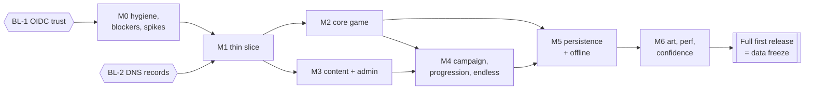
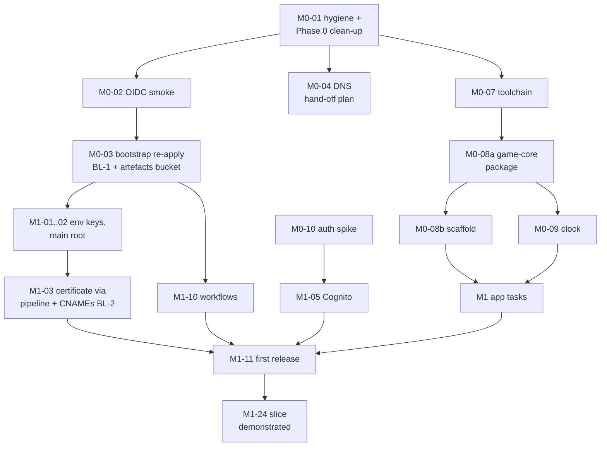

# J. Execution backlog

This section turns the plan into an ordered list of tasks that Claude builds in sequence and you review at each phase gate. Each task says what it covers, which
files it touches, what it waits for, roughly how big it is, what could go wrong, and how you will know it is finished. It ends
with the first build phase, a guide to reviewing a phase, and a way of recording decisions as the work lands.

Spec anchors: "Return dependency-ordered tasks with scope, affected areas/files, relative effort, risks and concrete completion
criteria. Give a small first task that I can implement myself. Document decisions as work is completed" (`prompt.md:76-77`);
"A phased backlog with dependencies, concrete completion criteria, affected areas/files based on the real repository and
relative effort" (`prompt.md:1316`); "A proposed first task small enough for the user to implement, explained as a
colleague/mentor" (`prompt.md:1318`); "Remaining genuine blockers only" (`prompt.md:1320`); the suggested milestones
(`prompt.md:1263-1288`).

**Way of working** **[CONFIRMED by owner, 2026-11-14]** ([spine S0.1](00-spine.md#s01-way-of-working-confirmed-by-owner-2026-11-14)):
Claude builds the app in sequential build phases and you review the code at each phase gate. Work happens on `main`; Claude or you
commit and push. Deployment happens **only** through GitHub Actions pipelines: locally, `terraform fmt`/`validate`/`plan` and
read-only AWS calls are fine, and the bootstrap root (which creates the CI's own trust) is the one thing you still apply locally.
This replaces the spec's "small first task that I can implement myself" (`prompt.md:77`, `prompt.md:1318`): J.4 describes the
**first build phase** and how to review a phase instead. The backlog below is unchanged in purpose; `docs/build-phases.md` (to
create) cuts it into the sequential phases Claude works through.

What this section does not repeat (it links instead):

- Every canonical name, state, key, route, code and rule: the spine, [00-spine.md](00-spine.md) (v0.3).
- What exists today and why: [A. Repository findings](A-repository-findings.md).
- The milestone contents, the first playable slice and owner decisions D-1 to D-13 and O-1 to O-4: [B. Scope and decisions](B-scope-and-decisions.md).
- Designs: [C](C-game-and-learning-design.md) (game and learning), [D](D-ux-and-content-operations.md) (UX and content operations),
  [E](E-architecture.md) (architecture), [F](F-state-and-data.md) (state and data), [G](G-api-contracts.md) (API),
  [H](H-infrastructure-and-delivery.md) (infrastructure and delivery), [I](I-validation.md) (tests and AC mapping).

Almost nothing in this section exists yet. Every task is future work, and every path in backticks marked "(to create)" is a
planned path. Paths that exist today are links. Some Milestone 0 work happened during planning: at commit `8583bd8` the repository
tracks a `.gitignore`, `prompt.md`, `infrastructure/`, `docs/`, [tools/sim/](../../tools/sim/), [oidc-smoke.yml](../../.github/workflows/oidc-smoke.yml),
an adapted [tf-apply-destroy-env.yml](../../.github/workflows/tf-apply-destroy-env.yml) used as a Phase 0 pipeline test, and the
start of `infrastructure/main/` **[VERIFIED]** (`git ls-files`, `git log`). M0-01, M0-02, M0-03, M0-06 and M1-02 say what is left.

---

## J.1 How to read the backlog

### J.1.1 Task fields

| Field | Meaning |
|---|---|
| **ID** | `M<milestone>-<nn>`. The number gives a sensible order inside a milestone; the "Depends on" column is the real constraint. |
| **Task (scope)** | What is in, in one or two lines. Anything not named is out. |
| **Areas / files** | Real paths are links. Planned paths are in backticks with "(to create)". `web/…` and `api/…` follow [E §E.5.1](E-architecture.md#e51-workspace-layout-all-to-create) and [H §H.2](H-infrastructure-and-delivery.md#h2-repository-layout-after-this-plan). |
| **Depends on** | Task IDs that must be finished first. "—" means it can start now. |
| **Effort** | Relative size, scale below. |
| **Risks** | What is most likely to go wrong or take longer. |
| **Done when** | Observable evidence: a command output, a screen, a green job, a recorded file. Not "code written". |
| **Trace** | The plan section that designs it. |

**Cross-plan ID legend.** Several sections number things with short prefixes, and a few prefixes look alike. This table says
which is which so a task's "Done when" can be read without guessing. **[PROPOSAL]**

| ID form | Meaning | Owned by |
|---|---|---|
| `M0-01` … `M6-10` | Backlog task (this section) | J |
| `J-1` … `J-3` | M1 choices made in this section | J §M1 |
| `ADR-0001`, `0001-…` | Architecture decision record in `docs/decisions/` (to create) | J.6 |
| `S0` … `S14`, "spine Sn" | Section of the spine | [00-spine.md](00-spine.md) |
| `D-1` … `D-13` | Owner decisions, all accepted as recommended **[CONFIRMED by owner, 2026-11-14]** | [B §B6](B-scope-and-decisions.md#b6-owner-decisions-d-1-to-d-13-o-1-to-o-4), [spine S13](00-spine.md#s13-owner-decisions) |
| `O-1` … `O-4` | Owner decisions taken in chat on 2026-11-14: voice engine, speech reuse and Play, domain facts, way of working | [B §B6.1](B-scope-and-decisions.md#b61-decisions-you-took-in-chat-on-2026-11-14-confirmed-by-owner-2026-11-14) |
| `BL-1`, `BL-2` | Genuine blockers (OIDC subject, DNS records) | [B §B7](B-scope-and-decisions.md#b7-genuine-blockers) |
| `N-n` | Where the plan narrows or reinterprets the spec | [B §B4](B-scope-and-decisions.md#b4-where-this-plan-narrows-or-reinterprets-the-spec) |
| `D-Tn`, `E-nn`, `F-nn`, `H-nn`, `I-nn`, `L-nn`, `R-nn`, `S-nn` | Rows of B's assumptions and engineering-decisions tables, prefixed by topic (note `F-nn` there is not H's `F-1`…`F-8`) | [B §B5](B-scope-and-decisions.md#b5-assumptions-and-engineering-decisions) |
| `C2` … `C27` | Sections of the game and learning design | [C](C-game-and-learning-design.md) |
| `P01` … `P16` (display), `p01` … `p16` (data) | Build pads on the map | [C](C-game-and-learning-design.md) |
| `P1` … `P15`, `A1` … `A11` | Player screens and admin screens (e.g. "D §P13") | [D](D-ux-and-content-operations.md) |
| `J1` … `J12`, `Q1` … `Q10` | Player journeys; phonics quality-gate checks | [D](D-ux-and-content-operations.md) |
| `G1` … `G11` (no hyphen) | DynamoDB transaction shapes (e.g. G5 ops, G7 create run, G11 speech ownership) | [spine S8.1](00-spine.md#s81-table-game-pk-pk-sk-sk-both-strings-no-gsi-no-ttl-except-syssignups), [F §12.3](F-state-and-data.md#123-transaction-composition-and-action-counts) |
| `R1` … `R30` | API routes | [G](G-api-contracts.md) |
| `G-1` … `G-15` (hyphen) | Quality gates in the release workflow | [H §H.10](H-infrastructure-and-delivery.md#h10-quality-gates) |
| `B-1` … `B-7`, `W-n` | Bootstrap changes; workflow rules | [H §H.5](H-infrastructure-and-delivery.md#h5-bootstrap-changes-you-make-no-replacement-bootstrap), [H §H.7](H-infrastructure-and-delivery.md#h7-workflows-what-replaces-the-two-copies) |
| `F-1` … `F-8` | Data-freeze checklist items | [H §H.11.3](H-infrastructure-and-delivery.md#h113-data-freeze-point-spine-s114) |
| `AC-01` … `AC-43` | Acceptance criteria of the spec | [I §I.3](I-validation.md#i3-acceptance-criteria-map-ac-01-to-ac-43) |
| `P1` … `P4` (playtest context) | Child playtest sessions (P1 in M1, P2 in M2, P3 in M4, P4 in M6) | [I §I.5](I-validation.md#i5-child-playtest-protocol-ages-57) |
| `N-001`, `M-009` | Activity slot IDs (`^[NM]-[0-9]{3}$`: normal or meteor slot after wave n); every other key ID is hyphenated lower case (`ma-0101`, `phoneme-sh`) | [spine S3.3](00-spine.md#s33-activity-slot), [spine S9.5](00-spine.md#s95-limits-one-shared-limits-file-read-by-client-and-handlers-numbers-assumption) |

### J.1.2 Effort scale **[ASSUMPTION]**

Sizes are relative and include your review at the phase gate. AWS/Terraform review goes at expert speed; application code takes
longer to review while the stack is new to you. They are not calendar estimates.

| Size | Meaning |
|---|---|
| **S** | Up to about one focused day. One idea, a handful of files, one test or check proves it. |
| **M** | Two to four days. Several files or one new concept to learn (e.g. a first reducer, a first Terraform module of this kind). |
| **L** | One to two weeks. Several concepts or a whole component with tests. |
| **XL** | More than two weeks. Never started as one task: split it first. Only the art and content items are XL, and each is split. |

### J.1.3 Definition of done for every task **[PROPOSAL]**

A task is only finished when all of these hold, in addition to its own "Done when":

1. The change is committed on `main` (by Claude or you) and pushed, and any CI gate that exists at that point is green
   ([H §H.10](H-infrastructure-and-delivery.md#h10-quality-gates)).
2. Anything deployed went through a GitHub Actions pipeline, never a local `terraform apply` on the main stack; the bootstrap root is
   the only local apply ([spine S0.1](00-spine.md#s01-way-of-working-confirmed-by-owner-2026-11-14)) **[CONFIRMED by owner, 2026-11-14]**.
3. If behaviour, setup or operations changed, the README or the relevant runbook says so (`prompt.md:1288`: documentation grows with the work).
4. If a decision was made or changed, there is an ADR in `docs/decisions/` (to create; J.6).
5. If the task settles a row of a plan section's "Unverified items to check" table, the ADR says so and the register (M0-14) ticks it.
6. The phase that contains the task has passed your review at its gate (J.4.3).

---

## J.2 Milestones and dependencies

### J.2.1 Milestone graph



Reading the diagram: the two genuine blockers ([B §B7](B-scope-and-decisions.md#b7-genuine-blockers)) sit in front of the
milestones they gate: the OIDC trust (BL-1) gates every CI run from M0 onwards, and your DNS records (BL-2) gate the first
deployed site in M1. After M1, game systems (M2) and content plus admin (M3) run in parallel because they meet only at the
activity slot. M4 needs both. M5 needs M4 because endless block planning and resets change what the offline pack holds. The
freeze comes at the end, no earlier than M5 ([B §B3.4](B-scope-and-decisions.md#b34-the-data-freeze-point-proposal-spine-s114)).
This keeps the milestone order of [B §B3.3](B-scope-and-decisions.md#b33-milestone-path), adding only the M2 → M5 edge. **[PROPOSAL]**

### J.2.2 Critical path to the first playable slice



Reading the diagram: the infrastructure path (left) is short and mostly waits on the two blockers and on your one local
bootstrap re-apply (M0-03), which also creates the artefacts bucket the release workflow uploads to. The certificate is requested
through the pipeline (M1-03), never by a local targeted apply. The application path (right) is long because it holds most of the
code. It starts with the toolchain (M0-07) and a minimal `game-core` package (M0-08a); the clock (M0-09) needs only those two, and
the larger scaffold spike (M0-08b) follows. Claude works on them while the OIDC and DNS items wait on GitHub settings, your
bootstrap apply or DNS propagation. **[PROPOSAL]**

### J.2.3 Parallel tracks **[PROPOSAL]**

| Track | Runs through | Note |
|---|---|---|
| Platform (Terraform, workflows, ops) | M0-02/03, M0-15, M1-01..11, M2-11, M6-04..09 | Your strongest area to review; quick gates |
| Game (game-core, Phaser, React player) | M0-08a/08b/09, M1-12..13, M1-20..23, M2 (except M2-11), M4 | The main learning track for your reviews |
| Server (Python Lambdas, DynamoDB) | M0-13, M1-14..19, M2-06/07, M3, M5 | |
| Content (authoring, audio review) | M0-11, M1-19, M3-10a..d, M4-02 (meteor pool) | Mostly operator time, not code; can run in evenings once the admin app exists |

---

## J.3 The backlog

### M0 — Repository hygiene, genuine blockers and spikes

Goal: remove the unknowns before anything gets big. Spec: "Inspect existing infrastructure/workflows. Confirm authentication
setup, React/Phaser integration and representative phonics generation. Resolve poor pronunciation before scaling the content
bank. Produce architecture decisions and a requirement trace" (`prompt.md:1267-1269`). Spikes build throwaway things; their
output is a recorded answer (an ADR), not production code. **[PROPOSAL]**

Spikes that need AWS resources (M0-10, M0-12, M0-13) use a throwaway Terraform root `spikes/<name>/` (to create) with names
prefixed `space-tower-defence-spike-`. Because deployment happens only through GitHub Actions
([spine S0.1](00-spine.md#s01-way-of-working-confirmed-by-owner-2026-11-14)), they are applied and destroyed by a manual
`spike.yml` workflow (M0-15), not from your laptop. Each spike's state lives under its own key `spikes/<name>/terraform.tfstate` in
the existing state bucket, so a spike can never read or change the main stack's state (`main/terraform.tfstate`). The workflow and
the spike roots are deleted at the end of M0, once every spike stack is destroyed. The Polly listening spike (M0-11) needs no
resources: `SynthesizeSpeech` from the AWS CLI creates nothing in the account. **[PROPOSAL]**

| ID | Task (scope) | Areas / files | Depends on | Effort | Risks | Done when | Trace |
|---|---|---|---|---|---|---|---|
| M0-01 | **Blocker prerequisite. Repository hygiene and Phase 0 clean-up.** Mostly done during planning: the `.gitignore` and the first commits are on `main` **[VERIFIED]** (`git log`: `8e669ff` added `.gitignore` with `prompt.md`, `infrastructure/` and `docs/`; `dee3f51` removed `deploy.yml` and adapted [tf-apply-destroy-env.yml](../../.github/workflows/tf-apply-destroy-env.yml) as a Phase 0 pipeline test). What is left: (1) destroy the throwaway test bucket in [main.tf](../../infrastructure/main/main.tf#L1-L6) through that workflow (its own comment says so) and delete the resource; (2) then remove the workflow's `destroy` action, so no destroy path exists by the time real resources do ([tf-apply-destroy-env.yml:56](../../.github/workflows/tf-apply-destroy-env.yml#L56); `prompt.md:1002`). The workflow stays as the interim plan/apply pipeline until M1-10 replaces it. *Part of the first build phase (J.4).* | [.gitignore](../../.gitignore); [tf-apply-destroy-env.yml](../../.github/workflows/tf-apply-destroy-env.yml); [infrastructure/main/main.tf](../../infrastructure/main/main.tf) | — | S | Whether the test bucket is currently applied is **[UNVERIFIED]**; removing the resource before the destroy run leaves an orphan bucket outside state | `git ls-files` lists nothing under `infrastructure/bootstrap/.terraform-prod/` (true at `8583bd8` **[VERIFIED]**); `aws s3api head-bucket --bucket testing-bucket-9489424594` (read-only) returns 404; `infrastructure/main/main.tf` holds no resource; the workflow's `action` input offers only `plan` and `apply` | [A §10.1](A-repository-findings.md#101-checklist) #1–2, [B §B4](B-scope-and-decisions.md#b4-where-this-plan-narrows-or-reinterprets-the-spec) N-5, [H §H.16](H-infrastructure-and-delivery.md#h16-gitignore-to-create-before-the-first-git-add-infrastructure) |
| M0-02 | **Blocker check (BL-1). OIDC smoke test.** [oidc-smoke.yml](../../.github/workflows/oidc-smoke.yml) already exists **[VERIFIED]** (commit `dee3f51`): one `workflow_dispatch` job with `environment: prod` that prints only the decoded `sub` claim, then assumes the CI role and runs `aws sts get-caller-identity`. What is left: create the `prod` environment with a `main`-only deployment-branch rule, dispatch the workflow on `main`, and check whether required reviewers can be added to an environment on this repository. The workflow is kept after M0 as a manual diagnostic ([spine S11.1](00-spine.md#s111-workflows)). *Part of the first build phase (J.4).* | [oidc-smoke.yml](../../.github/workflows/oidc-smoke.yml); GitHub Settings → Environments → `prod` | M0-01 | S | Token leaked into logs; environments or required reviewers unavailable on the repository's plan **[UNVERIFIED]**; step 2 fails until M0-03's re-apply (expected, and that is the finding) | One run on `main` shows the `sub` line; step 2 either shows `arn:aws:sts::263185198757:assumed-role/space-tower-defence-prod-github-oidc/…` or an `AssumeRoleWithWebIdentity` access-denied error; the observed subject and the reviewer availability are written down (they go into ADR-0011 in M0-03); searching the log for `eyJ` finds nothing | [A §5.2](A-repository-findings.md#52-immutable-oidc-subject-likely-ci-blocker), [H §H.5](H-infrastructure-and-delivery.md#h5-bootstrap-changes-you-make-no-replacement-bootstrap) B-1 |
| M0-03 | **Blocker fix (BL-1), your local apply. Trust and artefacts bucket in the bootstrap root.** [common.auto.tfvars.json:5](../../infrastructure/envs/common.auto.tfvars.json#L5) already sets `trusted_subs` to the immutable `…:environment:prod` subject **[VERIFIED]**; correct it if M0-02 printed something else (or use the fallback `…:ref:refs/heads/main` if environments are unavailable). If required reviewers are available, add a second environment `prod-apply` (reviewers, used only by the apply job) and put both subjects in `trusted_subs`. Claude adds the versioned Lambda artefacts bucket beside the existing module call (no replacement bootstrap; it also holds saved plans under `plans/<run_id>/`). You review and re-apply the bootstrap root locally: the one local apply the way of working allows. | [common.auto.tfvars.json](../../infrastructure/envs/common.auto.tfvars.json); [infrastructure/bootstrap/main.tf](../../infrastructure/bootstrap/main.tf), [outputs.tf](../../infrastructure/bootstrap/outputs.tf); GitHub environment settings | M0-02 | S | A typo in the subject locks CI out (recoverable from your laptop); the branch rule silently missing makes the narrowing meaningless; adding the bucket to the module call instead of beside it would replace bootstrap resources | Bootstrap plan shows an in-place update of the role's trust policy and the new bucket, nothing replaced or destroyed; M0-02 re-run on `main` prints the role ARN and account `263185198757`; a run dispatched from any other branch is refused before the job starts (branch rule) or at `AssumeRoleWithWebIdentity`; ADR-0011 records the final subject(s), whether `prod-apply` exists, and the bucket name | [A §5.3](A-repository-findings.md#53-recommended-narrowing), [H §H.5](H-infrastructure-and-delivery.md#h5-bootstrap-changes-you-make-no-replacement-bootstrap) B-1–B-3, [B §B7](B-scope-and-decisions.md#b7-genuine-blockers) BL-1, [spine S11.1](00-spine.md#s111-workflows) |
| M0-04 | **Blocker planning (BL-2), owner action. DNS hand-off plan.** Decide how you will create the two ACM validation CNAMEs and the two alias records (A + AAAA) in your DNS account, using your established lookup approach. Record the domain facts of [spine S1.0](00-spine.md#s10-dns-hand-off-facts-confirmed-by-owner-2026-11-14-unless-marked) **[CONFIRMED by owner, 2026-11-14]**: the apex `jackgl.com` already serves another app from another account; `aliens` and `admin.aliens` do not exist yet. Checks: CAA records on `jackgl.com` (if any) must allow `amazon.com`; whether the apex CloudFront distribution has a wildcard alternate domain name `*.jackgl.com`, which could block adding `aliens.jackgl.com` to a distribution in this account. Apex cookies reaching our subdomains (harmless: bearer tokens) and apex HSTS `includeSubDomains` (fine) need no action. Rules: never touch the apex or `www` records; never use `allow_overwrite`. Write the steps down; no records are created yet. | `docs/runbooks/dns-hand-off.md` (to create) | M0-01 | S | CAA records block issuance; a wildcard alias on the apex distribution blocks our alias **[UNVERIFIED]**; accidental change to the apex or `www` (other product) | The runbook names: where the records are created, who/what creates them, the four record names, the Terraform outputs they come from (`acm_validation_records`, `player_distribution_domain`, `admin_distribution_domain`, `cloudfront_hosted_zone_id`), the CAA result, the apex distribution's alternate domain names (read-only check in the other account), and the never-touch rules | [E §E.3.3](E-architecture.md#e33-dns-integration-points-no-redesign), [H §H.15](H-infrastructure-and-delivery.md#h15-dns-hand-off), [A §7](A-repository-findings.md#7-dns-integration-points-only) |
| M0-05 | **Repository instructions and decision log.** A short `CLAUDE.md` or README section (labels, layout, the way of working: Claude builds in phases, you review at each gate, deployment only through GitHub Actions, the bootstrap root the only local apply); `docs/decisions/` with the ADR template and ADR-0001…0010 (J.6), taken from spine v0.3 ([00-spine.md](00-spine.md), change log S14). This is also M0's "requirement trace": the ADRs link to the plan, and [I](I-validation.md) holds the AC mapping. | `CLAUDE.md` (to create); [README.md](../../README.md); `docs/decisions/README.md`, `docs/decisions/0000-template.md`, `docs/decisions/0001-…` to `0010-…` (to create) | M0-01 | S | Writing too much; ADRs that restate the plan instead of recording a decision | Ten ADR files exist, each under one screen, each linking to its plan section; README links the decision index | [A §10.1](A-repository-findings.md#101-checklist) #4, #13; J.6 |
| M0-06 | **Keep the balance simulator.** **Done during planning:** the simulator is in [tools/sim/](../../tools/sim/) and tracked in git, so the C17 evidence can be re-run **[VERIFIED]** (`git ls-files`; `python3 -B tools/sim/selftest.py` printed "selftest: all checks passed" on 2026-11-14). Kept as a row so the dependency from M1-23 and M4-01 stays visible. | [tools/sim/](../../tools/sim/) | — | S | A later edit breaks the self-test unnoticed | `python3 -B tools/sim/selftest.py` prints "selftest: all checks passed" (re-run at every phase gate that touches `tools/sim/` or game data) | [C §C17.8](C-game-and-learning-design.md#c178-how-to-re-run-it) |
| M0-07 | **Toolchain.** Node 24 is already installed locally via nvm **[CONFIRMED by owner, 2026-11-14]**; install Python 3.14 (3.12.3 is local today) with a version manager; add `.nvmrc` and `.python-version`. | `.nvmrc`, `.python-version` (to create) | M0-01 | S | Python 3.14 not packaged for your OS yet (use a version manager) | `node -v` prints `v24.x`; `python3.14 -V` prints `3.14.x`; both files committed | [H §H.17](H-infrastructure-and-delivery.md#h17-version-pins), [B §B7.1](B-scope-and-decisions.md#b71-things-to-check-early-that-are-not-blockers) |
| M0-08a | **Minimal `game-core` package.** `web/package.json` declaring one npm workspace, and `web/game-core/` with its own `package.json`, `tsconfig.json` and Vitest; one trivial passing test. Why a workspace package: `game-core` holds the rules that both the player and admin apps import, and making it a separate package with no Phaser or DOM dependency is what keeps the simulation pure and testable on its own ([E §E.5.1](E-architecture.md#e51-workspace-layout-all-to-create)). | `web/package.json`, `web/game-core/package.json`, `web/game-core/tsconfig.json`, `web/game-core/src/` (to create) | M0-07 | S | TypeScript 7 / Vitest configuration mismatch **[UNVERIFIED]** until tried | `npm ci && npm test` from `web/` runs one green Vitest test in `game-core` | [E §E.5.1](E-architecture.md#e51-workspace-layout-all-to-create), [H §H.17](H-infrastructure-and-delivery.md#h17-version-pins) |
| M0-08b | **Spike: front-end scaffold.** Add the `player`, `admin` and `shared` workspaces; Vite 8 + React 19 + TypeScript (per create-vite) + Phaser 4.2.1 + oxlint. One React page that mounts a Phaser scene drawing a rectangle, with Phaser keyboard capture disabled. `game-core` must not import Phaser or DOM (enforced by a lint rule or a test). | `web/player/`, `web/admin/`, `web/shared/` (to create) | M0-08a | M | TS 7 / Phaser 4 / Vite 8 type or plugin incompatibilities **[UNVERIFIED]** until tried; Phaser double-mount under React strict mode | `npm ci && npm run build && npm test` succeed from `web/`; the page shows the scene in a browser; an import of `phaser` inside `game-core` fails the check; versions recorded in ADR-0013 | [E §E.5.1](E-architecture.md#e51-workspace-layout-all-to-create), [H §H.17](H-infrastructure-and-delivery.md#h17-version-pins) |
| M0-09 | **Fixed-timestep clock in `game-core` with Vitest.** The accumulator loop of [spine S10](00-spine.md#s10-react--phaser-split-proposal) as a pure function plus tests at 30/60/144 Hz frame deltas, the 250 ms clamp, the per-frame step cap `MAX = 30` (250 ms × 2x ÷ one 1/60 s step) and pause, with an integer accumulator in units of 1/60,000 s. When the cap is hit, the remaining accumulator is discarded, so a slow laptop plays in slow motion (spine S10, C §C2.1) **[PROPOSAL]**. *Background for reviewing it: J.5.* | `web/game-core/src/clock.ts`, `web/game-core/src/clock.test.ts` (to create) | M0-07, M0-08a | S | Floating-point drift in the accumulator; tests that pass because they test the wrong thing | Vitest shows exactly 60 steps per simulated second at 30, 60 and 144 Hz (integer accumulator, J.5); a 2 s frame gap at 2x produces at most 30 steps and leaves the accumulator empty; paused time produces zero steps | [C §C2.1](C-game-and-learning-design.md#c21-time), [E §E.5.3](E-architecture.md#e53-the-bridge) |
| M0-10 | **Spike: authentication.** Throwaway player pool (username-only, case-insensitive, pre sign-up trigger that auto-confirms) and operator pool (admin group, TOTP). Check: managed-login sign-up for this pool shape; how a trigger's raised error is shown; access-token claims (`sub`, `scope`, `token_use`, `cognito:groups` serialisation in a captured HTTP API JWT-authoriser event); refresh keeps scopes; `prompt=login` and `/logout` switching on a shared browser; status code for a token without the route scope (401 or 403); how managed login shows the trigger's raised message (cap set to 0, screenshot); `tzdata`/Europe/London in the Python 3.14 runtime. Applied and destroyed through `spike.yml` (M0-15). | `spikes/auth-cognito/` (to create) | M0-07, M0-15 | M | Managed login cannot do username-only auto-confirmed sign-up **[UNVERIFIED]** → owner approval needed for the fallback (N-8); adult-only managed-login wording | ADR-0012 records each check's result with a captured (redacted) event; D-10 (two pools) is already accepted **[CONFIRMED by owner, 2026-11-14]**, so only the N-8 contingency remains to decide, and only if sign-up fails; the spike stack is destroyed (the workflow's `terraform state list` is empty) | [E §E.7.5](E-architecture.md#e75-main-risk-managed-login-sign-up), [B §B4](B-scope-and-decisions.md#b4-where-this-plan-narrows-or-reinterprets-the-spec) N-8, [B §B6](B-scope-and-decisions.md#b6-owner-decisions-d-1-to-d-13-o-1-to-o-4) D-10 |
| M0-11 | **Spike: Polly listening bake-off.** The voice is decided **[CONFIRMED by owner, 2026-11-14]**: Polly en-GB **Amy** on the **generative** engine, with `tts_phoneme_engine` (default `neural`) for PHONEME and LETTER_NAME clips, because AWS documentation contradicts itself on `<phoneme>` support in generative ([sources/11-voice-engine.md](sources/11-voice-engine.md)). Render the test set (about 24 items) with Amy on **both** engines with the AWS CLI (`SynthesizeSpeech` creates nothing in the account), using exactly the canonical inputs the clip key will hash (text/SSML, voice, engine, format). Try the variants for risky sounds; only if Amy fails a sound on both engines, try Emma, Brian or Arthur before marking it word-only. Listen with a second adult and one child. The preview route does not exist yet, so the chosen clips are re-rendered through it in M1 (M1-18, M1-19, M3-05). | `spikes/polly-listening/` (to create; clips stay local, not committed: add an ignore line for the clip folder, since H.16 has no audio pattern); `content/listening-verdicts.json` (to create) | — | M | Isolated phonemes sound wrong on both engines (then fewer sounds are published in isolation, L-09, or a human recording is used: the fallback **[CONFIRMED by owner, 2026-11-14]**); listening fatigue | ADR-0014 records the value of `tts_phoneme_engine` (stays `neural` unless generative passes, then `generative`), confirmation that Amy suits every speech kind, the frozen SSML templates, and a per-sound verdict (publishable · with small schwa · word-only) committed in `content/listening-verdicts.json` | [D §D9.1](D-ux-and-content-operations.md#d91-milestone-0-listening-spike-before-any-phonics-authoring), [C §C26.3](C-game-and-learning-design.md#c263-authoring-sequence-and-sources) phase A, [spine S5.2](00-spine.md#s52-activities-templates-speech) |
| M0-12 | **Spike: IndexedDB and presigned audio.** A throwaway bucket with CORS for `http://localhost:<port>`, one MP3, a presigned GET; in the browser fetch the bytes, store them with `idb`, play them with the network off; try `navigator.storage.persist()`, a quota error and an origin-wide Web Lock. Also: whether Safari honours `play()` after an awaited fetch when the element was primed synchronously, and whether `HeadObject` with `ChecksumMode = ENABLED` returns the SHA-256 of an object written with `ChecksumAlgorithm = SHA256` (how `tts` will return `sha256`). Applied and destroyed through `spike.yml` (M0-15). | `spikes/audio-idb/` (to create) | M0-08b, M0-15 | M | Autoplay rules block playback without a user gesture; Safari/Firefox storage differences | A short screen recording or notes show offline playback from stored bytes; ADR-0015 records the playback API choice, the persist/quota behaviour seen and the checksum result (or the fallback: store the hash as object metadata at `PutObject`) | [E §E.9](E-architecture.md#e9-audio-caching-and-playback), [F §9.3](F-state-and-data.md#93-local-database-scd-sub) |
| M0-13 | **Spike: DynamoDB transaction fixtures.** On a throwaway real table **and** in moto: a G5-shaped `TransactWriteItems` (ConditionCheck SESSION + revision-conditioned RUN update + slot update); capture `CancellationReasons` for each failure; `ReturnValuesOnConditionCheckFailure`; the nested-map `SET` after `planets = {}`; reserved-word handling via `ExpressionAttributeNames`. Save the real responses as fixtures. The real table is applied and destroyed through `spike.yml` (M0-15). | `spikes/ddb-transactions/` (to create); `api/tests/fixtures/ddb/` (to create) | M0-07, M0-15 | M | moto's cancellation reasons differ from the real service (the reason to capture real ones) | Fixture files hold real cancellation responses for SESSION-fence, revision and slot-status failures; a pytest shows moto matching or a note says where it differs | [F §12.3](F-state-and-data.md#123-transaction-composition-and-action-counts), [F §8](F-state-and-data.md#8-attempt-and-reward-idempotency) |
| M0-14 | **Unverified-facts register.** Collect every row of the sections' "Unverified items to check" tables (A–J) into one checklist with the task that will settle it (M0 spike, M1 smoke, or later). | `docs/decisions/unverified.md` (to create) | M0-05 | S | Items fall through the cracks | Every listed item has an owner task ID; items already settled are ticked with their ADR number (the rest are ticked as M0-10..13 and later tasks finish, which is not part of this task) | [A](A-repository-findings.md#unverified-items-to-check), [B](B-scope-and-decisions.md#unverified-items-to-check), [E](E-architecture.md#unverified-items-to-check), [F](F-state-and-data.md#unverified-items-to-check), this section's [table](#unverified-items-to-check) |
| M0-15 | **Spike workflow.** A manual `spike.yml`: `workflow_dispatch` with a `spike` input restricted to a choice list (`auth-cognito`, `audio-idb`, `ddb-transactions`) and an `action` input (`plan`, `apply`, `destroy`); `environment: prod` (so the existing trust applies); working directory `spikes/<spike>/` only; backend key `spikes/<spike>/terraform.tfstate`; saved plan applied as printed. Deleted, with the `spikes/` roots, once every spike stack is destroyed. Its `destroy` action can only reach spike state keys, never `main/terraform.tfstate`. | `.github/workflows/spike.yml` (to create) | M0-03 | S | A free-text path input letting a run target the main root (use a choice list); forgetting to destroy a spike before the workflow is deleted | A dispatch with each spike name plans only that root; the state bucket holds keys only under `spikes/` for these runs; at M0's end `spike.yml` and `spikes/*/` are gone and an S3 listing under `spikes/` shows only empty states | [spine S0.1](00-spine.md#s01-way-of-working-confirmed-by-owner-2026-11-14), [H §H.8.4](H-infrastructure-and-delivery.md#h84-backend-initialisation-every-job-that-runs-terraform) |

### M1 — Thin vertical slice (one planet, two waves, one activity with Play, cloud save)

Goal and scope: [B §B3.2](B-scope-and-decisions.md#b32-side-by-side). It uses the real op envelope, slot model, session fence and
speech path, with less content. Three choices this section makes for M1, each recorded as an ADR in M1-24:

| # | Choice | Why | Label |
|---|---|---|---|
| J-1 | The M1 wave set is `mode = CHALLENGE` (two waves, slot `N-001` only, no `meteorAfter`). | Smallest op set (no `COMPLETION_OFFER`, `FINISH_RUN` or an empty endless offer). The first `PROFILE` write on `COMPLETE_WAVE` moves to M2 ([F §3.7](F-state-and-data.md#37-the-milestone-1-wave-set-data-view)). Challenge badges (the final `COMPLETE_WAVE` of a CHALLENGE run writes `PROFILE.badges` only, [spine S3.2](00-spine.md#s32-operations-the-only-ways-run-state-changes)) arrive with M4-04. | **[PROPOSAL]** |
| J-2 | Session scope: server side complete (SESSION item, claim/renew/release, fence in every op, claim inside create); client stamps every op with its generation and runs one serial queue; a plain message for the session 409s. Takeover dialog, divergence options, recovery panel and offline wait for M5. | Adding generation stamping later would change stored ops ([F §5.6](F-state-and-data.md#56-what-milestone-1-needs)). | **[PROPOSAL]** |
| J-3 | The one M1 clip is previewed and approved through a **minimal admin app** (operator sign-in, a speech page with Preview / Play / Approve, an activity page with Validate / Publish for seeded drafts), served on `admin.aliens.jackgl.com`. So the admin alias record moves from M3 to M1. | The real preview → approve path without extra auth flows. The operator app client's callback URLs are on the admin hostname, so a CLI or `localhost` route would need a second client or a weaker auth flow. These pages are the first slice of the M3 admin app, not throwaway. | **[PROPOSAL]** (adopted in [spine S12](00-spine.md#s12-milestones-proposal-the-spec-heads-them-suggested); B and H follow this timing) |

Bank eligibility thresholds are set to 1 as labelled milestone configuration (N-7).

| ID | Task (scope) | Areas / files | Depends on | Effort | Risks | Done when | Trace |
|---|---|---|---|---|---|---|---|
| M1-01 | **Env keys.** Add the H.6 keys ([spine S1.3](00-spine.md#s13-configuration-names-and-repository-layout-proposal): `domain_name`, `player_hostname`, `admin_hostname`, `notification_email`, `player_signup_closed`, `player_auth_domain_prefix`, `operator_auth_domain_prefix`, `signup_daily_cap`, `tts_voice_id` = `Amy`, `tts_engine` = `generative`, `tts_phoneme_engine` = `neural`; `terraform_version` is already there **[VERIFIED]**); declare them (`default = null`) in the bootstrap root (B-5); you re-apply the bootstrap locally. | [common.auto.tfvars.json](../../infrastructure/envs/common.auto.tfvars.json), [prod.tfvars.json](../../infrastructure/envs/prod.tfvars.json), [bootstrap/variables.tf](../../infrastructure/bootstrap/variables.tf) | M0-03 | S | A key declared in one root only (warnings on every run) | Bootstrap plan: no changes and no undeclared-variable warnings | [H §H.6](H-infrastructure-and-delivery.md#h6-environment-file-keys), [A §10.2](A-repository-findings.md#102-environment-file-keys-to-add) |
| M1-02 | **Main root skeleton.** Started in commit `dee3f51` **[VERIFIED]**: [provider.tf](../../infrastructure/main/provider.tf) (partial S3 backend, `allowed_account_ids`, `default_tags`), [variables.tf](../../infrastructure/main/variables.tf) and the lock file exist. Add the `us_east_1` provider alias, `locals.tf`, `data.tf` (managed CloudFront policy lookups only), the module wiring in `main.tf` and `outputs.tf`. | [infrastructure/main/](../../infrastructure/main/provider.tf); `locals.tf`, `data.tf`, `outputs.tf` (to create) | M1-01, M0-01 | S | Backend bucket typo creates state elsewhere (the `head-bucket` guard prevents it in CI) | `terraform init` with the H.8.4 settings and `terraform validate` succeed locally; `terraform plan` shows no resources yet | [H §H.3](H-infrastructure-and-delivery.md#h3-infrastructuremain-all-to-create), [H §H.8.4](H-infrastructure-and-delivery.md#h84-backend-initialisation-every-job-that-runs-terraform) |
| M1-03 | **Certificate through the pipeline and validation CNAMEs (BL-2).** Module `certificate` (us-east-1, both hostnames) as the main root's first real resource, planned and applied through the interim pipeline (`tf-apply-destroy-env.yml` without its destroy action, M0-01), never by a local or `-target` apply **[CONFIRMED by owner, 2026-11-14]**; you create the two CNAMEs per M0-04. The artefacts bucket already exists from the bootstrap root (M0-03). Distributions are only planned once the certificate is `ISSUED`. | `infrastructure/modules/certificate/` (to create) | M1-02, M0-04 | S | Validation stalls (CAA, a wildcard alias on the apex distribution, typo); ACM gives up after 72 h | The pipeline run's `terraform output acm_validation_records` shows two records; `aws acm describe-certificate --region us-east-1` (read-only) shows `ISSUED` | [H §H.15.2](H-infrastructure-and-delivery.md#h152-first-apply-sequencing-proposal), [B §B5](B-scope-and-decisions.md#b5-assumptions-and-engineering-decisions) H-14 |
| M1-04 | **Data modules.** `dynamodb_table` ×2 (`game`, `content`; PITR, deletion protection, `prevent_destroy`; TTL attribute only on `game` for the sign-up counter) and `private_bucket` for audio (CORS from the two exact origins; clips under `tts/v1/`). Protection flags are on from the first apply ([spine S11.3](00-spine.md#s113-data-protection)). | `infrastructure/modules/dynamodb_table/`, `infrastructure/modules/private_bucket/` (to create) | M1-02 | S | TTL accidentally enabled on items other than `SYS#SIGNUPS` (it is per table, by attribute name; only that item carries `ttl`) | `terraform plan` shows two tables and the audio bucket with the protections listed in H.11.1 | [H §H.4.6](H-infrastructure-and-delivery.md#h46-dynamodb_table-called-twice-and-private_bucket-called-twice), [F §12](F-state-and-data.md#12-dynamodb-design) |
| M1-05 | **Cognito.** `cognito_pool` ×2 with the spike's findings (M0-10): player pool + pre sign-up trigger wiring and daily cap; operator pool with TOTP and `admin` group; prefix domains; resource servers and scopes; app clients with PKCE. Operator account created by `AdminCreateUser` per a runbook. | `infrastructure/modules/cognito_pool/` (to create); `docs/runbooks/operator-accounts.md` (to create) | M1-02, M0-10 | M | Changing an app client attribute that forces replacement (signs everyone out; plan guard reports it) | Plan shows both pools with deletion protection `ACTIVE`, the pre sign-up trigger attached to the player pool only, and TOTP required on the operator pool (the live sign-up and sign-in checks are part of M1-11) | [E §E.7](E-architecture.md#e7-authentication-and-authorisation), [H §H.4.5](H-infrastructure-and-delivery.md#h45-cognito_pool-called-twice) |
| M1-06 | **API and functions.** `lambda_function` ×4 (log group first, role beside function, zip from S3 by `s3_key` + hash, `Errors`/`Throttles` alarms; `player-api` timeout 25 s, all under the 30 s gateway limit; `tts_voice_id`, `tts_engine`, `tts_phoneme_engine` passed to `tts` and `admin-api` as environment; `tts` role with prefix-scoped `s3:ListBucket` on `tts/v1/*` and no `content` table read) and `http_api` (payload 2.0, `$default` stage, access log allow-list including the diagnostic `integrationLatency`, `integrationError`, `authorizerError`, two JWT authorisers, route scopes `game/play` and `ops/content`, throttles, permissions). | `infrastructure/modules/lambda_function/`, `infrastructure/modules/http_api/` (to create) | M1-02 | M | `source_arn` format for API Gateway permissions **[UNVERIFIED]**; bare `default_route_settings` meaning zero throttling **[UNVERIFIED]** | Plan shows four functions with the per-function IAM of E.6.4 and every route with an authoriser and scope; no route without one | [E §E.6](E-architecture.md#e6-lambda-and-api-boundaries), [H §H.4.3](H-infrastructure-and-delivery.md#h43-http_api), [H §H.4.4](H-infrastructure-and-delivery.md#h44-lambda_function-called-four-times) |
| M1-07 | **Sites.** `static_site` ×2: private bucket + OAC, CloudFront Function SPA fallback on the default behaviour only, `/api/*` behaviour (`CachingDisabled`, `AllViewerExceptHostHeader`), response headers policy and CSP (the policy is owned by [H](H-infrastructure-and-delivery.md)), aliases on the issued certificate. | `infrastructure/modules/static_site/` (to create) | M1-03 | M | A distribution-wide custom error response would rewrite API errors into `index.html` (gate G-5 refuses it); CloudFront Function size limit **[UNVERIFIED]** | Plan shows two distributions with no `custom_error_response` and the CloudFront Function on the default behaviour only (the live deep-link, `/missing.js` and `/api/me` 401 checks are M1-11's smoke checks) | [E §E.2](E-architecture.md#e2-same-origin-api-through-cloudfront), [H §H.4.2](H-infrastructure-and-delivery.md#h42-static_site-called-twice) |
| M1-08 | **Monitoring.** `monitoring` module: SNS topic + us-east-1 mirror, e-mail subscriptions, the H.14 alarms that exist at M1 (Lambda, API 5xx, `ops-rejected`, `speech-unavailable`, DynamoDB throttles, CloudFront 5xx). | `infrastructure/modules/monitoring/` (to create) | M1-06, M1-07 | S | Subscriptions not confirmed within 48 h (deleted by SNS) | Plan shows every alarm in H.14 except Backup, each wired to the right topic (the subscription confirmation and test e-mail are checked in M1-11) | [H §H.14](H-infrastructure-and-delivery.md#h14-monitoring-and-alarms-spine-s115) |
| M1-09 | **Python packaging and API skeleton.** `api/` with four function folders, `api/shared/` (data-access helper with ConsistentRead and `ExpressionAttributeNames`, error envelope, allow-list logger, route-key authorisation), Powertools, ruff, pytest + moto; `scripts/build_lambdas.py` producing reproducible arm64 zips. | `api/functions/{player_api,admin_api,tts,cognito_presignup}/`, `api/shared/`, `api/tests/`, `api/requirements*.txt`, `scripts/build_lambdas.py` (to create) | M0-07, M0-13 | M | Non-reproducible zips (every release shows every function changing); a missing arm64 wheel | Building twice gives identical SHA-256 per zip; `pytest` and `ruff` pass; a test proves an unknown route key is denied before any lookup | [H §H.9.2](H-infrastructure-and-delivery.md#h92-build-rules-that-keep-the-plan-honest), [E §E.6](E-architecture.md#e6-lambda-and-api-boundaries), [G §15](G-api-contracts.md#15-logging-allow-list) |
| M1-10 | **Release workflows.** `release.yml` (inputs `ref` and optional `artefacts_from=<release_id>` for rollback), `apply.yml`, `plan.yml` per H.7–H.8 and [spine S11.1](00-spine.md#s111-workflows) (config, checks incl. DynamoDB Local integration tests as a CI service container, build, plan + guard in report mode + the gate that plan route keys equal `contracts/routes.json`, two-dispatch approval, apply saved plan, publish, invalidate `index.html`, `config.json` and `/game-data/current.json`, smoke, record). The saved plan, lock file and manifest go to the artefacts bucket under `plans/<run_id>/`, never a GitHub artefact. Jobs use `environment: prod`; the apply job uses `prod-apply` if ADR-0011 says reviewers are available. Delete `tf-apply-destroy-env.yml` in the same commit; keep `oidc-smoke.yml`. Gates G-1, G-2, G-4, G-5, G-6, G-7 (report), G-10, G-11. | `.github/workflows/release.yml`, `apply.yml`, `plan.yml` (to create); `scripts/plan_guard.py`, `infrastructure/plan-guard.json` (to create); [tf-apply-destroy-env.yml](../../.github/workflows/tf-apply-destroy-env.yml) (deleted) | M0-03 (the artefacts bucket the build uploads to), M1-02, M1-09, M1-12 (`contracts/routes.json`) | L | Saved plan applied on a different runner/Terraform (stale or refused); inputs interpolated into shell | A dispatch on `main` runs to "dispatch apply.yml with plan_run_id = N"; `apply.yml` with that ID applies exactly that plan from `plans/<N>/`; a dispatch from another branch fails in `config`; `grep -r -- '-auto-approve\|update-function-code\|destroy' .github/` finds nothing (by then `spike.yml` is gone, M0-15) | [H §H.7](H-infrastructure-and-delivery.md#h7-workflows-what-replaces-the-two-copies), [H §H.8](H-infrastructure-and-delivery.md#h8-the-manual-release-spine-s111), [H §H.10](H-infrastructure-and-delivery.md#h10-quality-gates) |
| M1-11 | **First release (F2), validation CNAMEs (F3), alias records (F4, BL-2) and alarms (F5).** Dispatch the release; create `aliens.jackgl.com` and (per J-3) `admin.aliens.jackgl.com` aliases per the M0-04 runbook (never the apex or `www`, never `allow_overwrite`); confirm SNS; first entry in `docs/releases/`. | `docs/releases/` (to create) | M1-03…M1-10 | S | Distribution waits on certificate (should not: issued in M1-03) | All H.8.6 smoke checks green on both hostnames, not only `*.cloudfront.net`, including every route in `contracts/routes.json` returning 401 without a token on both distributions; a test child signs up and signs in through managed login and the operator signs in with TOTP (M1-05); both SNS subscriptions are confirmed and a `set-alarm-state` test e-mail arrives (M1-08); `docs/releases/` has the entry with the release ID | [H §H.15.2](H-infrastructure-and-delivery.md#h152-first-apply-sequencing-proposal), [H §H.8.6](H-infrastructure-and-delivery.md#h86-smoke-checks-step-7-read-only) |
| M1-12 | **Contracts for M1.** JSON Schemas for the ops envelope and the six M1 ops (`SAVE_PREP`, `START_WAVE`, `COMPLETE_WAVE`, `SUBMIT_ATTEMPT`, `DEFEAT`, `ABANDON`), the shared limits file, `contracts/routes.json` (every route key, read by the plan gate and the release smoke test), and the first op-sequence and answer fixtures (a canonical answer is one string of at most 64 characters for every interaction type, [spine S9.5](00-spine.md#s95-limits-one-shared-limits-file-read-by-client-and-handlers-numbers-assumption)). | `contracts/schemas/`, `contracts/fixtures/`, `contracts/routes.json` (to create); `web/shared/src/limits.ts` (to create) | M0-08b | M | Schemas drift from G (generate types from them rather than writing both by hand) | Both Vitest and pytest load the same fixture files; an unknown field in a payload fails schema validation in both | [G §5](G-api-contracts.md#5-the-ops-batch--post-apirunsrunidops-r11), [G §1.4](G-api-contracts.md#14-request-limits-applied-before-any-business-logic) |
| M1-13 | **`game-core` rules reducer (M1 ops) and next-phase rule; multiple-choice canonicaliser in `web/shared`.** A reducer is a pure function `(state, op) → new state or refusal`; it is how the client decides whether an op may exist at all. The answer canonicaliser lives once in `web/shared` (spine S7.2, S10), because the admin app uses it too; `game-core` holds only the reducer and the next-phase rule. | `web/game-core/src/rules/`, `web/shared/src/learning/canonical.ts` (to create) | M0-09, M1-12 | M | Reducer and server rules disagree (the fixtures exist to catch it) | Vitest runs every M1 fixture sequence and produces the expected views and refusals | [F §3.3](F-state-and-data.md#33-operations-the-only-ways-run-state-changes), [C §C20](C-game-and-learning-design.md#c20-the-six-interaction-types-data-definitions) |
| M1-14 | **Python reducer mirror (M1 ops).** The same rules on the server side, run against the same fixtures. | `api/shared/rules/` (to create) | M1-09, M1-12 | M | Subtle integer/rounding differences between languages | pytest runs the same fixture files as M1-13 with identical results | [F §3.3](F-state-and-data.md#33-operations-the-only-ways-run-state-changes) |
| M1-15 | **Profile routes.** `PUT/PATCH /api/me/profile`, `GET /api/me` (optional `?sessionId=` for `activeElsewhere`), `GET /api/planets`; DOB write-only; age band in Europe/London; `cognito-presignup` daily cap (fail closed). | `api/functions/player_api/`, `api/functions/cognito_presignup/` (to create) | M1-09, M0-10 | M | DOB leaking into a response, error detail or log line | A pytest posts a known DOB and asserts it appears in no response body and no captured log line; a test at the cap raises, never `autoConfirmUser=false` | [G §3](G-api-contracts.md#3-profile-and-dashboard-routes), [E §E.10](E-architecture.md#e10-family-level-trust-model) |
| M1-16 | **Runs and session routes.** `POST /api/runs` (G7: lookup first, one transaction with `ConditionCheck PROFILE attribute_exists(pk)`, the claim, run and slots; `takeover` input with `409 TAKEOVER_CONFIRM_REQUIRED` under the session-claim rule; `409 CONTENT_VERSION_UNSUPPORTED` for unknown or unreleased versions; `CONTENT_UNAVAILABLE{reason: PLANET_LOCKED}`), selection with threshold 1 (tests use small fixture game-data and bounds files until M1-23 supplies the real ones), `GET /api/runs/{runId}`, `/pack`; `PUT/DELETE /api/session` (claim/renew/release). | `api/functions/player_api/`, `api/shared/selection/` (to create) | M1-14, M1-15 | L | Transaction cancellation mis-classified (use the M0-13 fixtures) | moto tests: repeating a create returns the same run unchanged; a second session gets `ACTIVE_SESSION_ELSEWHERE` with `deviceLabel`; a claim on a terminal run gets `409 RUN_TERMINAL`; a create without a profile is refused by the PROFILE condition check; another player's `runId` returns `NOT_FOUND` | [F §5](F-state-and-data.md#5-play-session-state-machine-account-wide-lease-with-fencing-token), [G §4](G-api-contracts.md#4-runs), [G §7](G-api-contracts.md#7-session-lease--r13-put-apisession-r14-delete-apisession) |
| M1-17 | **The ops endpoint.** `POST /api/runs/{runId}/ops`: per-op order (a)–(i), G5 transaction, jittered retry, `recentOps`, per-op results (`outcome` one of `VOIDED`, `NO_OP_VOIDED_SLOT`, `INCORRECT`, `RESOLVED_SUCCEEDED`, `RESOLVED_FAILED`, `DECLINED`; [spine S7.1](00-spine.md#s71-envelope-and-per-op-processing)), HTTP status rules, structured log line per op. | `api/functions/player_api/` | M1-16 | L | Duplicate check placed after the fence (breaks idempotency); retries that re-use a stale read | Tests: replaying a batch returns `ALREADY_APPLIED` with the original result; a wrong `expectedRevision` stops the batch and later ops are `NOT_PROCESSED`; the third wrong answer resolves `FAILED` and a correct one grants the reward exactly once | [F §8](F-state-and-data.md#8-attempt-and-reward-idempotency), [G §5](G-api-contracts.md#5-the-ops-batch--post-apirunsrunidops-r11) |
| M1-18 | **Speech service.** `tts`: `POST /api/speech` (one consistent slot read under the caller's `sub`; the clip comes from the slot's pinned `clips` map; response `{clipKey, sha256, url (300 s), contentType, bytes}`; `SPEECH_UNAVAILABLE` on a missing object) and `POST /api/admin/speech/preview` (validation, synthesise only if absent, `PutObject If-None-Match: *`); shared clip-key module. Engine by speech kind: `tts_engine` (default `generative`) for WORD, INSTRUCTION and DICTATION, `tts_phoneme_engine` (default `neural`) for PHONEME and LETTER_NAME; voice `tts_voice_id` (default `Amy`); the voice/engine allow-list stays in code because IAM cannot restrict them **[CONFIRMED by owner, 2026-11-14]**. Voice and engine are in the clip-key inputs, so changing a variable affects new previews only. | `api/functions/tts/`, `api/shared/clipkey.py` (to create) | M1-09, M0-11, M0-12 | M | Returning `sha256` depends on the M0-12 checksum result; a missing object returns 403 instead of 404 if the prefix-scoped `ListBucket` is left out of the role (M1-06) | pytest: preview of the same input twice calls Polly once; a changed `tts_engine` produces a different clip key and leaves the approved clip's bytes untouched; the response `sha256` equals the stored bytes' hash; a child's request for another child's slot returns `NOT_FOUND`; a missing clip returns 503 `SPEECH_UNAVAILABLE` and writes one ERROR line of the shape the `speech-unavailable` metric filter matches (the live alarm is proved in M6-07) | [E §E.4](E-architecture.md#e4-the-dedicated-tts-service), [G §11](G-api-contracts.md#11-speech) |
| M1-19 | **Minimal admin path and seed (J-3).** `admin-api`: speech draft + approve (speech definitions carry `kind`, `provider` = `polly`, `engine`, `voiceId`; the approved version records `clipKey`, `sha256` and the render date), activity draft + validate + publish (subset). `scripts/seed_content.py` (dry-run by default, create-only) loading `ph-0102` and `phoneme-sh` drafts. `web/admin`: operator sign-in, Speech page, Activity page. | `api/functions/admin_api/`, `scripts/seed_content.py`, `content/seed/`, `web/admin/` (to create) | M1-05, M1-11, M1-18, M0-08b | M | Seed script overwriting (must be conditional); approving a clip that was never previewed | On `admin.aliens.jackgl.com` you preview, play and approve the clip, and the approved speech version records the same `clipKey` as the preview; running the seed twice reports "skipped, exists"; a player token is refused on every `/api/admin/*` route (gateway 401, never 2xx) and an operator token without the `admin` group gets `403 FORBIDDEN` ([I §I.2.7](I-validation.md#i27-api-contract-tests)) | [D §D8.6](D-ux-and-content-operations.md#d86-seeding-and-import), [D §D9](D-ux-and-content-operations.md#d9-phonics-preview-review-and-the-quality-gate), [G §12](G-api-contracts.md#12-administration-routes) |
| M1-20 | **Player shell.** `config.json` load, managed-login PKCE sign-in/out, profile setup, Home; API client with `ownerSub` check before every request; serial queue with generation-stamped ops (online only); sync chip (`SYNCED`, `PENDING`, `RETRYING`, `AUTH_REQUIRED`). | `web/player/src/` (to create) | M0-08b, M1-11, M1-12, M1-15 | L | Token refresh races; React re-rendering per frame later | Sign up → profile → Home works on `aliens.jackgl.com`; signing in as a different child in another tab makes the first tab stop and reload | [E §E.7.4](E-architecture.md#e74-sign-out-shared-laptop-switching-and-one-page-load--one-account), [D §D3](D-ux-and-content-operations.md#d3-key-journeys), [F §7](F-state-and-data.md#7-client-sync-state-machine-per-account-client-only) |
| M1-21 | **Battlefield slice.** Phaser scene with placeholder art: one route, a few pads, one class at level 1, one alien; `GameBridge`; simulation driven by the M0-09 clock; wave 1 → activity → wave 2 → completed; defeat. | `web/player/src/game/`, `web/game-core/src/sim/` (to create) | M0-09, M1-13 | L | Simulation logic leaking into the Phaser scene (keep it in `game-core`) | A two-wave run completes in the browser; the same seed and inputs give the same post-wave snapshot in a Vitest | [C §C2](C-game-and-learning-design.md#c2-simulation-rules-game-core), [E §E.5](E-architecture.md#e5-react-phaser-and-game-core) |
| M1-22 | **Learning panel (multiple choice) and Play.** Panel (in `web/shared`, no Phaser), greyed tries (client guard, D-8), feedback, reward; resume per phase. Play rule **[CONFIRMED by owner, 2026-11-14]** ([spine S5.2](00-spine.md#s52-activities-templates-speech)): clip bytes are stored once per `clipKey`; if the slot's pinned clip is stored locally, playback starts **immediately** from local bytes and `POST /api/speech` is sent concurrently; if not, the panel waits for the response, downloads, verifies `sha256`, stores and plays. A different `clipKey` in the response is logged and the server's clip is used from the next Play. | `web/shared/src/learning/`, `web/shared/src/audio/` (to create) | M1-18, M1-20, M1-21 | M | Treating a speech failure as an attempt (it must not); a stored clip skipping the request (AC-19 needs every online Play to reach the service) | Two wrong answers, refresh, the panel shows two greyed tries and one attempt left; the third try resolves; Play works after refresh; with the network throttled, a second Play starts sound before the `POST /api/speech` response arrives and the request still appears in the network log | [D §D6](D-ux-and-content-operations.md#d6-the-six-interaction-types-as-the-child-experiences-them), [E §E.4](E-architecture.md#e4-the-dedicated-tts-service) |
| M1-23 | **First game data.** Ruleset (`mechanics` 1) and planet document with the M1 challenge wave set; `current.json`; the TypeScript bounds-file build script. Seeded from `tools/sim/game_data.json` where it applies. | `game-data/ruleset/`, `game-data/campaign/`, `game-data/current.json`, `web/game-core/scripts/build-bounds.ts`, `api/shared/bounds.py` (`load_bounds`) (to create) | M0-06, M1-09, M1-10, M1-13 | S | Version strings that do not match `^[a-z0-9.-]{1,40}$` | The release publishes the files create-only; `player-api` loads the bounds file via `load_bounds` | [C §C15](C-game-and-learning-design.md#c15-where-these-numbers-live-in-the-build), [H §H.8.5](H-infrastructure-and-delivery.md#h85-static-publish-order-step-6) |
| M1-24 | **M1 demonstrated and recorded.** Walk the B3.2 "done when" list on production; ADRs for J-1…J-3; child playtest P1 ([I §I.5](I-validation.md#i5-child-playtest-protocol-ages-57)). | `docs/releases/`, `docs/decisions/`, `docs/validation/playtests/` (to create) | M1-11, M1-17, M1-19, M1-22, M1-23 | S | Declaring done on `*.cloudfront.net` only | On `aliens.jackgl.com`: a clip plays through the real service; three attempts and one reward; refresh keeps the attempts; leaving and returning resumes from the cloud save; release entry written; P1 notes (no names) in `docs/validation/playtests/` | [B §B3.2](B-scope-and-decisions.md#b32-side-by-side), [C §C26.3](C-game-and-learning-design.md#c263-authoring-sequence-and-sources) phase B |

### M2 — Core game systems

Goal: six classes, upgrades, selling, targeting, powers, the alien catalogue, carriers, bosses and the explicit run lifecycle
(`prompt.md:1273-1274`).

| ID | Task (scope) | Areas / files | Depends on | Effort | Risks | Done when | Trace |
|---|---|---|---|---|---|---|---|
| M2-01 | **Roster.** Six classes × three levels, purchase/upgrade/sell/refund, deployment caps; economy mutations validated at tick boundaries. | `web/game-core/src/sim/`, `game-data/ruleset/` | M1-24 | L | Negative balances from UI races (AC-09) | Vitest: rapid buy/sell commands never produce negative credits; refund values match C5.7 | [C §C5](C-game-and-learning-design.md#c5-astronaut-roster), [C §C9](C-game-and-learning-design.md#c9-economy) |
| M2-02 | **Targeting and support rules.** Targeting modes; slow cap and stacking; shield/repair limits; strongest-buff rule. | `web/game-core/src/sim/` | M2-01 | M | Feedback loops between buffs | Unit tests for each C5.4–C5.6 rule, including "no loops" | [C §C5.3](C-game-and-learning-design.md#c53-targeting) |
| M2-03 | **Aliens.** Catalogue, traits, carriers and splitters, object caps. | `web/game-core/src/sim/`, `web/player/src/game/` | M2-01 | L | Object counts above the caps (performance) | Tests: a carrier releases its descendants per C6.3; caps never exceeded in a stress wave | [C §C6](C-game-and-learning-design.md#c6-aliens) |
| M2-04 | **Bosses.** Five bosses with phases. | `web/game-core/src/sim/` | M2-03 | M | A boss that requires a class or power (C17.4 says none should) | Simulator and Vitest agree a baseline defence beats each boss | [C §C7](C-game-and-learning-design.md#c7-bosses) |
| M2-05 | **Meteor powers in the simulation.** `usePower`, charges, inventory cap. | `web/game-core/src/sim/` | M2-01 | M | A cooldown crossing a wave boundary ([spine S4](00-spine.md#s4-snapshot-and-checkpoint-semantics-proposal) forbids it) | Tests: charges only change through use or the server grant; nothing carries across waves except counts | [C §C10](C-game-and-learning-design.md#c10-meteor-powers) |
| M2-06 | **Full run lifecycle ops.** `METEOR` phase, `DISMISS_SLOT`, `COMPLETION_OFFER`, `FINISH_RUN`, `CHOOSE_ENDLESS` (route plumbing only; endless content in M4), `ABANDON` UI; `PROFILE` update on `COMPLETE_WAVE` (best wave). Both reducers. | `web/game-core/src/rules/`, `api/shared/rules/`, `api/functions/player_api/` | M1-24 | L | Phase × op matrix gaps | Fixtures cover every cell of F §3.5's matrix; both reducers pass | [F §3](F-state-and-data.md#3-run-state-machine), [G §6](G-api-contracts.md#6-post-apirunsrunidendless-r12-choose_endless--online-only) |
| M2-07 | **Plausibility bounds.** Bounds file with `maxBounty`, prices, caps; S6 checks in `player-api`. | `web/game-core/scripts/build-bounds.ts`, `api/shared/bounds.py` (both created in M1-23; extended here) | M2-01, M2-06 | M | Bounds too tight for legitimate play (false `REJECTED`, alarm fires) | Property test: thousands of simulated legitimate waves never trip a bound; a forged `COMPLETE_WAVE` with extra credits is `CHECKPOINT_OUT_OF_BOUNDS` | [E §E.10](E-architecture.md#e10-family-level-trust-model), [F §6](F-state-and-data.md#6-checkpoint-semantics) |
| M2-08 | **Shared fixtures become a gate (G-3).** Op sequences for every op and refusal; answer vectors. | `contracts/fixtures/`, `.github/workflows/release.yml` | M2-06 | M | Fixtures written from one implementation's output (they must come from the spec) | G-3 runs in `checks` and fails the release on any mismatch | [H §H.10](H-infrastructure-and-delivery.md#h10-quality-gates) |
| M2-09 | **HUD, shop and battlefield keys.** Speed, pause on hidden/dialog, keyboard actions (D5.2); HUD events ≤ 10 Hz. | `web/player/src/hud/` (to create) | M2-01 | M | React re-rendering every frame | Profiler shows no per-frame React commits; every battlefield action works mouse-only and keyboard-only | [D §D4](D-ux-and-content-operations.md#d4-screen-specifications), [D §D5](D-ux-and-content-operations.md#d5-keyboard-and-mouse) |
| M2-10 | **Determinism and frame-rate tests.** Same wave at 30/60/144 Hz gives identical tick count and post-wave snapshot. | `web/game-core/src/**/*.test.ts` | M2-04, M2-05 | S | Hidden use of wall-clock time or `Math.random` | Vitest passes for a boss wave at all three rates | `prompt.md:303`, AC-13 ([spine S10](00-spine.md#s10-react--phaser-split-proposal)), [C §C2](C-game-and-learning-design.md#c2-simulation-rules-game-core), [I](I-validation.md) |
| M2-11 | **Backup module and restore runbook draft.** Vault, daily plan, 7 recovery points, selection by table ARN; `backup-job-failed` alarm. | `infrastructure/modules/backup/`, `docs/runbooks/restore.md` (to create) | M1-11 | M | Backup trust principal string **[UNVERIFIED]** | Vault shows daily recovery points for both tables after two days; runbook procedures A–D written | [H §H.13](H-infrastructure-and-delivery.md#h13-daily-backup-and-restore-runbook-spine-s84) |
| M2-12 | **Saved games.** `GET /api/runs` list and cursor, soft cap of 5 open runs, best-effort pruning beyond 50 terminal runs, Saved games screen. | `api/functions/player_api/`, `web/player/src/` | M2-06 | M | Prune failure changing an op result (it must not) | Tests: a sixth open run returns `RUN_LIMIT_REACHED`; the 51st finished run triggers pruning of the oldest | [F §12](F-state-and-data.md#12-dynamodb-design), [D §D4](D-ux-and-content-operations.md#d4-screen-specifications) |
| M2-13 | **First performance measurement and playtest P2.** Measure the busiest M2 waves (carriers, a boss) on the children's laptop at 2x; write the AC-42 target into C14 (via an ADR, since C is a plan section); run child playtest P2 ([I §I.5](I-validation.md#i5-child-playtest-protocol-ages-57)). | `docs/validation/` (to create), `docs/validation/playtests/` | M2-03, M2-04, M2-09 | M | Measuring on a faster machine than the children use; placeholder art understating draw cost | A recorded measurement in `docs/validation/` with the device, wave and frame-time figures; the AC-42 target is written down (ADR and C14); P2 notes in `docs/validation/playtests/` | [C §C14](C-game-and-learning-design.md#c14-performance-budget-feeds-ac-42), [I §I.6](I-validation.md#i6-evidence-kept-per-milestone) |

### M3 — Educational content and administration

Goal: the age-banked content model, six interaction types, subject rotation, binary summaries, immutable publication and audio
review (`prompt.md:1276-1277`). Owner decisions D-1, D-2, D-4, D-5, D-7 and D-9 were accepted as recommended
**[CONFIRMED by owner, 2026-11-14]** ([B §B6](B-scope-and-decisions.md#b6-owner-decisions-d-1-to-d-13-o-1-to-o-4),
[spine S13](00-spine.md#s13-owner-decisions)); M3 builds them in.

| ID | Task (scope) | Areas / files | Depends on | Effort | Risks | Done when | Trace |
|---|---|---|---|---|---|---|---|
| M3-01 | **Admin app shell.** Navigation, operator route guard, activity list, bank status page placeholder. Builds on M1-19. | `web/admin/` | M1-24 | M | Admin depending on Phaser (forbidden by E.5.1) | Operator signs in with TOTP; a player account sees "not authorised"; a player token is refused on every `/api/admin/*` call (gateway 401, never 2xx) and an operator token without the `admin` group gets `403 FORBIDDEN` | [D §D8](D-ux-and-content-operations.md#d8-operator-app-adminaliensjackglcom) |
| M3-02 | **Activity lifecycle API.** Draft (with `draftRevision`; a stale one gets `409 DRAFT_CONFLICT`), validate (canonical answers one string ≤ 64 characters; the reserved separators `;` `=` `,` `\|` refused), publish (condition checks on approved speech; `fromDraftRevision` replay protection; records `review{checklist, previewSolvedDraftRevision}`), retire, withdraw `{version, reason}`, audit. Identity fields are locked once published: `subject`, `topicId`, `rewardCategory`, `authoringMode`, `interactionType`. | `api/functions/admin_api/` | M1-24 | L | Publish race between two tabs | Tests: a stale `draftRevision` gets `409 DRAFT_CONFLICT`; a replayed publish with an old `fromDraftRevision` is refused; changing a locked identity field after publication is refused; published versions are never modified; withdraw writes the audit item | [F §12](F-state-and-data.md#12-dynamodb-design), [G §12](G-api-contracts.md#12-administration-routes), [C §C22](C-game-and-learning-design.md#c22-activity-definition-schema-validation-and-lifecycle) |
| M3-03 | **Player learning panels for all six interaction types** and the canonicaliser for every type (one answer string per type; ARRANGE uses tile values, two-step answers are joined by `\|`); the shared learning panel in `web/shared` (from M1-22) is used by the player app and the admin preview-solve. | `web/shared/src/learning/` (from M1-22), `web/shared/src/learning/canonical.ts` (from M1-13, extended to every type) | M1-22 | L | Two normalisers creeping in (there must be one, in TypeScript) | Answer vectors pass for all six types in Vitest; pytest checks shapes only; each type works mouse-only and keyboard-only | [C §C20](C-game-and-learning-design.md#c20-the-six-interaction-types-data-definitions), [D §D6](D-ux-and-content-operations.md#d6-the-six-interaction-types-as-the-child-experiences-them) |
| M3-04 | **Admin editor and preview-solve** for the six types, rendering the real player panel. | `web/admin/src/editor/` (to create) | M3-01, M3-02, M3-03 | L | Editor allowing a choice activity with < 4 options (publish validation must refuse) | An operator can create, validate, preview-solve and publish one activity of each type | [D §D8](D-ux-and-content-operations.md#d8-operator-app-adminaliensjackglcom) |
| M3-05 | **Speech lifecycle and listening checklist UI.** Full speech definitions (`kind` WORD · PHONEME · LETTER_NAME · INSTRUCTION · DICTATION, `provider`, `engine`, `voiceId`); checklist before Approve; quality gate including the machine check that refuses a PHONEME definition whose sound is `word-only` in `content/listening-verdicts.json`. Withdrawing a speech version stays a runbook in v1 (M6-08), with no route. | `web/admin/src/speech/` (to create), `api/functions/admin_api/` | M3-01, M0-11 | M | Approving without listening (the checklist is a declaration, not proof) | Approve is disabled until preview has played and the checklist is ticked; the approved `clipKey` and `sha256` match the previewed clip; a PHONEME draft for a `word-only` sound fails validation | [D §D9](D-ux-and-content-operations.md#d9-phonics-preview-review-and-the-quality-gate), [E §E.4](E-architecture.md#e4-the-dedicated-tts-service) |
| M3-06 | **Templates.** Python generator module (pure, versioned), exhaustive publish check (cap 5,000), materialisation into slots at run creation. | `api/shared/generators/` (to create) | M3-02 | L | A generator's output changing between versions (must never happen for the same `(kind, version)`) | Snapshot tests per `(kind, version)`; publish refuses a template whose domain has an invalid instance | [C §C25](C-game-and-learning-design.md#c25-templates) |
| M3-07 | **Selection and bank status.** Subject rotation, seeded draws, no repeats, eligibility thresholds (real values), `CONTENT_UNAVAILABLE`, bank-status page. | `api/shared/selection/`, `web/admin/src/bank/` (to create) | M3-02, M3-06 | L | An age band reported eligible that cannot fill a run | Property test over many seeds: every slot filled, no activity repeated within a run; bank status matches the counts | [C §C24](C-game-and-learning-design.md#c24-selection-when-a-run-is-created) |
| M3-08 | **Learning summaries.** `SUM#` counters in the resolving transaction; `GET /api/me/progress`; My progress screen. | `api/functions/player_api/`, `web/player/src/progress/` (to create) | M2-06 | M | Double counting on replay | Replaying a resolving op leaves counters unchanged; DECLINED/VOIDED never count | [C §C26](C-game-and-learning-design.md#c26-learning-summaries-and-bank-sizing), [F §10.2](F-state-and-data.md#102-permanent-vs-run-progression) |
| M3-09 | **Withdrawal and VOID.** Server VOID path, `withdrawn` flag in the run view, child copy, `DISMISS_SLOT` for withdrawn slots. | `api/functions/player_api/`, `web/player/src/learning/` | M3-02, M2-06 | M | Voiding already-resolved slots (must not; D-9) | Fixture: withdrawn version → `VOIDED`, reward once, summary unchanged | [F §4.4](F-state-and-data.md#44-void-exceptional-invalid-content), [C §C27](C-game-and-learning-design.md#c27-invalid-content-handling-spine-s33) |
| M3-10a | **Content phase C.** The worked records (about 17 activities, 12 clips). | `content/seed/` | M3-04, M3-05 | M | Answer-key mistakes | Every type and mode works mouse-only and keyboard-only on real content | [C §C26.3](C-game-and-learning-design.md#c263-authoring-sequence-and-sources) |
| M3-10b | **Content phase D.** First eight generator kinds and about 30 template rows (maths). | `content/seed/`, `api/shared/generators/` | M3-06, M3-07, M3-10a | L | Domain too small for the no-repeat rule | Bank status: maths groups at threshold in every band | [C §C25](C-game-and-learning-design.md#c25-templates) |
| M3-10c | **Content phase E.** Phonics items, age 5, then 6, then 7; every clip reviewed. | admin app (content), `content/seed/` | M3-07, M3-10a | L | Listening fatigue; tier B/C sounds | Bank status: phonics groups at threshold; every clip has a review record | [C §C26.3](C-game-and-learning-design.md#c263-authoring-sequence-and-sources), [D §D9](D-ux-and-content-operations.md#d9-phonics-preview-review-and-the-quality-gate) |
| M3-10d | **Content phase F.** Spelling items, age 5 (tiles and pictures), then 6, then 7. | admin app (content), `content/seed/` | M3-07, M3-10a | L | British spelling errors in AI-assisted drafts | Bank status: spelling groups at threshold | [C §C26.3](C-game-and-learning-design.md#c263-authoring-sequence-and-sources) |
| M3-11 | **Import (optional convenience).** Spreadsheet import creating drafts only. | `web/admin/src/import/` (to create) | M3-04 | M | An import overwriting operator content (must skip and report) | Importing a file twice creates nothing the second time and reports every row as skipped | [D §D8.6](D-ux-and-content-operations.md#d86-seeding-and-import) |

### M4 — Full campaign, progression, challenges and endless

Goal: the 50-wave schedule, meteor challenges, badges, planet eligibility, short challenges and endless, with balance set by
playtests (`prompt.md:1279-1280`). D-6 and D-11 were accepted as recommended **[CONFIRMED by owner, 2026-11-14]**
([spine S13](00-spine.md#s13-owner-decisions)); M4 builds them in.

| ID | Task (scope) | Areas / files | Depends on | Effort | Risks | Done when | Trace |
|---|---|---|---|---|---|---|---|
| M4-01 | **Campaign data.** 50 waves, pads opening in stages, unlocks, meteor slots `M-009…M-049`; re-run the simulator after any change. | `game-data/campaign/`, `game-data/ruleset/`, `tools/sim/` | M2-04, M2-05 | M | A long wave set tripping the transaction-size gate | The game-data build refuses a wave set with `3 + (finalWave − 1) + len(meteorAfter) > 100` create-run transaction actions ([spine S5.1](00-spine.md#s51-pins-and-game-data)); the 50-wave campaign passes it; simulator margins recorded (`python3 -B tools/sim/selftest.py` green) | [C §C8](C-game-and-learning-design.md#c8-the-50-wave-campaign), [C §C3](C-game-and-learning-design.md#c3-map-route-and-pads) |
| M4-02 | **Meteor offers.** Meteor phase UI, power grant by the server, skip only before the first attempt (D-11), meteor pool content (phase G). | `web/player/src/learning/`, `api/functions/player_api/`, `content/seed/` | M4-01, M3-07 | M | Treating a success at the power cap as a failure | Fixture: dismiss after an attempt is refused by the reducer; a grant never exceeds the cap; a meteor success when that power is already at its cap (2) leaves the slot `SUCCEEDED` and counted, with no charge added ([spine S3.2](00-spine.md#s32-operations-the-only-ways-run-state-changes)) | [C §C10](C-game-and-learning-design.md#c10-meteor-powers) |
| M4-03 | **Badges and planet eligibility.** Campaign and progress badges (C12) and planet eligibility re-evaluated on `COMPLETE_WAVE`. The five learning-outcome badges are not in v1 ([spine S3.2](00-spine.md#s32-operations-the-only-ways-run-state-changes)). | `api/functions/player_api/`, `web/player/src/progress/` | M2-06, M3-08 | M | Badge awarded twice (map key with `if_not_exists`) | Tests: each C12 badge awarded once; reset of campaign progress lets it be earned again | [C §C12](C-game-and-learning-design.md#c12-badges), [F §10.2](F-state-and-data.md#102-permanent-vs-run-progression) |
| M4-04 | **Challenges.** The short wave sets; planet/run setup screen; challenge badges: the final `COMPLETE_WAVE` of a CHALLENGE run may write `PROFILE.badges` only (never planets or eligibility); challenge slot rewards use the ruleset's campaign interval table. | `game-data/campaign/`, `web/player/src/`, `api/functions/player_api/` | M4-01, M4-03 | M | A challenge write leaking into planets or eligibility | Each challenge completes to `COMPLETED` without touching best wave, planets or eligibility; its badge is awarded once; slot rewards match the campaign interval table | [C §C13](C-game-and-learning-design.md#c13-standalone-short-challenges-wave-sets) |
| M4-05 | **Endless.** Scaling generator; block planning inside `CHOOSE_ENDLESS` and endless `COMPLETE_WAVE`; "You have done every activity we have for now"; cap at wave 999. | `web/game-core/src/sim/`, `api/shared/selection/`, `api/functions/player_api/` | M4-01, M3-07 | L | Off-by-one at the end of endless | Tests: `plannedThrough` stays ahead by K; an exhausted bank writes no slot and never repeats; no slot is ever planned for an interval above 998; wave 999 completes the run | [C §C11](C-game-and-learning-design.md#c11-endless-continuation-and-bounded-scaling), [F §3.6](F-state-and-data.md#36-endless-block-planning) |
| M4-06 | **Resets.** All four reset types and the settings screen. | `api/functions/player_api/`, `web/player/src/settings/` (to create) | M2-06, M3-08 | M | Interrupted whole-profile reset leaving a `RESET#<requestId>` session holder | One test per reset type checks exactly the F §12.5 matrix; repeating a reset is harmless; a leftover `RESET#` holder is treated as released (no takeover prompt) | [F §12.5](F-state-and-data.md#125-resets-post-apimeresets-type-confirm), [D §P13](D-ux-and-content-operations.md#p13-settings-and-resets) |
| M4-07 | **Balance playtests (P3).** Sessions with the children; observations recorded per [I](I-validation.md); number changes go through the simulator first. | `docs/validation/playtests/`, `game-data/` | M4-01…M4-05 | M (repeats) | Tuning to one child | Each session has a short note; every number change has a simulator run behind it | [C §C17](C-game-and-learning-design.md#c17-simulator-evidence), [I §I.5](I-validation.md#i5-child-playtest-protocol-ages-57) |

### M5 — Robust persistence and offline continuation

Goal: local packs and audio caching, attempt persistence, reconnect idempotency, session exclusivity and stale-writer handling,
exercised on refresh/defeat and concurrent devices (`prompt.md:1282-1283`).

| ID | Task (scope) | Areas / files | Depends on | Effort | Risks | Done when | Trace |
|---|---|---|---|---|---|---|---|
| M5-01 | **Local database.** `scd-<sub>` with versioned stores (`ops`, `runs`, `packs`, `audio`, `recovery`, `meta`); durability rule; online-only flag when storage is unavailable. | `web/player/src/sync/db.ts` (to create) | M2-06 | L | A schema upgrade that drops `ops` or `recovery` | Upgrade test from the M1 schema keeps queued ops; private-window run shows the online-only banner | [F §9.3](F-state-and-data.md#93-local-database-scd-sub), [F §6](F-state-and-data.md#6-checkpoint-semantics) |
| M5-02 | **Offline queue.** `OFFLINE_PENDING`, background flush for all of the account's runs, Web Lock `scd-play`, identity checks; sign-out is connection-required and disabled offline ([spine S7.4](00-spine.md#s74-offline-rules)), with a pending-ops warning when online. | `web/player/src/sync/` | M5-01 | L | Two tabs flushing at once | Playwright: second tab cannot play; going offline mid-activity and back flushes in order; Sign out is disabled while offline | [F §7](F-state-and-data.md#7-client-sync-state-machine-per-account-client-only), [D §D7](D-ux-and-content-operations.md#d7-player-facing-copy-for-saving-sync-and-offline-states) |
| M5-03 | **Offline preparation and audio cache.** Pack download, readiness states, clip bytes stored once per `clipKey` and pre-fetched at run preparation (verified against `sha256`), offline Play from local bytes only; "Ready offline up to wave N" for endless. | `web/player/src/offline/` (to create) | M5-01, M0-12, M4-05 | L | Asset chunks not loaded into memory in this page session | Playwright with the network cut after "Ready offline": a prepared campaign continues and every clip plays | [E §E.8](E-architecture.md#e8-offline-preparation), [E §E.9](E-architecture.md#e9-audio-caching-and-playback) |
| M5-04 | **Divergence and recovery.** [Spine S7.5](00-spine.md#s75-divergence-procedure-stale_session-or-any-rejected) procedure, option (a) and (b) (option (b) with frozen ops for several runs is all-or-nothing), recovery store, "Progress that was not saved" panel (copy allows "some of this may already be saved") and download; an offline VOID against a locally FAILED branch keeps the local result (pairs with D-9). | `web/player/src/sync/`, `web/player/src/recovery/` (to create) | M5-02 | L | Automatic replay sneaking in (it must be explicit) | F §11.3 scenario passes end to end; the recovery file downloads as JSON | [F §9](F-state-and-data.md#9-offline-conflict-handling-divergence), [D §P14](D-ux-and-content-operations.md#p14-progress-that-was-not-saved) |
| M5-05 | **Takeover confirmation and lease timing.** Takeover dialog; renew only while visible and recently used. | `web/player/src/sync/` | M5-02 | M | Lease expiring during a long activity (renew rules) | Two-browser test shows the "Play here instead?" prompt only after a lapse without release | [F §5](F-state-and-data.md#5-play-session-state-machine-account-wide-lease-with-fencing-token), [G §7](G-api-contracts.md#7-session-lease--r13-put-apisession-r14-delete-apisession) |
| M5-06 | **Version compatibility.** `protocolVersion` current + previous, `CLIENT_UPGRADE_REQUIRED` that keeps the queue, a protocol newer than the server supports (only after a rollback) → `409 PROTOCOL_UNSUPPORTED` at batch level with the queue held in `RETRYING` ("Saving paused while the game updates"), never `REJECTED`; `playable(run)`, supported `mechanics` list; previous-release batch replay test. | `api/functions/player_api/`, `web/player/src/sync/`, `contracts/fixtures/` | M5-01 | M | A client treating `PROTOCOL_UNSUPPORTED` as a rejection and discarding ops | A recorded previous-release batch is accepted; a batch with a newer `protocolVersion` returns `409 PROTOCOL_UNSUPPORTED` and the queue keeps every op; an unsupported run shows `playable:false` and is skipped by Continue | [F §10](F-state-and-data.md#10-content-version-compatibility-and-progression), [G §9](G-api-contracts.md#9-versioning) |
| M5-07 | **Hard-case scenarios.** The F §11 scenarios and the automatable parts of the nine I §I.4 hard cases (for example refresh after wrong answers, lost `DEFEAT` response, stale offline writer, withdrawn activity offline, expired auth) as Playwright or pytest tests. Phonics correctness also needs human listening (M0-11, M3-05). | `web/player/e2e/` (to create), `api/tests/` | M5-03, M5-04, M5-05, M5-06 | L | Flaky timing in offline emulation | Every automatable I §I.4 case has a named test that is green in CI | [F §11](F-state-and-data.md#11-four-scenarios-step-by-step), [I §I.4](I-validation.md#i4-the-named-hard-cases) |

### M6 — Art, performance and release confidence

Goal: consistent generated art, measured frame rate and audio latency, full keyboard coverage, verified backup/restore and
compatible rollback, and documentation of what was actually built (`prompt.md:1285-1286`).

| ID | Task (scope) | Areas / files | Depends on | Effort | Risks | Done when | Trace |
|---|---|---|---|---|---|---|---|
| M6-01a | **Asset pipeline and manifest.** Asset manifest versions, naming conventions, loader. | `game-data/asset-manifest/`, `web/player/src/assets/` (to create) | M1-24 | M | Manifest edits after freeze (additive only) | Placeholder art loads through the manifest | [D §D10](D-ux-and-content-operations.md#d10-generated-art-and-audio-inventory) |
| M6-01b | **Battlefield art.** Planet, colony, astronauts × levels, aliens, bosses, power effects. | `web/player/public/` or `web/player/src/assets/` | M6-01a | L | Inconsistent style across generations | Every D10.2–D10.7 row has a final asset in the manifest | [D §D10](D-ux-and-content-operations.md#d10-generated-art-and-audio-inventory) |
| M6-01c | **Interface art and activity pictures; combat sound set.** | as above | M6-01a | L | Picture count larger than estimated | Every D10.8–D10.10 row has a final asset | [D §D10](D-ux-and-content-operations.md#d10-generated-art-and-audio-inventory) |
| M6-02 | **Performance.** Busiest representative waves measured against the C14 budget; audio latency from Play. | `docs/validation/` | M6-01b, M2-13 | M | Measuring on a faster machine than the children use | A recorded measurement on the children's laptop meets the documented target | [C §C14](C-game-and-learning-design.md#c14-performance-budget-feeds-ac-42) |
| M6-03 | **Keyboard and accessibility pass.** Every essential control and interaction with keyboard and mouse; axe scans. | `web/player/e2e/`, `web/admin/` | M3-03, M2-09 | M | Focus traps in dialogs | Playwright keyboard-only journeys pass; axe reports no serious issues | [D §D5](D-ux-and-content-operations.md#d5-keyboard-and-mouse), [I](I-validation.md) |
| M6-04 | **Scoped CI role.** Replace `AdministratorAccess` with the inline policy (B-4) plus a permissions boundary or equivalent; re-apply bootstrap. | [bootstrap/main.tf](../../infrastructure/bootstrap/main.tf), [bootstrap/variables.tf](../../infrastructure/bootstrap/variables.tf), [prod.tfvars.json](../../infrastructure/envs/prod.tfvars.json) | M5-07 | M | A missing permission found mid-release | A full release and a rollback rehearsal succeed with the scoped role; an attempt to delete a table from CI is denied | [H §H.5.1](H-infrastructure-and-delivery.md#h51-scoped-ci-policy-outline-not-json), [A §5.3](A-repository-findings.md#53-recommended-narrowing) |
| M6-05 | **Restore drill.** Both tables to scratch tables; verify; record time and result. The runbook's cut-over step bumps every `SESSION.generation` ([spine S8.4](00-spine.md#s84-backup-and-restore)), so no browser holding a pre-restore lease can write. | `docs/runbooks/restore.md`, `scripts/restore_copy.py`, `scripts/verify_pins.py` (to create) | M2-11 | M | Restored table lacks protections (expected; it is scratch) | Runbook entry with date, duration and result for both tables | [H §H.13.4](H-infrastructure-and-delivery.md#h134-restore-drill-ac-39) |
| M6-06 | **Rollback rehearsal and game-data lock.** Dispatch `release.yml` with `artefacts_from=<release_id>` (current `main` Terraform plus that release's archived manifest; rolling back Terraform code itself is a normal forward commit); G-8 lock check (additive-only for `game-data/` and `contracts/golden/`) and G-9 golden scenarios become gates. | `.github/workflows/release.yml`, `scripts/gamedata_lock_check.py` (to create) | M5-06 | M | Rolling back past a mechanics or protocol addition | An earlier release re-published from its archived manifest without a rebuild; a modified game-data or golden file fails G-8 | [spine S11.2](00-spine.md#s112-rollback), [H §H.12](H-infrastructure-and-delivery.md#h12-compatible-rollback-spine-s112), [H §H.10](H-infrastructure-and-delivery.md#h10-quality-gates) |
| M6-07 | **Monitoring proof (AC-40).** `set-alarm-state` test and one real failure. | — | M1-08 | S | Unconfirmed subscriptions | Both e-mails received and noted in `docs/releases/` | [H §H.14](H-infrastructure-and-delivery.md#h14-monitoring-and-alarms-spine-s115) |
| M6-08 | **Runbooks and README.** Operator password reset, sign-up kill switch, rollback, restore, DNS, speech withdrawal (a runbook only in v1: no route and no "used by" index, [spine S5.2](00-spine.md#s52-activities-templates-speech)); README with local setup, build, test and release. | `docs/runbooks/` (to create), [README.md](../../README.md) | M6-05, M6-06 | M | Runbooks describing intended rather than actual behaviour | Each runbook has been followed once and says so | [A §10.1](A-repository-findings.md#101-checklist) #13 |
| M6-09 | **Acceptance pass.** AC-01…AC-43 demonstrated per [I](I-validation.md); browser matrix; child playtest P4; gaps become tasks. | `docs/validation/` (the AC table and `browsers.md`), `docs/validation/playtests/` | M6-01…M6-08 | L | Treating a test as proof of a behaviour it does not exercise | Every AC has evidence recorded (test name, screenshot or log) in the `docs/validation/` AC table; `docs/validation/browsers.md` is filled in; P4 notes in `docs/validation/playtests/` | [I §I.3](I-validation.md#i3-acceptance-criteria-map-ac-01-to-ac-43) |
| M6-10 | **Data-freeze release.** Checklist F-1…F-8; plan guard switched to enforcing (`enforce: true`; the protection flags themselves have been on since the first apply, [spine S11.4](00-spine.md#s114-data-freeze-point)); release tagged `release-<release_id>` and noted as the freeze. | `infrastructure/plan-guard.json`, `docs/releases/` | M6-04, M6-05, M6-06, M6-09 | S | Freezing with pre-freeze test data left by accident (F-8) | All eight checklist items have evidence; the freeze release is tagged | [H §H.11.3](H-infrastructure-and-delivery.md#h113-data-freeze-point-spine-s114), [B §B3.4](B-scope-and-decisions.md#b34-the-data-freeze-point-proposal-spine-s114) |

### J.3.1 Size of each milestone (count of tasks by effort) **[ASSUMPTION]**

| Milestone | S | M | L | Note |
|---|---|---|---|---|
| M0 | 11 | 5 | 0 | Spikes are M because each needs a throwaway stack and a written result; M0-01, M0-02 and M0-06 were largely done during planning |
| M1 | 8 | 11 | 5 | The largest learning step: every layer once, reviewed at small size |
| M2 | 1 | 9 | 3 | |
| M3 | 0 | 6 | 8 | Includes content authoring, which is operator time rather than code |
| M4 | 0 | 6 | 1 | M4-07 repeats |
| M5 | 0 | 2 | 5 | |
| M6 | 2 | 7 | 3 | Art (M6-01b/c) is split from an XL |

---

## J.4 First build phase and how to review a phase

### J.4.1 What changed, and where the phases live

The spec asked for a small first task that you would implement yourself (`prompt.md:77`, `prompt.md:1318`). You have since
changed the way of working **[CONFIRMED by owner, 2026-11-14]** ([spine S0.1](00-spine.md#s01-way-of-working-confirmed-by-owner-2026-11-14)):
Claude builds the app in sequential build phases, and you review the code at each phase gate. So this section now describes the
**first build phase** and a guide to reviewing any phase.

- **Where the phases are:** `docs/build-phases.md` (to create) cuts this backlog into sequential phases. Each phase names its tasks
  (by the IDs in J.3), its goal, what you do yourself (local bootstrap applies, DNS records, GitHub settings, listening sessions,
  playtests) and its gate. J stays the source for each task's scope, dependencies and "Done when"; `build-phases.md` holds the cut and
  each gate's outcome. **[PROPOSAL]**
- **Git:** work happens on `main`; Claude or you commit and push. Because there is no pull request, a gate is a review of commits that
  are already pushed. Pushing never deploys: releases are dispatched by hand, so you can hold a release until its phase passes review.
- **Deployment:** only through GitHub Actions pipelines. Locally, `terraform fmt`/`validate`/`plan` and read-only AWS calls are fine. The
  bootstrap root is the one local apply, and it is yours.

### J.4.2 The first build phase: hygiene, OIDC trust and the bootstrap

Scope: M0-01, M0-02, M0-03, M0-04, M0-05 and M0-07. **[PROPOSAL]**

Why this first: it is the start of the only blocker that stops every release (BL-1), it turns the biggest **[UNVERIFIED]** risk in
the plan (the OIDC subject) into a fact at almost no cost, and it is mostly platform work, which makes it a gentle first review in
your strongest area before application code arrives.

| Task | Claude does | You do |
|---|---|---|
| M0-01 | Removes the Phase 0 test bucket resource from [main.tf](../../infrastructure/main/main.tf) after the destroy run; removes the `destroy` action from [tf-apply-destroy-env.yml](../../.github/workflows/tf-apply-destroy-env.yml) | Dispatch the destroy run of the test bucket first (deployment stays your decision); review the two commits |
| M0-02 | Nothing new to write: [oidc-smoke.yml](../../.github/workflows/oidc-smoke.yml) exists | Create the `prod` environment with the deployment-branch rule "selected branches: `main`"; check whether required reviewers can be added; dispatch the smoke test on `main` |
| M0-03 | Adds the artefacts bucket beside the module call in the bootstrap root; corrects `trusted_subs` if M0-02 printed a different subject; adds `prod-apply` if reviewers are available | Review the diff; run the bootstrap plan and apply locally; re-run the smoke test |
| M0-04 | Drafts `docs/runbooks/dns-hand-off.md` (to create) with the record names, Terraform outputs and rules | Fill in the CAA result and the apex distribution's alternate domain names (read-only, in the other account) |
| M0-05 | Writes `CLAUDE.md`, the ADR template, ADR-0001…0010 and ADR-0011 from your smoke-test and bootstrap results | Read the ADRs; they record decisions you already accepted |
| M0-07 | Adds `.nvmrc` and `.python-version` | Install Python 3.14 (Node 24 is already installed via nvm) |

**Reading the smoke-test result.** `trusted_subs` already holds the immutable `…:environment:prod` subject
([common.auto.tfvars.json:5](../../infrastructure/envs/common.auto.tfvars.json#L5), **[VERIFIED]**); whether the bootstrap has been
re-applied with it is **[UNVERIFIED]**.

| What the run shows | Meaning | Next |
|---|---|---|
| Step 1 prints a `sub` equal to `trusted_subs`; the role step prints the assumed-role ARN and account `263185198757` | The bootstrap was already re-applied with that subject | M0-03 adds only the artefacts bucket (and `prod-apply` if available); record ADR-0011 |
| Step 1 prints a `sub` equal to `trusted_subs`; the role step fails with `Not authorized to perform sts:AssumeRoleWithWebIdentity` | The deployed trust still has the old wildcard; the bootstrap has not been re-applied | M0-03 re-applies the bootstrap; re-run the smoke test |
| Step 1 prints a different `sub` (for example the classic `repo:jacklavelle286/space-tower-defence:environment:prod`) | The repository does not use the subject the env file expects | M0-03 sets `trusted_subs` to exactly the printed value and re-applies |

**Background for reviewing this phase.**

| Topic | The idea in one or two sentences |
|---|---|
| Ignore rules | Patterns are matched against paths relative to the `.gitignore`; a trailing `/` matches directories only; `!` re-includes. Ignoring is about *untracked* files only: once a file is tracked, adding it to `.gitignore` does nothing. |
| Workflow anatomy | A workflow has triggers (`on:`), a default permission set for the job token, and jobs; each job runs on a fresh runner and has steps. Permissions are least-privilege: `id-token: write` is what allows the OIDC request at all. |
| Environments | A job that names an environment gets that environment's protection rules (branch rules, reviewers) and its name appears in the OIDC `sub`. That is why naming one changes what IAM sees. |
| JWT anatomy | Header and payload are base64url-encoded JSON, readable by anyone who has the token; the signature is what makes it trustworthy. So the payload is still sensitive while the token is valid: print a claim, never the token. |
| OIDC trust on the AWS side | Your territory: the role's trust policy matches `token.actions.githubusercontent.com:sub`. The new fact is only the subject's shape. |

**What to check in this phase's review.**

| Check | Why |
|---|---|
| The smoke workflow prints only the `sub` line and masks the token (`::add-mask::`) before anything else touches it; no `set -x`; searching the run log for `eyJ` finds nothing | `eyJ` starts every base64url-encoded JSON header; finding it means a token leaked |
| The print step comes before the role step | If the role step fails first, the job stops and you never see the subject |
| JWT decoding handles base64url (`-`/`_`, missing `=` padding) | A plain `base64 -d` can fail or produce garbage |
| `prod` exists with its branch rule before the first run | Referencing a missing environment may create it on the fly with no branch rule **[UNVERIFIED]** |
| A run dispatched from another branch is refused | That is the branch rule working; it is also M0-03's negative test |
| The bootstrap plan shows the trust update and the new bucket, nothing replaced | The bucket goes beside the module call, not into it |
| `tf-apply-destroy-env.yml` offers no `destroy` action once the test bucket is gone | No destroy path may exist when real data does (`prompt.md:1002`) |

**Gate:** every task's "Done when" in J.3 holds, ADR-0011 is written, and you record the gate in `docs/build-phases.md` (J.4.3).

### J.4.3 How to review a phase **[PROPOSAL]**

| Step | What you do |
|---|---|
| 1. Orient | Read the phase's entry in `docs/build-phases.md`: goal, task IDs, what you do yourself. Open each task's row in J.3 for its "Done when". |
| 2. See the change | `git log --oneline <last gate commit>..main` and `git diff --stat <last gate commit>..main`, then file by file. The last gate's commit SHA is recorded in `build-phases.md`. |
| 3. Run the checks locally | Whatever exists by then: `npm ci && npm test` in `web/`, `pytest` and `ruff` in `api/`, `terraform fmt -check -recursive`, `terraform validate` and `terraform plan` with read-only credentials, `python3 -B tools/sim/selftest.py`. Never `terraform apply` on the main stack. DynamoDB Local tests run in CI only (no Docker or Java locally). |
| 4. Check the evidence | For each task: the green CI run, the release entry, the screenshot or the ADR its "Done when" asks for. "Code written" is not evidence. |
| 5. Read for the risks | Use the area table below. Ask Claude to explain anything you would not be able to maintain. |
| 6. Check the paperwork | New decisions are ADRs; README and runbooks match what was built; settled rows of the unverified register (M0-14) are ticked. |
| 7. Decide | Approve: record date, commit SHA and notes in `build-phases.md`, then dispatch any release the phase needs. Or request changes: list them; Claude fixes them in follow-up commits on `main`, and you re-review only those. |

What to look for, by area:

| Area | Look for |
|---|---|
| Terraform and IAM | Least privilege per function (spine S1, E.6); protection flags on from the first apply; no `-target`, no `force_destroy`, no destroy path; names as in [spine S1.1](00-spine.md#s11-naming-verified-reference-conventions-applied-as-proposal); nothing changes resources it should not (read the plan, not just the code) |
| Workflows | No token or secret printed; workflow inputs passed through `env:` rather than interpolated into shell; jobs that assume the role name the environment; the saved plan is applied as printed |
| Python Lambdas | DOB never in a response, error or log line; logs use the allow-list logger; writes are conditional; a replayed request gives the same result (idempotency) |
| `game-core` (TypeScript) | No Phaser, DOM, wall clock or `Math.random`; time and randomness are passed in; pure functions with tests |
| React and Phaser | No per-frame React renders; simulation logic stays in `game-core`, not in the scene |
| Tests | Would the test fail if the code were wrong? A test that cannot fail proves nothing |

### J.4.4 Then

A suggested order for the next phases; `docs/build-phases.md` sets the final cut. **[PROPOSAL]**

1. Toolchain follow-through and first game code: M0-08a, M0-09 (the clock, J.5), then M0-08b (scaffold spike).
2. Spikes: M0-15, then M0-10, M0-12, M0-13 through `spike.yml`; M0-11 (your listening sessions); M0-14; `spike.yml` removed at the end.
3. M1, in several phases: infrastructure (M1-01…M1-11), shared contracts and rules (M1-12…M1-14), server (M1-15…M1-19), player
   (M1-20…M1-23), then M1-24 with playtest P1.

---

## J.5 The fixed-timestep clock (M0-09): background for its review

This is the first piece of real game code, in the second build phase. It does not need React, Vite or Phaser, so it comes before
the full scaffold spike (M0-08b). Knowing why it is shaped the way it is makes the review quick.

**Why the pattern exists.** Browsers call the frame callback at whatever rate the screen runs (30, 60, 144 Hz) and irregularly
when busy. If the simulation moved "by however much time passed", the same wave would play out differently on different laptops,
and the spec forbids that (`prompt.md:303`, AC-13). A fixed timestep keeps a time bank: each frame adds the elapsed time, and the
simulation takes as many fixed 1/60 s steps as the bank allows. Same inputs, same steps, same result
([C §C2.1](C-game-and-learning-design.md#c21-time), [spine S10](00-spine.md#s10-react--phaser-split-proposal)).

**Shape** (conceptual, from spine S10): `acc += min(frameDeltaMs, 250) × speed`; `while acc ≥ STEP and steps < MAX: step(); acc −= STEP`.
Paused or hidden adds nothing. `MAX = 30` (250 ms × 2x ÷ one step); when the cap is hit, the remaining accumulator is discarded, so
a slow laptop plays in slow motion rather than catching up in a burst. **[PROPOSAL]**

**How it will be built.** (1) Tests first: a fake sequence of frame deltas for one simulated second at 30, 60 and 144 Hz, asserting
60 steps in each case. (2) The smallest pure function that passes: it takes the accumulator and a delta and returns the new
accumulator and the number of steps; it never reads the real clock. (3) Tests for the 250 ms clamp, the per-frame cap (including that
the leftover accumulator is discarded) and pause.

**Done when** Vitest shows all three frame rates producing exactly 60 steps per simulated second, the clamp and cap tests pass,
and the module imports nothing from Phaser or the DOM.

**What to check in review.** `STEP = 1000/60` is not exact in floating point: a naive float accumulator fed 144 deltas of
`1000/144` ms takes 59 steps, not 60. That is why spine S10 keeps the accumulator in integer units of 1/60,000 s:
`acc += Math.round(min(deltaMs, 250) × speed × 60)`, with `STEP = 1000` units. The tests should feed deltas whose units sum to exactly
60,000 per simulated second; at 144 Hz that is a repeating integer pattern (417, 417, 416 units, 48 times), so 60 steps is exact.
**[PROPOSAL]** The function must not call `performance.now()`; time is passed in, which is what makes it testable.

---

## J.6 Decision log practice

### J.6.1 What and why **[PROPOSAL]**

The spec asks for decisions to be documented as work is completed (`prompt.md:77`, `prompt.md:1288`). I'd suggest Architecture
Decision Records (ADRs): one short file per decision, numbered, never rewritten once accepted. When a decision changes, a new ADR
supersedes the old one, and both stay. The point is that in six months you can see *why* something is the way it is, and what was
rejected.

- Folder: `docs/decisions/` (to create), files `NNNN-short-title.md`, plus `docs/decisions/README.md` (to create) as an index.
- When: in the same commit as the work that made the decision. A spike's output **is** an ADR.
- Numbers 0011–0015 are reserved for the M0 tasks named in J.6.3. Whichever task writes an ADR first creates the
  `docs/decisions/` folder, so no M0 task has to wait for M0-05's template and index. **[ASSUMPTION]**
- Status: `Proposed` (not yet agreed) → `Accepted` → `Superseded by NNNN` (or `Rejected`). ADR-0001…0010 record decisions you
  already accepted with the plan **[CONFIRMED by owner, 2026-11-14]** ([spine S13](00-spine.md#s13-owner-decisions)), so they start as
  `Accepted`. A new ADR written during a build phase starts as `Proposed` and becomes `Accepted` when you approve that phase's gate.
- Size: one screen. If it needs more, the detail belongs in a plan section or a runbook, and the ADR links to it.
- The spine ([00-spine.md](00-spine.md), v0.3) is the baseline. Any later change to a spine rule is made by an ADR first and then
  added to the spine's change log (S14), so the spine and the code never drift silently.

### J.6.2 Template

```markdown
# NNNN. <Decision in a few words>
Status: Proposed | Accepted | Superseded by NNNN | Rejected · Date: YYYY-MM-DD
Context: <the problem and the forces, 2–5 lines; link the plan section>
Decision: <what we do, stated plainly>
Alternatives: <each rejected option and why, one line each>
Consequences: <what becomes easier, harder, or must now be true>
Evidence: <spike output, test, doc link, ADR it supersedes>
```

### J.6.3 The first ten ADRs, from the spine

| ADR | Decision | Source | Plan section |
|---|---|---|---|
| 0001 | Same-origin API: each distribution routes `/api/*` to the HTTP API default endpoint, keeping `/api` in route keys; no API hostname, no CORS; SPA fallback via a CloudFront Function on the default behaviour only | [spine S1](00-spine.md#s1-system-shape) | [E §E.2](E-architecture.md#e2-same-origin-api-through-cloudfront) |
| 0002 | Two Cognito user pools (player, operator), managed login with PKCE; identity is the access-token `sub`; profile data never in Cognito attributes (contingent on M0-10) | [spine S1](00-spine.md#s1-system-shape), D-10, N-8 | [E §E.7](E-architecture.md#e7-authentication-and-authorisation) |
| 0003 | Four Python arm64 Lambdas with one role each, including a dedicated `tts`; no Lambda calls another | [spine S1](00-spine.md#s1-system-shape) | [E §E.6](E-architecture.md#e6-lambda-and-api-boundaries) |
| 0004 | Two DynamoDB tables (`game`, `content`), no GSI, no TTL except the sign-up counter | [spine S1](00-spine.md#s1-system-shape), [S8](00-spine.md#s8-dynamodb-proposal) | [F §12](F-state-and-data.md#12-dynamodb-design) |
| 0005 | Family-level trust: the browser simulates combat; the server owns identity, accepted state, attempts and rewards, and checks per-op plausibility bounds; accepted tampering gains stated | [spine S2](00-spine.md#s2-trust-model-confirmed-family-level-trust-mechanisms-proposal), [S6](00-spine.md#s6-plausibility-bounds-proposal-per-op-against-the-stored-snapshot) | [E §E.10](E-architecture.md#e10-family-level-trust-model) |
| 0006 | Run state as `status` + `stage` + `phase` with one snapshot; nothing persisted during combat; a wave restarts from its start snapshot | [spine S3](00-spine.md#s3-state-machines-proposal), [S4](00-spine.md#s4-snapshot-and-checkpoint-semantics-proposal) | [F §3](F-state-and-data.md#3-run-state-machine), [F §6](F-state-and-data.md#6-checkpoint-semantics) |
| 0007 | One write path: ordered op batches with `expectedRevision`, `recentOps` idempotency and a pure reducer in both languages sharing fixtures; answers canonicalised once, in TypeScript | [spine S7](00-spine.md#s7-operation-log-revisions-idempotency-proposal) | [F §8](F-state-and-data.md#8-attempt-and-reward-idempotency), [G §5](G-api-contracts.md#5-the-ops-batch--post-apirunsrunidops-r11) |
| 0008 | Account-wide play-session lease with a fencing generation; one accepted writer; offline browsers cannot be stopped, only fenced | [spine S3.4](00-spine.md#s34-play-session-account-wide-lease-with-fencing-token) | [F §5](F-state-and-data.md#5-play-session-state-machine-account-wide-lease-with-fencing-token) |
| 0009 | One speech render path: content-addressed clips, Polly only via operator preview, approval binds the previewed bytes; player speech never synthesises (narrows `prompt.md:577`); Polly generative en-GB Amy with `tts_phoneme_engine` for phonemes and letter names, set by Terraform variables (O-1); a locally stored clip plays at once while `POST /api/speech` runs concurrently (O-2) | [spine S5.2](00-spine.md#s52-activities-templates-speech), D-12, O-1, O-2 | [E §E.4](E-architecture.md#e4-the-dedicated-tts-service) |
| 0010 | Delivery: one manual release; Terraform owns infrastructure and Lambda code, the workflow owns static files and `config.json`; two-dispatch approval by default; deployment only through GitHub Actions, the bootstrap root the one local apply (O-4); artefacts bucket in the bootstrap root; rollback by `artefacts_from`; no destroy workflow; data-freeze point | [spine S11](00-spine.md#s11-delivery-proposal), [S0.1](00-spine.md#s01-way-of-working-confirmed-by-owner-2026-11-14) | [H §H.8](H-infrastructure-and-delivery.md#h8-the-manual-release-spine-s111), [H §H.9](H-infrastructure-and-delivery.md#h9-artefact-ownership) |

Next in line, recorded when the work happens: 0011 OIDC subject, trust, environments (`prod`, optional `prod-apply`) and the artefacts bucket (M0-02/03) · 0012 auth spike
results (M0-10) · 0013 front-end stack versions (M0-08b) · 0014 listening bake-off: `tts_phoneme_engine`, per-sound verdicts and SSML
templates (M0-11) · 0015 browser audio storage and the `sha256` source (M0-12) ·
0016–0018 M1 choices J-1, J-2, J-3 (M1-24) · then game data as immutable versioned files with `mechanics` compatibility
([spine S5.1](00-spine.md#s51-pins-and-game-data)), the fixed 60 Hz timestep (spine S10), and the data-freeze point when it is named (M6-10).

---

## J.7 Traceability: every major plan element has a task

| Plan element | Tasks |
|---|---|
| [A](A-repository-findings.md) `.gitignore`, first commit, repository instructions | M0-01, M0-05 |
| [A §5](A-repository-findings.md#5-github-oidc-trust-breadth-subject-format-and-the-review-pause) OIDC subject, trust narrowing, reviewers; CI permission scoping | M0-02, M0-03, M6-04 |
| [A §6](A-repository-findings.md#6-state-bucket-naming-mismatch) state-bucket name | M1-02, M1-10 |
| [A §7](A-repository-findings.md#7-dns-integration-points-only) / [E §E.3.3](E-architecture.md#e33-dns-integration-points-no-redesign) / [H §H.15](H-infrastructure-and-delivery.md#h15-dns-hand-off) DNS hand-off | M0-04, M1-03, M1-11 |
| [B §B3](B-scope-and-decisions.md#b3-full-first-release-versus-the-first-playable-milestone) milestones, M1 slice, data freeze | M1-24, M6-10 |
| [B §B6](B-scope-and-decisions.md#b6-owner-decisions-d-1-to-d-13-o-1-to-o-4) owner decisions D-1…D-13 (all accepted as recommended) | D-10: M0-10, M1-05 · D-8, D-12: M1 · D-1, D-2, D-4, D-5, D-7, D-9: M3 · D-6, D-11: M4 · D-3: before the eldest child turns 8 · D-13: M0-02, M0-03, M1-10 |
| [B §B6.1](B-scope-and-decisions.md#b61-decisions-you-took-in-chat-on-2026-11-14-confirmed-by-owner-2026-11-14) owner decisions O-1…O-4 | O-1 voice engine: M0-11, M1-01, M1-06, M1-18, M1-19, M3-05 · O-2 speech reuse and Play: M1-18, M1-22, M5-03 · O-3 domain facts: M0-04, M1-03, M1-11 · O-4 way of working: J.4, M0-01, M0-03, M0-15, M1-03, M1-10 |
| [C §C2](C-game-and-learning-design.md#c2-simulation-rules-game-core), [spine S10](00-spine.md#s10-react--phaser-split-proposal) simulation, timestep, determinism | M0-09, M1-21, M2-10 |
| [C §C3–C7](C-game-and-learning-design.md#c5-astronaut-roster) map, colony, roster, aliens, bosses | M1-21, M2-01…M2-04 |
| [C §C8](C-game-and-learning-design.md#c8-the-50-wave-campaign), [C §C9](C-game-and-learning-design.md#c9-economy) campaign and economy | M2-01, M4-01, M4-07 |
| [C §C10](C-game-and-learning-design.md#c10-meteor-powers)–[C §C13](C-game-and-learning-design.md#c13-standalone-short-challenges-wave-sets) powers, endless, badges, challenges | M2-05, M4-02…M4-05 |
| [C §C14](C-game-and-learning-design.md#c14-performance-budget-feeds-ac-42) performance budget | M2-13, M6-02 |
| [C §C17](C-game-and-learning-design.md#c17-simulator-evidence) simulator ([tools/sim/](../../tools/sim/)) | M0-06, M4-01, M4-07 |
| [C §C18–C27](C-game-and-learning-design.md#c24-selection-when-a-run-is-created) content bank, interaction types, schema, selection, templates, summaries, invalid content | M1-13, M3-02…M3-10d |
| [D §D2–D7](D-ux-and-content-operations.md#d4-screen-specifications) player screens, keys, sync copy | M1-20…M1-22, M2-09, M2-12, M4-06, M5-02, M5-04, M6-03 |
| [D §D8](D-ux-and-content-operations.md#d8-operator-app-adminaliensjackglcom) admin app, seeding | M1-19, M3-01, M3-04, M3-11 |
| [D §D9](D-ux-and-content-operations.md#d9-phonics-preview-review-and-the-quality-gate) listening spike, review, quality gate | M0-11, M1-19, M3-05, M3-10c |
| [D §D10](D-ux-and-content-operations.md#d10-generated-art-and-audio-inventory) art and audio inventory | M6-01a…M6-01c |
| [E §E.2](E-architecture.md#e2-same-origin-api-through-cloudfront) same-origin API | M1-07 |
| [E §E.4](E-architecture.md#e4-the-dedicated-tts-service) dedicated TTS | M0-11, M1-18, M3-05 |
| [E §E.5](E-architecture.md#e5-react-phaser-and-game-core) React / Phaser / game-core | M0-08a, M0-08b, M1-21 |
| [E §E.6](E-architecture.md#e6-lambda-and-api-boundaries), [E §E.7](E-architecture.md#e7-authentication-and-authorisation) Lambdas, auth | M0-10, M1-05, M1-06, M1-09, M1-15 |
| [E §E.8](E-architecture.md#e8-offline-preparation), [E §E.9](E-architecture.md#e9-audio-caching-and-playback) offline preparation, audio cache | M0-12, M5-03 |
| [E §E.10](E-architecture.md#e10-family-level-trust-model) trust model | M1-15, M2-07 |
| [F §3–4](F-state-and-data.md#3-run-state-machine) run and slot state machines | M1-13, M1-14, M2-06, M3-09 |
| [F §5](F-state-and-data.md#5-play-session-state-machine-account-wide-lease-with-fencing-token) session lease | M1-16, M5-05 |
| [F §6–9](F-state-and-data.md#9-offline-conflict-handling-divergence) checkpoints, sync, idempotency, divergence | M1-17, M1-20, M5-01, M5-02, M5-04 |
| [F §10](F-state-and-data.md#10-content-version-compatibility-and-progression) compatibility and progression | M5-06, M4-03 |
| [F §11](F-state-and-data.md#11-four-scenarios-step-by-step) scenarios | M5-07 |
| [F §12](F-state-and-data.md#12-dynamodb-design) DynamoDB, resets, bounded growth | M0-13, M1-04, M1-16, M2-12, M4-06 |
| [G](G-api-contracts.md) routes, errors, limits, logging | M1-12, M1-15…M1-19, M2-06, M3-02, M5-06 |
| [H §H.3–H.6](H-infrastructure-and-delivery.md#h4-infrastructuremodules-all-to-create) root, modules, bootstrap (incl. the artefacts bucket), env keys | M0-03, M1-01…M1-08, M2-11 |
| [H §H.7–H.10](H-infrastructure-and-delivery.md#h8-the-manual-release-spine-s111) workflows, release, ownership, gates | M0-01, M0-02, M0-15, M1-09, M1-10, M2-08, M6-06 |
| [H §H.11–H.14](H-infrastructure-and-delivery.md#h11-data-protection-spine-s113) protection, rollback, backup, monitoring | M1-08, M2-11, M6-05…M6-07, M6-10 |
| [H §H.17](H-infrastructure-and-delivery.md#h17-version-pins) version pins | M0-07, M0-08a, M0-08b |
| [I](I-validation.md) tests, AC mapping, playtests (P1 M1-24, P2 M2-13, P3 M4-07, P4 M6-09), hard cases | M1-24, M2-08, M2-10, M2-13, M4-07, M5-07, M6-09 |

---


## Unverified items to check

Facts this section relies on that could not be checked during planning. M0-14 copies them into the register
`docs/decisions/unverified.md` (to create) with the rows of the other sections.

| Item | Why it matters | How / when to check | Milestone |
|---|---|---|---|
| Whether the bootstrap root has been re-applied with the immutable `trusted_subs` value now in [common.auto.tfvars.json:5](../../infrastructure/envs/common.auto.tfvars.json#L5) **[UNVERIFIED]** | Until the deployed trust matches the subject the token presents, no workflow can assume the CI role (BL-1) | Run [oidc-smoke.yml](../../.github/workflows/oidc-smoke.yml) on `main` and read J.4.2's outcome table (M0-02) | M0 |
| Whether the Phase 0 test bucket `testing-bucket-9489424594` ([main.tf](../../infrastructure/main/main.tf#L1-L6)) currently exists **[UNVERIFIED]** | Deleting the resource from code before a destroy run would leave an orphan bucket outside state | `aws s3api head-bucket --bucket testing-bucket-9489424594` (read-only), and a pipeline `plan` of the main root (M0-01) | M0 |
| The runner's OIDC request variables `ACTIONS_ID_TOKEN_REQUEST_URL` and `ACTIONS_ID_TOKEN_REQUEST_TOKEN` behave as `oidc-smoke.yml` assumes **[UNVERIFIED]** | The smoke test's first step depends on them to print the subject | GitHub's "OpenID Connect" documentation, then the first smoke-test run (M0-02) | M0 |
| Whether a job that references a missing environment makes GitHub create it with no branch rule **[UNVERIFIED]** | A silently created `prod` without the `main`-only rule makes the trust narrowing meaningless | GitHub's environments documentation; avoid the question by creating `prod` with its rule before the first run (M0-02) | M0 |
| Whether environments and required reviewers are available on this repository's plan and visibility **[UNVERIFIED]** | Decides `environment:prod` alone, `prod` plus `prod-apply` with reviewers, or the `…:ref:refs/heads/main` fallback ([spine S11.1](00-spine.md#s111-workflows)) | Settings → Environments, plus `gh api repos/jacklavelle286/space-tower-defence --jq '.visibility'`; record in ADR-0011 (M0-02, M0-03) | M0 |
| Whether the apex `jackgl.com` CloudFront distribution (another account) has a wildcard alternate domain name `*.jackgl.com` **[UNVERIFIED]** | CloudFront may refuse `aliens.jackgl.com` as an alias in this account while a wildcard covers it elsewhere ([spine S1.0](00-spine.md#s10-dns-hand-off-facts-confirmed-by-owner-2026-11-14-unless-marked)) | Read-only look at the apex distribution's alternate domain names in its own account; record in the DNS runbook (M0-04) | M0, before M1-11 |
| Whether `jackgl.com` has CAA records, and whether they allow `amazon.com` **[UNVERIFIED]** | A CAA record without `amazon.com` stops ACM issuing the certificate (M1-03) | `dig CAA jackgl.com` (read-only); record in the DNS runbook (M0-04) | M0 |
| TypeScript 7, Vitest, Vite 8 and Phaser 4.2.1 work together as pinned **[UNVERIFIED]** | A type or plugin incompatibility would change the pins before any game code exists | M0-08a (Vitest in `game-core`) and M0-08b (full scaffold); record versions in ADR-0013 | M0 |
