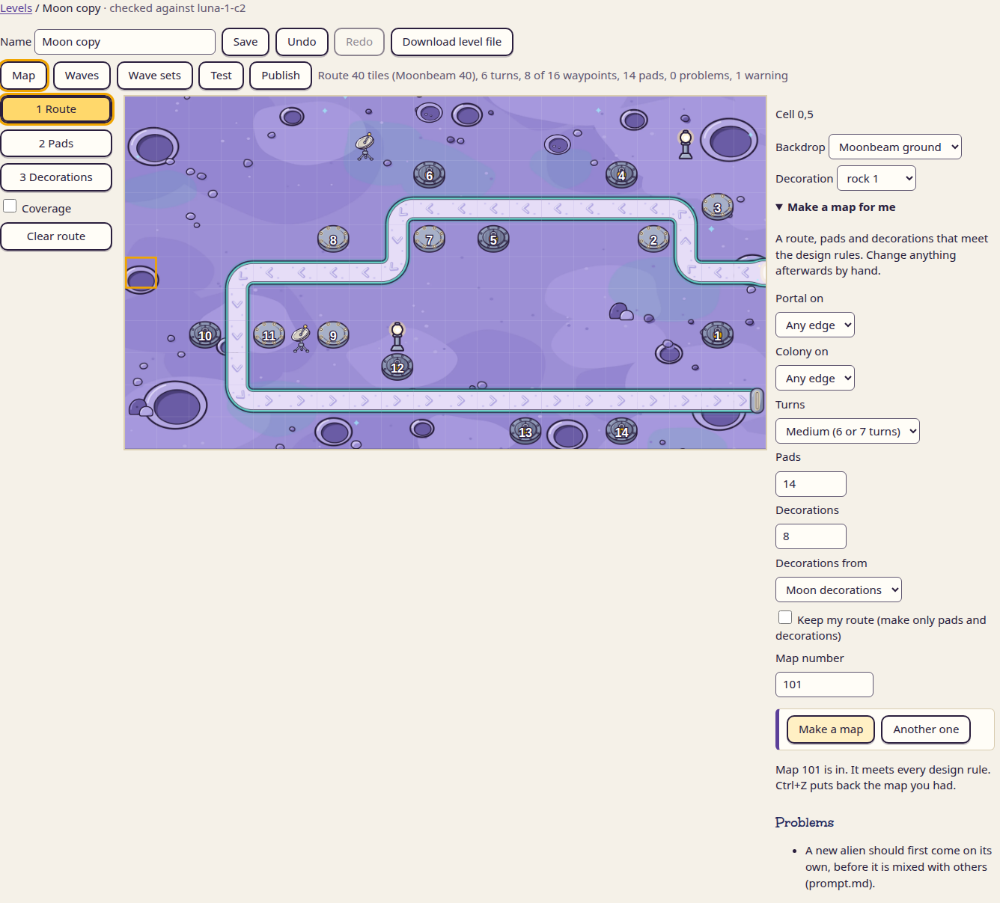
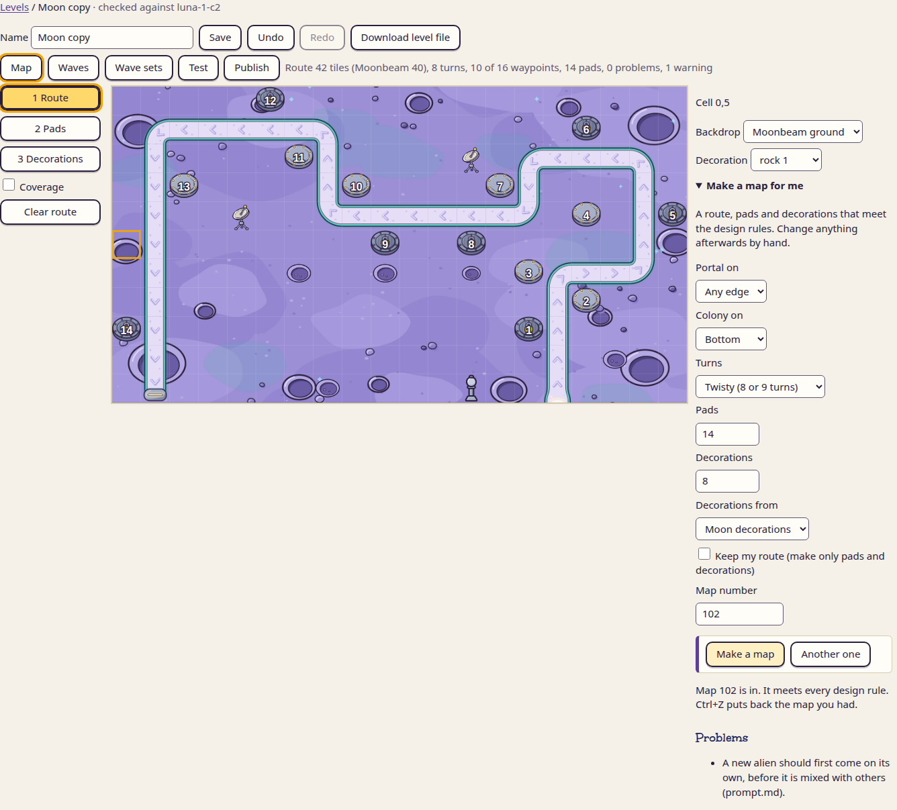
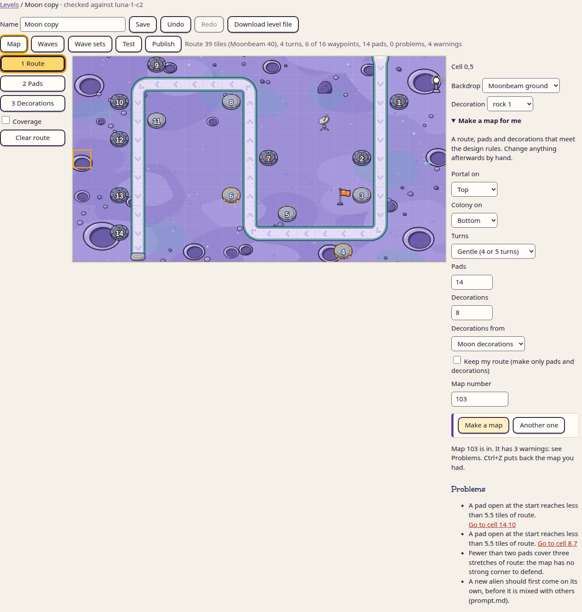

# LD14 — Make a map for me

Owner request, 2026-11-18: make a map (route, pads, decorations) that fits the design rules, because maps are hard to
design by hand. Design [PROPOSAL] agreed in chat the same day; phase entry in
[build-phases.md](../build-phases.md#phase-ld14--make-a-map-for-me).

## What it does

Level editor → Map tab → **Make a map for me**: choose the portal and colony edges (or any), how much the route
turns (gentle 4–5, medium 6–7, twisty 8–9), 12 to 16 pads, 0 to 24 decorations from the Moon decorations, your
approved decorations or both, and optionally **Keep my route** (pads and decorations only). **Make a map** uses the
map number (the generator's seed: the same number and choices always make the same map); **Another one** goes to
the next number. The map goes in as one edit, so Ctrl+Z puts back the map before. The backdrop, the waves and the
name are not touched.

How the map is made (game-core `generateMap`, [generate.ts](../../web/game-core/src/map/generate.ts)): routes by
trial, scored by warnings, length against 40 tiles and how much of the battlefield is far from the route; pads chosen
one by one by the route they reach (corner pads first), the strong ones open at the start and the rest after waves
5 to 25; decorations where the decoration rule allows. Every try is checked with `mapProblems`, the same rules that
block publishing, and the best with no hard or blocking problem is kept.

## Evidence [VERIFIED 2026-11-18]

| Check | Result |
|---|---|
| 150 seeds, every combination of edges, twists and 12–16 pads (`generate.test.ts`) | No hard or blocking problem in any map; 14 of 150 have a warning |
| Where the warnings come from | Choices that cannot avoid one, such as a gentle route from the top edge to the top or bottom edge (too little room for 36 tiles, or no corner pad reaching three stretches). They show under Problems and do not block publishing |
| Speed | 10–40 ms a map; the worst combination about 0.4 s on this laptop |
| Same map number, same map; Ctrl+Z restores; tier 1 rules (left to right) when `ANY_DIRECTION_ROUTES` is off | Tests pass |
| In the browser (admin dev page `/level-preview.html`, Chrome) | Three maps made, no page errors; screenshots below |

(The "new alien should first come on its own" line in the screenshots is about the level's waves, not the map.)

## Open

- [UNVERIFIED] How generated maps play: the owner tries a few in See it in the game, and Measure margins on the
  Waves tab checks them against the target. A test-player check inside the generator is a possible follow-up.
